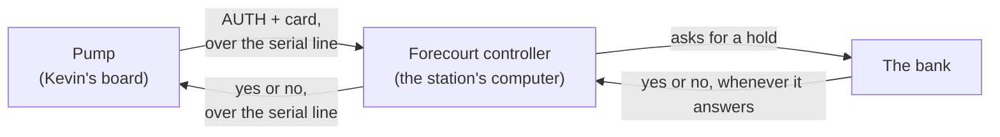
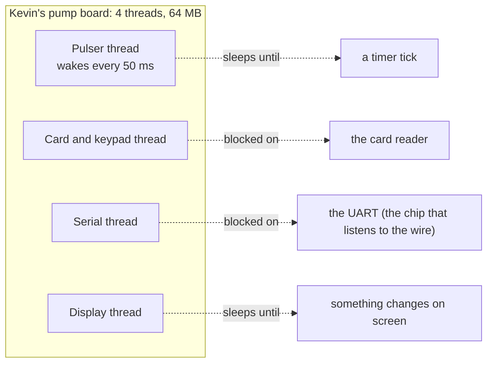

# 0. Dinner

## At the table

Tuesday night, the wing place on the frontage road at 183A and Whitesone Blvd. Good blue cheese, and four TVs nobody watches. They were all showing bass fishing with the sound off, and a man in a boat held up a fish like it owed him money.

Steve got there first and took the booth in the back, the one where he could see the door. He ordered a coffee. Dee brought it without being asked.

"Your buddy coming?" she said.

"He's coming. He's just late. He's always late when he's worried."

"What's he worried about?"

"A pump."

Dee nodded like that was a normal thing to be worried about, and went to check on the fishing fans at the bar.

Kevin came in ten minutes later with a laptop bag he did not open. He slid into the booth and put the bag next to him on the bench, the way you park a thing you plan to use later.

"You said bring the pump problem," Kevin said. "I brought the pump problem."

"Sit down first. Order first. Then the we fix the pump."

Dee was already there. "Sweet tea, and the the Cluckin' Hot ones," she said to Kevin. "And you want the ones that say hot and aren't," she said to Steve.

"Dee knows me better than my wife does," Kevin said.

"Dee has to. You tip better when you're stressed."

Dee wrote nothing down, she never did, and left.

---

Hey... Narrator here. Welcome to this story about this repo. I figure a story helps to ground one in the use cases to be covered far better than some dry text. I have intentionally written this for an average reader and NOT a computer scientist, so bear with some explanations that seem a bit basic. If you hate it, too bad. Here is the problem Kevin brought.

Kevin writes **firmware** for a fuel dispenser - yep... a gas pump. Firmware is the program that lives inside a machine instead of on a computer you sit in front of. When you pull up to a gas pump, tap your card, and pick a grade, you are talking to Kevin's firmware.

The head of the pump, the part with the card reader and the screen and the nozzle switches, has a small computer board inside it. It has an ARM chip (a small, low-power processor, the same family that is in your phone), 64 MB of memory, and an operating system called Windows CE 6. For scale, a cheap phone today has well over a hundred times that much memory.

The code is C# on the **.NET Compact Framework 3.5**. That is a trimmed-down version of .NET made for small devices. Somebody wrote it in 2009, and that person left in 2011. Kevin has been "the guy" since 2014.

The compiler (the tool that turns the C# into a program) is Visual Studio 2008. It is going to stay Visual Studio 2008 until the hardware is retired. The reason is the **certification**. Before a pump is allowed to take credit cards, an outside lab tests it, and the test is done on one exact build. Change the compiler and you have to pay for the test again, and the test costs more than Kevin makes in a year. Dale, Kevin's boss, is the person who signs that check. Dale does not like to sign that check.

"So here's what I've got," Kevin said, and pulled a napkin toward him. This was napkin number one. He drew four boxes. "Four threads."

Quick stop for the word. A **thread** is one worker inside a program. A program with four threads is like a shop with four employees: each one can be in the middle of a different job at the same time. Each one has a desk, which we will get to.

"One reads the pulser," Kevin said, pointing at the first box. "That's the meter. A pulse is a tiny electrical tick, and every tick is a thousandth of a gallon. The thread checks the count every fifty milliseconds, does the math, and shuts the valve when you hit the limit. One watches the card reader and the keypad. One talks to the forecourt controller over a serial line. That's how we ask the bank for permission to sell you gas. And one draws the display."

(A **serial line** is a wire that sends one thing at a time, like a one-lane road.)

(The **forecourt** is the paved area of a gas station where the pumps sit. The **forecourt controller** is the station's computer that looks after every pump out there. The pump itself only runs the nozzle and counts fuel. It does not handle money. So when a card is tapped, the pump asks the controller, and the controller asks the bank.)

**In words:**

1. Someone taps a card. The pump sends the word AUTH and the card down the serial line to the forecourt controller.
2. The controller is the only one that talks to the bank. It asks the bank to put a hold on that much money.
3. The bank answers yes or no. That can take a moment, and sometimes it never comes.
4. The controller sends the answer back down the serial line to the pump. The pump arms the nozzle or says "declined."
5. The pump's serial thread is the one waiting for step 4. Kevin's worry is what happens when step 3 or step 4 never arrives.

**Why it matters:** the pump asks a question of somebody else's computer and then has to wait for the answer. A wait on someone else is the job that async is good at, and the whole course is about that wait.

"That's not bad," Steve said.

"It's not bad. It works. It's worked for fifteen years." Kevin pushed the napkin over. "But we're adding a second nozzle per side, and a receipt printer, and a loyalty thing where you scan the app. And every one of those is another thread. And the box has 64 meg."

"And?"

"And the serial thread." Kevin picked up his tea and put it down again without drinking. "The serial thread is the one that scares me. It sits and waits for the controller to talk. If the controller stops talking, that thread is stuck until the **watchdog** kicks the whole board. The watchdog is a little timer chip that says 'nobody's home, I'm rebooting the pump.' In the middle of a sale. In Tulsa, once, that was a guy with his nozzle in his truck and a screen that went black."

"The Tulsa pump."

"The Tulsa pump."

The wings came. Kevin's were the color of a stop sign. Steve's were the color of a sunset that does not scare anyone. Dee set down a stack of napkins without comment, which was a joke between her and Steve that had been running for two years.

Steve looked at the napkin for a while. Kevin went after a wing.

"You know what the serial thread is doing while it waits?"

"Waiting."

"Right. And what is it holding while it waits?"

"A... thread."

"Let's go through what a thread is. Think of it as a worker, and the worker has a desk. The desk has a chair and a filing cabinet. That's the **stack**: the thread's own private memory for its notes while it works. Then there's the worker's file at HR. That's the **kernel object**: the operating system's own record that this thread exists. And there's a roll-call sheet. The boss, which is called the **scheduler**, walks the room all day deciding who gets to work next, and every worker has a line on that sheet. Even the sleeping ones. The boss still reads the line, sees you're asleep, and moves on."

"That's a lot of paper."

"On a box with 64 meg, it's a lot of paper. And your serial thread is holding all of it, the desk and the file and the line on the sheet, to do nothing. The UART, that's the chip that actually listens to the wire, is doing the real work. Your thread is just standing next to the UART so it can be the one to notice." Steve took a wing. "Same with the pulser. It sleeps fifty milliseconds, wakes up, reads a number, sleeps again. That's a thread whose whole job is to sleep."

Kevin chewed. He did not love hearing that. "So what, I put everything on one thread? I tried that once. The display froze every time the bank was slow."

"Bro, no. You don't do that. You keep the work. You stop holding a worker while you wait."

"On CE. On the 2008 compiler."

"On the 2008 compiler."

Kevin put the wing down.

"There's no `await` on the 2008 compiler, Steve."

"There's no `await` *keyword*. There's everything `await` is made of. The keyword is sugar. Underneath it, it's a **state machine** and a **callback**, and C# 2 already had both." (A state machine is a way of cutting a job into pieces so it can stop in the middle and pick up later. A callback is a piece of code you hand to someone and say "call this when you're done." You'll get both of them in chapters 2 and 3. For tonight, just know the words.) "I built the rest. It's about seven hundred lines and it runs on 3.5." Steve pulled his own laptop out and set it next to the wing basket. "We're going to go through it chapter by chapter, tonight. When we're done, your serial thread is gone, and so is your pulser thread, and the display never freezes. And the box has the same four threads it had when it booted."

"Dale is going to have a stroke," Kevin said. "I'm not putting a library into certified firmware."

"We'll get to Dale. Chapter 9 is Dale's chapter."

"How many wings is this going to take?"

"All of them."

Kevin looked at the basket. There were eleven left, between them. He picked up the napkin, flipped it over, and wrote "NAPKIN 1" in the corner, which was how Steve knew he was in.

---

## The napkin

This is what Kevin drew, redrawn so you can read the handwriting.

One word you will see in the picture is **blocked**. A thread is blocked when it has asked for something that is not ready yet, and the operating system has put it to sleep until it is. A blocked thread runs none of your code and uses no CPU time. It just sits there, still holding its desk, until the thing it asked for shows up. Think of standing at the counter, staring at the cook until your plate comes up. You can do nothing else while you wait.

Here is how that fits Kevin's board. The card thread calls something like "give me the next card," and that call does not come back until a card arrives. The reader can be tapped or inserted. The thread does not care which, because the reader hardware spots either one and tells the operating system, which wakes the thread. The serial thread works the same way. It asks the UART for the next bytes, and the call does not come back until some arrive. In both cases the hardware does the real waiting. The thread is just blocked next to it, waiting to be the one who notices.

**In words:**

1. The big box is the board inside the pump. It has four threads, and the memory around them is only 64 MB.
2. The pulser thread keeps a dotted line to "a timer tick". It wakes every 50 milliseconds, reads the pulse count, then goes back to sleep.
3. The card and keypad thread has a dotted line to the card reader. It is blocked until somebody taps or inserts a card.
4. The serial thread has a dotted line to the UART. It is blocked until the controller says something. This is the thread that scares Kevin.
5. The display thread waits until something changes and then redraws.
6. Every dotted arrow points at a thing that is *not* a thread: a timer, a reader, a chip, an event. The waiting is being done by hardware. The thread is just standing next to the hardware.

**Why it matters:** all four threads are asleep most of the time, and every one of them is still paying for a desk, a file at HR, and a line on the boss's roll-call sheet. That is the waste this whole course is about.

## What follows

The rest of the course is the dinner, with the code running alongside it. Each chapter opens at the table, where Kevin asks the question a working engineer would ask and Steve answers it with the thing in the chapter. Then the chapter goes through the code step by step, with pictures.

The code Kevin brought (the threads) and the code he left with (this library) are in `samples/MMP.AsyncProxy.Forecourt`. They are built for `net35` with the C# 3 compiler. The tests in `tests/MMP.AsyncProxy.Tests/ForecourtTests.cs` run both versions.

The library also builds against the Compact Framework 3.5 (`src/MMP.AsyncProxy.NetCF`), and Kevin's pump code builds there too. That build is checked on the desktop runtime, not on a real Windows CE board. The library keeps `Monitor.Wait` and `Monitor.Pulse` (two older locking tools the Compact Framework doesn't have) out of itself, and the sample does the same. Chapter 5 and `docs/netcf-port.md` say what else the port gives up.

Kevin is made up. The pump is not: MMP.GasPumpSimulator is a working model of one, and chapter 10 is where the two meet.

## Words you just met

| Word | In plain words | The picture |
|---|---|---|
| **Firmware** | The program that lives inside a machine | The brain inside the pump |
| **Thread** | One worker inside a program | An employee with a desk |
| **Stack** | A thread's private memory for its notes | The desk and filing cabinet |
| **Kernel object** | The operating system's record of a thread | The worker's file at HR |
| **Scheduler** | The part of the operating system that decides who runs next | The boss with the roll-call sheet |
| **Blocked** | A thread put to sleep by the operating system until what it asked for is ready | Standing at the counter, staring at the cook |
| **Serial line / UART** | A one-at-a-time wire, and the chip that listens to it | A one-lane road and its toll booth |
| **Forecourt / forecourt controller** | The pump area of a gas station; the station's computer that looks after every pump and talks to the bank | The front desk that phones the bank for every pump |
| **Watchdog** | A timer that reboots the board if nobody checks in | A night guard who locks up if he hears nothing |
| **State machine, callback** | Two tools you'll build in chapters 2 and 3 | Coming up |
