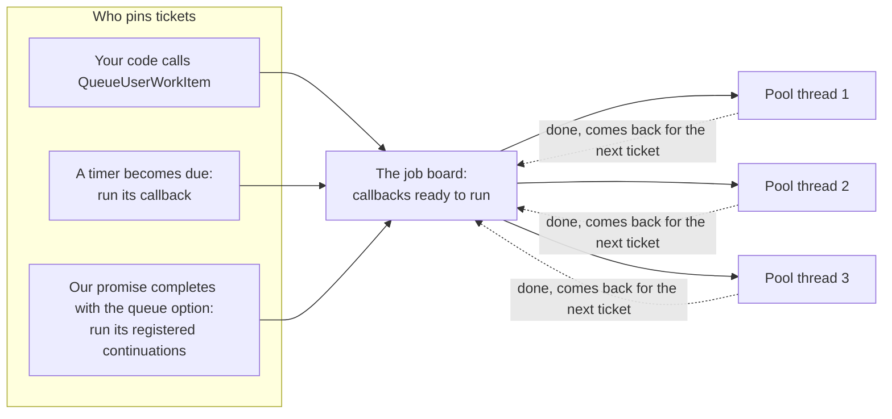
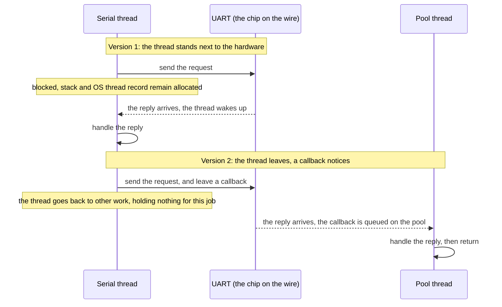
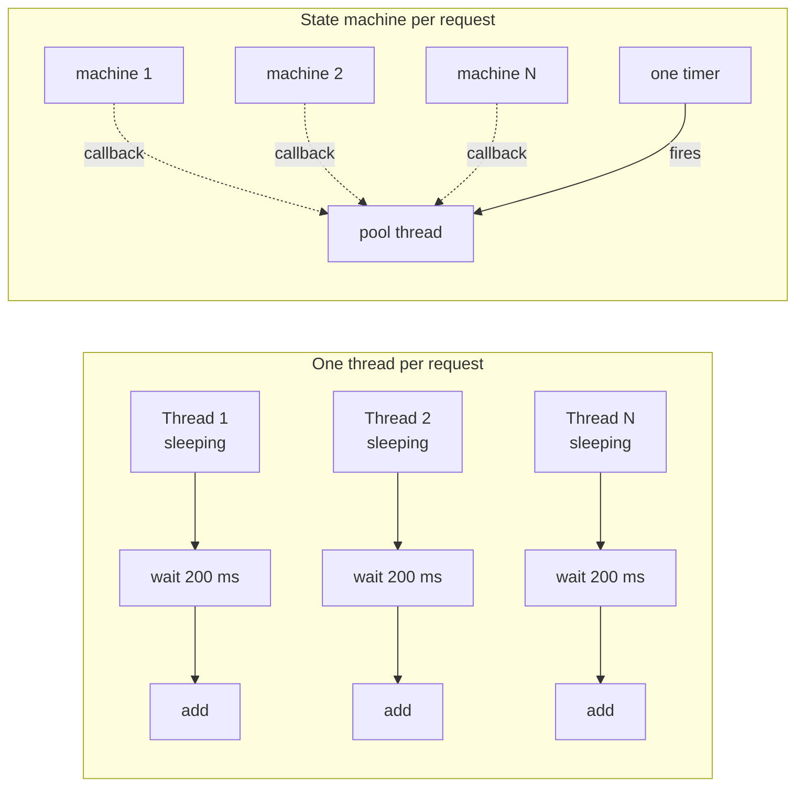

# 1. Why threads hurt

## At the table

The wings were not even halfway to gone. Kevin had finished his third hot one and was making the face of a man who says it's fine. Dee topped off his tea and filled Steve's coffee without being asked, and then she looked at the napkin on the table with the four boxes on it and said, "Is that a bomb?" and Steve said, "It's a gas pump," and she said, "Same thing, at your age," and left.

At the bar, somebody asked for the Cowboys highlights. Dee found the remote and replaced the bass boat with football. A Dallas receiver made the same sideline catch on all four screens.

"Four threads," Steve said, tapping the napkin. "Tell me what each one is doing right now. Not what it's *for*. What it's doing, this second."

"Right now? Nobody's at the pump. The pulser thread is asleep. Fifty milliseconds, it wakes up, reads zero pulses, goes back to sleep. The card reader thread is blocked on the reader. The serial thread is blocked on a read. The display thread is asleep until something changes."

"So four threads, and all four are asleep."

"They're waiting. That's the job."

"Sure. And what does a sleeping thread cost you on that board?"

Kevin thought about it. "The stack. CE gives you sixty-four K by default." He saw Steve's eyebrow. "K as in kilobytes. We bumped the serial thread to 256 because it blew up once."

"So a quarter of a meg of memory for a thread whose whole job is to sit in a read call. Plus the kernel's record of it. The scheduler puts a blocked thread aside until it can run again. The stack and the kernel record stay allocated. Four threads, fine. You said you're adding a second nozzle, a printer, loyalty. That's eight threads. Ten. And the guy who wrote it in 2009 made a new thread for every job, because that's how you did it in 2009."

"That's how you did it in 2009."

"It's how I did it in 1989. Different problem, same mistake." Steve ate a wing, wiped his fingers, and slid the napkin around so it faced Kevin. "Here's what I want you to see. The UART receives bytes from the wire. A timer tracks elapsed time. Your blocked thread runs no code while it waits for either one. If the driver supports a callback, we can save the next step and return instead. We still need to check how your serial driver delivers those bytes."

"Somebody's got to notice, bud."

"Think about all the people waiting for tables at a busy restaurant. Suppose you have to stay in the entrance line to keep your place. You can't walk down the street while you wait. Now suppose the host records your party and gives you a pager. You can leave the line and do something else. When a table opens, the host buzzes you. You come back and ask which table is yours."

Kevin looked at his tea. "My serial thread is the guy who has to stay in line."

"Your serial thread keeps its stack and operating-system record while it waits. What if we saved the next step and let a free thread run it when the reply arrives?"

"Something else like what."

"Like a **callback**. That is the code we register to run when the operation finishes. Think of it as the action after the buzz: return to the host and get your table assignment. The pager gives the signal, and the callback does the next piece of work. A timer can run it on a pool thread. Other operations may call it on the thread that delivers the result. We'll choose where our next piece runs."

"Pool thread? Like from a pool of threads? On CE?"

"The Compact Framework has a thread pool. We need to check its limits and memory use on your board." Steve counted on his fingers, then gave up and just said it. "A pool thread runs a queued job, then becomes available for another one. Comparing a pulse count to a ceiling is a short job. Waiting for the next pulse would occupy that worker."

Steve turned the laptop around. "First, look at what a waiting thread keeps in memory. Then I'll show you what goes on the pool's job board."


## What a thread costs

A thread costs CPU scheduling time, memory, and CPU processing to complete a task.

A waiting thread keeps memory allocated even while another thread uses the CPU. Kevin wants to release those threads during long waits. The idea is noble and good, but manipulating threads is expensive in time and memory.

Each thread needs memory and operating-system support:

- **A stack.** A thread uses its stack to track active method calls and their local data. On desktop Windows, a managed thread often reserves about 1 MB of stack address space by default. The Compact Framework uses smaller defaults. Reserved space means a range of memory addresses is set aside; physical memory is supplied as needed. At 1 MB per stack, 2,000 threads would reserve about 2 GB of addresses. A 32-bit process has a limited address space, and its code and other data need room too.
- **A kernel object.** The kernel is the core of the operating system. It keeps a control record for each thread. That record includes the thread's ID, priority, and state: running, ready to run, or waiting. The record stays in memory while the thread waits.
- **Scheduling work.** The **scheduler** chooses which ready thread runs on each CPU core. A core is a processor's execution unit. Waking a thread and switching between ready threads takes work. A blocked thread stays off the ready list until its wait ends.

During `Thread.Sleep` or a blocking read, the thread keeps its stack and kernel record. It uses no CPU time while blocked. More waiting threads therefore increase memory use even when the CPU is idle.

**Blocked** is the word for it. A blocked thread is not running any of your code. It has been put to sleep by the operating system, and will be woken up when the thing it is waiting for happens. It is like the customer who must stay in the entrance line to keep a place.

## A thread pool is the first fix for thread problems

By the time .NET 1.0 shipped, people had noticed this. The fix was: "Stop making a new thread for every job. Keep a few threads around, put the jobs in a line, and let the threads pick jobs off the line." That is the **thread pool**, and it is worth getting this word right, because the name is a little misleading.

**What it is.** A thread pool is a shared set of reusable threads. The **job board** is our name for the pool's queue of **work items**. A work item tells a pool thread which method to call and gives it access to any data that method needs.

### What goes on the job board

Kevin pointed at the screen. "What can I put on that board? A method? My whole pulser loop?"

"Start with one pulse-count check," Steve said. "The method reads the count, compares it to the fuel limit, and returns. To queue that method, you give the pool a **delegate**. A delegate identifies code to call. It can also give that code access to the data it needs."

Steve typed:

```csharp
ThreadPool.QueueUserWorkItem(delegate
{
    // This is the ticket. A free crew worker will run it.
    CompareCountToCeiling();
});
```

"The `delegate` block is the callback," Steve said. "It calls `CompareCountToCeiling`. `QueueUserWorkItem` puts a work item on the board so a pool thread can call that block. It queues the work without waiting for the check to finish."

"So the board holds the instruction to call my method?"

"Right. A free worker takes that item and calls your code. The worker stays occupied while the code runs. When your check returns, the worker can take another item. The pool chooses the thread, so your next check may run on a different one."

"What if I give it my whole loop, with the fifty-millisecond sleep?"

"It will accept that callback too. The API requires a callback instead of `null`, but it doesn't inspect the method for sleeps or long calculations. Your loop would keep a worker occupied through every sleep. Instead, let a timer arrange the next check when fifty milliseconds have passed. That leaves the worker free between checks."

"Is the timer using the pool because the callback might be a lot of computation?"

"The timer uses the pool so it can run your callback on a shared worker when the time comes," Steve said. "The amount of computation doesn't determine that. Your callback could just read the pulse count and compare it to the ceiling."

"So even that quick check needs a thread?"

"Yes, while the check runs. Between checks, the timer tracks when the next one is due. No worker needs to sleep through that interval."

"And if the callback does a long calculation?"

"It keeps that worker occupied until it returns. Other queued work may have to wait. We'll compare those cases when we look at pool starvation and CPU work."

"And `QueueUserWorkItem` is for the same kind of short job?"

"Yes. It queues a callback now, whether that callback is small or large. You choose work that can share the pool without holding up other jobs. Queuing code asks the pool to choose a thread for it. The code still needs CPU time."

"Does the timer call `QueueUserWorkItem` to set up my callback?"

"When you create a `System.Threading.Timer`, you give it the callback, any data it needs, and when to run. The timer arranges for a pool thread to call that callback when it's due. You normally don't need to queue it again inside the callback."

"The timer schedules the callback for a due time. `QueueUserWorkItem` queues the callback to run when a pool worker is available, with no delay setting. Both use pool workers. We'll cover timer setup when we refactor the pulser."

"So setting the timer and running the callback are two different steps?"

"Right. Setup records what to call and when. Later, the callback runs on a pool worker. The runtime handles that scheduling, and its internal calls can vary between versions."

Steve pointed to the diagram. "These arrows show three ways work reaches the board. Your call queues code directly. A timer arranges for its callback to run when it's due. The third arrow is another component called a promise arranging for the waiting sale code to continue."

"And you show a delegate is tied to the promise component in that picture?"

"A delegate can be queued on its own, as we just did. For the bank request, there are two separate pieces of code. The **receiving callback** runs when the serial link delivers the reply. Its job is to store that reply in the **promise**. The promise holds the operation's outcome so the sale code can read it."

"How does the sale code know the reply is there?"

"Before the reply arrives, the sale code registers a **continuation** with the promise. A continuation is a callback that runs the next part of the sale when the operation ends. While the promise is pending, it stores that continuation until the outcome is available. Then the serial link calls the receiving callback, which stores `OK` in the promise. Completing the promise makes the sale continuation ready to run. That continuation reads `OK` and decides what to do next. I know this is a bit complex at the moment. The next topic will dig really deep into Promises, but keep running with your thoughts."

"So one callback puts the reply in, and the continuation reads it back?"

"Right. If we created this library's promise with `RunContinuationsAsynchronously`, completing it queues code that calls the registered continuations. A free pool worker then runs the sale continuation. With the default option, the thread storing the reply calls the continuations directly. Either way, the promise keeps the outcome. If the request ends with an error or cancellation, the sale continuation must handle that before approving fuel."

The diagram shows the three routes Steve described. Chapter 2 takes apart the promise.



**In words:**

1. Your code can queue a callback directly. A timer also arranges for its callback to run on a pool thread when it becomes due.
2. Our promise queues code to run its registered continuations when it completes with the queue option enabled. Those continuations stay with the pending promise until completion.
3. The board holds work ready to be called. It does not wait for each promise or timer to become ready. The drawing uses one board to keep scheduling easy to follow. Actual runtimes can use several queues, and execution order can vary.
4. A free worker takes a work item and calls its callback. Different work items can run at the same time on different workers.
5. Once that callback finishes, the worker can run another item. The diagram shows three workers; the actual number can change.
6. When workers are occupied, queued callbacks wait. The pool may add threads within its limits, but it cannot guarantee an immediate start.

In this library, continuations registered after a promise has already completed run during registration, even with the queue option. The diagram shows continuations registered while the promise was pending. A captured display context can also send the next step to the display thread; the later context discussion in chapter 5 covers that path.

### Three ways to schedule a callback

| Route | What you supply | When work reaches a pool worker |
|---|---|---|
| `QueueUserWorkItem` | A callback and optional data | Once queued, it can run as soon as a worker is available |
| `System.Threading.Timer` | A callback, data, and a due time | When the timer becomes due, scheduling makes its callback available to a pool worker |
| Our promise with the queue option | A continuation registered while the promise is pending | Completion queues code that invokes the registered continuations |

The receiving callback writes the bank reply, such as `"OK"`, into the promise. The sale continuation reads that reply and acts on it. The promise connects the writer to the waiting reader. The queued work item calls the continuation; the promise itself remains a result holder.

**The extra queue in this library.** `DelayWheel` uses one `System.Threading.Timer` for many delays. Its `Fire` callback already runs on a pool thread. It collects the delays that are due, then calls `QueueUserWorkItem(CompleteOne, entry)` for each one. Here, `CompleteOne` identifies the completion method, and `entry` supplies that delay's data. Each completion becomes a separate work item, so one slow completion does not make `Fire` run the rest in sequence. Pool capacity still limits how many can run together.

That extra queue is a choice made by this library. A timer callback that only checks one count can do that work directly on the pool thread it already has.

Here, "timer" means `System.Threading.Timer`. Other timer types can have different thread rules. Check the timer's contract before assuming its callback runs on the pool. Microsoft's references describe the [timer callback](https://learn.microsoft.com/en-us/dotnet/api/system.threading.timer) and [direct work-item queuing](https://learn.microsoft.com/en-us/dotnet/api/system.threading.threadpool.queueuserworkitem).

**The names in the code.** `ThreadPool` is the shared crew. A **pool thread**, also called a **worker thread**, is one member of that crew. A **work item** is one queued job. Other libraries may call the same arrangement a **worker pool** or an **executor**.

`ThreadPool` is a static class: your code calls its methods without creating a `ThreadPool` object. The runtime manages the shared threads. This is separate from a `Task`, which can represent a result that will arrive later. Chapter 2 explains that result holder.

**The rules for using it:**

- Prefer short callbacks that return promptly.
- Use asynchronous waits instead of sleeping or blocking inside a pool job.
- Expect queued jobs to wait when the crew is busy. Worker limits and growth rates depend on the runtime. A desktop measurement does not establish the Compact Framework's behavior.

That second rule is the one people break. Put a `Thread.Sleep` inside a work item and you have taken one of the few crew workers and parked them. Put sixty-four of those on the board and the crew is stuck while the tickets pile up, and the pool adds new workers slowly. Stephen Toub walks through this at 50:18 in his "Writing async/await from scratch" talk. Chapter 6 traces four workers handling 64 queued jobs and measures the delay.

## A callback for the serial reply

For Kevin's serial request, the next step is to handle the controller's reply. If his serial API supports a callback, the program can register the receiving callback, send the request, and return. When bytes arrive, the serial API calls that callback. The callback can store the reply in a promise, allowing the sale continuation to run.

The serial API determines which thread delivers the reply. It may still need a dedicated reader thread. Putting a blocking read inside `QueueUserWorkItem` simply moves that wait onto a pool worker. We must check the driver's capabilities before claiming a thread saving.

The diagram below compares a blocking read with a callback-based version that queues reply handling to the pool. Chapter 5 covers code that must return to a particular thread, such as the display thread.



**In words:**

1. In Version 1, the serial thread sends the request out the wire through the UART.
2. Then it sits blocked. It runs no code, but its stack and operating-system record remain allocated.
3. The reply arrives. The operating system wakes the thread, and the thread finally handles the reply.
4. In Version 2, the thread sends the same request, but also leaves a callback: a note that says "when the reply comes, run this."
5. The thread is free to do other work. The operation keeps enough data to call the callback later.
6. In this diagram, reply handling is queued to the pool. A free worker runs it, then becomes available for another job. A real serial link still needs a way to receive the bytes.


## The picture, at scale

Here is the same idea for many requests at once. On the left, every request gets its own sleeping worker. On the right, every request is a small object, and a single timer wakes the pool.



**In words:**

1. On the left, each request gets a thread. `N` means the total number of requests; the diagram shows three to save space.
2. Each thread goes to sleep for 200 ms, and then wakes up to do the tiny job of adding two numbers.
3. That is N stacks and N operating-system thread records, all kept in memory while the requests wait.
4. On the right, each request keeps a **state machine**: an object that saves its data and its next step. Chapter 3 builds one. Its size depends on the fields it holds. It needs a thread only while code runs.
5. One shared timer tracks the delays. The library's `DelayWheel` stores each request's due time. When a delay is due, it queues that request's completion to the thread pool.
6. A pool thread runs each due completion and its callbacks. How long it stays occupied depends on the code those callbacks run.


## What this chapter sets up

The rest of the course is how you build the right-hand side without a compiler that knows `await`. You need:

1. A way to hand out "the answer is coming" and let one party fill it in later. Callbacks and promises, in chapter 2.
2. A way to cut a method in half at the wait and resume it later. The state machine, in chapter 3.
3. A protocol between the two. Awaiter and builder, in chapter 4.
4. A way to carry per-request data across the cut. Context, in chapter 5.

Then we compare thread usage and timing in chapter 6 and use the iterator trick in chapter 7.

## Words you just met

| Word | Meaning | Example or comparison |
|---|---|---|
| **Stack** | Memory used to track active method calls and their local data | Each thread reserves its own stack space |
| **Address space** | The range of memory addresses a process can use | Stack reservations take up part of this range |
| **Kernel object** | The operating system's control record for a thread | Holds the thread ID, priority, and state |
| **Scheduler** | Chooses a ready thread to run on a CPU core | A waiting thread becomes eligible when its wait ends |
| **Blocked** | A thread asleep, waiting for something | The customer who must stay in the entrance line |
| **Callback** | Code you hand over to be run when something finishes | Returning to the host after the pager buzzes |
| **Thread pool** | A shared crew of reusable worker threads plus a job board | A shared crew and its job board |
| **Work item** | A callback queued for a pool thread to call, with access to its required data | A ticket saying which code to run |
| **Promise** | Stores an operation's outcome and arranges for registered continuations to run when it completes | The receiving callback stores the bank reply here |
| **Continuation** | A callback registered to run the next part of the work after an operation ends | The sale continuation reads the bank reply |
| **Pool thread** (idiomatic: *worker thread*) | One of the crew that takes tickets | A worker from the break room |
| **Worker pool / executor** | What other languages call the thread pool | The same crew and job board, under another name |
