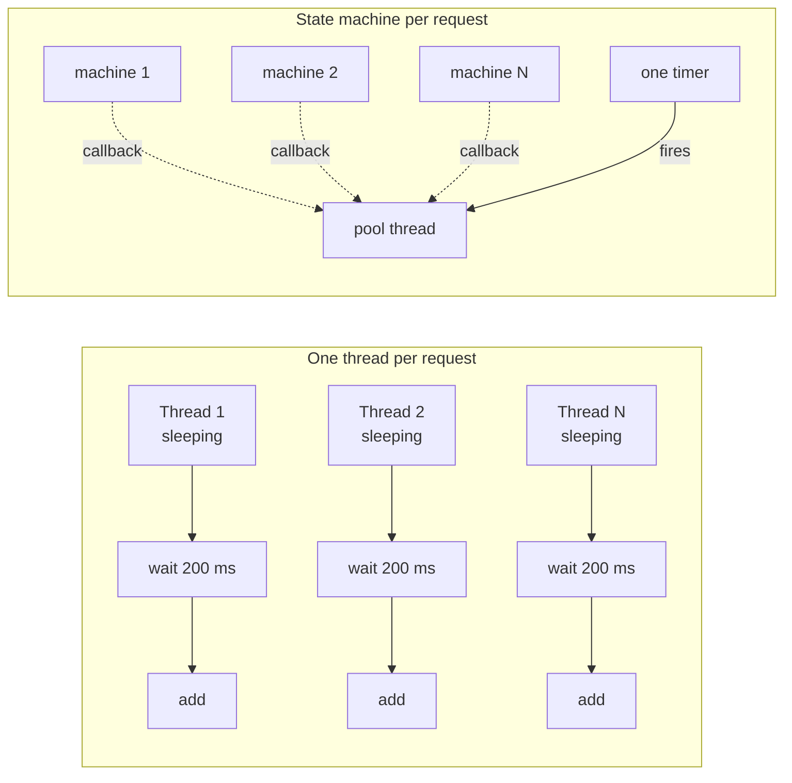

# 1. Why threads hurt

So here is the thing nobody tells you when you learn threads. A thread is a great tool for doing work. It is a terrible tool for waiting.

## What a thread costs

Every thread you make gets:

- A reserved stack. One megabyte on Windows by default. Reserved, so it is address space more than RAM, but 2000 threads is 2 GB of address space on a 32-bit process. That process will not start.
- A kernel object. The OS has to track it, schedule it, context-switch into it.
- A slot in the scheduler's attention. The more threads, the more time the OS spends deciding who runs, and the less time anything runs.

And when that thread is sitting in `Thread.Sleep` or blocked on a socket read, it is paying all of that to do nothing. That is the waste.

## The thread pool was the first fix

"Fine," said .NET 1.0, "stop making threads. Put the work in a queue, and a small set of threads will pull from it." That is the thread pool. It is great, as long as the work items do work.

Put a `Thread.Sleep` inside a work item and you have pinned one of those few threads. Put sixty-four of them in and the pool drains at a crawl, because it adds new threads slowly on purpose. Stephen Toub walks through this at 50:18 in his "Writing async/await from scratch" talk. We measured it in chapter 6.

## The real fix: stop waiting on a thread at all

When you read from a socket, your thread is not doing the reading. The network card is. When you wait 200 ms, your thread is not doing the waiting. A hardware timer is. The thread is just standing there so it can be the one to notice when the work is done.

So the question becomes: what if the thread left, and something else noticed?

That "something else" is a callback. The OS or the timer finishes, raises a signal, and a pool thread picks up a small piece of work: "run the rest of that method." The method continues. The thread it continues on may be a different one. The method does not care.

## The picture

Left side: N threads, N stacks, N things for the OS to juggle, all asleep. Right side: N small objects on the heap, one timer, and a pool thread that wakes up for microseconds per request.

## What this chapter sets up

The rest of the course is how you build the right-hand side without a compiler that knows `await`. You need:

1. A way to hand out "the answer is coming" and let one party fill it in later. Chapter 2.
2. A way to cut a method in half at the wait and resume it later. Chapter 3.
3. A protocol between the two. Chapter 4.
4. A way to carry per-request data across the cut. Chapter 5.

Then we run the numbers in chapter 6 and cheat with iterators in chapter 7.
