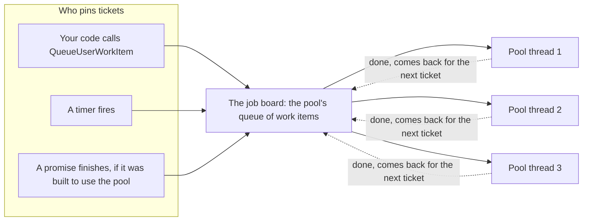
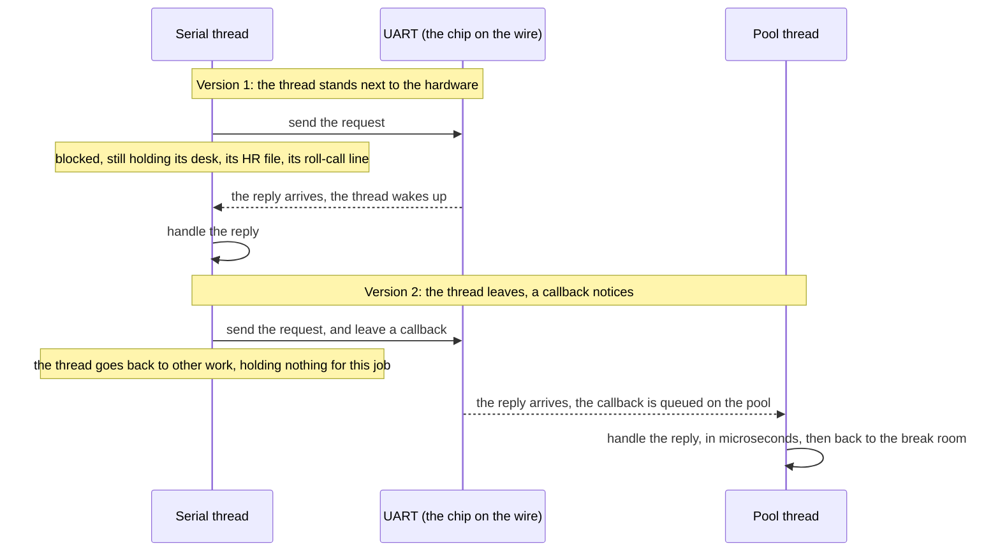
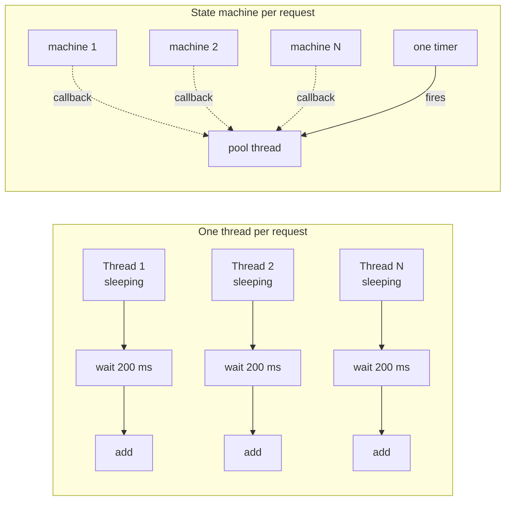

# 1. Why threads hurt

## At the table

The wings were not even halfway to gone. Kevin had finished the first hot one and was making the face of a man who says it's fine. Dee topped off his tea and filled Steve's coffee without being asked, and then she looked at the napkin on the table with the four boxes on it and said, "Is that a bomb?" and Steve said, "It's a gas pump," and she said, "Same thing, at your age," and left.

"Four threads," Steve said, tapping the napkin. "Tell me what each one is doing right now. Not what it's *for*. What it's doing, this second."

"Right now? Nobody's at the pump. The pulser thread is asleep. Fifty milliseconds, it wakes up, reads zero pulses, goes back to sleep. The card reader thread is blocked on the reader. The serial thread is blocked on a read. The display thread is asleep until something changes."

"So four threads, and all four are asleep."

"They're waiting. That's the job."

"Sure. And what does a sleeping thread cost you on that board?"

Kevin thought about it. "The stack. CE gives you sixty-four K by default." He saw Steve's eyebrow. "K as in kilobytes. We bumped the serial thread to 256 because it blew up once."

"So a quarter of a meg of memory for a thread whose whole job is to sit in a read call. Plus the kernel's record of it. Plus the boss's roll-call sheet: every time the scheduler goes around the room, it reads that thread's line, decides it's still asleep, and moves on. Four threads, fine. You said you're adding a second nozzle, a printer, loyalty. That's eight threads. Ten. And the guy who wrote it in 2009 made a new thread for every job, because that's how you did it in 2009."

"That's how you did it in 2009."

"It's how I did it in 1989. Different problem, same mistake." Steve ate a wing, wiped his fingers, and slid the napkin around so it faced Kevin. "Here's what I want you to see. The thread isn't doing the waiting. The UART is doing the waiting. The timer chip is doing the waiting. Your thread is standing next to the hardware doing nothing useful in between so it can be the one who *notices* when it's done."

"Somebody's got to notice, bro."

"Does it have to be a thread? Think about a restaurant. You can wait for your food two ways. One, you stand at the counter and stare at the cook until the plate comes up. You can't do anything else. You can't sit down, you can't answer your phone, you're just a person-shaped waiting machine. Two, they give you one of those pagers. You go sit. Your hands are free. When the food's ready, it buzzes, and *then* you get up."

Kevin looked at his tea. "My serial thread is the guy at the counter."

"Your serial thread is the guy at the counter with a stool nobody offered him, holding a whole desk and a file at HR. What if the thread left, and something else noticed?"

"Something else like what."

"Like a **callback**. That's the pager. The hardware finishes, it raises a signal, and a pool thread runs one small piece of code: pick up where that method left off. On whatever thread is free. The method doesn't care which."

"Pool thread. On CE."

"The Compact Framework has a thread pool. Twenty-five threads, 128 K stacks, if the 2.0 docs still hold for your 3.5. Three megs of stack for the whole pool, worst case." Steve counted on his fingers, then gave up and just said it. "It's small because the work is small. A pool thread runs your code for the microseconds it takes to compare a pulse count to a ceiling, and then goes back to the break room."

"The break room."

"I'll explain the break room. No joke, it's the most useful picture in this whole chapter. Hang on." He turned the laptop around. "Here's the shape of what you have, and the shape of what you're going to have."

So here is the thing nobody tells you when you learn threads. A thread is a great tool for doing work. It is a terrible tool for waiting.

## What a thread costs

Go back to the worker with a desk. Every thread you make gets:

- **A stack.** This is the thread's own private memory for its notes while it works: its local variables, and the list of "I was in this method, which was called from that method." Picture the desk and the filing cabinet. On Windows, a .NET thread reserves about one megabyte for it by default. "Reserved" means it is set aside, even if the worker never writes a single note. It is more about *addresses* than about memory: the thread claims a stretch of the program's address space, the numbered "street addresses" a program is allowed to use. A 32-bit program only has about 4 GB of addresses in total. Make 2,000 threads and you have reserved 2 GB of them. That process will not start.
- **A kernel object.** The kernel is the core of the operating system. It keeps a record for every thread so it can schedule it, pause it, and switch into it. Picture the worker's file at HR.
- **A line on the roll-call sheet.** The **scheduler** is the part of the operating system that decides which thread runs on which CPU core, and for how long. It keeps a list of threads and walks it. The more threads, the more time the OS spends deciding who runs, and the less time anything actually runs.

Now the sad part. When a thread is sitting in `Thread.Sleep`, or blocked on a socket read, it is still paying for all three. The desk is still reserved. The file is still open. The line is still on the sheet. The thread is paying rent to do nothing. That is the waste.

**Blocked** is the word for it. A blocked thread is not running any of your code. It has been put to sleep by the operating system, and will be woken up when the thing it is waiting for happens. It is the person at the counter staring at the cook.

## The thread pool was the first fix

By the time .NET 1.0 shipped, people had noticed this. The fix was: "Stop making a new thread for every job. Keep a few threads around, put the jobs in a line, and let the threads pick jobs off the line." That is the **thread pool**, and it is worth getting this word right, because the name is a little misleading.

**What it is.** A thread pool is a small crew of worker threads that the whole program shares, plus a job board. The job board is a queue: a line of tickets waiting to be picked up. Each ticket is a small piece of code to run. The official name for a ticket is a **work item**. You do not hand the pool a thread. You pin a ticket to the board, with `ThreadPool.QueueUserWorkItem`. When a crew worker is free, they take the next ticket, do the job, and go back to the break room to wait for the next one. A crew worker is called a **pool thread**.

```csharp
ThreadPool.QueueUserWorkItem(delegate
{
    // This is the ticket. A free crew worker will run it.
    CompareCountToCeiling();
});
```

**Read it like this.** `ThreadPool` is the shared crew. `QueueUserWorkItem` means "pin this ticket on the board." The `delegate { ... }` is the ticket: a little piece of code with no name. Notice what you did *not* do: you did not make a thread, you did not start a thread, and you never get a thread back. You gave over a job and walked away.

Here is the shape of it.



**In words:**

1. Three kinds of things put tickets on the board: your own code, a timer when it goes off, and a promise that finished and was told to hand its waiting code to the pool. (Chapter 2 explains promises.)
2. All the tickets land in one place: the job board, which is the pool's queue.
3. A small, fixed crew of pool threads (three are drawn here) takes tickets off the board one at a time.
4. A pool thread runs the ticket's code. That should take microseconds or milliseconds.
5. When it is done, the dotted arrow shows it going back to the board for the next ticket. It is the same thread, every time. No new thread was made.
6. If every crew worker is busy and the board is backed up, tickets wait. The pool will hire more workers, but slowly.

**Why it matters:** making a thread is expensive, and the pool pays that cost a few times instead of thousands of times. The crew is shared by everybody in the program, so every ticket needs to be short.

**About the name.** `ThreadPool` is Microsoft's name. It has been in every .NET book and every stack trace for over twenty years, and we are not going to rename it. This course keeps the real name. But the name misleads two ways.

1. It sounds like a bag of thread objects that you reach into and take one. You don't. You never hold a pool thread. You hold nothing. You pin a ticket and the pool decides which worker runs it.
2. "Pool" sounds like somewhere you park things, like a parking lot. It is the opposite. A better picture is a **motor pool**, like the cars a company keeps for short trips. You borrow one, make a short run, and give it right back. Nobody keeps a motor-pool car for a week.

**What everybody else calls it.** The same machine (a few shared threads pulling jobs off one queue) turns up in every language, and the usual names are **worker pool** and **executor**. Java hands your jobs to an `Executor`, and the threads inside it are called *worker threads*. Go programmers talk about a *worker pool*. So the idiomatic name for what this course calls a **pool thread** is a **worker thread**, and the idiomatic name for the whole crew-plus-board is a **worker pool**. When you see "worker" in another language's docs, it is this crew. This course says "pool thread" because .NET's own docs and stack traces say "thread pool thread", and you will meet that phrase.

**Where Microsoft muddied it.** In fairness, "pool" is the industry word and Microsoft did not invent it. The mud is in how .NET dresses it up:

1. `ThreadPool` is a *static class*. There is exactly one pool in your whole program. You can't make a second one, hand one to a method, or size one differently for a different kind of job. The name sounds like a thing you can have several of. It is really one global setting.
2. `QueueUserWorkItem` is the name of a Windows 2000-era Win32 call, carried over as it was. The word "User" in the middle says nothing a reader needs.
3. `Task` sounds like a job to do. A lot of `Task`s are just a place to wait for an answer: the read-only pickup window from chapter 2. A `TaskCompletionSource` makes `Task`s that have no work behind them at all. And .NET has three different classes named `Timer`, in three different namespaces.

None of it is fatal. It is just why a newcomer reads `ThreadPool` and pictures a bag of threads.

If it were up to me I would have called it `SharedWorkerCrew`. We are stuck with `ThreadPool`, so read it that way in your head.

In this course, we will say **the thread pool** for the whole thing (the crew plus the board), **a pool thread** (the idiomatic name is a *worker thread*) for one crew worker, **a work item** for one ticket, and **the job board** (or "the pool's queue") for the line of tickets.

**The rules for using it:**

- Give it short jobs.
- Never make a job wait inside it.
- The crew starts small, about one worker per CPU core. When the board is backed up, the manager hires one extra worker only every so often, on the order of one per half second. That is on purpose: a sudden burst of work should not make a thousand threads.

That second rule is the one people break. Put a `Thread.Sleep` inside a work item and you have taken one of the few crew workers and parked them. Put sixty-four of those on the board and the crew is stuck while the tickets pile up, and the pool adds new workers slowly. Stephen Toub walks through this at 50:18 in his "Writing async/await from scratch" talk. We measure it, with a pizza shop to help picture it, in chapter 6.

## The real fix: stop waiting on a thread at all

Think about what is really going on when you read from a network socket. Your thread is not doing the reading. The network card is. When you wait 200 ms, your thread is not doing the waiting. A hardware timer is. The thread is just standing there so it can be the one to notice when the work is done.

So the question becomes: what if the thread left, and something else noticed?

That "something else" is a callback. The operating system or the timer finishes, raises a signal, and a pool thread picks up a small piece of work: "run the rest of that method." The method continues. The thread it continues on may be a different one. The method does not care.



**In words:**

1. In Version 1, the serial thread sends the request out the wire through the UART.
2. Then it sits blocked. No code of yours is running, but its desk, its file, and its roll-call line are all still taken.
3. The reply arrives. The operating system wakes the thread, and the thread finally handles the reply.
4. In Version 2, the thread sends the same request, but also leaves a callback: a note that says "when the reply comes, run this."
5. The thread is now free. It can go and do something else, or go away completely. Nothing is being held for this job.
6. When the reply arrives, the callback is pinned on the pool's job board. A pool thread that is already awake runs it, takes a few microseconds, and goes back to the break room.

**Why it matters:** the work done is the same in both versions. What changed is what gets held while you wait. Version 1 holds a whole worker. Version 2 holds a note.

## The picture, at scale

Here is the same idea for many requests at once. On the left, every request gets its own sleeping worker. On the right, every request is a small object, and a single timer wakes the pool.



**In words:**

1. On the left, three requests (and "N" more, because it could be thousands) each get a whole thread.
2. Each thread goes to sleep for 200 ms, and then wakes up to do the tiny job of adding two numbers.
3. That is N desks, N files at HR, N lines on the roll-call sheet, and every one of them is asleep.
4. On the right, each request is a **state machine**: a small object that remembers where it stopped. (Chapter 3 builds one.) It costs a few hundred bytes and no thread.
5. One shared timer does all the counting. When time is up, the timer fires, and the pool thread runs the callbacks one at a time.
6. The pool thread is busy only for microseconds per request, then goes back to the break room.

**Why it matters:** left side, cost grows with the number of requests. Right side, cost grows with the amount of real work, and waiting is nearly free.

## What this chapter sets up

The rest of the course is how you build the right-hand side without a compiler that knows `await`. You need:

1. A way to hand out "the answer is coming" and let one party fill it in later. Chapter 2.
2. A way to cut a method in half at the wait and resume it later. Chapter 3.
3. A protocol between the two. Chapter 4.
4. A way to carry per-request data across the cut. Chapter 5.

Then we run the numbers in chapter 6 and cheat with iterators in chapter 7.

## Words you just met

| Word | In plain words | The picture |
|---|---|---|
| **Stack** | A thread's private memory for its notes and its place in the code | The desk and the filing cabinet |
| **Address space** | The numbered "street addresses" a program may use | A city's street map; each thread reserves a block |
| **Kernel object** | The operating system's record of a thread | The worker's file at HR |
| **Scheduler** | Decides which thread runs on which core | The boss with the roll-call sheet |
| **Blocked** | A thread asleep, waiting for something | The person staring at the cook |
| **Callback** | Code you hand over to be run when something finishes | The restaurant pager |
| **Thread pool** | A shared crew of reusable worker threads plus a job board | A motor pool, not a parking lot |
| **Work item** | One small job (a piece of code) waiting on the job board | A ticket on the board |
| **Pool thread** (idiomatic: *worker thread*) | One of the crew that takes tickets | A worker from the break room |
| **Worker pool / executor** | What other languages call the thread pool | The same crew and job board, under another name |
