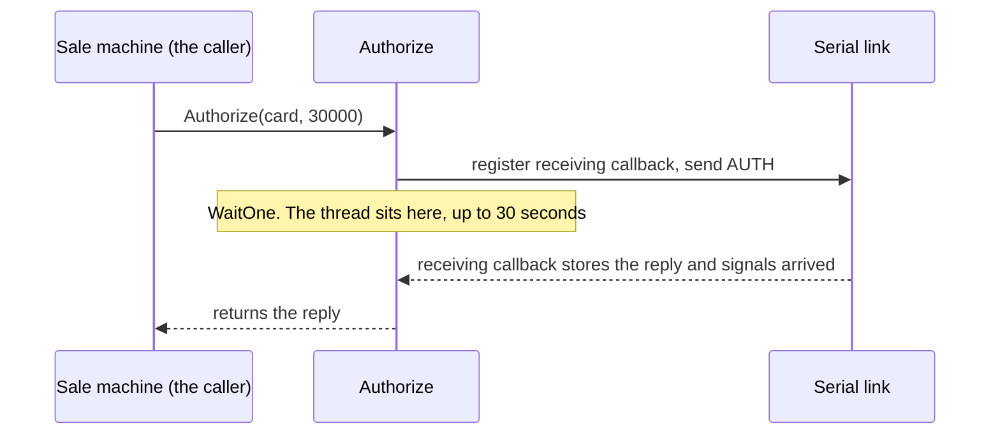
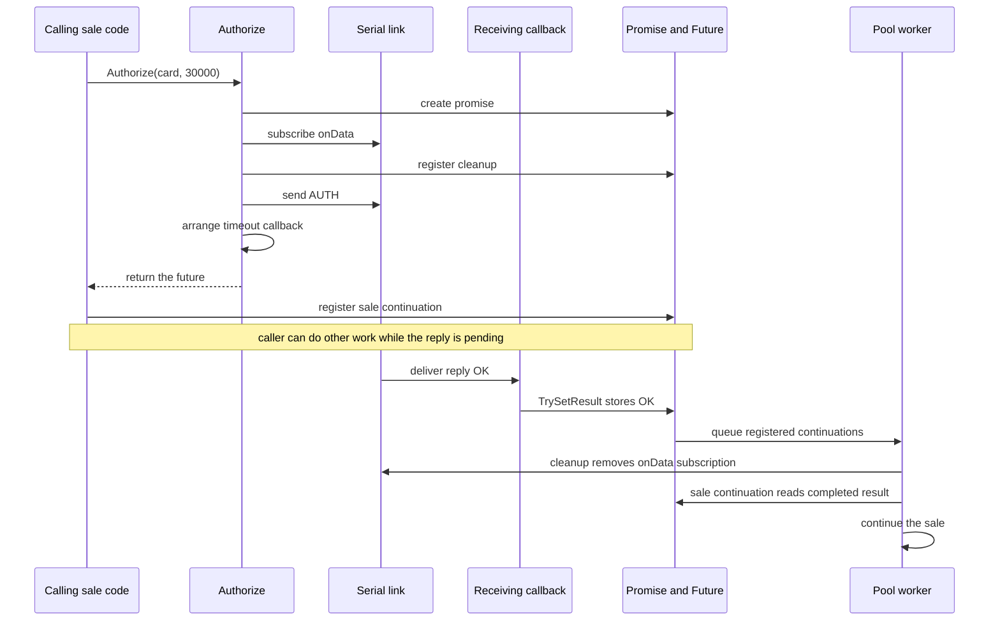
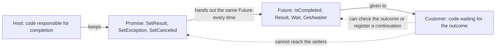
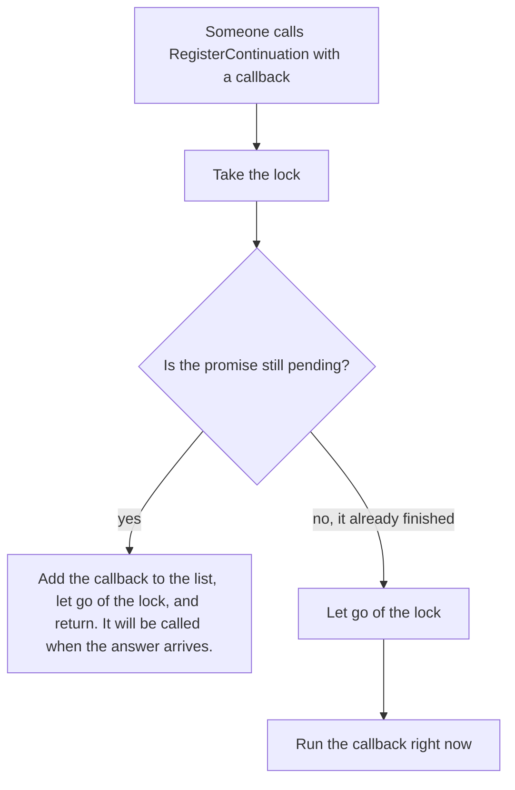
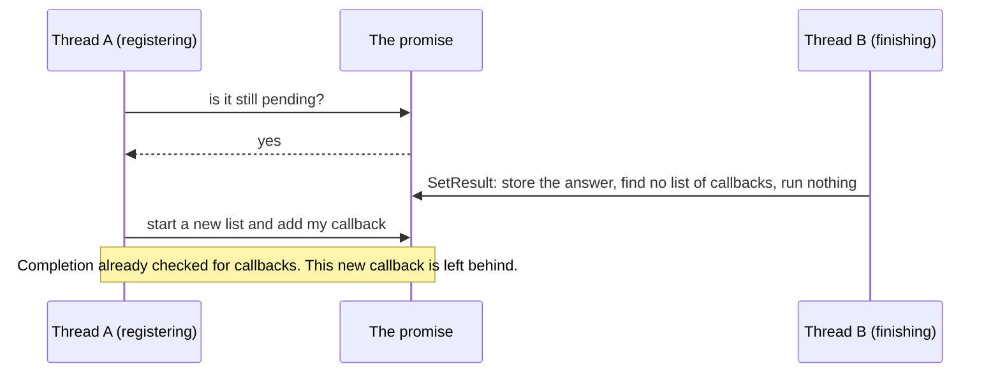
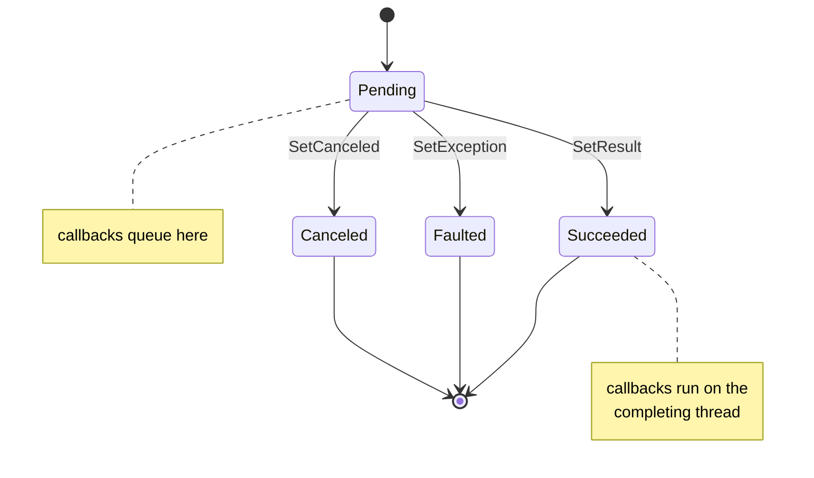

# 2. Callbacks and promises

## At the table

Dee came by as Kevin finished the last wing from the first basket and asked if they wanted a second. Kevin said "let's see how this goes," and Dee said "that's a yes" and wrote nothing down. She refilled Steve's coffee and topped off Kevin's sweet tea. Kevin wiped his hands on a spare napkin and moved napkin number one off to the side so he would not lose the four boxes.

"Show me your host call," Steve said. "The serial one."

Kevin opened the bag. He took out the laptop and turned it so Steve could see. The method was short. He had written it himself, in 2015, after the original one deadlocked a pump in Tulsa.

```csharp
public string Authorize(string card, int timeoutMs)
{
    string reply = null;

    // A reply callback can outlive this block, but adding the 'using' keyword
    // disposes arrived on exit.
    // The method does not coordinate disposal with callbacks still in progress.
    using (AutoResetEvent arrived = new AutoResetEvent(false))
    {
        // This receiving callback captures reply and arrived. Anonymous
        Action<string> onData = delegate(string text)
        {
            reply = text;
            // The reply is stored. Set signals that it is ready to read,
            // allowing the thread blocked in WaitOne to resume.
            // If the wait timed out and using already disposed arrived,
            // this call throws ObjectDisposedException.
            arrived.Set();
        };
        _link.DataReceived += onData;
        try
        {
            _link.Send("AUTH " + card);

            // The callback receives the reply.
            // Timing out ends this wait; the controller's request can still finish.
            if (!arrived.WaitOne(timeoutMs, false)) return "TIMEOUT";
            return reply;
        }
        finally
        {
            // Unsubscribe, but a callback already in progress can keep running.
            // It may still call arrived.Set() after this method leaves using.
            _link.DataReceived -= onData;
        }
    }
}
```

"That's not bad," Steve said again. Waving a hand to pass over the laptop to himself,
Kevin slid the box over, "Let me show you something with some comments," and started typing away.

"You keep saying my code isn't bad, but you want to comment it?"

"It's not bad. I'm just helping you look at what you built, though," as fingers flew over the keyboard.

>The copy below adds restaurant waiting-list comments to the same method. Its blocking wait and cleanup race are still there.

Steve turned the laptop around and nodded toward the people waiting near the entrance. "I'm glad we got in when we did. Look at the crowd at the door." Kevin shifted on the bench to get a view of the entrance. "Imagine the host makes each party stay in that line until a table opens. You're one of many customers. If you leave the line, you lose your place, so you can't do anything else while you wait. Look at the comments I just added."

Turning back to the computer, Kevin dove into understanding the code. Steve pulled a clean napkin, wrote a small 2 in the corner, and began drawing. Dee delivered the second basket and a few more napkins. Kevin spoke up, "In that version, standing in line is my thread at `WaitOne`."

"Right. In that version, the hostess takes the party at the front of the line when a table opens. She tells them, 'Table 12 is ready.' The table assignment is the result. Calling them forward is the ready signal. In your code, `reply` holds the bank's answer, and `arrived` signals that it is available. The caller has to stay at `WaitOne` until then."

He pointed at the receiving callback. "This code does both jobs. It stores `reply`, then calls `arrived.Set()`. But your caller still has to wait in line until that signal arrives."

"The event remembers its signal," Steve added. "If the reply arrives before `WaitOne`, the thread can still consume that signal. It won't miss the reply just because it started waiting afterward." The napkin he had been working on earlier was turned so Kevin could see, "Let me show you a diagram of your flow and look at the comments I wrote to compare things."

---

```csharp
public string Authorize(string card, int timeoutMs)
{
    // The caller has no answer yet, like a party still waiting in the entrance line.
    string reply = null;

    // The ready signal is separate from the answer itself.
    // false means no reply has been signaled yet.
    // 'using' disposes the ready signal when this block exits.
    // It does not control the delegate's lifetime or wait for callbacks to finish.
    using (AutoResetEvent arrived = new AutoResetEvent(false))
    {
        // Define the receiving callback now. The link calls it when a reply arrives.
        Action<string> onData = delegate(string text)
        {
            reply = text;   // Store the reply before signaling the waiting caller.
            arrived.Set();  // Signal that the answer is ready, after storing it.
        };

        // Register the receiving callback before sending the request.
        // Otherwise, a fast reply could arrive before anyone is listening.
        _link.DataReceived += onData;
        try
        {
            // Make the request: ask the controller to authorize this card.
            _link.Send("AUTH " + card);

            // The caller stays in line: this thread waits until signaled or timed out.
            // The link calls onData when a reply arrives. WaitOne does not call it.
            // If Set ran first, the event remembers it; WaitOne consumes that signal.
            if (!arrived.WaitOne(timeoutMs, false)) return "TIMEOUT";

            // Read the answer recorded by the receiving callback.
            return reply;
        }
        finally
        {
            // Remove the callback subscription on success, timeout, or error.
            // This does not cancel the request already sent to the controller.
            _link.DataReceived -= onData;
        }
    }   // using releases the event's operating-system resources as we leave.
}
```

## Kevin's method, one line at a time

Kevin's method sends a request, waits for a reply, then returns a string. The thread that calls it stays inside `WaitOne` during the wait. This shortened example shows that wait; production code also needs to handle late replies and cleanup races.

1. `string reply = null;` The caller has no answer yet. The receiving callback will put the bank's reply here, like being told which table is available.
2. `new AutoResetEvent(false)` creates the ready signal. It is like the hostess calling the next party forward; the signal is separate from the table assignment. `false` means the signal starts unset. `using` disposes the event when the block exits; it does not wait for receiving callbacks to finish.
3. `onData = delegate(string text) { reply = text; arrived.Set(); }` defines a callback. When the link raises its data event, this code stores the text in `reply`, then signals `arrived`. The link decides which thread calls it.
4. `_link.DataReceived += onData;` registers the receiving callback with the serial link before sending the request. `+=` adds that handler to the event's subscribers.
5. `_link.Send("AUTH " + card);` Send the question out the wire. This does not wait for an answer.
6. `arrived.WaitOne(timeoutMs, false)` keeps the calling thread waiting, like the customer who must remain in line. It returns `true` when it consumes the ready signal, or `false` on timeout. The second argument is an older runtime setting; it does not select whether to block.
7. `finally { _link.DataReceived -= onData; }` removes the event handler on success, timeout, or error. Removing it stops future notifications. A handler already running may still finish, so real code must coordinate that handler with disposal of `arrived`.

### Steve's Napkin

Here is the same story as a picture, with the caller on the left, the serial link in the middle, and the answer coming back. Look for where the thread is when nothing is happening.



**In words:**

1. The sale machine calls `Authorize` and hands over the card and a time limit.
2. `Authorize` registers the receiving callback and sends the request over the serial line.
3. Now `Authorize` calls `WaitOne` and the thread goes to sleep. Nothing else can use this thread. If the controller never answers, it sleeps until the timeout.
4. The receiving callback stores the reply and sets the ready signal. The waiting thread can then resume.
5. `Authorize` returns the reply to the sale machine.


## Let the receiving callback supply the answer

Steve tapped the long wait in the diagram. "That's the line your code creates. But is that what the hostess here is doing?"

Kevin turned toward the entrance again. "She's taking names on a sheet and handing out pagers. Those people aren't all standing in line. Some are at the bar. Some are outside."

"How do they keep their place?"

"Their names are still on her sheet. They can mill around while they wait. When a table opens for their party, she buzzes their pager. They come back to find out where to sit."

"Right. They're still in the queue. They just don't have to stand in one place to stay in it. Her record keeps the request while the customer does something else."

Kevin looked back at the method, then with a bit of a smile, spoke up. "I think you are missing something. Tell me why am I keeping a thread at `WaitOne`?"

"Because `Authorize` promises to return a string," Steve said. "It can't return that string until the reply arrives or the timeout expires."

"Yes, so you see what I see. So tell me Mr. All-Knowing... how do you change this section to keep your place without waiting in line?"

"Change the return type to `IFuture<string>`. Then it can hand back a way to read the answer later."

"Like in Javascript? Are you saying I can do the pager now, the table assignment later? You need to show me how. And what is IFuture? I don't really have a good handle on this idea because my .net version doesn't support it."

"I get it. If you can't use it, concentrate on the things you do use. Well, bud, I've got a way you can use it. Heck, even .net came around to this tech in later versions. I just rolled my own. `IFuture<string>` is my library's way of handing back a string that may arrive later. Think of it as the pager. You leave the line with something that will let you know when your request is finished."

"So the future holds my place?"

"The host's record holds your place. That's the promise. When the table is ready, the host records the assignment and buzzes your pager. You return to find out where to sit."

"And in the code?"

"The promise holds the outcome and records its **state**," Steve said. "It starts **Pending**. We're still waiting, so there's no outcome to read yet."

He wrote three more names on the napkin. "There are three ways to finish. **Succeeded** means we have a result, such as the bank's reply. **Faulted** means the operation ended with an error. **Canceled** means it ended through cancellation."

"And the future?"

"It exposes that same state and outcome to the caller. The receiving callback stores the bank's reply in the promise, moving it from `Pending` to `Succeeded`. The caller can then read the reply through `future.Result`. The future reads the promise's outcome; it isn't a second container we fill."

"So completed means the bank approved the sale?"

"Completed means the operation ended. A bank reply saying 'declined' is still a successfully received reply. The sale code has to read it. If sending fails before a result is recorded, we use `Faulted`. Once the promise reaches a completed state, that state stays fixed."

"What about the timeout?"

"In the version below, the timer supplies the string `TIMEOUT` as a result. That makes this promise `Succeeded`, with `TIMEOUT` as its value. We aren't using cancellation in this method. `Canceled` is available for operations that support it."

Kevin tapped the pager Steve had drawn. "How does the sale code know it's time to look?"

"It registers a **continuation** through the future. That's code to run the next part of the sale when the operation completes. At the restaurant, the pager buzzes and you return to the host to hear the outcome. The buzz is the notification. Returning and asking is the continuation."

"Even if something went wrong?"

"Yes. Completion can mean success, error, or cancellation. The continuation checks that outcome before deciding what to do. Reading `Result` gives the value on success; it throws on an error or cancellation."

Steve pointed at the code. "With the queue option we'll use below, completion queues the registered continuations to the pool. The promise stores the outcome. The queued code continues the work."

"So the caller can leave the line?"

"We can remove the event and `WaitOne`. The promise holds the outcome and arranges for continuations to run. There's no event to dispose while a late receiving callback is still using it. We still need to unsubscribe the receiving callback when the operation ends. We will register a cleanup continuation for that job. We'll walk through it after the example."

Steve motioned back to the laptop, and Kevin proffered it. Keys started clicking. Kevin picked up another wing and a piece of celery to blunt the heat. He was just putting the bones on the waste plate when Steve completed his code.

"Here, look at this. We replaced the local reply variable and the blocking event with a promise. It tracks the outcome and the continuations that need to run after completion. Its future lets the caller inspect that same outcome and register its next step."

The promise is a completion object, rather than an immutable value object. Its state changes from `Pending` to one completed state. Returning its future lets the caller continue before the result exists.

```csharp
public IFuture<string> Authorize(string card, int timeoutMs)
{
    // The old method used a local reply string and a separate blocking signal.
    // This promise tracks Pending, then a final outcome, plus registered continuations.
    // The option queues saved continuations instead of running them in onData.
    Promise<string> reply = new Promise<string>(
        PromiseOptions.RunContinuationsAsynchronously);

    // Define the receiving callback. The serial link supplies text when a reply arrives.
    // The delegate captures reply so it can complete this promise after Authorize returns.
    Action<string> onData = delegate(string text)
    {
        // Store text and change Pending to Succeeded. First completion wins.
        // If timeout or an error already completed it, this returns false.
        reply.TrySetResult(text);
    };

    // _link is the pump's existing SerialLink field, supplied through its constructor.
    // It represents the connection to the forecourt controller, which contacts the bank.
    // DataReceived is its reply event. += subscribes onData; it does not call it here.
    _link.DataReceived += onData;

    // Future is the caller's view of this promise's state and outcome.
    // ContinueOnAnyThread does not request a return to a captured display thread.
    // OnCompleted registers cleanup for when the operation ends, however it ends.
    // Register before Send because the reply could arrive during that call.
    reply.Future.ContinueOnAnyThread().OnCompleted(delegate
    {
        // Remove this subscription so later replies are no longer sent to this handler.
        // A receiving callback already in progress can still finish.
        _link.DataReceived -= onData;
    });

    try
    {
        // Ask the controller to authorize this card. The answer arrives via DataReceived.
        _link.Send("AUTH " + card);

        // Delay returns a future for the timeout; it does not sleep on a worker.
        // This is my library's shared timer system so a
        // thread doesn't need to sleep. The closest
        // modern .NET equivalent is Task.Delay(timeoutMs).
        IFuture timeout = Futures.Delay(timeoutMs);

        // Register a second callback, this time on the delay's future.
        // When the delay completes, this callback competes with onData.
        timeout.ContinueOnAnyThread().OnCompleted(delegate
        {
            // If still Pending, record TIMEOUT as the successful string result.
            // Use TrySetResult so if the bank reply already won, leave that result unchanged.
            reply.TrySetResult("TIMEOUT");
        });
    }
    catch (Exception error)
    {
        // A send or timer-setup error changes Pending to Faulted and stores the error.
        // If another completion already won, TrySetException leaves it unchanged.
        // Important to note. An exception does NOT need to be handled if a
        // success or timeout already occurred (won).
        // I left logging out of this for now. Consider adding it.
        reply.TrySetException(error);
    }

    // Return read access to the state and outcome, even if the reply is still pending.
    // The caller can register its sale continuation through this future.
    return reply.Future;
}
```

"There are two callbacks that can finish this promise," Steve said. "The receiving callback tries to store the reply. The timeout callback tries to store `TIMEOUT`. Both callbacks call `TrySetResult` on the same promise. The first call stores its value and returns `true`. If the second callback runs later, its call returns `false` and leaves the stored value unchanged."

"What runs when one of them wins?"

"The continuations registered through the future. We registered cleanup first, so it removes the receiving callback's subscription. The sale code can register another continuation that reads the outcome. We chose the queue option to run these saved continuations on the pool."

> **What changed:** `Authorize` now returns a future instead of blocking for a string. `OnCompleted` registers code to call later. `ContinueOnAnyThread` lets that continuation run without returning to a captured display thread; the later context discussion in chapter 5 covers that choice. This version uses ordinary callbacks, without `yield` or a state machine written by the reader.
The caller must change too. This console example registers the sale's next step and then carries on:

```csharp
// Authorize returns a future without waiting for the bank's reply.
// Register a continuation to read the outcome when the operation ends:
// a reply, a timeout, or an error.
IFuture<string> authorization = Authorize(card, 30000);
authorization.ContinueOnAnyThread().OnCompleted(delegate
{
    if (authorization.IsFaulted)
    {
        Console.WriteLine("Authorization failed: " + authorization.Exception.Message);
        return;
    }
    // Completion has happened, so reading Result here does not wait.
    Console.WriteLine("Authorization reply: " + authorization.Result);
});
Console.WriteLine("The caller can do other work while the reply is pending.");
```

A fast reply can complete before the caller registers its continuation. In this library, registration then calls the continuation immediately. Otherwise, it runs after completion. The caller must allow either order. Calling `authorization.Result` before completion would block the caller again.

This example expects a finite, nonnegative timeout supported by `Futures.Delay`. As in Kevin's version, that timeout starts after `Send` returns. `Send` itself still needs to return promptly. A successful reply leaves the timeout scheduled; its later completion attempt is harmless because `TrySetResult` refuses a second answer.

Unsubscribing still cannot stop a receiving callback already in progress. That callback can safely try to complete this promise: there is no disposed event to signal. Timeout does not cancel the bank request. The example assumes the serial link delivers the reply for this one request. A real link must also match replies to requests before allowing another authorization to start.

### The same request, without a blocked caller

The diagram follows a reply that arrives after the caller registers its continuation. The timer is the competing completion path described in the code.



**In words:**

1. `Authorize` creates the promise, registers cleanup, sends the request, and sets up the timeout callback.
2. It returns the future without waiting for the reply. The caller registers its sale continuation and can do other work.
3. The serial link delivers the reply to the receiving callback, which stores it in the promise.
4. Completing the promise queues its registered continuations. A pool worker runs cleanup, then the sale continuation reads the result.
5. If the timeout wins instead, the same continuations run, but the sale reads `TIMEOUT`.

The caller no longer holds a thread waiting for this reply. The serial link may still need its own reader thread to receive bytes. Continuations also need a thread while they run.

"So I still have code running when the answer comes," Kevin said. "I just don't keep the calling thread asleep until then."

"Right. Now let's look inside the promise that makes that work."

Open `src/MMP.AsyncProxy/Core/Promise{T}.cs` to follow the promise code.

## Two halves of one object

"Hang on," Kevin said. "Let me see if I got this right."

He reached for a fresh napkin just as Dee came past the booth. She saw him pull it from the dispenser, rolled her eyes, and chuckled. Steve caught her look, raised his hands a little, and smiled back. Kevin wrote 3 in the corner.

Kevin flattened the napkin beside the laptop. "The host keeps the record. That's `Promise<string>`. When the reply arrives, the receiving callback uses `SetResult`, or `TrySetResult`, to record it."

"Right. `SetResult` throws if something already completed the promise. `TrySetResult` returns `false` instead."

"And `SetException` records an error. `SetCanceled` records cancellation. Those all belong on the host's side."

"The code responsible for finishing the operation keeps the promise."

Kevin drew a second box. "But my sale code gets the future. It can find out whether the request is finished and read the outcome. Like carrying the pager, then returning to the host for the table assignment. It doesn't get to assign itself a table."

He drew an arrow between the boxes, then added the host and customer at either end.



Kevin followed the arrows with his pen. "So `reply.Future` gives me a separate object that looks at the promise's outcome. The result stays in the promise."

"Yes. The object is a sealed `Future<T>`. It holds a reference to the promise and forwards the reading and registration calls."

"What if I ask for `reply.Future` twice? Two pagers?"

"Not two pagers. You get the same future object both times. Those references lead to the same operation and the same outcome. You can look at the pager as many times as you like and it will still be dark until the host has an outcome to report."

Kevin wrote the method names under his second box. "`IsCompleted` tells me whether it ended. `Result` gives me the answer. And this item... `GetAwaiter` lets me register what to do when it's ready?"

"That's one of the things its awaiter helps you do," Steve said. "`GetAwaiter` returns an **awaiter**. It gives the caller the same way to handle completion whether the future represents a bank reply or a timer delay."

Steve pointed to the names on the napkin. "`IsCompleted` checks whether the operation ended. `OnCompleted` registers your continuation. `GetResult` reads the outcome after completion. If the operation faulted or was canceled, it throws instead."

"So getting the awaiter gives me those three members. Then I choose which one to call?"

"Right. Calling `GetAwaiter` alone doesn't wait or register anything. The future and awaiter both refer to the same promise. Neither creates another operation."

"Walk me through one bank reply with it."

"Start with the future returned by `Authorize`. You call `GetAwaiter()` and keep the awaiter. Then you check its `IsCompleted` property. If the operation has ended, call `GetResult()` and handle the outcome. That could be the bank's reply, our `TIMEOUT` result, or an exception."

"And if we're still waiting for the bank?"

"Think about the pump's display. It shows 'Authorizing...' while the bank processes the request. We need the bank's approval before enabling fuel. But the display still needs to handle buttons and update messages during that wait."

"So waiting inside the display's button handler would hold up those other jobs?"

"Yes. Instead, call `OnCompleted` with a continuation, then return from the handler. That frees the display thread to process other events while authorization is pending."

"What goes in that continuation?"

"It calls `GetResult()` and handles the outcome. An approval lets the sale proceed to enabling fuel. A rejection displays the bank's answer. Our `TIMEOUT` result displays a timeout message. If `GetResult()` throws, the continuation handles the error or cancellation."

"So the awaiter chooses whether to enable fuel?"

"Your sale code makes that decision. You put that code in the continuation. The awaiter connects it to completion, so you can return now and handle the outcome later. The bank request carries on independently."

"Could I choose a different continuation depending on how the customer is buying fuel?"

"Yes. For self-service, choose a continuation that handles the answer on the pump. For an attended sale, choose one that sends the outcome to the attendant's workflow. Choose the delegate at runtime, then pass it to `OnCompleted`. Each continuation handles approval, rejection, timeout, and errors for its own workflow."

"Could I register another one later to replace it?"

"Each call adds a continuation. It leaves the earlier one registered. If the choice must stay open until authorization ends, register one continuation that checks the current sale mode when it runs. We'll follow both approaches later when we look inside the awaiter."

"And the continuation can update the display?"

"It must run on the display thread to do that. With `GetAwaiter`, registering from that thread can capture its context and send the continuation back there. We'll cover that setup later when we discuss context and returning to the display thread. Returning from the handler keeps the display thread available to run it."

"What if the reply arrives between my check and my call to `OnCompleted`?"

"Registration handles that race. If the promise has already completed, it runs the registered continuation or sends it to the chosen thread. You still get the notification."

Kevin circled the three member names. "So the continuation contains my next part of the sale. The awaiter gives me the same way to check, register, and read the outcome for a bank reply or a timer delay."

"Right. Suppose we change the sale rules after a bank approval. That change belongs in the sale code. The awaiter still checks completion, registers the continuation, and reads the outcome."

"Is that the S in SOLID? Single responsibility?"

"That's the connection: keep code that changes for different reasons separate. The sale rules and the mechanics of receiving an outcome have different reasons to change. CUPID's Unix philosophy also fits the awaiter's focused job. Open/Closed would be a different example: adding support for another operation through the same awaiter interface while keeping the consuming code unchanged. We'll compare those ideas later in our discussion of patterns and principles."

"Our example used `ContinueOnAnyThread`. Does that return an awaiter too?"

"Yes. Both methods return an awaiter with the same three members. The difference is where the continuation runs. With `GetAwaiter`, calling `OnCompleted` from the display thread can capture its context and arrange to return there. `ContinueOnAnyThread` skips that arrangement."

"So I can use that when my continuation can run on whichever thread calls it?"

"Right. Neither method starts a new thread. If the continuation needs to update the display, we must arrange for that work to run on the display thread. We'll cover that in our later discussion of context. Before that, we'll take apart the awaiter and builder. For now, follow the call to `OnCompleted` to find where we register the continuation."

"And `Result` can block if you read it too early. In our caller example, the continuation reads it after completion."

"There's `Wait` on that side too. So I could put myself back in the line?"

"You could. `Wait` blocks your thread until completion. Registering a continuation lets the caller return instead. In the restaurant, you keep your place through the host's record, and return when the pager buzzes."

Kevin looked from one box to the other. "Could I cast the future back to the promise and call `SetResult` myself?"

"A **cast** asks C# to treat an object as another type. It doesn't turn one object into a different object. Your future and my promise are separate objects. The future has no setters, and casting it cannot get you back to the promise."

"So the sale code can read the bank's answer, but it can't give itself approval."

"Right. The future's public methods let it read, wait, or register a continuation. The code holding the promise decides how the operation ends. That separate future costs one extra object per promise."

Kevin put a small mark beside the second box. "And in newer .NET, the host keeps a `TaskCompletionSource`, and the caller gets a `Task`?"

"Those are the counterparts in .NET 4. Our names are `Promise` and `Future`. Now look at what happens when the caller registers its continuation."

## The one thing a promise does

A pending promise stores callbacks in a list. Completing the promise makes those callbacks ready to run. This shortened excerpt shows registration; the source also creates the list on its first use.

```csharp
internal void RegisterContinuation(Action continuation)
{
    lock (_gate)
    {
        if (_status == FutureStatus.Pending)
        {
            _continuations.Add(continuation);   // not done yet, remember it
            return;
        }
    }
    continuation();                             // already done, run it now
}
```

**Read it like this.** Somebody says "here is my callback." There are two cases.

- *The host has not recorded an outcome yet* (`Pending`). Store the continuation with the promise and return. It will be called after completion.
- *The outcome is already recorded.* Call the continuation now instead of saving it for later.

Suppose Kevin registers a callback before the reply arrives. `RegisterContinuation` adds it to the list and returns. Later, `Complete` takes that list and calls the callback. If the reply arrived first, registration calls the callback immediately instead. Both orders must work: a fast reply can arrive before the caller registers.

A **lock** lets one thread at a time enter code guarded by the same lock object. Both registration and completion use `_gate`. While registration checks the status and adds a callback, completion must wait. That closes the gap shown below.



**In words:**

1. Someone gives the promise a callback.
2. The promise takes its lock so nobody else can change its state for a moment.
3. It checks whether the promise already has a completed outcome.
4. If the promise is pending, it stores the callback, releases the lock, and returns.
5. If the answer is already there, the promise lets go of the lock and runs the callback on the spot.


### The race the lock prevents

Kevin tapped `lock (_gate)`. "We already check whether the promise is pending. Why do we need this too?"

"Because another thread can complete the promise between that check and adding your callback," Steve said. "Let's use your bank reply. The display thread is registering the sale continuation. The receiving thread is about to store `OK`. Imagine we remove the lock."

"The display thread checks the promise. Still pending."

"Then it pauses before adding the continuation. During that pause, the receiving thread stores `OK` and takes the list of callbacks to run."

"But mine isn't on the list yet."

"Right. Suppose yours is the first callback. The list is still empty, so completion has nothing to call. Then the display thread resumes and adds your callback."

Kevin frowned. "The answer is there, but my sale code never gets called?"

"That's the race. The result was stored, but registration happened too late for completion to find the callback. The sale could stay on 'Authorizing...' even though the bank already replied. Whether it happens depends on how those two threads' steps overlap."

Steve turned napkin two over and drew the broken order on the back.



"Could I check `IsCompleted` again before adding the callback?" Kevin asked.

"Completion could happen just after that second check too. We need to keep the check and the addition together. Both registration and completion use the same lock, `_gate`. Only one thread can execute the protected code at a time."

Kevin traced thread A's arrow. "If registration gets the lock first, it checks the status and adds my callback before releasing the lock."

"Yes. Completion waits to acquire that lock. Once registration releases it, completion can store the outcome and take the list. Your callback is already there."

"What if the receiving thread gets the lock first?"

"It records the outcome and takes any saved callbacks. When registration gets the lock afterward, it sees the completed status. It releases the lock and calls your callback directly instead of saving it for later. An awaiter may then post your continuation to the display thread."

"So either my callback gets onto the list before completion takes it, or registration sees that completion already happened and calls it."

"Right. The shared lock closes the gap between checking the status and adding the callback."

"Are we holding that lock while we wait for the bank?"

"Only while we inspect or change the promise's data. We release it before returning to other work. We also release it before calling the saved callbacks. The bank can take seconds to reply while the lock is free."


## Completion, in order

Dee stopped beside the table with the coffee pot. Kevin had written `OK` and `TIMEOUT` in the space below the boxes on napkin three.

"Do I want to know?" she asked.

"Two answers for one sale," Kevin said.

"One answer," Steve said. "Two attempts to supply it."

Dee topped off Steve's coffee. "I'll leave you to settle that."

Steve opened [`src/MMP.AsyncProxy/Core/Promise{T}.cs`](../../src/MMP.AsyncProxy/Core/Promise%7BT%7D.cs). "Find the private `Complete` method. `TrySetResult`, `TrySetException`, and `TrySetCanceled` all call it with a different final status. This shortened version shows the default callback behavior. The full method also signals blocking waiters and supports the option to queue callbacks to the pool."

```csharp
private bool Complete(FutureStatus status, T result, Exception exception)
{
    // Keep the saved callbacks here so we can call them after releasing the lock.
    List<Action> toRun;
    lock (_gate)
    {
        // Registration uses this same lock. It cannot add a callback while
        // we record the outcome and take the list of callbacks to run.
        // A completed promise keeps its first outcome. This attempt loses.
        if (_status != FutureStatus.Pending) return false;

        // Record how the operation ended and its result or error.
        _status = status;
        _result = result;
        _exception = exception;

        // Copy the list reference, then clear the promise's reference.
        // The callbacks remain in the list now held by toRun.
        toRun = _continuations;
        _continuations = null;
    }

    // The lock is free before user code runs. In this default version,
    // this thread calls each saved callback in registration order.
    if (toRun != null)
    {
        foreach (Action callback in toRun) callback();
    }

    // This attempt recorded the outcome and the callbacks returned normally.
    return true;
}
```

"Does setting `_continuations` to `null` delete my callbacks?" Kevin asked.

"It clears one reference to the list. `toRun` still refers to that same list, so the callbacks are still there. Completion takes responsibility for calling them. Later registrations see the completed status and use the direct-call path we just covered."

"And `return true` means the bank approved the sale?"

"It means this completion attempt recorded the outcome. `TrySetResult(\"DECLINED\")` can return `true` too. The bank's answer is the stored string. The Boolean tells the code supplying that string whether its completion attempt won."

### An example, one step at a time

Kevin pointed to the two outcomes on the napkin. "Suppose the bank replies just as the timer expires."

"Let's trace that. Two continuations are already registered: A handles the sale, and B handles the display. Both observe the same outcome. The receiving callback and the timeout callback are different: they compete to supply that outcome."

"So two callbacks try to complete it, and two continuations react to whichever outcome wins?"

"Right. For this trace, suppose the timeout tries to cancel the promise. Our earlier `Authorize` example stored the string `TIMEOUT` instead. Either policy uses the same first-completion rule. Canceling this promise records a canceled outcome; it doesn't stop the bank request."

Steve put his finger beside `OK`. "Suppose the receiving thread gets the lock first. These two continuation bodies are placeholders for the approved path. Real sale code must check the outcome before enabling fuel or showing approval."

```csharp
Promise<string> reply = new Promise<string>();

// Register two observers before completion. These bodies show only the
// approved path. Real handlers must check the outcome before taking action.
reply.Future.GetAwaiter().OnCompleted(() => ArmThePump());   // continuation A
reply.Future.GetAwaiter().OnCompleted(() => ShowApproved()); // continuation B

// Inside the receiving callback on the UART reader's thread:
// Try to record OK. Complete returns false if another attempt already won.
bool first = reply.TrySetResult("OK");

// Separately, inside the timeout callback on a pool thread:
// Try to record cancellation. This does not cancel the bank's work.
bool second = reply.TrySetCanceled();
```

"Are those last two lines supposed to create two threads?"

"They represent calls made by two existing callbacks on different threads. This listing shows the calls together so we can compare them. For the order below, the receiving thread takes the lock first. The timer thread takes it after the result is stored but before the receiving thread calls the saved continuations."

Kevin moved his pen down the table, following the result and the callback list separately.

| Moment | `_status` | `_result` | `_continuations` | What is happening |
|---|---|---|---|---|
| Before anything | Pending | nothing | [A, B] | Both continuations are registered. No outcome has been recorded. |
| UART thread enters `Complete`, takes the lock | Pending | nothing | [A, B] | Still pending, so it is allowed to finish the promise. |
| Inside the lock, writing | Succeeded | "OK" | [A, B] | The result is recorded. The status says the operation succeeded. |
| Inside the lock, taking the list | Succeeded | "OK" | empty (`null`) | `toRun` now holds [A, B]. The promise's own list is cleared. |
| Lock released | Succeeded | "OK" | empty | From here on, any other thread can look at the promise. |
| Timer thread enters `Complete` | Succeeded | "OK" | empty | It takes the lock and sees the status is not Pending. It returns `false` and changes nothing. `second` is `false`. |
| UART thread runs `toRun` | Succeeded | "OK" | empty | A runs (`ArmThePump`), then B runs (`ShowApproved`). Then `Complete` returns `true`. `first` is `true`. |

"The timer gets in before A and B run," Kevin said. "Could it still change the answer?"

"The outcome is already recorded. The timer sees `Succeeded`, returns `false`, and leaves `OK` in place. Completion and calling continuations are separate steps."

"And if the timeout got the lock first?"

"Then the promise would stay canceled. The bank's later `TrySetResult` would return `false`. Both continuations would still be notified, but they would need to handle cancellation instead of taking the approved path."

Kevin crossed out his heading, *two answers*, and wrote *one outcome*. "So completion tells my code to inspect the outcome. It doesn't mean approval."

"Right. Now there are three details in that trace worth keeping."

1. **First completion wins.** `TrySetResult` returns `true` when it changes the promise from pending to complete. A later `TrySetCanceled` returns `false` and leaves that result alone. The `SetResult` version throws `InvalidOperationException` if the promise already completed. Use the `Try` methods when two expected events, such as a reply and timeout, compete to finish one promise.
2. **The callbacks run outside the lock.** A callback might complete another promise, which takes another lock. Hold yours while that happens and you have built a deadlock kit. (A **deadlock** is when two things each wait for the other forever.) Here is how it would go if `Complete` ran the callbacks *inside* the lock. Say callback A, running under promise `reply`'s lock, finishes a second promise `other`, and `other`'s own callback tries to finish `reply`:

   | Thread 1 | Thread 2 |
   |---|---|
   | finishes `reply`: holds `reply`'s lock, runs A | finishes `other`: holds `other`'s lock, runs its callback |
   | A tries to finish `other`: needs `other`'s lock, waits | the callback tries to finish `reply`: needs `reply`'s lock, waits |
   | both are waiting for a lock the other one holds, and neither lets go | |

   Releasing `_gate` before calling user code prevents this lock cycle inside the promise. A caller may still hold some other lock when it completes a promise, so its callbacks need care too.
3. **The default promise calls its stored callbacks on the completing thread.** The direct callback runs before `SetResult` returns. An awaiter may instead post the user's continuation to a captured display context. The console example below assumes there is no such context or registered post target. In the example, `ArmThePump` and `ShowApproved` ran on the UART thread, the one that called `TrySetResult`. You can see it for yourself (in a console program, which has no synchronization context. The context discussion in chapter 5 explains when that matters):

   ```csharp
   reply.Future.GetAwaiter().OnCompleted(() => Console.WriteLine("callback ran on thread " + Thread.CurrentThread.ManagedThreadId));
   Console.WriteLine("completing on thread " + Thread.CurrentThread.ManagedThreadId);
   reply.SetResult("OK");
   Console.WriteLine("SetResult has returned");
   // Example output:
   //   completing on thread 1
   //   callback ran on thread 1     <- printed before SetResult returned, on the same thread
   //   SetResult has returned
   ```

   A callback may complete another promise, which calls another callback before returning. A long chain like that grows the call stack. Also, this implementation lets a callback exception escape the completion call, which can prevent later callbacks in the saved list from running. The examples assume callbacks finish normally.

That third one has an off switch. When the completing thread needs to return quickly or may hold another lock, create the promise with this option:

```csharp
Promise<string> reply = new Promise<string>(PromiseOptions.RunContinuationsAsynchronously);
```

**Read it like this.** On completion, the promise queues its saved callbacks to the thread pool. A free worker calls them. This keeps that work off the serial reader's thread. A managed serial callback is different from the hardware interrupt that first receives the bytes.

The option applies to callbacks saved before completion. A callback registered after completion runs immediately on the registering thread. A captured context may then post the user's code elsewhere. The later context discussion in chapter 5 explains that step.

## Wait, for when you must

`Wait()` blocks the calling thread until the future completes. If the future is pending, the first wait creates a `ManualResetEvent`, a signal that stays set after completion. A completed future returns from `Wait()` immediately. Blocking can be useful at the end of a console program or in a test. Inside asynchronous code, it ties up the thread again.

## State diagram



**In words:**

1. Every promise starts at the black dot and is `Pending`, like a host's request record with no table assignment yet.
2. While it is pending, callbacks that arrive are added to the list. This is what the note on `Pending` means.
3. Exactly one of three things then happens: `SetResult` (it worked: `Succeeded`), `SetException` (it broke: `Faulted`), or `SetCanceled` (somebody gave up: `Canceled`).
4. By default, completion calls saved callbacks on the completing thread. The note shows that default for `Succeeded`; it also applies to failure and cancellation. The asynchronous option described above queues them instead.
5. Each of the three end states goes to the black dot on the right. That is the end. There are no arrows leading out of an end state.


## Try it

```csharp
var promise = new Promise<string>();
IFuture<string> future = promise.Future;

future.GetAwaiter().OnCompleted(() => Console.WriteLine("got " + future.Result));
Console.WriteLine("registered");

promise.SetResult("hello");       // "got hello" prints here, on this thread
```

That prints `registered`, then `got hello`. Now shuffle the lines and predict the output before you run it.

| Order | What prints | Why |
|---|---|---|
| Register, print `registered`, `SetResult` (as above) | `registered`, then `got hello` | The callback waits on the list. `SetResult` runs it, on this thread, before it returns. |
| Register, `SetResult`, print `registered` (swap the last two lines) | `got hello`, then `registered` | The callback is on the list, and `SetResult` runs it right there before the next line. |
| `SetResult`, register, print `registered` | `got hello`, then `registered` | The outcome was already recorded, so registration calls the continuation immediately. |

These rows all run on one thread. What changes is when the callback runs: during completion in the first two rows, during registration in the last. The caller must handle either order.

Kevin gathered the drawings and checked the corners. "One: my four threads. Two: the old authorization flow, with your race on the back. Three: promise and future, plus the two attempts to complete them."

He added `Authorize` above the flow on napkin two and stacked the three in order, away from the sauce. The napkins used for wiping hands went on the waste plate.

"Next one is four," he said.

## Words you just met

| Word | In plain words | The picture |
|---|---|---|
| **Receiving callback** | Code the serial link calls when a reply arrives | The host recording a table assignment |
| **Continuation** | Code registered to run the next part of the work after completion | Returning to the host after the pager buzzes |
| **Promise** | The writable object kept by the code responsible for completion | The host's request record, including the final table assignment |
| **Future** | Read-only access to the outcome, with a way to register continuations | The customer's pager, with access to the recorded outcome in code |
| **`reply` and `arrived`** | A variable for the answer and an event that signals readiness | The table assignment and the hostess calling the next party forward |
| **Event** (`AutoResetEvent`) | A ready signal consumed by a waiting thread | Being called forward while you wait in line |
| **Lock** | A rule that lets only one thread into a piece of code at a time | The one-key bathroom |
| **Deadlock** | Two things each waiting for the other forever | Two people stuck in a doorway, each insisting the other go first |
| **`TaskCompletionSource` / `Task`** | The .NET 4 counterparts to Promise and Future | The host's record and the customer's pager; code also exposes the recorded outcome |
