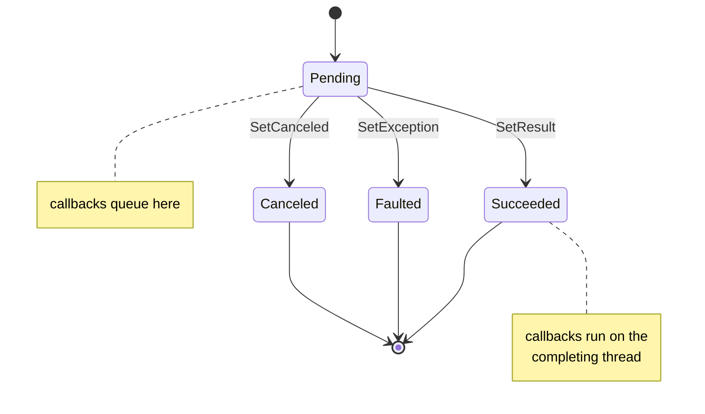

# 2. Callbacks and promises

## At the table

"Show me your host call," Steve said. "The serial one."

Kevin opened the bag after all. The method was short. He had written it himself, in 2015, after the original one deadlocked a pump in Tulsa.

```csharp
public string Authorize(string card, int timeoutMs)
{
    string reply = null;
    using (AutoResetEvent arrived = new AutoResetEvent(false))
    {
        Action<string> onData = delegate(string text) { reply = text; arrived.Set(); };
        _link.DataReceived += onData;
        try
        {
            _link.Send("AUTH " + card);
            if (!arrived.WaitOne(timeoutMs, false)) return "TIMEOUT";   // the thread is parked here
            return reply;
        }
        finally { _link.DataReceived -= onData; }
    }
}
```

"That's not bad," Steve said again.

"You keep saying that."

"It's not bad. Look at what you built, though. You've got a slot for the answer, `reply`. You've got a signal that says the answer is in the slot, `arrived`. And you've got a thread sitting on the signal. The first two are the right idea. The third one is the problem."

"The thread has to wait somewhere."

"Does it? What does the thread do when `arrived` fires?"

"It... returns `reply`."

"To who?"

"To the sale state machine. Which decides whether to arm the pump."

"So the thread's whole job after the signal is: hand a string to the next guy. What if the slot could hand the string to the next guy itself? You put the answer in the slot and the slot calls whoever was waiting. No thread sitting on an event. Just a list of people to call."

Kevin looked at it. "That's a callback."

"That's a callback with a box around it so you can only put the answer in once, and so the people waiting can't put an answer in themselves. In this library it's called a `Promise`. The read-only half you hand out is a `Future`. In 4.5 it's `TaskCompletionSource` and `Task`. Same split. Your `reply` and your `arrived` are the two halves of a promise, and you built them by hand without knowing it."

"And the thread?"

"Gone. The next guy gets called when the slot fills. We'll get to who calls him. First, the slot."

Open `src/MMP.AsyncProxy/Core/Promise{T}.cs`. That file is the whole chapter.

## Two halves of one object

A `Promise<T>` comes with a partner.

- The **promise** has `SetResult`, `SetException`, `SetCanceled`. You keep this one.
- The **future** is a separate sealed `Future<T>` that holds the promise and forwards the read members: `IsCompleted`, `Result`, `Wait`, `GetAwaiter`. You give this one away.

The `Future` property hands out the same `Future<T>` instance every time. It is a different object from the promise, and `Promise<T>` does not implement `IFuture<T>` at all, so there is no cast that gets a caller from the view back to the setters. The compiler refuses `future is Promise<T>` outright. One extra allocation per promise buys that.

Why bother? Because the moment a caller can complete your work, your work is no longer yours. Someone, somewhere, will "fix" a timeout by calling `SetResult` on a future they did not own, and the real result will arrive later into a promise that is already closed. This is the `Task` and `TaskCompletionSource` split in .NET 4, and it is there for the same reason. Toub makes the point at 27:05.

## The one thing a promise does

Strip away the getters and it does one thing: it holds a list of callbacks, and runs them when it completes.

```csharp
internal void RegisterContinuation(Action continuation)
{
    lock (_gate)
    {
        if (_status == FutureStatus.Pending)
        {
            _continuations.Add(continuation);   // not done yet, remember it
            return;
        }
    }
    continuation();                             // already done, run it now
}
```

Two cases, and the lock closes the gap between them. Without the lock, a completion could land between "is it pending?" and "add to the list", and that callback would never run. That is the kind of bug that shows up once a week in production and never in a test.

## Completion, in order

```csharp
private bool Complete(FutureStatus status, T result, Exception exception)
{
    List<Action> toRun;
    lock (_gate)
    {
        if (_status != FutureStatus.Pending) return false;   // first one wins
        _status = status; _result = result; _exception = exception;
        toRun = _continuations; _continuations = null;
    }
    if (toRun != null) foreach (var c in toRun) c();         // outside the lock
    return true;
}
```

Three things to notice.

1. **First completion wins.** The second `SetResult` returns false. `TrySetResult` lets you ask politely. `SetResult` throws if you lose.
2. **The callbacks run outside the lock.** A callback might complete another promise, which takes another lock. Hold yours while that happens and you have built a deadlock kit.
3. **The callbacks run on the completing thread.** Whoever calls `SetResult` runs every continuation right there, before `SetResult` returns. That is how `TaskCompletionSource` works by default too. It means a long chain of synchronous completions grows the stack. We live with it for now; it is on the plan.

## Wait, for when you must

`Wait()` makes a `ManualResetEvent` on first use and blocks on it. It is there for the top of a console program and for tests. Every time you call it from inside async code, you have put a thread back to sleep, and chapter 1 happens again.

## State diagram



One move. Never back. That is what makes it safe to read the status without a lock after you have seen it complete once.

## Try it

```csharp
var promise = new Promise<string>();
IFuture<string> future = promise.Future;

future.GetAwaiter().OnCompleted(() => Console.WriteLine("got " + future.Result));
Console.WriteLine("registered");

promise.SetResult("hello");       // "got hello" prints here, on this thread
```

Swap the last two statements and "got hello" prints first, because the callback runs at registration. Same code, same result, different thread timing. That is the property await depends on.
