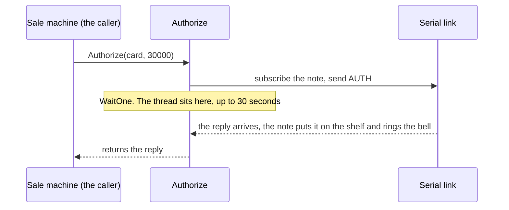
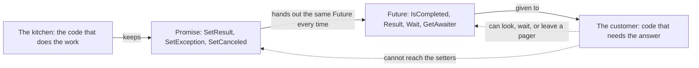
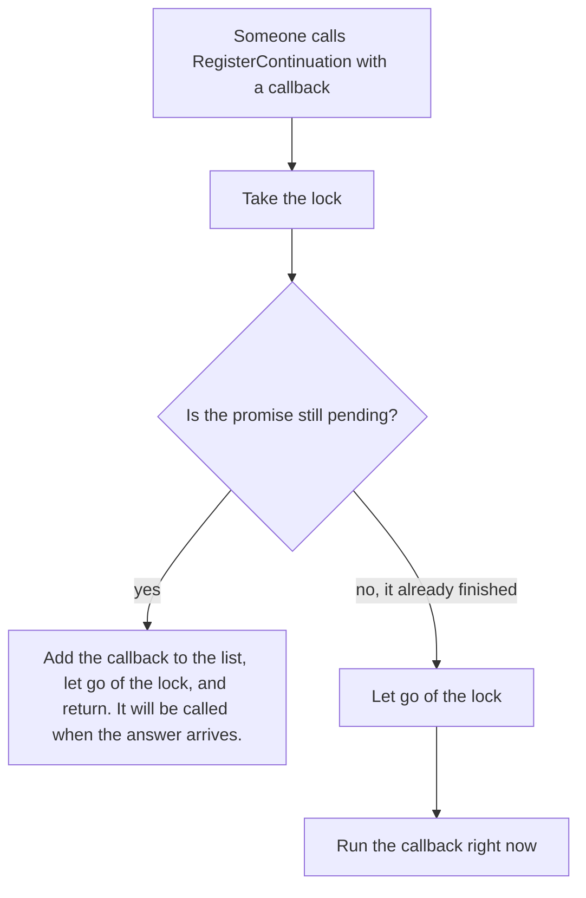
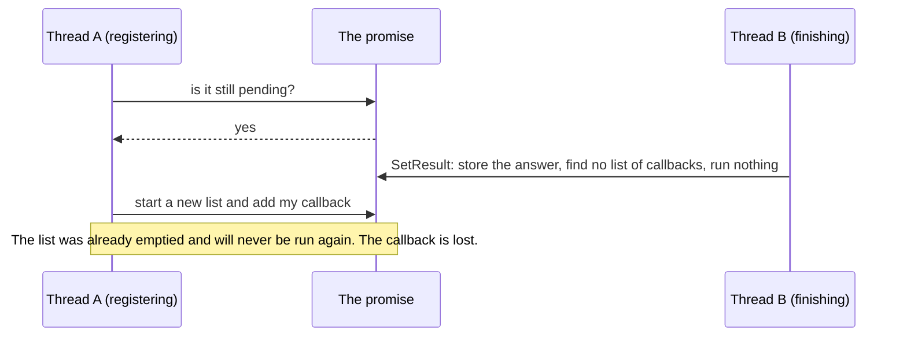
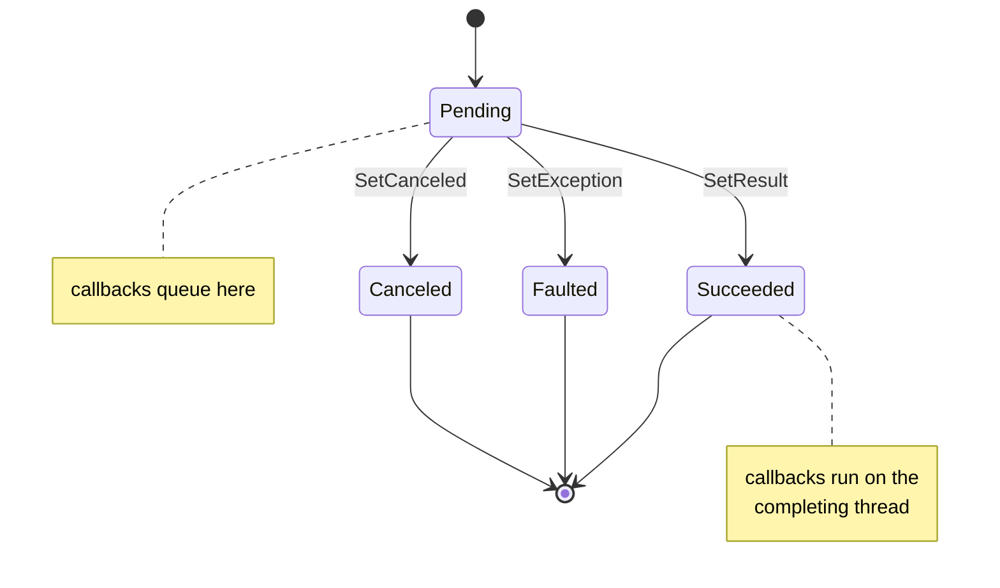
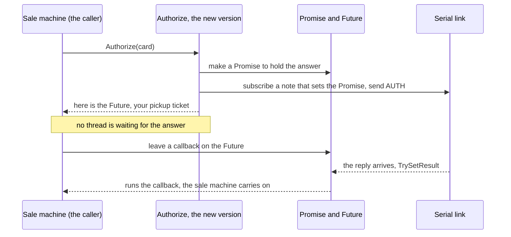

# 2. Callbacks and promises

## At the table

Dee came by and asked if they wanted the second basket, and Kevin said "let's see how this goes," and Dee said "that's a yes" and wrote nothing down. Steve got a refill. Kevin wiped his hands on napkin number two, which was clean, and moved napkin number one off to the side so he would not lose the four boxes.

"Show me your host call," Steve said. "The serial one."

Kevin opened the bag after all. He took out the laptop and turned it so Steve could see. The method was short. He had written it himself, in 2015, after the original one deadlocked a pump in Tulsa.

```csharp
public string Authorize(string card, int timeoutMs)
{
    string reply = null;
    using (AutoResetEvent arrived = new AutoResetEvent(false))
    {
        Action<string> onData = delegate(string text) { reply = text; arrived.Set(); };
        _link.DataReceived += onData;
        try
        {
            _link.Send("AUTH " + card);
            if (!arrived.WaitOne(timeoutMs, false)) return "TIMEOUT";   // the thread is parked here
            return reply;
        }
        finally { _link.DataReceived -= onData; }
    }
}
```

"That's not bad," Steve said again.

"You keep saying that."

"It's not bad. Look at what you built, though." Steve picked up the salt shaker and the sugar caddy and set them in front of Kevin. "Pretend the bank is a bakery in the back, and you've put in an order for a cake. Your variable `reply` is a shelf by the register. One spot, and when the cake is done, the baker sets it there. That's all `reply` is: a place to set the answer down."

He pushed the sugar caddy forward. "`arrived` is the doorbell on the counter. The baker sets the cake on the shelf, then rings the bell, so you know it's there. Shelf says *what* the answer is. Bell says *that* it's ready. Those are two different jobs, and you got them both right."

"Okay. So what's the problem."

"The third thing you built. Where's your thread?"

Kevin looked at the line with the comment on it. "On the doorbell. Sitting there."

"On a stool. Right next to the bell, with its eyes on the bell. For up to thirty seconds. Doing nothing, with a whole desk and a file at HR and a line on the roll-call sheet. If you had a hundred customers, you'd hire a hundred people to sit on a hundred stools next to a hundred doorbells." Steve took a wing. "The shelf and the bell are the right idea. The person on the stool is the problem."

"Somebody has to be at the bell, bro. It has to ring *someone*."

"Does it? Let's ask what the thread does when the bell rings."

"It... returns `reply`."

"To who?"

"To the sale state machine. Which decides whether to arm the pump."

"So the thread's whole job, after the bell, is to hand a string to the next guy. That's it. Now what if the shelf could hand the string to the next guy *itself*? Say you leave your pager on the shelf: you put your pager number on a list taped to it. The baker sets the cake down, the shelf sees the list, and it buzzes everybody on it. Nobody is on a stool. Nobody is staring at a bell. There's just a list of people to call."

Kevin looked at it. "That's a callback."

"That's a callback with a box around it. The box does two things. You can only put the answer on the shelf once. And the people waiting for the answer are not allowed to put one there themselves. Picture a pickup window at a restaurant. The kitchen can put food in the window. The customer can look in the window, and ask to be buzzed. The customer can't reach in and put a fake order in. In this library the kitchen's half is called a `Promise`, and the customer's half is called a `Future`. In .NET 4 and up they're `TaskCompletionSource` and `Task`. Same split. Your `reply` and your `arrived` are two halves of a promise, and you built them by hand without knowing it."

"And the thread?"

"Gone. The next guy gets called when the shelf fills. We'll get to who does the calling. First, the shelf."

"Dale is going to love 'the shelf,'" Kevin said.

"Dale doesn't have to love it. Dale has to sign it."

Open `src/MMP.AsyncProxy/Core/Promise{T}.cs`. That file is the whole chapter.

## Kevin's method, one line at a time

Before we throw it away, let's read what Kevin wrote in plain words. It is a good method, and it is easier to see what is wrong with it once you can see what each line does.

1. `string reply = null;` The shelf. A variable that starts empty. The answer will be set here.
2. `new AutoResetEvent(false)` The doorbell. An **event** is a signal that one thread can sleep on until another thread rings it. `false` means "starts un-rung." `using` means "throw the doorbell away when we are done," because a doorbell like this is a real object the operating system has to keep track of.
3. `onData = delegate(string text) { reply = text; arrived.Set(); }` The note. "When something arrives, put it on the shelf, then ring the bell." This code does not run now. It is waiting for the data to show up, and it runs on whatever thread the serial hardware delivers it on.
4. `_link.DataReceived += onData;` Hand the note to the serial line so it knows who to tell. `+=` means "add me to the list of people who want to hear about this."
5. `_link.Send("AUTH " + card);` Send the question out the wire. This does not wait for an answer.
6. `arrived.WaitOne(timeoutMs, false)` Sit on the stool. The thread sleeps here until the bell rings or time runs out. It gives back `true` if the bell rang, and `false` if it timed out. (The `false` argument is an old setting you can ignore.)
7. `finally { _link.DataReceived -= onData; }` Take the note down no matter how we leave. If we forgot, a late reply would ring a doorbell that has already been thrown away.

Here is the same story as a picture, with the caller on the left, the serial link in the middle, and the answer coming back. Look for where the thread is when nothing is happening.



**In words:**

1. The sale machine calls `Authorize` and hands over the card and a time limit.
2. `Authorize` gives the serial link its note and sends the question out the wire.
3. Now `Authorize` calls `WaitOne` and the thread goes to sleep. Nothing else can use this thread. If the controller never answers, it sleeps until the timeout.
4. The reply arrives. The note runs, sets the shelf, and rings the bell. The thread wakes.
5. `Authorize` returns the reply to the sale machine.

**Why it matters:** the only time anything useful happens in this whole picture is steps 2 and 4. Step 3, the long one, is a worker on a stool, doing nothing, for up to the timeout.

## Two halves of one object

A `Promise<T>` comes with a partner. Think of the pickup window again.

- The **promise** is the kitchen's half. It has `SetResult`, `SetException`, and `SetCanceled`: ways to say "here is the answer," "it broke," and "it was cancelled." You keep this one.
- The **future** is the customer's half. It is a separate sealed `Future<T>` that holds the promise and forwards the read members: `IsCompleted`, `Result`, `Wait`, `GetAwaiter`. You give this one away.



**In words:**

1. The kitchen (the code that does the work) creates a promise and keeps it.
2. The promise gives out a future. It is the same one every time, so two people comparing futures find out they are looking at the same one.
3. The future is handed to whoever needs the answer: the customer.
4. The customer can look at the future, wait on it, or leave a pager (a callback) on it.
5. The customer cannot get from the future back to the promise's setters. There is no cast that does it.

**Why it matters:** only the code that does the work can say the work is done. That protects you from somebody else deciding the answer for you.

A word about "no cast": a **cast** is how C# lets you say "treat this object as a different type." The `Future` property hands out the same `Future<T>` object every time. It is a different object from the promise, and `Promise<T>` does not implement `IFuture<T>` at all, so there is no cast that gets a caller from the view back to the setters. The compiler refuses `future is Promise<T>` outright. One extra allocation per promise buys that.

Why bother? Because the moment a caller can complete your work, your work is no longer yours. Someone, somewhere, will "fix" a timeout by calling `SetResult` on a future they did not own, and the real result will arrive later into a promise that is already closed. This is the `Task` and `TaskCompletionSource` split in .NET 4, and it is there for the same reason. Toub makes the point at 27:05.

## The one thing a promise does

Strip away the getters and it does one thing: it keeps a list of pagers (callbacks), and buzzes them all when the answer is set.

```csharp
internal void RegisterContinuation(Action continuation)
{
    lock (_gate)
    {
        if (_status == FutureStatus.Pending)
        {
            _continuations.Add(continuation);   // not done yet, remember it
            return;
        }
    }
    continuation();                             // already done, run it now
}
```

**Read it like this.** Somebody says "here is my callback." There are two cases.

- *The answer isn't on the shelf yet* (`Pending`). Write the callback on the list, and leave. It will be called later.
- *The answer is already there.* Don't bother with the list. Run the callback right now.

Notice what this method does *not* do. It does not take anything off the list and put it back. The callback is **handed in** by the caller, and the method makes one decision about that one callback: put it on the list, or run it now. A callback goes on the list once and stays there. The list is emptied later, once, by a different method (`Complete`, below), which takes the whole list and runs everything on it. Programmers call this pattern **check, then act** (look at the state, then do something based on what you saw), and the job of "subscribe, but run me right away if the event already happened" is **register or run immediately**. The observer pattern in chapter 9 is the same idea.

A **lock** is a rule that only lets one thread into a piece of code at a time, like a bathroom with one key. The `lock (_gate)` makes sure that "is it still pending?" and "add it to the list" happen as one move, with nobody sneaking in between them.



**In words:**

1. Someone gives the promise a callback.
2. The promise takes its lock so nobody else can change its state for a moment.
3. It checks: is the answer on the shelf yet?
4. If not yet, the callback goes on the list and the promise lets go of the lock. That is the whole job for now.
5. If the answer is already there, the promise lets go of the lock and runs the callback on the spot.

**Why it matters:** both cases end with the callback running exactly once. Without the lock, a completion could land between "is it pending?" and "add to the list," and that callback would never run. That is the kind of bug that shows up once a week in production and never in a test.

### The race the lock prevents

Here is the bug, as a timeline of two threads. Thread A is registering a callback. Thread B is finishing the promise. Pretend there is **no lock**.



**In words:**

1. Thread A asks the promise whether it is still pending. The answer is yes, so A decides to add its callback to the list.
2. Before A gets to do that, thread B finishes the promise. B stores the answer and looks for waiting callbacks. There are none yet, because A has not added anything (the real code makes the list only when the first callback arrives). B runs nothing and leaves.
3. Now A starts a new list and adds its callback. The promise is already finished, and nobody will ever look at that list again. The callback never runs, and whoever was waiting waits forever.

**With the lock,** A takes the lock before step 1 and keeps it until its callback is on the list. B's `SetResult` can't start until A is done, so B finds the callback on the list and runs it. Or B goes first, and then A finds the promise already finished and runs its own callback right away. Either order, the callback runs exactly once.

**Why it matters:** the check ("is it pending?") and the act ("add it") have to be one move. The lock is what makes them one move.

## Completion, in order

```csharp
private bool Complete(FutureStatus status, T result, Exception exception)
{
    List<Action> toRun;
    lock (_gate)
    {
        if (_status != FutureStatus.Pending) return false;   // first one wins
        _status = status; _result = result; _exception = exception;
        toRun = _continuations; _continuations = null;
    }
    if (toRun != null) foreach (var c in toRun) c();         // outside the lock
    return true;
}
```

**Read it like this.** Inside the lock, check that nobody finished it first. If not, write down the result, take the whole callback list, and empty the promise's own list. Then let go of the lock and call every callback on the list.

Three things to notice.

1. **First completion wins.** The second `SetResult` returns false. `TrySetResult` lets you ask politely ("did it work?"). `SetResult` throws if you lose. Think of a window with one cake: the first baker to set it down wins, and a second baker is told it's already there.
2. **The callbacks run outside the lock.** A callback might complete another promise, which takes another lock. Hold yours while that happens and you have built a deadlock kit. (A **deadlock** is when two things each wait for the other forever.)
3. **The callbacks run on the completing thread.** Whoever calls `SetResult` runs every waiting callback right there, before `SetResult` returns. That is how `TaskCompletionSource` works by default too. A long chain of synchronous completions makes the call stack grow. We live with that for now; it is on the plan.

That third one has an off switch. If the code that sets the result should not run other people's code (it holds a lock, or it is a hardware interrupt), build the promise like this:

```csharp
Promise<string> reply = new Promise<string>(PromiseOptions.RunContinuationsAsynchronously);
```

**Read it like this.** This promise, when it finishes, does not run the waiting code itself. It pins the callbacks on the thread pool's job board and returns right away. A pool thread picks them up a moment later. Chapter 7 uses it for the serial reply, because you do not want the UART's interrupt running your sale logic. (The thread pool is explained in chapter 1, if you skipped it: a shared crew of workers and a job board.)

## Wait, for when you must

`Wait()` makes a `ManualResetEvent` the first time you call it and sleeps on it. (That is a doorbell again, one that stays rung once it is rung.) It is there for the top of a console program and for tests. Every time you call it from inside async code, you have put a thread back on the stool, and chapter 1 happens again.

## State diagram



**In words:**

1. Every promise starts at the black dot and is `Pending`: the shelf is empty.
2. While it is pending, callbacks that arrive are added to the list. This is what the note on `Pending` means.
3. Exactly one of three things then happens: `SetResult` (it worked: `Succeeded`), `SetException` (it broke: `Faulted`), or `SetCanceled` (somebody gave up: `Canceled`).
4. When that happens, the callbacks run on whichever thread made the call. That is the note on `Succeeded`, and it is the same for the other two.
5. Each of the three end states goes to the black dot on the right. That is the end. There are no arrows leading out of an end state.

**Why it matters:** one move, never back. That is what makes it safe to read the status without a lock after you have seen it complete once.

Now the same story with a promise in place of Kevin's shelf and bell. Compare it with the picture of Kevin's method above and look at where the thread went.



**In words:**

1. The sale machine calls `Authorize` as before.
2. This version makes a promise, and gives the serial link a note that fills it in. It sends the question.
3. It hands the sale machine the future, which is a pickup ticket, and returns at once. No thread waits anywhere.
4. The sale machine leaves a callback on the future: "buzz me."
5. Later the reply arrives and the note sets the promise. The promise buzzes the sale machine's callback.

**Why it matters:** the shelf and the bell are still there, but they live inside one object, and the stool is gone.

## Try it

```csharp
var promise = new Promise<string>();
IFuture<string> future = promise.Future;

future.GetAwaiter().OnCompleted(() => Console.WriteLine("got " + future.Result));
Console.WriteLine("registered");

promise.SetResult("hello");       // "got hello" prints here, on this thread
```

That prints `registered`, then `got hello`. Now shuffle the lines and predict the output before you run it.

| Order | What prints | Why |
|---|---|---|
| Register, print `registered`, `SetResult` (as above) | `registered`, then `got hello` | The callback waits on the list. `SetResult` runs it, on this thread, before it returns. |
| Register, `SetResult`, print `registered` (swap the last two lines) | `got hello`, then `registered` | The callback is on the list, and `SetResult` runs it right there before the next line. |
| `SetResult`, register, print `registered` | `got hello`, then `registered` | The answer was already on the shelf, so the callback runs at the moment you register it. |

The first two rows are the same callback, run at different times. The third row is the other case from the `RegisterContinuation` picture. Same code, same result, different thread timing. That is the property `await` depends on.

## Words you just met

| Word | In plain words | The picture |
|---|---|---|
| **Callback** (also called a **continuation**) | Code you hand over to be run when something finishes | The pager |
| **Promise** | The half you keep: the only one that can set the answer, once | The kitchen's side of the pickup window |
| **Future** | The half you give away: can look, wait, or leave a callback, but not set the answer | The customer's side of the pickup window |
| **`reply` and `arrived`** | A variable for the answer and an event that says it is ready | The shelf and the doorbell |
| **Event** (`AutoResetEvent`) | A signal one thread sleeps on until another rings it | The doorbell |
| **Lock** | A rule that lets only one thread into a piece of code at a time | The one-key bathroom |
| **Deadlock** | Two things each waiting for the other forever | Two people stuck in a doorway, each insisting the other go first |
| **`TaskCompletionSource` / `Task`** | The .NET 4 names for Promise and Future | Same window, different sign |
