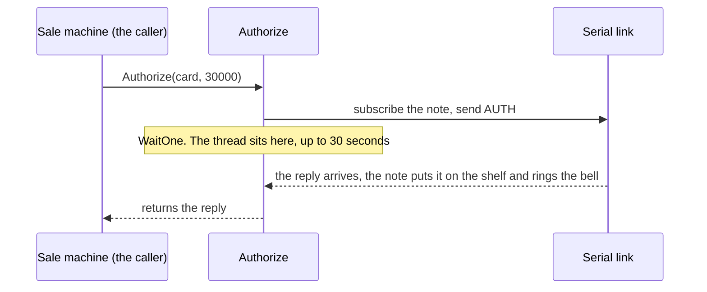
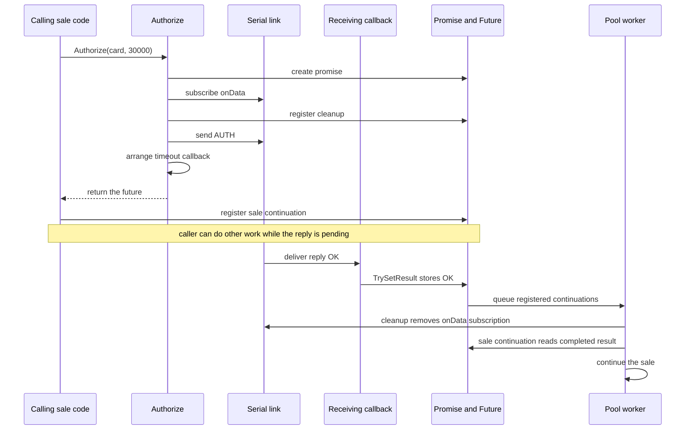
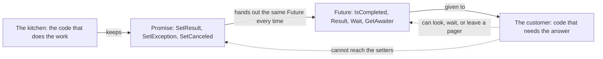
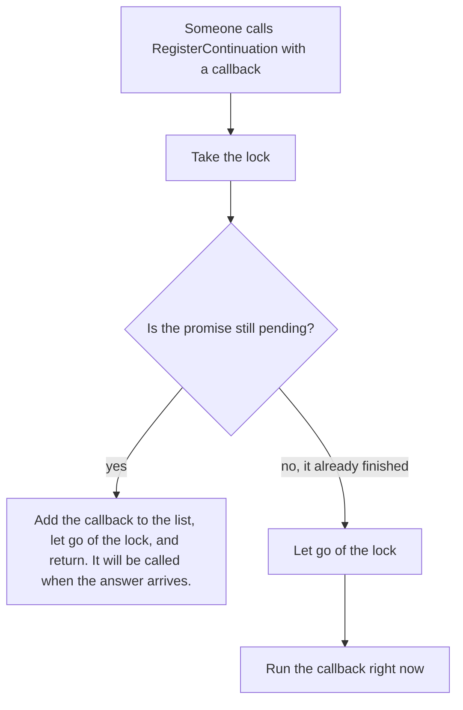
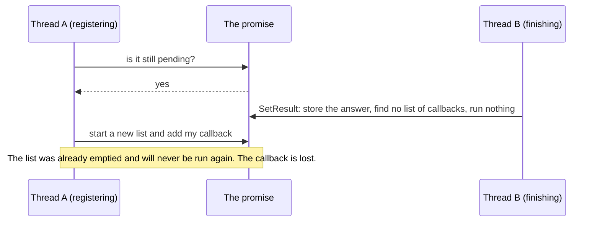
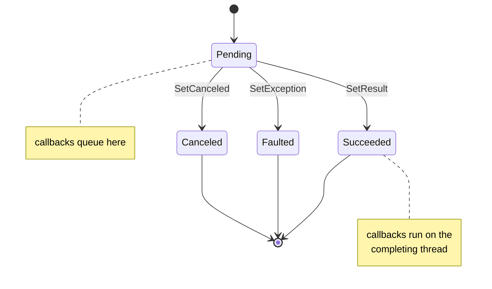

# 2. Callbacks and promises

## At the table

Dee came by and asked if they wanted the second basket, and Kevin said "let's see how this goes," and Dee said "that's a yes" and wrote nothing down. Steve got a refill. Kevin wiped his hands on napkin number two, which was clean, and moved napkin number one off to the side so he would not lose the four boxes.

"Show me your host call," Steve said. "The serial one."

Kevin opened the bag after all. He took out the laptop and turned it so Steve could see. The method was short. He had written it himself, in 2015, after the original one deadlocked a pump in Tulsa.

```csharp
public string Authorize(string card, int timeoutMs)
{
    string reply = null;

    // A reply callback can outlive this block, but using disposes arrived on exit.
    // The method does not coordinate disposal with callbacks still in progress.
    using (AutoResetEvent arrived = new AutoResetEvent(false))
    {
        // This receiving callback captures reply and arrived.
        Action<string> onData = delegate(string text)
        {
            reply = text;
            // A late callback can reach this line after arrived has been disposed.
            arrived.Set();
        };
        _link.DataReceived += onData;
        try
        {
            _link.Send("AUTH " + card);

            // The callback receives the reply, but the caller still blocks here.
            // Timing out ends this wait; the controller's request can still finish.
            if (!arrived.WaitOne(timeoutMs, false)) return "TIMEOUT";
            return reply;
        }
        finally
        {
            // Unsubscribe, but a callback already in progress can keep running.
            // It may still call arrived.Set() after this method leaves using.
            _link.DataReceived -= onData;
        }
    }
}
```

"That's not bad," Steve said again. Waving a hand to pass over the laptop to himself,
Steve said, "Let me show you something with some comments," and started typing away.

"You keep saying my code isn't bad, but you want to comment it?"

"It's not bad. I'm just helping you look at what you built, though," as fingers flew over the keyboard.

The copy below adds bakery labels to the same method. Its blocking wait and cleanup race are still there.

When he finished, Steve turned the laptop around and placed a salt shaker and the sugar caddy in front of Kevin. "Pretend the bank is a bakery in the back, and you've put in an order for a cake. Your variable `reply` is a shelf by the register. One spot, and when the cake is done, the baker sets it there. That's all `reply` is: a place to set the answer down."

He pushed the sugar caddy forward. "`arrived` is the pickup bell on the counter. The baker puts the cake on the shelf, then rings the bell. The shelf holds the answer. The bell signals that it's ready. In your code, the receiving callback does both jobs: it stores `reply`, then calls `arrived.Set()`."

"One difference from a real bell," Steve added. "This signal is remembered until a waiting thread consumes it. If the reply arrives before `WaitOne`, the thread can still collect the signal."

```csharp
public string Authorize(string card, int timeoutMs)
{
    // The empty pickup shelf: this variable will hold the bank's reply.
    string reply = null;

    // The pickup bell is a ready signal, separate from the reply itself.
    // false means no reply has been signaled yet.
    // 'using' disposes the ready signal when this block exits.
    // It does not control the delegate's lifetime or wait for callbacks to finish.
    using (AutoResetEvent arrived = new AutoResetEvent(false))
    {
        // Define the receiving callback now. The link calls it when a reply arrives.
        Action<string> onData = delegate(string text)
        {
            reply = text;   // Put the delivered answer on the pickup shelf.
            arrived.Set();  // Signal that the answer is ready, after storing it.
        };

        // Register the receiving callback before sending the request.
        // Otherwise, a fast reply could arrive before anyone is listening.
        _link.DataReceived += onData;
        try
        {
            // Place the order: ask the controller to authorize this card.
            _link.Send("AUTH " + card);

            // The calling thread waits at the counter until signaled or timed out.
            // The link calls onData when a reply arrives. WaitOne does not call it.
            // If Set ran first, the event remembers it; WaitOne consumes that signal.
            if (!arrived.WaitOne(timeoutMs, false)) return "TIMEOUT";

            // Collect the answer the receiving callback left on the shelf.
            return reply;
        }
        finally
        {
            // Remove the callback subscription on success, timeout, or error.
            // This does not cancel the request already sent to the controller.
            _link.DataReceived -= onData;
        }
    }   // using releases the event's operating-system resources as we leave.
}
```

## Kevin's method, one line at a time

Kevin's method sends a request, waits for a reply, then returns a string. The thread that calls it stays inside `WaitOne` during the wait. This shortened example shows that wait; production code also needs to handle late replies and cleanup races.

1. `string reply = null;` The shelf. A variable that starts empty. The answer will be set here.
2. `new AutoResetEvent(false)` The doorbell. An **event** is a signal that one thread can sleep on until another thread rings it. `false` means "starts un-rung." `using` means "throw the doorbell away when we are done," because a doorbell like this is a real object the operating system has to keep track of.
3. `onData = delegate(string text) { reply = text; arrived.Set(); }` defines a callback. When the link raises its data event, this code stores the text in `reply`, then signals `arrived`. The link decides which thread calls it.
4. `_link.DataReceived += onData;` Hand the note to the serial line so it knows who to tell. `+=` means "add me to the list of people who want to hear about this."
5. `_link.Send("AUTH " + card);` Send the question out the wire. This does not wait for an answer.
6. `arrived.WaitOne(timeoutMs, false)` Sit on the stool. The thread sleeps here until the bell rings or time runs out. It gives back `true` if the bell rang, and `false` if it timed out. (The `false` argument is an old setting you can ignore.)
7. `finally { _link.DataReceived -= onData; }` removes the event handler on success, timeout, or error. Removing it stops future notifications. A handler already running may still finish, so real code must coordinate that handler with disposal of `arrived`.

Here is the same story as a picture, with the caller on the left, the serial link in the middle, and the answer coming back. Look for where the thread is when nothing is happening.



**In words:**

1. The sale machine calls `Authorize` and hands over the card and a time limit.
2. `Authorize` gives the serial link its note and sends the question out the wire.
3. Now `Authorize` calls `WaitOne` and the thread goes to sleep. Nothing else can use this thread. If the controller never answers, it sleeps until the timeout.
4. The reply arrives. The note runs, sets the shelf, and rings the bell. The thread wakes.
5. `Authorize` returns the reply to the sale machine.


## Let the receiving callback supply the answer

Kevin traced the long wait in the diagram. "The receiving callback already has the reply. Why does my method need a thread waiting for it?"

"Because `Authorize` promises to return a string," Steve said. "It can't return that string until the reply arrives or the timeout expires. Change the return type to `IFuture<string>`. Then it can hand back a way to read the answer later."

"The pickup ticket instead of the cake?"

"Right. We keep a promise for the reply and give the caller its future. The receiving callback puts the reply in the promise. The sale code registers a continuation to read it. The calling thread can do other work while the reply is pending."

"And the bell?"

"We can remove the event and `WaitOne`. The promise holds the result and arranges for continuations to run. There's no event to dispose while a late receiving callback is still using it. We still unsubscribe that callback when the operation ends."

Steve moved the sugar caddy aside and typed another version.

```csharp
public IFuture<string> Authorize(string card, int timeoutMs)
{
    // Keep the answer on the shelf, without an event for a thread to wait on.
    Promise<string> reply = new Promise<string>(
        PromiseOptions.RunContinuationsAsynchronously);

    // The receiving callback stores the bank's reply. It does not wait.
    Action<string> onData = delegate(string text)
    {
        reply.TrySetResult(text);
    };
    _link.DataReceived += onData;

    // Register cleanup before sending: the reply could arrive during Send.
    reply.Future.ContinueOnAnyThread().OnCompleted(delegate
    {
        _link.DataReceived -= onData;
    });

    try
    {
        _link.Send("AUTH " + card);

        // A timer competes with the reply. No worker sleeps through this delay.
        IFuture timeout = Futures.Delay(timeoutMs);
        timeout.ContinueOnAnyThread().OnCompleted(delegate
        {
            reply.TrySetResult("TIMEOUT");
        });
    }
    catch (Exception error)
    {
        // A send or timer-setup error also completes the future.
        reply.TrySetException(error);
    }

    // Hand back the pickup ticket now. The result may still be pending.
    return reply.Future;
}
```

"There are two callbacks that can finish this promise," Steve said. "The receiving callback tries to store the reply. The timeout callback tries to store `TIMEOUT`. `TrySetResult` lets the first completion win. The other call returns `false` and leaves the answer alone."

"What runs when one of them wins?"

"The continuations registered through the future. We registered cleanup first, so it removes the receiving callback's subscription. The sale code can register another continuation that reads the outcome. We chose the queue option to run these saved continuations on the pool."

**What changed:** `Authorize` now returns a future instead of blocking for a string. `OnCompleted` registers code to call later. `ContinueOnAnyThread` lets that continuation run without returning to a captured display thread; chapter 5 covers that choice. This version uses ordinary callbacks, without `yield` or a state machine written by the reader.

The caller must change too. This console example registers the sale's next step and then carries on:

```csharp
IFuture<string> authorization = Authorize(card, 30000);
authorization.ContinueOnAnyThread().OnCompleted(delegate
{
    if (authorization.IsFaulted)
    {
        Console.WriteLine("Authorization failed: " + authorization.Exception.Message);
        return;
    }
    // Completion has happened, so reading Result here does not wait.
    Console.WriteLine("Authorization reply: " + authorization.Result);
});
Console.WriteLine("The caller can do other work while the reply is pending.");
```

A fast reply can complete before the caller registers its continuation. In this library, registration then calls the continuation immediately. Otherwise, it runs after completion. The caller must allow either order. Calling `authorization.Result` before completion would block the caller again.

This example expects a finite, nonnegative timeout supported by `Futures.Delay`. As in Kevin's version, that timeout starts after `Send` returns. `Send` itself still needs to return promptly. A successful reply leaves the timeout scheduled; its later completion attempt is harmless because `TrySetResult` refuses a second answer.

Unsubscribing still cannot stop a receiving callback already in progress. That callback can safely try to complete this promise: there is no disposed event to signal. Timeout does not cancel the bank request. The example assumes the serial link delivers the reply for this one request. A real link must also match replies to requests before allowing another authorization to start.

### The same request, without a blocked caller

The diagram follows a reply that arrives after the caller registers its continuation. The timer is the competing completion path described in the code.



**In words:**

1. `Authorize` creates the promise, registers cleanup, sends the request, and sets up the timeout callback.
2. It returns the future without waiting for the reply. The caller registers its sale continuation and can do other work.
3. The serial link delivers the reply to the receiving callback, which stores it in the promise.
4. Completing the promise queues its registered continuations. A pool worker runs cleanup, then the sale continuation reads the result.
5. If the timeout wins instead, the same continuations run, but the sale reads `TIMEOUT`.

The caller no longer holds a thread waiting for this reply. The serial link may still need its own reader thread to receive bytes. Continuations also need a thread while they run.

"So I still have code running when the answer comes," Kevin said. "I just don't keep the calling thread asleep until then."

"Right. Now let's look inside the promise that makes that work."

Open `src/MMP.AsyncProxy/Core/Promise{T}.cs` to follow the promise code.

## Two halves of one object

A `Promise<T>` comes with a partner. Think of the pickup window again.

- The **promise** is the kitchen's half. It has `SetResult`, `SetException`, and `SetCanceled`: ways to say "here is the answer," "it broke," and "it was cancelled." You keep this one.
- The **future** is the customer's half. It is a separate sealed `Future<T>` that holds the promise and forwards the read members: `IsCompleted`, `Result`, `Wait`, `GetAwaiter`. You give this one away.



**In words:**

1. The kitchen (the code that does the work) creates a promise and keeps it.
2. The promise gives out a future. It is the same one every time, so two people comparing futures find out they are looking at the same one.
3. The future is handed to whoever needs the answer: the customer.
4. The customer can look at the future, wait on it, or leave a pager (a callback) on it.
5. The customer cannot get from the future back to the promise's setters. There is no cast that does it.


A **cast** asks C# to treat an object as another type. The future and promise are separate objects. Casting the future cannot turn it into the promise that created it. The future's public methods let the caller read or wait for the result; they provide no setter. This separation costs one extra object per promise.

This keeps the decision about completion with the code doing the work. A caller waiting for authorization can observe the answer, but it cannot approve its own sale by setting that answer. `TaskCompletionSource` and `Task` use the same split in .NET 4.

## The one thing a promise does

A pending promise stores callbacks in a list. Completing the promise makes those callbacks ready to run. This shortened excerpt shows registration; the source also creates the list on its first use.

```csharp
internal void RegisterContinuation(Action continuation)
{
    lock (_gate)
    {
        if (_status == FutureStatus.Pending)
        {
            _continuations.Add(continuation);   // not done yet, remember it
            return;
        }
    }
    continuation();                             // already done, run it now
}
```

**Read it like this.** Somebody says "here is my callback." There are two cases.

- *The answer isn't on the shelf yet* (`Pending`). Write the callback on the list, and leave. It will be called later.
- *The answer is already there.* Don't bother with the list. Run the callback right now.

Suppose Kevin registers a callback before the reply arrives. `RegisterContinuation` adds it to the list and returns. Later, `Complete` takes that list and calls the callback. If the reply arrived first, registration calls the callback immediately instead. Both orders must work: a fast reply can arrive before the caller registers.

A **lock** lets one thread at a time enter code guarded by the same lock object. Both registration and completion use `_gate`. While registration checks the status and adds a callback, completion must wait. That closes the gap shown below.



**In words:**

1. Someone gives the promise a callback.
2. The promise takes its lock so nobody else can change its state for a moment.
3. It checks: is the answer on the shelf yet?
4. If the promise is pending, it stores the callback, releases the lock, and returns.
5. If the answer is already there, the promise lets go of the lock and runs the callback on the spot.


### The race the lock prevents

Here is the bug, as a timeline of two threads. Thread A is registering a callback. Thread B is finishing the promise. Pretend there is **no lock**.



**In words:**

1. Thread A asks the promise whether it is still pending. The answer is yes, so A decides to add its callback to the list.
2. Before A gets to do that, thread B finishes the promise. B stores the answer and looks for waiting callbacks. There are none yet, because A has not added anything (the real code makes the list only when the first callback arrives). B runs nothing and leaves.
3. Now A starts a new list and adds its callback. The promise is already finished, and nobody will ever look at that list again. The callback never runs, and whoever was waiting waits forever.

**With the lock,** A takes the lock before step 1 and keeps it until its callback is on the list. B's `SetResult` can't start until A is done, so B finds the callback on the list and runs it. Or B goes first, and then A finds the promise already finished and runs its own callback right away. Either order, the callback runs exactly once.


## Completion, in order

```csharp
private bool Complete(FutureStatus status, T result, Exception exception)
{
    List<Action> toRun;
    lock (_gate)
    {
        if (_status != FutureStatus.Pending) return false;   // first one wins
        _status = status; _result = result; _exception = exception;
        toRun = _continuations; _continuations = null;
    }
    if (toRun != null) foreach (var c in toRun) c();         // outside the lock
    return true;
}
```

**Read it like this.** `Complete` takes `_gate` and checks `_status`. If another call already finished the promise, it returns `false`. Otherwise it stores the final status, value, and error. It moves the callback list into `toRun` and clears `_continuations`. After releasing the lock, it calls the saved callbacks. This excerpt shows the default behavior; the full source also wakes blocking waiters and supports queuing callbacks to the pool.

### An example, one step at a time

Take Kevin's serial reply. Two pieces of code are waiting for it. The sale machine wants to arm the pump when the answer is "OK". The display wants to show "Approved". Each one handed the promise a callback, so the promise's list holds both. Suppose the link delivers the bank's answer just as the 30-second timeout expires. The next example shows which completion wins. Its callbacks are placeholders for approved-result handling, rather than safe pump-control code. A real callback must read the completed result and handle cancellation or failure before it enables fuel or displays approval.

```csharp
Promise<string> reply = new Promise<string>();
reply.Future.GetAwaiter().OnCompleted(() => ArmThePump());      // callback A: the sale machine
reply.Future.GetAwaiter().OnCompleted(() => ShowApproved());    // callback B: the display

// On the UART thread, the answer arrives:
bool first = reply.TrySetResult("OK");        // this call runs Complete(...)
// Almost at once, on the timer thread, the timeout fires:
bool second = reply.TrySetCanceled();         // this call runs Complete(...) too
```

Here is what the promise looks like at each moment. Read down the table, one row at a time.

| Moment | `_status` | `_result` | `_continuations` | What is happening |
|---|---|---|---|---|
| Before anything | Pending | nothing | [A, B] | Both callbacks are waiting. The shelf is empty. |
| UART thread enters `Complete`, takes the lock | Pending | nothing | [A, B] | Still pending, so it is allowed to finish the promise. |
| Inside the lock, writing | Succeeded | "OK" | [A, B] | The answer is on the shelf. The status says so. |
| Inside the lock, taking the list | Succeeded | "OK" | empty (`null`) | `toRun` now holds [A, B]. The promise's own list is cleared. |
| Lock released | Succeeded | "OK" | empty | From here on, any other thread can look at the promise. |
| Timer thread enters `Complete` | Succeeded | "OK" | empty | It takes the lock and sees the status is not Pending. It returns `false` and changes nothing. `second` is `false`. |
| UART thread runs `toRun` | Succeeded | "OK" | empty | A runs (`ArmThePump`), then B runs (`ShowApproved`). Then `Complete` returns `true`. `first` is `true`. |

In this ordering, the reply wins. The timeout call returns `false` because the promise already holds "OK". If cancellation took the lock first, the promise would stay canceled and both callbacks would still be called. Completion means the operation ended; the callback must check how it ended.

1. **First completion wins.** `TrySetResult` returns `true` when it changes the promise from pending to complete. A later `TrySetCanceled` returns `false` and leaves that result alone. The `SetResult` version throws `InvalidOperationException` if the promise already completed. Use the `Try` methods when two expected events, such as a reply and timeout, compete to finish one promise.
2. **The callbacks run outside the lock.** A callback might complete another promise, which takes another lock. Hold yours while that happens and you have built a deadlock kit. (A **deadlock** is when two things each wait for the other forever.) Here is how it would go if `Complete` ran the callbacks *inside* the lock. Say callback A, running under promise `reply`'s lock, finishes a second promise `other`, and `other`'s own callback tries to finish `reply`:

   | Thread 1 | Thread 2 |
   |---|---|
   | finishes `reply`: holds `reply`'s lock, runs A | finishes `other`: holds `other`'s lock, runs its callback |
   | A tries to finish `other`: needs `other`'s lock, waits | the callback tries to finish `reply`: needs `reply`'s lock, waits |
   | both are waiting for a lock the other one holds, and neither lets go | |

   Releasing `_gate` before calling user code prevents this lock cycle inside the promise. A caller may still hold some other lock when it completes a promise, so its callbacks need care too.
3. **The default promise calls its stored callbacks on the completing thread.** The direct callback runs before `SetResult` returns. An awaiter may instead post the user's continuation to a captured display context. The console example below assumes there is no such context or registered post target. In the example, `ArmThePump` and `ShowApproved` ran on the UART thread, the one that called `TrySetResult`. You can see it for yourself (in a console program, which has no synchronization context. Chapter 5 explains when that matters):

   ```csharp
   reply.Future.GetAwaiter().OnCompleted(() => Console.WriteLine("callback ran on thread " + Thread.CurrentThread.ManagedThreadId));
   Console.WriteLine("completing on thread " + Thread.CurrentThread.ManagedThreadId);
   reply.SetResult("OK");
   Console.WriteLine("SetResult has returned");
   // Example output:
   //   completing on thread 1
   //   callback ran on thread 1     <- printed before SetResult returned, on the same thread
   //   SetResult has returned
   ```

   A callback may complete another promise, which calls another callback before returning. A long chain like that grows the call stack. Also, this implementation lets a callback exception escape the completion call, which can prevent later callbacks in the saved list from running. The examples assume callbacks finish normally.

That third one has an off switch. When the completing thread needs to return quickly or may hold another lock, create the promise with this option:

```csharp
Promise<string> reply = new Promise<string>(PromiseOptions.RunContinuationsAsynchronously);
```

**Read it like this.** On completion, the promise queues its saved callbacks to the thread pool. A free worker calls them. This keeps that work off the serial reader's thread. A managed serial callback is different from the hardware interrupt that first receives the bytes.

The option applies to callbacks saved before completion. A callback registered after completion runs immediately on the registering thread. A captured context may then post the user's code elsewhere. Chapter 5 explains that step.

## Wait, for when you must

`Wait()` blocks the calling thread until the future completes. If the future is pending, the first wait creates a `ManualResetEvent`, a signal that stays set after completion. A completed future returns from `Wait()` immediately. Blocking can be useful at the end of a console program or in a test. Inside asynchronous code, it ties up the thread again.

## State diagram



**In words:**

1. Every promise starts at the black dot and is `Pending`: the shelf is empty.
2. While it is pending, callbacks that arrive are added to the list. This is what the note on `Pending` means.
3. Exactly one of three things then happens: `SetResult` (it worked: `Succeeded`), `SetException` (it broke: `Faulted`), or `SetCanceled` (somebody gave up: `Canceled`).
4. By default, completion calls saved callbacks on the completing thread. The note shows that default for `Succeeded`; it also applies to failure and cancellation. The asynchronous option described above queues them instead.
5. Each of the three end states goes to the black dot on the right. That is the end. There are no arrows leading out of an end state.


## Try it

```csharp
var promise = new Promise<string>();
IFuture<string> future = promise.Future;

future.GetAwaiter().OnCompleted(() => Console.WriteLine("got " + future.Result));
Console.WriteLine("registered");

promise.SetResult("hello");       // "got hello" prints here, on this thread
```

That prints `registered`, then `got hello`. Now shuffle the lines and predict the output before you run it.

| Order | What prints | Why |
|---|---|---|
| Register, print `registered`, `SetResult` (as above) | `registered`, then `got hello` | The callback waits on the list. `SetResult` runs it, on this thread, before it returns. |
| Register, `SetResult`, print `registered` (swap the last two lines) | `got hello`, then `registered` | The callback is on the list, and `SetResult` runs it right there before the next line. |
| `SetResult`, register, print `registered` | `got hello`, then `registered` | The answer was already on the shelf, so the callback runs at the moment you register it. |

These rows all run on one thread. What changes is when the callback runs: during completion in the first two rows, during registration in the last. The caller must handle either order.

## Words you just met

| Word | In plain words | The picture |
|---|---|---|
| **Callback** (also called a **continuation**) | Code you hand over to be run when something finishes | The pager |
| **Promise** | The half you keep: the only one that can set the answer, once | The kitchen's side of the pickup window |
| **Future** | The half you give away: can look, wait, or leave a callback, but not set the answer | The customer's side of the pickup window |
| **`reply` and `arrived`** | A variable for the answer and an event that says it is ready | The shelf and the doorbell |
| **Event** (`AutoResetEvent`) | A signal one thread sleeps on until another rings it | The doorbell |
| **Lock** | A rule that lets only one thread into a piece of code at a time | The one-key bathroom |
| **Deadlock** | Two things each waiting for the other forever | Two people stuck in a doorway, each insisting the other go first |
| **`TaskCompletionSource` / `Task`** | The .NET 4 names for Promise and Future | Same window, different sign |
