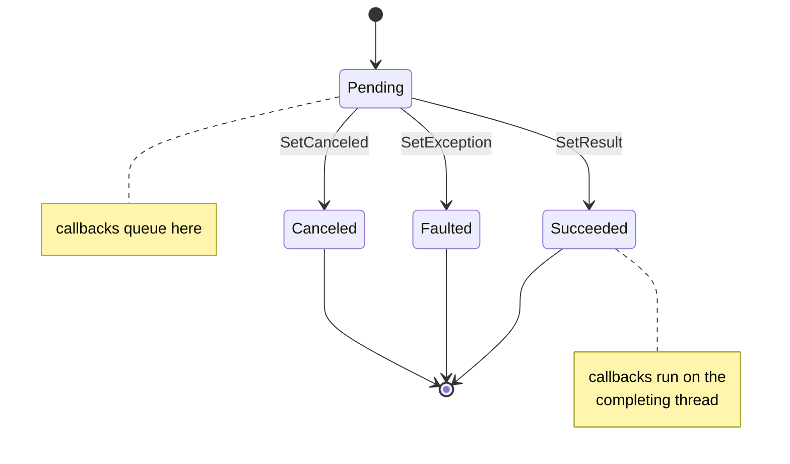

# 2. Callbacks and promises

Open `src/MMP.AsyncProxy/Core/Promise{T}.cs`. That file is the whole chapter.

## Two halves of one object

A `Promise<T>` is one object with two faces.

- The **promise** face has `SetResult`, `SetException`, `SetCanceled`. You keep this one.
- The **future** face is `IFuture<T>`. It has `IsCompleted`, `Result`, `Wait`, `GetAwaiter`. You give this one away.

Same object. The `Future` property returns `this`, typed as the interface. The caller gets a reference they can await, and the compiler will not let them call `SetResult` on it.

Why bother? Because the moment a caller can complete your work, your work is no longer yours. Someone, somewhere, will "fix" a timeout by calling `SetResult` on a future they did not own, and the real result will arrive later into a promise that is already closed. This is the `Task` and `TaskCompletionSource` split in .NET 4, and it is there for the same reason. Toub makes the point at 27:05.

## The one thing a promise does

Strip away the getters and it does one thing: it holds a list of callbacks, and runs them when it completes.

```csharp
internal void RegisterContinuation(Action continuation)
{
    lock (_gate)
    {
        if (_status == FutureStatus.Pending)
        {
            _continuations.Add(continuation);   // not done yet, remember it
            return;
        }
    }
    continuation();                             // already done, run it now
}
```

Two cases, and the lock closes the gap between them. Without the lock, a completion could land between "is it pending?" and "add to the list", and that callback would never run. That is the kind of bug that shows up once a week in production and never in a test.

## Completion, in order

```csharp
private bool Complete(FutureStatus status, T result, Exception exception)
{
    List<Action> toRun;
    lock (_gate)
    {
        if (_status != FutureStatus.Pending) return false;   // first one wins
        _status = status; _result = result; _exception = exception;
        toRun = _continuations; _continuations = null;
    }
    if (toRun != null) foreach (var c in toRun) c();         // outside the lock
    return true;
}
```

Three things to notice.

1. **First completion wins.** The second `SetResult` returns false. `TrySetResult` lets you ask politely. `SetResult` throws if you lose.
2. **The callbacks run outside the lock.** A callback might complete another promise, which takes another lock. Hold yours while that happens and you have built a deadlock kit.
3. **The callbacks run on the completing thread.** Whoever calls `SetResult` runs every continuation right there, before `SetResult` returns. That is how `TaskCompletionSource` works by default too. It means a long chain of synchronous completions grows the stack. We live with it for now; it is on the plan.

## Wait, for when you must

`Wait()` makes a `ManualResetEvent` on first use and blocks on it. It is there for the top of a console program and for tests. Every time you call it from inside async code, you have put a thread back to sleep, and chapter 1 happens again.

## State diagram



One move. Never back. That is what makes it safe to read the status without a lock after you have seen it complete once.

## Try it

```csharp
var promise = new Promise<string>();
IFuture<string> future = promise.Future;

future.GetAwaiter().OnCompleted(() => Console.WriteLine("got " + future.Result));
Console.WriteLine("registered");

promise.SetResult("hello");       // "got hello" prints here, on this thread
```

Swap the last two statements and "got hello" prints first, because the callback runs at registration. Same code, same result, different thread timing. That is the property await depends on.
