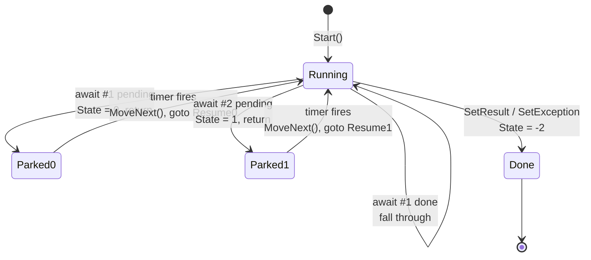

# 3. The state machine

This is the chapter. If you only read one, read this one with `samples/MMP.AsyncProxy.Samples/AddAfterDelay.cs` open beside it.

## The method we want

```csharp
async IFuture<int> AddAfterDelayAsync(int a, int b)
{
    await Futures.Delay(10);
    int sum = a + b;
    await Futures.Delay(10);
    return sum * 2;
}
```

Two awaits. One local that lives across the second one. One return. Simple enough that we can hold the whole transform in our heads.

## The problem the compiler solves

When a method hits `await` and the thing is not ready, the method has to return. That is the whole point: give the thread back. But returning destroys the stack frame. `a`, `b`, `sum`, and "I was on line 4" are all gone.

So the compiler moves everything that has to survive off the stack and into a heap object. Parameters become fields. Locals that cross an await become fields. "Where was I" becomes an `int` field called `State`. The method body becomes a `MoveNext()` method on that object, and it opens with a `switch (State)` that jumps back to wherever it left off.

## The shape

```csharp
internal sealed class AddAfterDelayMachine : IAsyncStateMachine
{
    public int State;                       // -1 running, -2 done, 0.. parked at await N
    public AsyncMethodBuilder<int> Builder; // the thing that owns the result future
    public int A, B, DelayMs;               // parameters, hoisted
    private int _sum;                       // local that crosses await #2, hoisted
    private IAwaiter _awaiter;              // what we are parked on
```

Everything the method needs, as fields. The public stub builds one, sets the fields, starts it, returns the future:

```csharp
public static IFuture<int> RunAsync(int a, int b, int delayMs)
{
    var machine = new AddAfterDelayMachine { A = a, B = b, DelayMs = delayMs, State = -1 };
    machine.Builder = AsyncMethodBuilder<int>.Create();
    machine.Builder.Start(ref machine);    // runs MoveNext once, synchronously
    return machine.Builder.Future;
}
```

## MoveNext, one await at a time

```csharp
public void MoveNext()
{
    int result;
    try
    {
        IAwaiter awaiter;
        switch (State)
        {
            case 0: awaiter = _awaiter; _awaiter = null; State = -1; goto Resume0;
            case 1: awaiter = _awaiter; _awaiter = null; State = -1; goto Resume1;
        }
```

First call, `State` is -1, neither case matches, we fall through to the top of the method body.

```csharp
        awaiter = Futures.Delay(DelayMs).GetAwaiter();
        if (!awaiter.IsCompleted)
        {
            State = 0;                                   // remember: parked at await 0
            _awaiter = awaiter;                          // remember what we are parked on
            var self = this;
            Builder.AwaitOnCompleted(ref awaiter, ref self); // "call MoveNext when done"
            return;                                      // the thread leaves
        }
    Resume0:
        awaiter.GetResult();                             // throws if the delay faulted
```

Read that `return` slowly. That is the thread walking away. The method is "running" in the sense that the machine object exists on the heap with `State = 0`. No thread is inside it. Nothing is blocked.

Ten milliseconds later a timer fires. A pool thread calls `MoveNext()`. `State` is 0, so we jump to `Resume0`, call `GetResult()` on the awaiter we stashed, and carry on with the next line of the original method as if nothing happened.

```csharp
        _sum = A + B;

        awaiter = Futures.Delay(DelayMs).GetAwaiter();
        if (!awaiter.IsCompleted) { State = 1; _awaiter = awaiter; var self = this; Builder.AwaitOnCompleted(ref awaiter, ref self); return; }
    Resume1:
        awaiter.GetResult();

        result = _sum * 2;
    }
```

Same dance for the second await. `sum` went into `_sum` because the thread that computed it and the thread that reads it may be different threads with different stacks.

## The two exits

```csharp
    catch (Exception ex)
    {
        State = -2;
        Builder.SetException(ex);   // the fault goes into the future
        return;
    }
    State = -2;
    Builder.SetResult(result);      // the value goes into the future
}
```

Nothing escapes `MoveNext`. A throw anywhere in the body, in any state, lands in the catch and becomes the future's fault. The caller sees it when they call `GetResult` on their own awaiter. That is why an exception thrown inside an `async` method shows up at the `await` in the caller and not at the call.

## The fast path

Look at `if (!awaiter.IsCompleted)` again. When the awaited thing is already done, we skip the whole park-and-return and fall straight through to `Resume0` on the same thread. No callback, no thread hop. An `async` method that never hits a pending await runs fully synchronously. That is why `await Task.FromResult(x)` costs almost nothing.

## State diagram



## What the real compiler does differently

Three things, and none of them change the idea.

1. It makes the machine a `struct` in Release, to avoid an allocation when the method completes synchronously. On the first real suspend it boxes the struct, and `SetStateMachine` is how the builder learns which box to call back. Ours is a class, so `SetStateMachine` is empty. Toub discusses the trade at 63:11.
2. It generates ugly names: `<>1__state`, `<>t__builder`, `<a>5__1`. Decompile any async method with ilspycmd and you will see the same fields with worse names.
3. It handles `await` inside `try`/`finally`, inside loops, inside `using`. The transform is the same; the goto targets get more interesting.

Decompile one and diff it against our sample. The shapes line up field for field. That is the whole claim of this repo.
