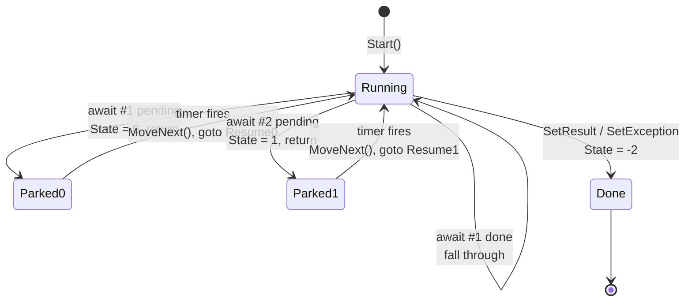

# 3. The state machine

## At the table

The wings were about half gone. Dee had already been by twice: once to top off Kevin's sweet tea without being asked, once to look at the wreckage of napkins on the table and say, "Y'all want me to bring a bigger napkin, or a whiteboard?"

"Napkins are fine," Steve told her. "They're cheap and they don't need a marker."

Kevin was on napkin number four. Napkin one was the four threads. Number two was a drawing of a pager that Steve had made him copy, and number three was a list of everything the serial thread touched. Now he was staring at the stack and frowning, and Steve could tell the frown was a good one. It was the frown of a guy who had found the hole in the plan.

"Okay," Kevin said. "I get the pickup window. The promise fills, and the window buzzes the next guy. Fine. But the next guy is the middle of a method. My pulser loop is a `while` with a sleep in it. If the thread leaves at the sleep, the loop's gone. The ceiling's gone. It's a local."

"We have to save the local before the thread leaves, buddy."

"The method returns. What happens to the locals on its stack?"

"Right. You know what a stack is, in plain words?"

"It's where the locals live. While the method runs."

"When a method call returns, its stack space can be reused," Steve said. He set his wing down. "So anything needed after the wait must be saved elsewhere. The compiler makes an object with fields for those values and a number for the next step."

"An object?"

"An object on the heap. It stays available while something holds a reference to it, even after the original method call returns." Steve licked sauce off his thumb. "So the parameters go in the box. Every local that has to live past the wait goes in the box. And one more thing goes in: a note that says where you were. An `int`. Step one, step two. A bookmark."

"A bookmark in what?"

"In the method. Think of the method as a recipe. Stir, wait ten minutes, add the eggs, wait ten minutes, bake. When you hit 'wait ten minutes,' you don't stand over the pot. You write on a sticky note, 'I'm at step two, here's the bowl of flour I measured,' stick it in the book, close the book, and go watch TV. When the kitchen timer dings, anybody can walk in, open the book to the bookmark, read the sticky note, and keep cooking. They don't need to be you. They don't even need to be the same person."

"And the code that does the picking-up?"

"One method on the box. `MoveNext`. It means 'open the book at the bookmark and do the next piece.' The first thing it does is look at the bookmark and jump to the right spot. A `switch` on the int."

Kevin grabbed the napkin and pulled the pen out of his shirt pocket. "That sounds awful to write."

"It's awful to write. I wrote one so you can see it. Sixty lines for a method that's four lines with `await`. You're never going to write one by hand, and neither am I. Chapter 7 is the cheat. But if you don't see one of these once, buddy, the cheat is magic. And I don't ship magic to a pump."

"Dale would have a stroke if I told him it was magic."

"Dale should have a stroke if you told him it was magic."

Kevin drew a box. He wrote three things in it: `ceiling`, `pulser`, `state`. He looked at it for a while.

"So my pulser loop turns into this. A little box with three things in it. And somebody calls `MoveNext` on it every fifty milliseconds."

"The delay's callback does. Between calls, the box sits on the shelf. Its size depends on the fields we save. The method keeps that box while the thread does other work."

"Just the box."

"Versus a 64K stack, a kernel object, and the work of waking that thread. Yeah."

"I'm not gonna lie," Kevin said, "that's a good trade."

"It's the best trade in the building." Steve slid the sauce cup out of the way. "Okay. Open the sample. We're going to read the box together, line by line."

Open `samples/MMP.AsyncProxy.Samples/AddAfterDelay.cs` beside this chapter. It contains the hand-written state machine we will follow.

## The method we want

This is the method we want to express. It shows the idea using `async` and `await`, which Kevin's C# 3 compiler cannot compile. The hand-written class below performs these steps without those keywords.

```csharp
async IFuture<int> AddAfterDelayAsync(int a, int b)
{
    await Futures.Delay(10);
    int sum = a + b;
    await Futures.Delay(10);
    return sum * 2;
}
```

**Read it like this.** With `a = 3` and `b = 4`, wait at least ten milliseconds, then compute `sum = 7`. Wait again, then return `14`. The method must save `a` and `b` through the first wait, and `sum` through the second. In the hand-written version, `DelayMs` sets both waits; use `10` to match this example. The source file also rejects a negative `a` after the first wait; the excerpts here leave out that check.

## The problem the compiler solves

When an awaited operation is pending, this method saves its next step, registers a callback, and returns. The caller's thread can then do other work.

A **stack frame** is the space a method call uses on a thread's stack. It tracks that call and its local data. Returning releases the frame. To continue later, the method needs to save its data somewhere that outlives this call.

Our state machine saves that data in an object on the **heap**, the memory area used for objects. The object remains available while the callback holds a reference to it. Saving a local as a field is called **hoisting**. For example, the local `sum` becomes the field `_sum`.

- Parameters become fields.
- Locals that cross an `await` become fields.
- "Where was I" becomes an `int` field called `State`.
- The method body becomes a `MoveNext()` method on that object. It opens with a `switch (State)` that jumps back to wherever the method left off.

The box has a name: the **state machine**. It is a machine because it moves from one state to the next. Each state is a step the method can be parked at.

## Before, during, and after: where everything lives


**In words:**

1. `RunAsync` starts on the caller's thread. It copies `a` and `b` into the machine's fields before calling `MoveNext`. The drawing shows the general save-and-resume idea; our hand-written class creates its saved fields at the start.
2. The delay is not done yet, so the method has to leave. Before it does, everything it needs is already sitting in fields on the heap box: `A`, `B`, and the delay's awaiter. `State` is set to 0, the bookmark that says "I am parked at the first `await`".
3. `MoveNext` returns while the delay is pending. Its stack frame is released, and the machine stays on the heap. Other code can run on the thread during this wait.
4. Once the delay is due, a pool thread calls `MoveNext` again in this console example. The thread has its own active calls on its stack. It may be a different thread from the first call. A display context can change where resumption runs; chapter 5 covers that.
5. `MoveNext` reads `State`, sees 0, and jumps to the line after the first `await`. It finds `A` and `B` in the box, right where it left them.


## The saved fields

Here is the box. It is a class with fields. This one is hand-written, the way the compiler would write it.

```csharp
internal sealed class AddAfterDelayMachine : IAsyncStateMachine
{
    public int State;                       // -1 running, -2 done, 0.. parked at await N
    public AsyncMethodBuilder<int> Builder; // the thing that owns the result future
    public int A, B, DelayMs;               // parameters, hoisted
    private int _sum;                       // local that crosses await #2, hoisted
    private IAwaiter _awaiter;              // what we are parked on
```

**Read it like this.** `State` is the bookmark. `-1` means "a thread is running me right now". `-2` means "I am finished". `0` and `1` mean "I am parked at the first `await`" and "I am parked at the second one". `Builder` is a helper that owns the **future**, the read-only pickup window where the caller will find the answer (chapter 2). `A`, `B` and `DelayMs` are the parameters, moved off the stack. `_sum` is the one local that has to survive the second wait. `_awaiter` is whatever we are parked on: the thing that will tell us when it is done.

Everything the method needs is a field. The public stub builds one box, fills in the fields, starts it, and hands back the future:

```csharp
public static IFuture<int> RunAsync(int a, int b, int delayMs)
{
    var machine = new AddAfterDelayMachine { A = a, B = b, DelayMs = delayMs, State = -1 };
    machine.Builder = AsyncMethodBuilder<int>.Create();
    machine.Builder.Start(ref machine);    // runs MoveNext once, synchronously
    return machine.Builder.Future;
}
```

**Read it like this.** `RunAsync(3, 4, 10)` creates a machine with `A = 3`, `B = 4`, and `DelayMs = 10`. It sets `State = -1` for the first entry. The builder creates the future that will hold the final result. `Start` calls `MoveNext` on the caller's thread. After that call returns, `RunAsync` hands back the future, which may still be pending. Chapter 4 explains the builder.

## MoveNext, one await at a time

Here is the flow of `MoveNext` as a picture first, then the code.


**In words:**

1. Someone calls `MoveNext`. The first thing it does is look at `State`.
2. If `State` is `-1`, this is the first call. The method runs from the top and asks for the first delay's awaiter. If that delay is already finished, take the fast path and keep going on the same thread (the arrow straight to Resume0).
3. If it is not finished, `MoveNext` parks: it writes `State = 0`, saves the awaiter in a field, tells the builder "call me when this is done", and returns. The thread leaves. This is the end of this call.
4. If `State` is `0` or `1`, this is a resume. `MoveNext` jumps straight to the line after the `await` it was parked on, as if it had never left.
5. After the first wait finishes, the method computes `_sum = A + B`, then does the same dance for the second delay: either park again with `State = 1`, or fall through.
6. After the second wait finishes, it computes `sum * 2`, sets `State = -2`, and hands the answer to the builder, which fills the pickup window.


Now the same thing as code, one piece at a time.

```csharp
public void MoveNext()
{
    int result;
    try
    {
        IAwaiter awaiter;
        switch (State)
        {
            case 0: awaiter = _awaiter; _awaiter = null; State = -1; goto Resume0;
            case 1: awaiter = _awaiter; _awaiter = null; State = -1; goto Resume1;
        }
```

**Read it like this.** `switch (State)` is the bookmark check. For a resume (`0` or `1`), take back the awaiter we saved on the sticky note, clear the field, set `State = -1` ("a thread is running me again"), and `goto` the label for that spot. A `goto` is a jump: "go to the line labeled `Resume0` and carry on from there". For the first call, `State` is `-1`, no case matches, and we fall through to the top of the method body.

```csharp
        awaiter = Futures.Delay(DelayMs).GetAwaiter();
        if (!awaiter.IsCompleted)
        {
            State = 0;                                   // remember: parked at await 0
            _awaiter = awaiter;                          // remember what we are parked on
            var self = this;
            Builder.AwaitOnCompleted(ref awaiter, ref self); // "call MoveNext when done"
            return;                                      // the thread leaves
        }
    Resume0:
        awaiter.GetResult();                             // throws if the delay faulted
```

**Read it like this.**

1. `Futures.Delay(DelayMs)` schedules a delay and returns a future. With `DelayMs = 10`, it becomes due after ten milliseconds; scheduling may make the callback run later. `GetAwaiter()` returns a helper that can check completion and register the next step.
2. `if (!awaiter.IsCompleted)`: is the delay still running? If so, we have to park.
3. `State = 0` writes the bookmark. `_awaiter = awaiter` writes on the sticky note what we are waiting for.
4. `Builder.AwaitOnCompleted(...)` says "when this awaiter finishes, call `MoveNext` on me". It is the pager: leave your number, we will buzz you.
5. `return` ends this call to `MoveNext`. The operation remains pending with `State = 0`. The saved fields and callback keep the machine ready to resume. This delay holds no thread blocked.
6. `Resume0:` is the label we jump to when we come back. `awaiter.GetResult()` reads the answer. For a delay there is no answer, but if the delay had failed, this is the line that would throw.

When the first delay completes, the callback calls `MoveNext()` again. `State` is `0`, so the switch restores the saved awaiter and jumps to `Resume0`. `GetResult()` checks whether the delay succeeded. Then the machine can compute the sum.

```csharp
        _sum = A + B;

        awaiter = Futures.Delay(DelayMs).GetAwaiter();
        if (!awaiter.IsCompleted) { State = 1; _awaiter = awaiter; var self = this; Builder.AwaitOnCompleted(ref awaiter, ref self); return; }
    Resume1:
        awaiter.GetResult();

        result = _sum * 2;
    }
```

**Read it like this.** `_sum = A + B` is the line `int sum = a + b;` from the original method. It writes into a field instead of a local. The second delay is the same park-and-resume dance with `State = 1` and the label `Resume1`. After it, `result = _sum * 2` is the original `return sum * 2;`.

With `A = 3` and `B = 4`, `_sum` now holds `7`. The second wait saves `State = 1`. On the next call, the switch jumps to `Resume1`, and the saved `_sum` produces `14`. A field is needed even if the same thread resumes: the earlier call's local workspace was released when it returned.

## The two exits

```csharp
    catch (Exception ex)
    {
        State = -2;
        Builder.SetException(ex);   // the fault goes into the future
        return;
    }
    State = -2;
    Builder.SetResult(result);      // the value goes into the future
}
```

**Read it like this.** There are two ways out. If anything above threw, we land in `catch`, set `State = -2` ("finished"), and put the exception in the pickup window with `SetException`. If everything went fine, we set `State = -2` and put the answer in the window with `SetResult`. Either way the future gets completed, and whoever is holding it finds out.

The `try` covers the method's work across both resume points. If that work throws, `catch` stores the error in the result future. The caller then receives that error when it reads the completed future through `GetResult`. This describes errors in the method body; errors from setup or user completion callbacks are separate.

## The fast path

Look at `if (!awaiter.IsCompleted)` again. When the awaited thing is already done, we skip the whole park-and-return and fall straight through to `Resume0` on the same thread. No pager, no thread hop. Think of ordering a coffee that is already sitting on the counter: you grab it, you do not take a number.

If each awaited operation is already complete, this method runs to the end on the caller's thread. With `DelayMs = 0`, both delays are complete when checked, so `RunAsync(3, 4, 0)` returns a future already holding `14`.

## State diagram



**In words:**

1. `Start()` calls `MoveNext` once and the machine is **Running**. A thread is inside it, on the caller's stack.
2. At the first `await`, one of two things happens. If the delay is already done, the machine stays Running and falls through (the loop arrow on Running). If not, the machine moves to **Parked0**: `State = 0`, `return`, thread gone.
3. While Parked0, nothing runs. The machine is a box on the heap waiting for the timer.
4. The timer fires. A pool thread calls `MoveNext`, and the machine goes back to **Running**, jumping to `Resume0`.
5. The same happens at the second `await`, with **Parked1** and `State = 1`.
6. When the method finishes, or throws, the machine goes to **Done**. `State = -2`, and the future is completed.


## What the real compiler does differently

The compiler uses the same save-and-resume approach, with these differences.

1. It makes the machine a **`struct`** in Release, to avoid an allocation when the method completes synchronously. (A `struct` lives inside whatever holds it. A `class`, like ours, gets its own box on the heap.) On the first real suspend it boxes the struct, and `SetStateMachine` is how the builder learns which box to call back. Ours is a class, so `SetStateMachine` is empty. Toub discusses the trade at 63:11.
2. It generates ugly names: `<>1__state`, `<>t__builder`, `<a>5__1`. Decompile any async method with ilspycmd and you will see the same fields with worse names. The number the compiler adds to a name just keeps names from colliding.
3. It handles `await` inside `try`/`finally`, inside loops, inside `using`. The transform is the same; the goto targets get more interesting.

To compare the two, decompile a small `async` method and find its state field, saved locals, builder, and `MoveNext`. The exact fields and generated names depend on the compiler and the method.

## Words you just met

| Term | Plain meaning | Example or comparison |
|------|---------------|-------------|
| **stack** | Memory used by active method calls and their local data. A returning call releases its part of the stack. | The thread reuses that space for later calls |
| **heap** | Shared memory where objects stay until nothing refers to them. | The shelf |
| **hoist** | Store a local variable as a field so it survives a returning call. | The local `sum` becomes the field `_sum` |
| **state machine** | The heap object the compiler builds from an `async` method. It holds the hoisted variables and a `MoveNext`. | A recipe with a bookmark and a sticky note |
| **`State`** | An `int` field that records which step the method is parked at. `-1` running, `-2` done, `0` and up parked. | The bookmark |
| **`MoveNext`** | The one method on the box. It reads `State`, jumps to the right line, and runs to the next pause. | "Open the book at the bookmark and do the next piece" |
| **fast path** | If the awaited thing is already done, skip the park and keep going on the same thread. | The coffee already on the counter |
| **builder** | A helper that owns the result future and does the bookkeeping. Chapter 4 is about it. | The assistant who handles the pickup window |
