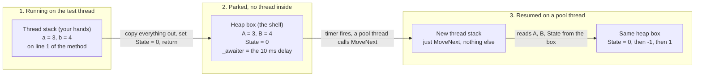
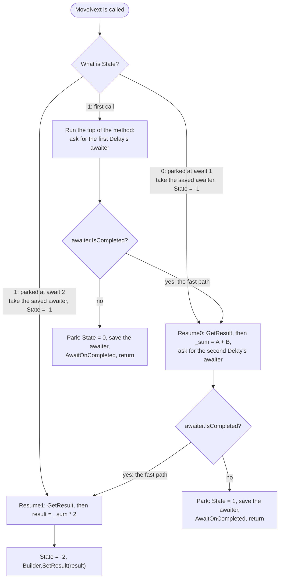
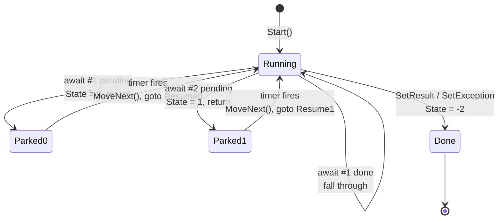

# 3. The state machine

## At the table

The wings were about half gone. Dee had already been by twice: once to top off Kevin's sweet tea without being asked, once to look at the wreckage of napkins on the table and say, "Y'all want me to bring a bigger napkin, or a whiteboard?"

"Napkins are fine," Steve told her. "They're cheap and they don't need a marker."

Kevin was on napkin number four. Napkin one was the four threads. Number two was a drawing of a pager that Steve had made him copy, and number three was a list of everything the serial thread touched. Now he was staring at the stack and frowning, and Steve could tell the frown was a good one. It was the frown of a guy who had found the hole in the plan.

"Okay," Kevin said. "I get the pickup window. The promise fills, and the window buzzes the next guy. Fine. But the next guy is the middle of a method. My pulser loop is a `while` with a sleep in it. If the thread leaves at the sleep, the loop's gone. The ceiling's gone. It's a local."

"That's the right question, bro. That's the whole chapter."

"The thread walks off. The local was on the thread's stack. The stack goes with it."

"Right. You know what a stack is, in plain words?"

"It's where the locals live. While the method runs."

"It's your hands," Steve said. He held both of his up, a wing in one of them. "Whatever you're holding right now is on the stack. The ceiling, the pulser, where you are in the loop. You're holding it. The second you leave the room, your hands are empty. The method is over, as far as the stack knows. So here's what the C# 5 compiler does. Before the thread leaves, it takes everything out of your hands and puts it in a labeled box and sets the box on a shelf."

"A box."

"An object. On the heap. The heap is the shelf. It stays there as long as somebody has a reference to it, even after the thread's gone." Steve licked sauce off his thumb. "So the parameters go in the box. Every local that has to live past the wait goes in the box. And one more thing goes in: a note that says where you were. An `int`. Step one, step two. A bookmark."

"A bookmark in what?"

"In the method. Think of the method as a recipe. Stir, wait ten minutes, add the eggs, wait ten minutes, bake. When you hit 'wait ten minutes,' you don't stand over the pot. You write on a sticky note, 'I'm at step two, here's the bowl of flour I measured,' stick it in the book, close the book, and go watch TV. When the kitchen timer dings, anybody can walk in, open the book to the bookmark, read the sticky note, and keep cooking. They don't need to be you. They don't even need to be the same person."

"And the code that does the picking-up?"

"One method on the box. `MoveNext`. It means 'open the book at the bookmark and do the next piece.' The first thing it does is look at the bookmark and jump to the right spot. A `switch` on the int."

Kevin grabbed the napkin and pulled the pen out of his shirt pocket. "That sounds awful to write."

"It's awful to write. I wrote one so you can see it. Sixty lines for a method that's four lines with `await`. You're never going to write one by hand, and neither am I. Chapter 7 is the cheat. But if you don't see one of these once, bro, the cheat is magic. And I don't ship magic to a pump."

"Dale would have a stroke if I told him it was magic."

"Dale should have a stroke if you told him it was magic."

Kevin drew a box. He wrote three things in it: `ceiling`, `pulser`, `state`. He looked at it for a while.

"So my pulser loop turns into this. A little box with three things in it. And somebody calls `MoveNext` on it every fifty milliseconds."

"The timer does. And between calls, the box sits on the shelf. Forty bytes or so. Nobody's standing near it. No thread, nothing running."

"Forty bytes."

"Versus a 64K stack, a kernel object, and a line on the manager's roll-call sheet. Yeah."

"I'm not gonna lie," Kevin said, "that's a good trade."

"It's the best trade in the building." Steve slid the sauce cup out of the way. "Okay. Open the sample. We're going to read the box together, line by line."

This is the chapter. If you only read one, read this one with `samples/MMP.AsyncProxy.Samples/AddAfterDelay.cs` open beside it.

## The method we want

Here is a small `async` method. It is the one we will take apart.

```csharp
async IFuture<int> AddAfterDelayAsync(int a, int b)
{
    await Futures.Delay(10);
    int sum = a + b;
    await Futures.Delay(10);
    return sum * 2;
}
```

**Read it like this.** Wait ten milliseconds. Add `a` and `b` and remember the answer. Wait ten milliseconds again. Hand back double the answer. There are two `await` lines. One variable (`sum`) has to survive across the second wait. One `return`. That is small enough to hold in your head, so we can see the whole trick.

## The problem the compiler solves

When a method hits `await` and the thing it is waiting for is not ready, the method has to **return**. That is the point of `await`: give the thread back so it can do something else. But returning destroys the **stack frame**. A stack frame is the method's private workspace: its parameters, its locals, and "I was on line 4". It lives on the thread's stack, which is your hands in the story above. When the method returns, the frame is gone, and `a`, `b`, `sum`, and the bookmark go with it.

So the compiler moves everything that has to survive off the stack and into a **heap object**. The heap is a big shared area of memory where objects live until nothing refers to them anymore. An object there stays put after the thread leaves. The compiler's move has a name: it **hoists** the variables. To hoist a variable is to lift it out of the method's workspace and make it a field on the box.

- Parameters become fields.
- Locals that cross an `await` become fields.
- "Where was I" becomes an `int` field called `State`.
- The method body becomes a `MoveNext()` method on that object. It opens with a `switch (State)` that jumps back to wherever the method left off.

The box has a name: the **state machine**. It is a machine because it moves from one state to the next. Each state is a step the method can be parked at.

## Before, during, and after: where everything lives



**In words:**

1. The method starts on the caller's thread. `a` and `b` are on that thread's stack, which is your hands. It runs down to the first `await`.
2. The delay is not done yet, so the method has to leave. Before it does, everything it needs is already sitting in fields on the heap box: `A`, `B`, and the delay's awaiter. `State` is set to 0, the bookmark that says "I am parked at the first `await`".
3. The method returns. The thread's stack frame is gone. The box stays on the heap. At this moment no thread is inside the method. Nothing is running and nothing is blocked.
4. Ten milliseconds later a timer fires. A pool thread (one of the crew's worker threads from the shared thread pool) calls `MoveNext` on the box. This is a different thread, with its own empty stack.
5. `MoveNext` reads `State`, sees 0, and jumps to the line after the first `await`. It finds `A` and `B` in the box, right where it left them.

**Why it matters:** the stack is where the variables live while a thread is inside the method. The heap box is where they live while no thread is. The state machine is the trick that moves them from one place to the other and back.

## The shape

Here is the box. It is a class with fields. This one is hand-written, the way the compiler would write it.

```csharp
internal sealed class AddAfterDelayMachine : IAsyncStateMachine
{
    public int State;                       // -1 running, -2 done, 0.. parked at await N
    public AsyncMethodBuilder<int> Builder; // the thing that owns the result future
    public int A, B, DelayMs;               // parameters, hoisted
    private int _sum;                       // local that crosses await #2, hoisted
    private IAwaiter _awaiter;              // what we are parked on
```

**Read it like this.** `State` is the bookmark. `-1` means "a thread is running me right now". `-2` means "I am finished". `0` and `1` mean "I am parked at the first `await`" and "I am parked at the second one". `Builder` is a helper that owns the **future**, the read-only pickup window where the caller will find the answer (chapter 2). `A`, `B` and `DelayMs` are the parameters, moved off the stack. `_sum` is the one local that has to survive the second wait. `_awaiter` is whatever we are parked on: the thing that will tell us when it is done.

Everything the method needs is a field. The public stub builds one box, fills in the fields, starts it, and hands back the future:

```csharp
public static IFuture<int> RunAsync(int a, int b, int delayMs)
{
    var machine = new AddAfterDelayMachine { A = a, B = b, DelayMs = delayMs, State = -1 };
    machine.Builder = AsyncMethodBuilder<int>.Create();
    machine.Builder.Start(ref machine);    // runs MoveNext once, synchronously
    return machine.Builder.Future;
}
```

**Read it like this.** Line one builds the box and sets `State = -1`, "running". Line two asks the builder to make the future, the pickup window. Line three calls `MoveNext` once, right now, on the caller's thread. Line four hands the caller the window. If the method had to park, the caller gets a window that is still empty and can go do other things. We will meet the builder properly in chapter 4.

## MoveNext, one await at a time

Here is the flow of `MoveNext` as a picture first, then the code.



**In words:**

1. Someone calls `MoveNext`. The first thing it does is look at `State`.
2. If `State` is `-1`, this is the first call. The method runs from the top and asks for the first delay's awaiter. If that delay is already finished, take the fast path and keep going on the same thread (the arrow straight to Resume0).
3. If it is not finished, `MoveNext` parks: it writes `State = 0`, saves the awaiter in a field, tells the builder "call me when this is done", and returns. The thread leaves. This is the end of this call.
4. If `State` is `0` or `1`, this is a resume. `MoveNext` jumps straight to the line after the `await` it was parked on, as if it had never left.
5. After the first wait finishes, the method computes `_sum = A + B`, then does the same dance for the second delay: either park again with `State = 1`, or fall through.
6. After the second wait finishes, it computes `sum * 2`, sets `State = -2`, and hands the answer to the builder, which fills the pickup window.

**Why it matters:** there is only one method, and it can be entered at three different places. The `switch` at the top is how it picks the right one.

Now the same thing as code, one piece at a time.

```csharp
public void MoveNext()
{
    int result;
    try
    {
        IAwaiter awaiter;
        switch (State)
        {
            case 0: awaiter = _awaiter; _awaiter = null; State = -1; goto Resume0;
            case 1: awaiter = _awaiter; _awaiter = null; State = -1; goto Resume1;
        }
```

**Read it like this.** `switch (State)` is the bookmark check. For a resume (`0` or `1`), take back the awaiter we saved on the sticky note, clear the field, set `State = -1` ("a thread is running me again"), and `goto` the label for that spot. A `goto` is a jump: "go to the line labeled `Resume0` and carry on from there". For the first call, `State` is `-1`, no case matches, and we fall through to the top of the method body.

```csharp
        awaiter = Futures.Delay(DelayMs).GetAwaiter();
        if (!awaiter.IsCompleted)
        {
            State = 0;                                   // remember: parked at await 0
            _awaiter = awaiter;                          // remember what we are parked on
            var self = this;
            Builder.AwaitOnCompleted(ref awaiter, ref self); // "call MoveNext when done"
            return;                                      // the thread leaves
        }
    Resume0:
        awaiter.GetResult();                             // throws if the delay faulted
```

**Read it like this.**

1. `Futures.Delay(DelayMs)` starts a ten-millisecond timer and gives back a future. `.GetAwaiter()` asks that future for its awaiter, which is the thing that can say "am I done?".
2. `if (!awaiter.IsCompleted)`: is the delay still running? If so, we have to park.
3. `State = 0` writes the bookmark. `_awaiter = awaiter` writes on the sticky note what we are waiting for.
4. `Builder.AwaitOnCompleted(...)` says "when this awaiter finishes, call `MoveNext` on me". It is the pager: leave your number, we will buzz you.
5. `return` is the thread walking away. The method is still "running" in the sense that the box exists on the heap with `State = 0`. But no thread is inside it. Nothing is blocked.
6. `Resume0:` is the label we jump to when we come back. `awaiter.GetResult()` reads the answer. For a delay there is no answer, but if the delay had failed, this is the line that would throw.

Read that `return` slowly. That is the thread walking away.

Ten milliseconds later a timer fires. A pool thread calls `MoveNext()`. `State` is 0, so we jump to `Resume0`, call `GetResult()` on the awaiter we stashed, and carry on with the next line of the original method as if nothing happened.

```csharp
        _sum = A + B;

        awaiter = Futures.Delay(DelayMs).GetAwaiter();
        if (!awaiter.IsCompleted) { State = 1; _awaiter = awaiter; var self = this; Builder.AwaitOnCompleted(ref awaiter, ref self); return; }
    Resume1:
        awaiter.GetResult();

        result = _sum * 2;
    }
```

**Read it like this.** `_sum = A + B` is the line `int sum = a + b;` from the original method. It writes into a field instead of a local. The second delay is the same park-and-resume dance with `State = 1` and the label `Resume1`. After it, `result = _sum * 2` is the original `return sum * 2;`.

Same dance for the second await. `sum` went into `_sum` because the thread that computed it and the thread that reads it may be different threads with different stacks. A local on one thread's stack is invisible to the other thread. A field on the shared box is visible to both.

## The two exits

```csharp
    catch (Exception ex)
    {
        State = -2;
        Builder.SetException(ex);   // the fault goes into the future
        return;
    }
    State = -2;
    Builder.SetResult(result);      // the value goes into the future
}
```

**Read it like this.** There are two ways out. If anything above threw, we land in `catch`, set `State = -2` ("finished"), and put the exception in the pickup window with `SetException`. If everything went fine, we set `State = -2` and put the answer in the window with `SetResult`. Either way the future gets completed, and whoever is holding it finds out.

Nothing escapes `MoveNext`. A throw anywhere in the body, in any state, lands in the `catch` and becomes the future's fault. The caller sees it when they call `GetResult` on their own awaiter. That is why an exception thrown inside an `async` method shows up at the `await` in the caller and not at the call.

## The fast path

Look at `if (!awaiter.IsCompleted)` again. When the awaited thing is already done, we skip the whole park-and-return and fall straight through to `Resume0` on the same thread. No pager, no thread hop. Think of ordering a coffee that is already sitting on the counter: you grab it, you do not take a number.

An `async` method that never hits a pending `await` runs fully synchronously, start to finish, on the caller's thread. That is why `await Task.FromResult(x)` costs almost nothing. It is also why a delay of zero milliseconds completes before `MoveNext` even returns.

## State diagram



**In words:**

1. `Start()` calls `MoveNext` once and the machine is **Running**. A thread is inside it, on the caller's stack.
2. At the first `await`, one of two things happens. If the delay is already done, the machine stays Running and falls through (the loop arrow on Running). If not, the machine moves to **Parked0**: `State = 0`, `return`, thread gone.
3. While Parked0, nothing runs. The machine is a box on the heap waiting for the timer.
4. The timer fires. A pool thread calls `MoveNext`, and the machine goes back to **Running**, jumping to `Resume0`.
5. The same happens at the second `await`, with **Parked1** and `State = 1`.
6. When the method finishes, or throws, the machine goes to **Done**. `State = -2`, and the future is completed.

**Why it matters:** the machine is either Running (a thread is inside) or Parked (no thread at all), and the arrows between them are the only ways it can change. There is no state where it is "waiting on a thread".

## What the real compiler does differently

Three things, and none of them change the idea.

1. It makes the machine a **`struct`** in Release, to avoid an allocation when the method completes synchronously. (A `struct` lives inside whatever holds it. A `class`, like ours, gets its own box on the heap.) On the first real suspend it boxes the struct, and `SetStateMachine` is how the builder learns which box to call back. Ours is a class, so `SetStateMachine` is empty. Toub discusses the trade at 63:11.
2. It generates ugly names: `<>1__state`, `<>t__builder`, `<a>5__1`. Decompile any async method with ilspycmd and you will see the same fields with worse names. The number the compiler adds to a name just keeps names from colliding.
3. It handles `await` inside `try`/`finally`, inside loops, inside `using`. The transform is the same; the goto targets get more interesting.

Decompile one and diff it against our sample. The shapes line up field for field. That is the whole claim of this repo.

## Words you just met

| Term | Plain meaning | The picture |
|------|---------------|-------------|
| **stack** | The thread's private workspace for a running method: parameters, locals, where it is. Gone when the method returns. | Your hands |
| **heap** | Shared memory where objects stay until nothing refers to them. | The shelf |
| **hoist** | Lift a variable off the stack and make it a field on a heap object. | Moving what's in your hands into a labeled box |
| **state machine** | The heap object the compiler builds from an `async` method. It holds the hoisted variables and a `MoveNext`. | A recipe with a bookmark and a sticky note |
| **`State`** | An `int` field that records which step the method is parked at. `-1` running, `-2` done, `0` and up parked. | The bookmark |
| **`MoveNext`** | The one method on the box. It reads `State`, jumps to the right line, and runs to the next pause. | "Open the book at the bookmark and do the next piece" |
| **fast path** | If the awaited thing is already done, skip the park and keep going on the same thread. | The coffee already on the counter |
| **builder** | A helper that owns the result future and does the bookkeeping. Chapter 4 is about it. | The assistant who handles the pickup window |
