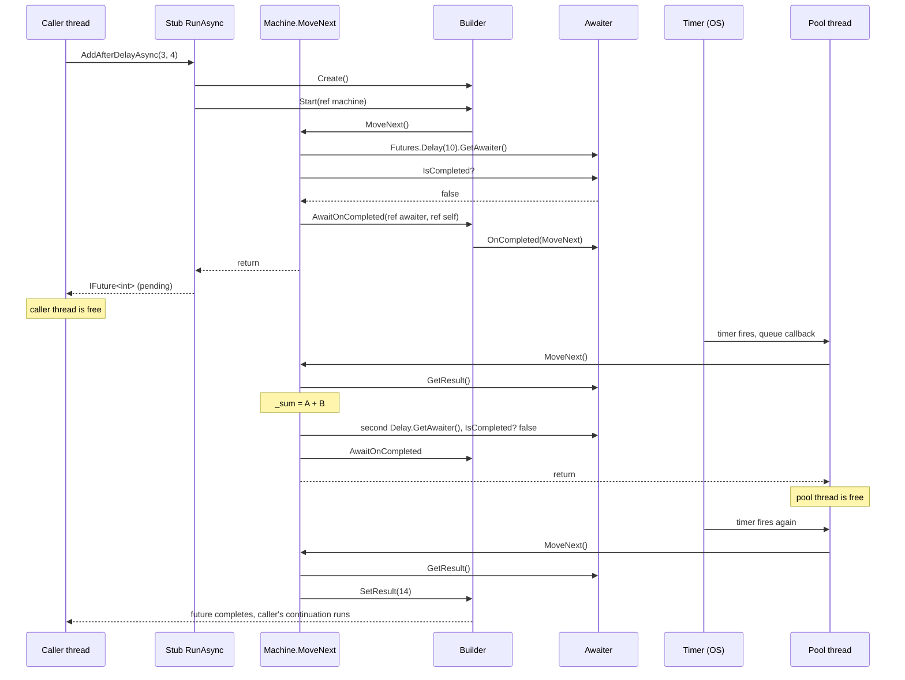

# 4. Awaiter and builder

Chapter 3 had two calls we hand-waved: `GetAwaiter()` and `Builder.AwaitOnCompleted(...)`. This chapter is those two calls. Open `Core/FutureAwaiter{T}.cs` and `Builder/AsyncMethodBuilder{T}.cs`.

## The awaiter: three questions

An awaiter is the thing an `await` talks to. The compiler only needs three members from it, and that is the entire contract:

```csharp
public interface IAwaiter
{
    bool IsCompleted { get; }              // are you done?
    void OnCompleted(Action continuation); // call me when you are
    void GetResult();                      // give me the answer, or throw
}
```

This is why you can `await` anything in C# 5, not only `Task`. If your type has a `GetAwaiter()` that returns something with those three members, the compiler is happy. `Task.Yield()`, `Task.Delay`, `HttpClient` responses, your own types: all of them are this interface wearing different clothes.

Our `FutureAwaiter<T>` is a struct that wraps a `Promise<T>`. `IsCompleted` asks the promise. `GetResult` asks the promise. `OnCompleted` is where the interesting bit lives, and we get to it in chapter 5.

## The builder: four calls

The builder is the compiler's helper. It owns the result future and does the bookkeeping the machine should not have to:

| Call | When | What it does |
|------|------|--------------|
| `Create()` | in the stub | makes the promise behind the future |
| `Start(ref machine)` | in the stub | calls `MoveNext()` once |
| `AwaitOnCompleted(ref awaiter, ref machine)` | at each suspend | hooks `MoveNext` to the awaiter's callback |
| `SetResult(x)` / `SetException(ex)` | at the end | completes the promise |

The real one is `AsyncTaskMethodBuilder<T>`. Same four calls, same order.

`AwaitOnCompleted` is one line of idea:

```csharp
awaiter.OnCompleted(machine.MoveNext);
```

"When you finish, call MoveNext." That is `await`. Everything else in that method is about carrying context across the gap, which is chapter 5.

## The whole round trip



Count the arrows that go to the caller thread after the first return. Zero, until the very end. The caller handed us a thread for a few microseconds, got a future back, and left. Two pool threads each borrowed a few more microseconds later. In between, nothing was running and nothing was blocked.

## Why `ref`

`Start<TStateMachine>(ref TStateMachine)` and `AwaitOnCompleted(ref TAwaiter, ref TStateMachine)` take their arguments by reference. In the real runtime the machine is a struct, and passing a struct by value would copy it, and the copy would have the state changes while the original would not. We use classes, so the `ref` is only for shape. It costs us one `var self = this;` line at each await site, because you cannot write `ref this`.

## Try it

Put a breakpoint on `MoveNext` in the sample. Run the test `Hand_written_machine_suspends_then_returns_the_value`. You will hit the breakpoint three times. Look at the thread ID in the debugger each time. First hit: the test thread. Second and third: pool threads, and probably different ones. Look at `State` each time: -1, then 0, then 1.
