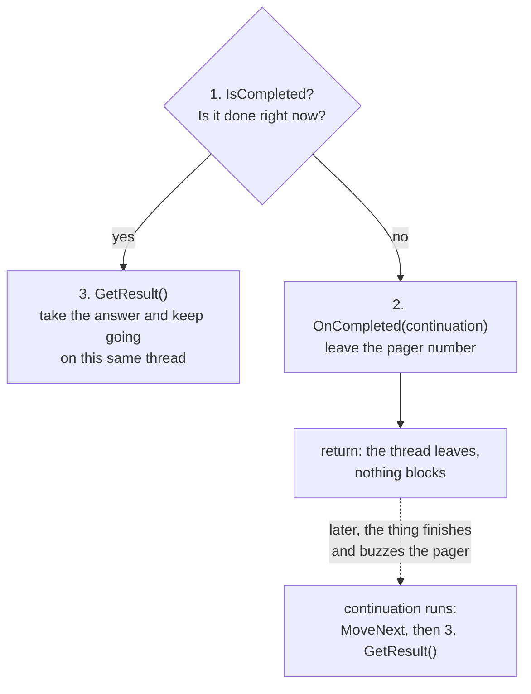
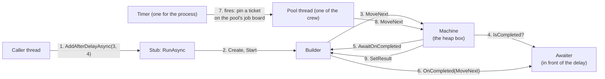
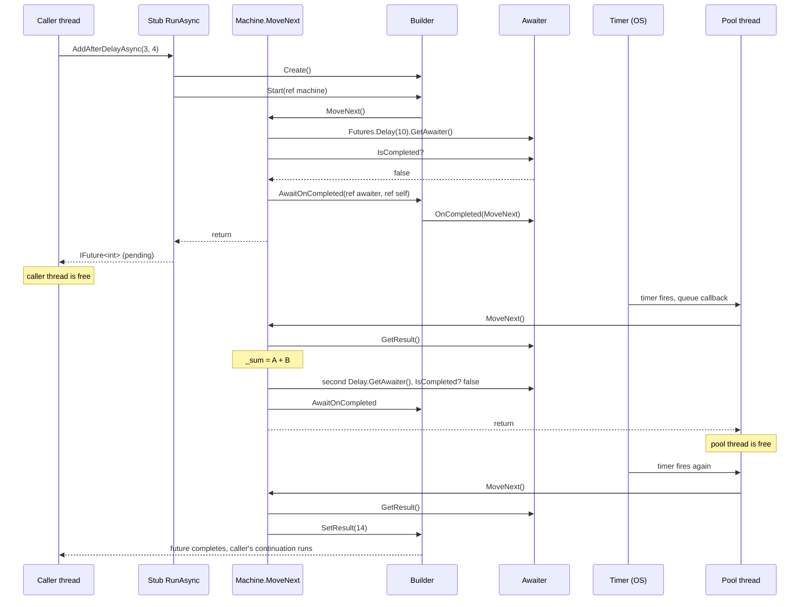

# 4. Awaiter and builder

## At the table

The wings were down to bones and a pile of celery nobody was going to touch. Steve had finally pulled his laptop out and propped it against the napkin dispenser, and Kevin had a fresh napkin, number five, with a box on it labeled MY BOX and a circle off to one side labeled TIMER. Between the two he had drawn a line and put a question mark on it.

"Who calls `MoveNext`," Kevin said. He tapped the question mark. "You keep saying the timer calls it. The timer doesn't know about my box."

"Nope."

"The timer is a timer. It knows how to count and then go ding. It doesn't know what a state machine is. It doesn't know what a pulser is."

"Right. And you shouldn't want it to. If the timer had to know about every box, you'd have to rewrite the timer every time you wrote a new box." Steve cracked his knuckles. "So there are two little helpers in between. Three questions and four calls. That's the protocol."

"The protocol."

"Okay. Think about the pager again. You're at the restaurant and you ordered the burger. The host takes your name, hands you a pager, and says go sit. Now what does the kitchen need to be able to do for that to work? Three things. One: tell you whether the burger is ready right now, because maybe it already is. Two: take your pager number so they can buzz you when it is. Three: hand you the burger when you come up."

"Is it ready. Buzz me when it is. Give it to me."

"That's the awaiter. Anything that can answer those three questions can be awaited. That's why in C# 5 you can `await` things that have nothing to do with `Task`. The compiler doesn't care what the thing is. It cares that the thing can answer three questions."

Kevin wrote them down on the napkin, small, under the circle: *done? buzz me. answer.*

"And the four calls?"

"That's the builder. It's the machine's assistant." Steve picked up a wing bone and laid it on the table. "Make the pickup window for the result. That's call one. Start the machine. Two." Another bone. "When the machine has to park, hook its `MoveNext` to the awaiter's buzz-me. Three. And when the machine finishes, put the answer in the window. Four."

"Create, start, hook, finish."

"`Create`, `Start`, `AwaitOnCompleted`, `SetResult`. The real one in 4.5 is `AsyncTaskMethodBuilder` and it has the same four. Same order, too."

"And `AwaitOnCompleted`," Kevin said slowly, "that's the line where the timer finds out about my box."

"It's one line of idea. `awaiter.OnCompleted(machine.MoveNext)`. When you're done, call this. That's `await`, buddy. That's the whole word. Every other line in that method is about carrying stuff across the gap, and that's next chapter."

Kevin sat back. For a second he didn't say anything. Then: "On CE. Is `System.Threading.Timer` even there?"

"It's there. Compact Framework 2.0 and up. It fires on a pool thread." Steve could see the next question coming and answered it first. "That's one of the crew's worker threads. The thread pool is a small crew that the whole program shares, plus a job board. The timer pins a ticket to the board, a free worker picks it up and calls `MoveNext`, and that worker is busy for however long it takes to read a counter and compare it to your ceiling. Microseconds. Then it goes back to the break room."

"So the pool thread is the only thread in the whole thing."

"A pool thread runs each timer callback. It is shared with the rest of the program. Between callbacks, your loop holds no thread." Steve turned the laptop around. "Watch the arrows."

Dee came by with the tea pitcher, glanced at the screen, saw a diagram with seven columns and about two dozen arrows, and decided not to ask.

Chapter 3 had two calls we hand-waved: `GetAwaiter()` and `Builder.AwaitOnCompleted(...)`. This chapter is those two calls. Open `Core/FutureAwaiter{T}.cs` and `Builder/AsyncMethodBuilder{T}.cs`.

## The awaiter: three questions

An **awaiter** connects the state machine to an operation, such as a delay. It checks completion, accepts a callback, and reads the result. This library groups those members in an interface:

```csharp
public interface IAwaiter
{
    bool IsCompleted { get; }              // are you done?
    void OnCompleted(Action continuation); // call me when you are
    void GetResult();                      // give me the answer, or throw
}
```

**Read it like this.** `IsCompleted` is "is the burger ready right now?" It answers yes or no and does not wait. `OnCompleted` is "here is my pager, buzz me". The `Action continuation` is the pager: it is a piece of code that means "the rest of my method", and it will be run when the thing finishes. `GetResult` is "hand me the burger". If the thing failed, `GetResult` throws instead, which is how a failure travels back to your method.

The machine checks completion before reading the result. Calling this library's `GetResult` too early throws an exception. Here is how the machine uses them:



**In words:**

1. The machine asks the awaiter question one: `IsCompleted`. It is a quick yes or no.
2. If yes, the machine goes straight to question three, `GetResult`, takes the answer, and keeps running on the same thread. No pager, no waiting. This is the fast path from chapter 3.
3. If no, the machine asks question two: `OnCompleted`, handing over the continuation. The awaiter stores it.
4. The machine returns. The thread leaves. Nothing is blocked.
5. Later the thing finishes and runs the stored continuation. That calls `MoveNext`, and the first thing `MoveNext` does is question three: `GetResult`.


C# 5 uses an awaiter pattern, so custom types can support `await` too. The type supplies `GetAwaiter()`. Its awaiter supplies `IsCompleted` and `GetResult`, plus the required completion interface. Our `IAwaiter` is a teaching version of that pattern. `Task.Delay` and `Task.Yield()` both return awaitable objects. An `HttpClient` async call returns a task that can be awaited.

Our `FutureAwaiter<T>` is a struct that wraps a `Promise<T>`. `IsCompleted` reads the promise's status. `GetResult` reads its value or throws its error. `OnCompleted` registers the callback that will resume the machine. Chapter 5 explains how it chooses where that callback runs.

## The builder: four calls

The **builder** is the compiler's helper. It owns the result future (the pickup window from chapter 2) and does the bookkeeping the machine should not have to. Think of it as the machine's assistant: the machine does the cooking, the assistant handles the paperwork.

| Call | When | What it does |
|------|------|--------------|
| `Create()` | in the stub | makes the promise behind the future |
| `Start(ref machine)` | in the stub | calls `MoveNext()` once |
| `AwaitOnCompleted(ref awaiter, ref machine)` | at each suspend | hooks `MoveNext` to the awaiter's callback |
| `SetResult(x)` / `SetException(ex)` | at the end | completes the promise |

**Read it like this.** `Create` builds the empty pickup window. `Start` is "begin cooking". `AwaitOnCompleted` is "I have to park, so take this pager number and buzz it when you are ready". `SetResult` or `SetException` is "I'm finished, put the answer, or the failure, in the window".

The .NET task builder is `AsyncTaskMethodBuilder<T>`. It has these same jobs, plus runtime details that this teaching builder leaves out.

`AwaitOnCompleted` is one line of idea:

```csharp
awaiter.OnCompleted(machine.MoveNext);
```

"When you finish, call `MoveNext`." That is `await`. Everything else in that method is about carrying context across the gap, which is chapter 5.

## Who calls whom

Before the full round trip, here is the same cast of characters as a map. Each arrow is one call, numbered in the order it happens.



**In words:**

1. The caller calls `AddAfterDelayAsync(3, 4)`. That hits the stub.
2. The stub asks the builder to `Create` the result future, then `Start` the machine.
3. The builder calls `MoveNext` on the machine, on the caller's own thread.
4. The machine asks the delay's awaiter `IsCompleted`. The answer is no.
5. The machine tells the builder `AwaitOnCompleted`: "I'm parking".
6. The builder passes the buzz-me along: `OnCompleted(MoveNext)` on the awaiter. Now the awaiter holds a pager that rings the machine.
7. Later the timer fires. It pins a ticket on the pool's job board, and a free crew worker picks it up.
8. That pool thread calls `MoveNext` on the machine. The machine runs the next piece.
9. When the machine finishes, it tells the builder `SetResult`, and the pickup window fills.


## The whole round trip



**In words:**

1. **Setup (caller thread).** The caller calls the stub. The stub asks the builder to `Create` the future and `Start` the machine. The builder calls `MoveNext`.
2. **First question.** `MoveNext` asks for a ten-millisecond delay's awaiter and asks `IsCompleted`. No.
3. **Park.** `MoveNext` tells the builder `AwaitOnCompleted`. The builder hands the awaiter the pager: `OnCompleted(MoveNext)`. `MoveNext` returns.
4. **Free.** The stub hands the caller a pending future. The caller's thread is free and goes on with its life.
5. **First ding.** Once the delay expires, the timer callback runs. Timer and thread scheduling can make this later than ten milliseconds. A pool thread calls `MoveNext`. It calls `GetResult` on the saved awaiter and computes `_sum = A + B`.
6. **Second wait.** The machine asks for the second delay, which is not done, so it parks again with `AwaitOnCompleted` and returns. The pool thread is free.
7. **Second ding.** The timer fires again. A pool thread calls `MoveNext`, calls `GetResult`, and the method reaches its `return`.
8. **Finish.** With `A = 3` and `B = 4`, `_sum` is 7. The final calculation doubles it to 14. `SetResult(14)` completes the future. Registered continuations can then run. They return to the caller's thread only if a captured context sends them there.


## Why `ref`

`Start<TStateMachine>(ref TStateMachine)` and `AwaitOnCompleted(ref TAwaiter, ref TStateMachine)` take their arguments by reference. A **reference** (`ref`) means "work on the original, not a copy".

Here is why it matters. In the real runtime the machine is a **struct**, a kind of object that gets copied whenever you pass it around. Picture a recipe card. Passing a struct by value is like photocopying the card and handing the photocopy to someone. If they write "I'm at step 2" on the photocopy, your original card still says step 1. With `ref`, they get the real card, so what they write is what you see.

We use classes, so we never get the photocopy problem and the `ref` is only for shape. It costs us one `var self = this;` line at each await site, because you cannot write `ref this`.

## Try it

Put a breakpoint on `MoveNext` in the sample. Run the test `Hand_written_machine_suspends_then_returns_the_value`. You will hit the breakpoint three times. Look at the thread ID in the debugger each time. First hit: the test thread. Second and third: pool threads. A worker may be reused, so those two IDs can match. Look at `State` each time: -1, then 0, then 1.

The first call starts the method. The next two calls resume it after the saved delays. The machine's fields preserve the calculation across those calls, even when the thread changes.

## Words you just met

| Term | Plain meaning | The picture |
|------|---------------|-------------|
| **awaiter** | A small helper in front of the thing you are awaiting. It answers three questions: done? buzz me when you are, give me the answer. | The counter at the pickup window |
| **`IsCompleted`** | "Is it done right now?" A quick yes or no. | "Is the burger ready?" |
| **`OnCompleted`** | "Run this piece of code when you finish." | Handing over your pager |
| **`GetResult`** | "Give me the answer, or throw if it failed." | Taking the burger |
| **continuation** | The rest of the method, packaged as code to run later. | The pager's message: "come back and finish" |
| **builder** | The machine's assistant. Four calls: `Create`, `Start`, `AwaitOnCompleted`, `SetResult`. | The one who handles the paperwork and the pickup window |
| **`ref`** | Pass the original, not a copy. | Handing over the real recipe card, not a photocopy |
| **pool thread** | One of the shared crew of worker threads from the thread pool. It runs a ticket, then goes back to wait. | A crew worker from the break room |
