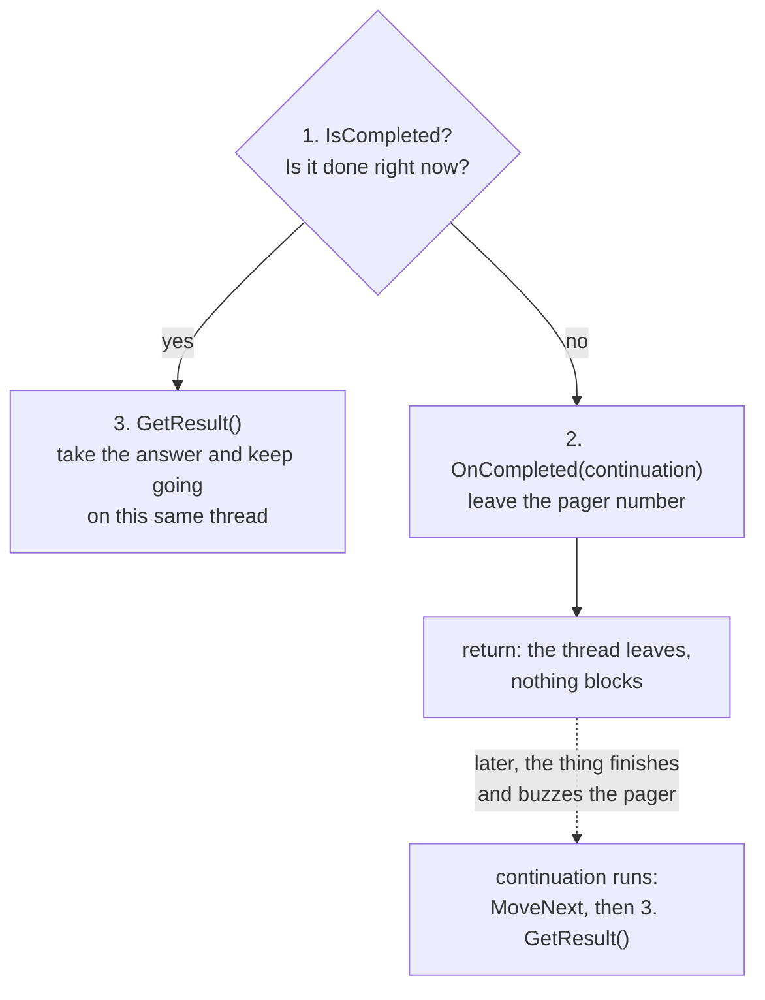
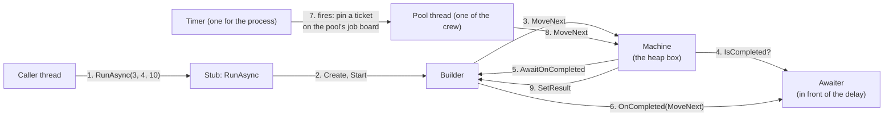
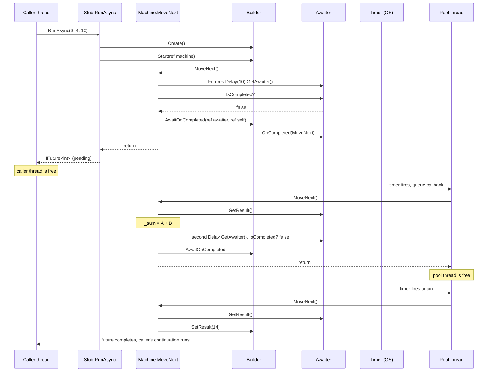

# 4. Awaiter and builder

## At the table

The second basket was down to bones and almost all the celery was gone, mostly eaten by Kevin. Steve propped the open laptop against the napkin dispenser, and Kevin had a fresh napkin, number five, with a box on it labeled MY BOX and a circle off to one side labeled TIMER. Between the two he had drawn a line and put a question mark on it.

"Who calls `MoveNext`," Kevin said. He tapped the question mark. "You keep saying the timer calls it. The timer doesn't know about my box."

"Nope."

"The timer is a timer. It knows how to count and then go ding. It doesn't know what a state machine is. It doesn't know what a pulser is."

"Right. And you shouldn't want it to. If the timer had to know about every box, you'd have to rewrite the timer every time you wrote a new box." Steve cracked his knuckles. "So there are two little helpers in between. Three questions and four calls. That's the protocol."

"The protocol."

"Think about waiting for a table again. The host records your party and gives you a claim ticket and a pager. You need three things from the host: check whether your request is complete, arrange to be buzzed when it completes, and read the table assignment when you return."

"Is it ready. Buzz me when it is. Give it to me."

"That's the awaiter. Anything that can answer those three questions can be awaited. That's why in C# 5 you can `await` things that have nothing to do with `Task`. The compiler doesn't care what the thing is. It cares that the thing can answer three questions."

Kevin wrote them down on the napkin, small, under the circle: *done? buzz me. answer.*

"And the four calls?"

"That's the builder. It's the machine's assistant." Steve picked up a wing bone and laid it on the table. "Create the result record. That's call one. Start the machine. Two." Another bone. "When the machine has to park, hook its `MoveNext` to the awaiter's buzz-me. Three. And when the machine finishes, store the answer in the result record. Four."

"Create, start, hook, finish."

"`Create`, `Start`, `AwaitOnCompleted`, `SetResult`. The real one in 4.5 is `AsyncTaskMethodBuilder` and it does the same four jobs, in the same order. For the hook, the compiler calls `AwaitUnsafeOnCompleted`, and the real builder adds a fifth member, `SetStateMachine`."

"And `AwaitOnCompleted`," Kevin said slowly, "that's the line where the timer finds out about my box."

"It's one line of idea. `awaiter.OnCompleted(machine.MoveNext)`. When you're done, call this. That's my version of `await`, bud. Next we'll look at context: which request data travels with the continuation, and which thread should run it."

Kevin sat back. For a second he didn't say anything. Then: "On CE. Is `System.Threading.Timer` even there?"

"It's there. It's present in CF 3.5; the audit checked. On the desktop it fires on a pool thread." Steve could see the next question coming and answered it first. "That's one of the crew's worker threads. The thread pool is a small crew that the whole program shares, plus a job board. The timer pins a ticket to the board, a free worker picks it up and calls `MoveNext`, and that worker is busy for however long it takes to read a counter and compare it to your ceiling. Then it goes back to the break room. Which thread runs the callback on your CE board, and how long that takes, nobody has measured yet. Your board will tell us."

"So the pool thread is the only thread in the whole thing."

"A pool thread runs each timer callback. It is shared with the rest of the program. Between callbacks, your loop holds no thread." Steve turned the laptop around. "Watch the arrows."

Dee came by with a pitcher of sweet tea, refilled Kevin's glass, and left the pitcher within his reach. She glanced at the screen, saw a diagram with seven columns and about two dozen arrows, and decided not to ask.

The state-machine walkthrough in chapter 3 used two calls without taking them apart: `GetAwaiter()` and `Builder.AwaitOnCompleted(...)`. We now examine those calls. Open [IAwaiter.cs](../../src/MMP.AsyncProxy/Core/IAwaiter.cs), [FutureAwaiter{T}.cs](../../src/MMP.AsyncProxy/Core/FutureAwaiter%7BT%7D.cs), and [AsyncMethodBuilder{T}.cs](../../src/MMP.AsyncProxy/Builder/AsyncMethodBuilder%7BT%7D.cs).

## The awaiter: three questions

An **awaiter** connects the state machine to an operation, such as a delay. It checks completion, accepts a callback, and reads the result. This library groups those members in an interface:

```csharp
public interface IAwaiter
{
    bool IsCompleted { get; }              // checks status without blocking
    void OnCompleted(Action continuation); // registers code for completion, even if it just happened
    void GetResult();                      // after completion: throw on fault or cancellation
}
```

**Read it like this.**
- `IsCompleted` is "has the host finished handling my table request?" It answers yes or no and does not wait.
- `OnCompleted` is "buzz me when my request completes". The `Action continuation` is the code that resumes the method. In the restaurant example, it is the action after the buzz: return to the host and read the table assignment.
- `GetResult` reads that assignment. If the thing failed, `GetResult` throws instead, which is how a failure travels back to your method.

Kevin tapped `void`. "Where does the bank's string come back?"

"This is the untyped interface," Steve said. "A delay has no value to return. `IAwaiter<string>` adds a `GetResult` that returns a string. The untyped call still checks the outcome, but discards any value."

The machine checks completion before reading the result. Calling this library's `GetResult` too early throws an exception. Here is how the machine uses them:



**In words:**

1. The machine asks the awaiter question one: `IsCompleted`. It is a quick yes or no.
2. If yes, the machine goes straight to question three, `GetResult`, takes the answer, and keeps running on the same thread. No pager, no waiting. This is the fast path from the earlier state-machine walkthrough in chapter 3.
3. If no, the machine calls `OnCompleted`, handing over the continuation. The awaiter registers it with the promise. If completion already happened, registration runs or posts the continuation immediately.
4. The machine returns. The thread leaves. Nothing is blocked.
5. Later the thing finishes and runs the stored continuation. That calls `MoveNext`, and the first thing `MoveNext` does is question three: `GetResult`.


C# 5 uses an awaiter pattern, so custom types can support `await` too. The type supplies `GetAwaiter()`. Its awaiter supplies `IsCompleted` and `GetResult`, plus the required completion interface. Our `IAwaiter` is a teaching version of that pattern. `Task.Delay` and `Task.Yield()` both return awaitable objects. An `HttpClient` async call returns a task that can be awaited.

Our `FutureAwaiter<T>` is a struct that wraps a `Promise<T>`. `IsCompleted` reads the promise's status. `GetResult` reads its value or throws its error. `OnCompleted` registers the callback that will resume the machine. The next topic, context, explains how it chooses where that callback runs.

## Choosing the continuation at runtime

Kevin tapped `OnCompleted`. "Earlier, when we discussed the authorization continuation, we chose between self-service and an attended sale. Where does that choice go?"

"Before registration, if you already know the sale mode," Steve said. "Your code chooses a delegate, then passes that delegate to `OnCompleted`. The awaiter registers the delegate you supplied."

"So a self-service sale gets the pump's outcome handler. An attended sale gets the attendant's outcome handler."

"Yes. Both handlers read the authorization outcome and apply their own workflow. They still need to handle a rejection, timeout, or error. Choosing the handler doesn't choose the bank's answer."

"What if the sale mode changes while authorization is pending?"

"Then decide whether the sale should use its original mode or its current mode. Choosing a delegate before registration keeps the original choice. Registering one continuation that reads the mode when it runs lets you make the choice after completion."

"Could I just call `OnCompleted` again with the new handler?"

"That adds another continuation. Both can run for the same outcome. This API has no method to replace or remove a registered continuation. For one decision after completion, register one continuation and make the decision inside it."

"And if something else changes that mode at the same time?"

"Keep those changes and the decision on the same owning thread, or protect the shared state. When we discuss context next, I'll show you how to return the continuation to the display thread."

Kevin pointed back to the state machine. "But here we keep passing `MoveNext`."

"Right. In our hand-written callback example, we choose the delegate ourselves. For the state machine, the builder registers `MoveNext`. The sale decisions belong in the method that the machine resumes. You don't replace `MoveNext` to choose a different sale path."

## The builder: four calls

The **builder** is the compiler's helper. It owns the promise behind the result future and handles completion and continuation registration for the machine. In the earlier promise discussion, the promise was the host's record and the future was the customer's claim ticket.

| Call | When | What it does |
|------|------|--------------|
| `Create()` | in the stub | makes the promise behind the future |
| `Start(ref machine)` | in the stub | calls `MoveNext()` once |
| `AwaitOnCompleted(ref awaiter, ref machine)` | at each suspend | hooks `MoveNext` to the awaiter's callback |
| `SetResult(x)` / `SetException(ex)` | at the end | completes the promise |

**Read it like this.** `Create` makes the result promise. `Start` calls the machine for the first time. At a pending wait, `AwaitOnCompleted` registers the code that resumes the machine. When the method ends, `SetResult` or `SetException` stores its outcome in the result promise.

The .NET task builder is `AsyncTaskMethodBuilder<T>`. It has these same jobs, plus runtime details that this teaching builder leaves out.

`AwaitOnCompleted` is one line of idea:

```csharp
// Register a method call, not its result. Completion will call MoveNext.
awaiter.OnCompleted(machine.MoveNext);
```

This line is the registration idea, not the full builder implementation. The complete builder also carries execution context on desktop builds. "When you finish, call `MoveNext`." The next discussion, about context, explains how the builder carries request data across suspension.

## Who calls whom

Before the full round trip, here is the same cast of characters as a map. Each arrow is one call, numbered in the order it happens.



**In words:**

1. The caller calls `RunAsync(3, 4, 10)`. That hits the stub.
2. The stub asks the builder to `Create` the result future, then `Start` the machine.
3. The builder calls `MoveNext` on the machine, on the caller's own thread.
4. The machine asks the delay's awaiter `IsCompleted`. The answer is no.
5. The machine tells the builder `AwaitOnCompleted`: "I'm parking".
6. The builder passes the buzz-me along: `OnCompleted(MoveNext)` on the awaiter. The awaiter registers the code that resumes the machine when the operation completes.
7. Later the timer fires. It pins a ticket on the pool's job board, and a free crew worker picks it up.
8. That pool thread calls `MoveNext` on the machine. The machine runs the next piece.
9. When the machine finishes, it tells the builder `SetResult`, and the result promise stores the answer.


## The whole round trip



**In words:**

1. **Setup (caller thread).** The caller calls the stub. The stub asks the builder to `Create` the future and `Start` the machine. The builder calls `MoveNext`.
2. **First question.** `MoveNext` asks for a ten-millisecond delay's awaiter and asks `IsCompleted`. No.
3. **Park.** `MoveNext` tells the builder `AwaitOnCompleted`. The builder registers the resuming callback with the awaiter: `OnCompleted(MoveNext)`. `MoveNext` returns.
4. **Free.** The stub hands the caller a pending future. The caller's thread is free and goes on with its life.
5. **First ding.** Once the delay expires, the timer callback runs. Timer and thread scheduling can make this later than ten milliseconds. A pool thread calls `MoveNext`. It calls `GetResult` on the saved awaiter and computes `_sum = A + B`.
6. **Second wait.** The machine asks for the second delay, which is not done, so it parks again with `AwaitOnCompleted` and returns. The pool thread is free.
7. **Second ding.** The timer fires again. A pool thread calls `MoveNext`, calls `GetResult`, and the method reaches its `return`.
8. **Finish.** With `A = 3` and `B = 4`, `_sum` is 7. The final calculation doubles it to 14. `SetResult(14)` completes the future. Registered continuations can then run. They return to the caller's thread only if a captured context sends them there.


## Why `ref`

`Start<TStateMachine>(ref TStateMachine)` and `AwaitOnCompleted(ref TAwaiter, ref TStateMachine)` take their arguments by reference. A **reference** (`ref`) means "work on the original, not a copy".

Here is why it matters. In the real runtime the machine is a **struct**, a kind of object that gets copied whenever you pass it around. Picture a recipe card. Passing a struct by value is like photocopying the card and handing the photocopy to someone. If they write "I'm at step 2" on the photocopy, your original card still says step 1. With `ref`, they get the real card, so what they write is what you see.

We use classes, so we never get the photocopy problem and the `ref` is only for shape. It costs us one `var self = this;` line at each await site, because you cannot write `ref this`.

## Try it

Put a breakpoint on `MoveNext` in the sample. Run the test `Hand_written_machine_suspends_then_returns_the_value`. You will hit the breakpoint three times. Look at the thread ID in the debugger each time. First hit: the test thread. Second and third: pool threads. A worker may be reused, so those two IDs can match. Look at `State` each time: -1, then 0, then 1.

The first call starts the method. The next two calls resume it after the saved delays. The machine's fields preserve the calculation across those calls, even when the thread changes.

## Words you just met

| Term | Plain meaning | The picture |
|------|---------------|-------------|
| **awaiter** | A small helper in front of the thing you are awaiting. It answers three questions: done? buzz me when you are, give me the answer. | Asking the host about your table request |
| **`IsCompleted`** | "Is it done right now?" A quick yes or no. | "Has my table request completed?" |
| **`OnCompleted`** | "Run this piece of code when you finish." | Arranging to be buzzed when the request completes |
| **`GetResult`** | "Give me the answer, or throw if it failed." | Reading the table assignment through the claim ticket |
| **continuation** | The rest of the method, packaged as code to run later. | Returning to the host after the buzz |
| **builder** | The machine's assistant. Four calls: `Create`, `Start`, `AwaitOnCompleted`, `SetResult`. | The helper that creates and completes the result record |
| **`ref`** | Pass the original, not a copy. | Handing over the real recipe card, not a photocopy |
| **pool thread** | One of the shared crew of worker threads from the thread pool. It runs a ticket, then goes back to wait. | A crew worker from the break room |
