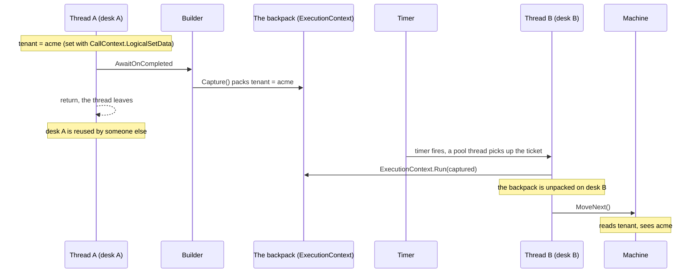
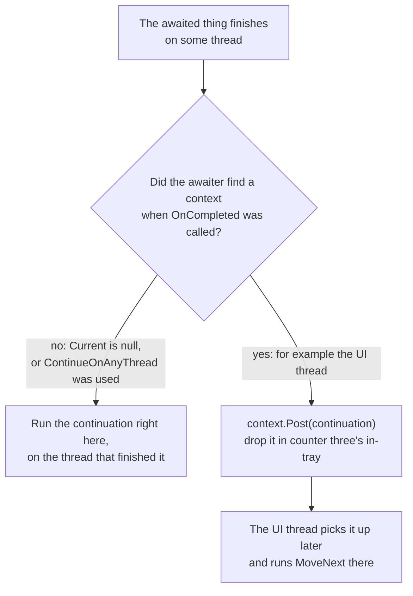
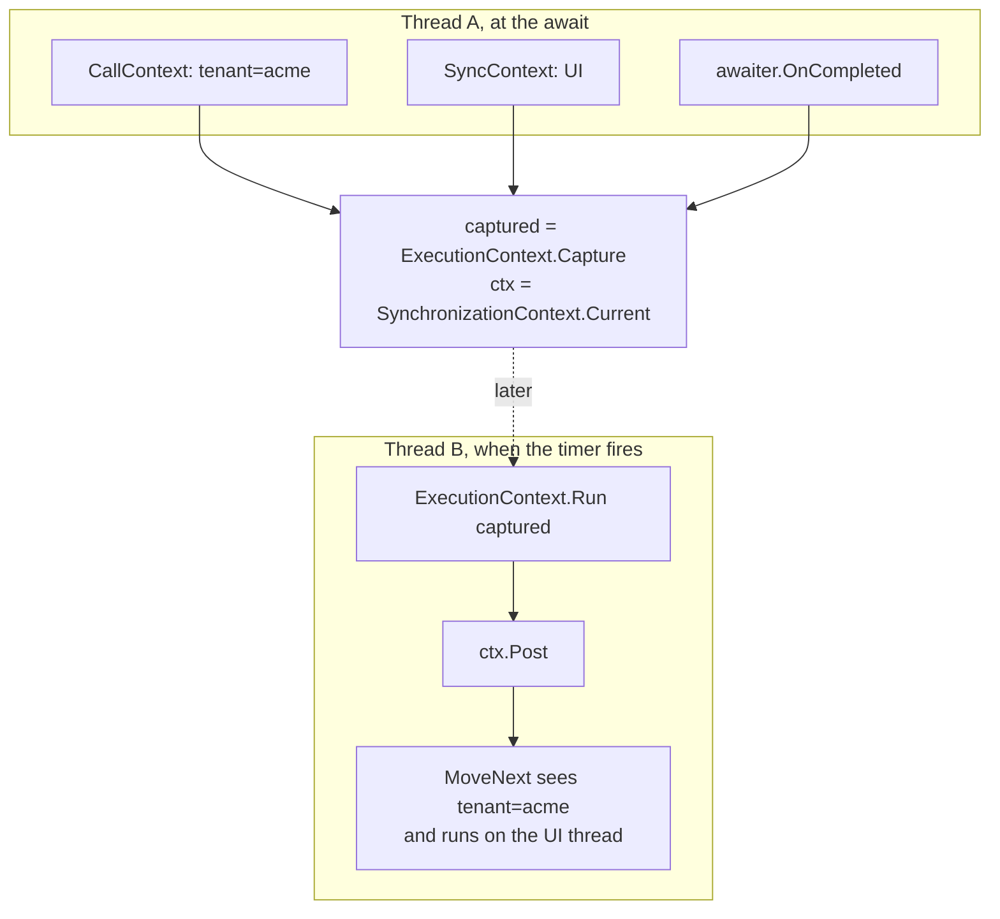

# 5. Context rides along

## At the table

Dee brought the second pitcher of tea without being asked and a basket of fries nobody had ordered. "On the house," she said. "You two have been here three hours and I'm afraid to take the napkins." Behind her, one of the TVs was showing a man in a bass boat holding up a fish. Nobody was watching it.

Kevin was on napkin number six. He had stopped drawing boxes and started drawing little stick figures at desks, which Steve took as a sign that it was sinking in.

"Here's one that's going to bite me," Kevin said. "I keep the current sale in a static. `CurrentSale`. The pulser thread sets it when the valve opens, the display thread reads it to draw the gallons. If my pulser loop wakes up on a pool thread now..."

"Is the static thread-static?"

"No. Plain static, with a lock."

"Then you're fine. One static, and the lock is doing its job." Steve took a fry. "Picture a whiteboard in the break room. Everybody in the building can walk up and read it. The lock is one marker on a string. Only the person holding the marker can write. That's a plain static with a lock. It doesn't care who you are or what desk you sit at."

"Okay."

"The one that bites is `[ThreadStatic]`. That's not a whiteboard. That's a sticky note taped to your own desk. Only you see it. Only that desk has it. People love it because it's a cheap per-request bag: the request starts, you tape the tenant name to your desk, and everything you call can read it. No arguments to pass. It's great, right up until the job leaves your desk."

Kevin stopped with a fry halfway to his mouth. "Leaves."

"Request starts on desk A. You tape on the tenant. Then it hits an `await`, and the thread walks away. When the timer dings, the job wakes up on desk B. Whatever note is taped to desk B is whatever the last job that sat there left. You're reading somebody else's card number."

"We don't do that."

"You don't do that *yet*." Steve said it gently. "The guy before you didn't have pool threads to tempt him. Here's the rule, and it's older than `await`: once your code can wake up on any thread, anything tied to a thread is a bug. No exceptions, no 'but it works on my desk'."

"So how do I carry it?"

"Two fixes. One: put it in the object you're already passing around. The sale. The sale object already has the sale id in it. Hand the sale to whoever needs it. Two: put it in a backpack that travels with the job. On the desktop that's called `ExecutionContext`. The builder packs the backpack right before the thread leaves, and unpacks it right before the job starts again. Doesn't matter which desk it lands on."

"Does CE have the backpack?"

Steve shook his head. "Compact Framework doesn't ship `ExecutionContext`. I pulled the 3.5 assemblies and looked. So on your box, the backpack is off the table, and you do the first fix. Which is the better fix anyway, bro. A value you can see in the argument list is a value you can't forget about."

"And the display thread? That's the one thread I'm keeping. It owns the LCD."

"That one gets a different thing. `SynchronizationContext`. Picture a sign on the job that says 'Return to counter three.' Counter three is the one person allowed to touch the screen. WinForms sets that sign up on the UI thread on the desktop. In 4.5 the switch is `ConfigureAwait`. In this library it's `ContinueOnAnyThread`, and your pulser loop should use it. The pulser has no business hopping over to the display thread just to compare two numbers."

"Does CE have that one?"

"Same look, same answer. CF 3.5 has neither. So the port gets a small interface of its own. One method: post this to my thread. Your display loop implements it with a queue it drains. The awaiter captures that instead. It's the one real design decision in the port, and it's written down in `docs/netcf-port.md` with everything else the assemblies do and don't have. It's built now, too. The interface is `IPostTarget`, a thread registers itself once with `PostTarget.SetForCurrentThread`, and on the desktop the awaiter still looks for a `SynchronizationContext` first."

Kevin leaned back and looked at napkin six for a while. A desk. A taped note. An arrow to a second desk with a different note.

"Two contexts," he said.

"Two contexts, two jobs, one table. Next page." Steve pushed the fries toward him. "Eat. You're going to need it for chapter six. Chapter six has numbers."

Chapter 4 ended on "the method wakes up on a different thread." That raises a question any real system has to answer: what happened to the stuff that was on the old thread?

## The problem

Say a web request sets a tenant id in a **thread-static** before it starts work. A thread-static field is a variable with one copy per thread. Each thread sees only its own copy, like a sticky note taped to its own desk.

```csharp
[ThreadStatic] static string CurrentTenant;
```

Then the request awaits something, and the continuation runs on pool thread 7. (A pool thread is one of the crew's worker threads from the shared thread pool.) Thread 7's `CurrentTenant` is whatever the last request that used thread 7 left there. You are now reading another customer's account number. Toub shows this bug live at 15:55.

Here is that story as a sketch. It is not in the repo. It only shows the mistake:

```csharp
[ThreadStatic] static string CurrentTenant;       // a note taped to this thread's desk

async IFuture<string> Handle(string tenant)
{
    CurrentTenant = tenant;                        // tape the note to desk A
    await Futures.Delay(10);                       // the job leaves; desk A is free for the next job
    return CurrentTenant;                          // wakes up on desk B. Whose note is this?
}
```

**Read it like this.** The first line tapes the customer's name to the desk the job is sitting at. `await` makes the job leave that desk, and the desk gets reused. When the job comes back, it may sit at a different desk, and the last line reads whatever note is taped there. It might be empty. It might be someone else's.

Thread-static is the wrong tool once the thread is not yours.

## ExecutionContext: the bag that travels

.NET has had the fix since 2.0. **`ExecutionContext`** is a bag of ambient state, things like the current tenant, the culture, and security information that code reads without being handed them as arguments. The bag is **captured** (photographed and packed) as an object and **restored** (unpacked) later, on any thread. `CallContext.LogicalSetData` writes into it. Security context and culture ride in it too. In .NET 4.6 `AsyncLocal<T>` is the friendly front door; in 3.5 you use `CallContext` directly.

The builder does the carrying:

```csharp
public void AwaitOnCompleted<TAwaiter, TStateMachine>(ref TAwaiter awaiter, ref TStateMachine stateMachine)
{
    IAsyncStateMachine machine = stateMachine;
    ExecutionContext captured = ExecutionContext.Capture();   // snapshot, here, now
    awaiter.OnCompleted(delegate
    {
        ExecutionContext.Run(captured, delegate { machine.MoveNext(); }, null);   // restore, there, later
    });
}
```

**Read it like this.**

1. `ExecutionContext.Capture()` packs the backpack. It runs right here, at the `await`, on the thread that is about to leave. Whatever the code set with `CallContext.LogicalSetData` is in the bag now.
2. `awaiter.OnCompleted(delegate { ... })` is the pager from chapter 4. We hand over a piece of code to run when the thing finishes.
3. Inside that code, `ExecutionContext.Run(captured, ...)` unpacks the backpack on whatever thread is running it, and only then calls `machine.MoveNext()`. So the method wakes up with its bag in its hands.

Capture at the await. Restore right before `MoveNext`. Whatever thread runs the continuation, the method sees the same logical values it saw before it suspended. The test `ExecutionContext_flows_across_the_await` proves it: set a value, await a timer, read it back on the pool thread, same value.

Toub spends 13:44 to 20:27 on this and it is worth the time. The key sentence: ExecutionContext is captured at queue time and restored at run time, which is why the data follows the work and never the thread.

## The backpack, as a timeline



**In words:**

1. Thread A is running the method. The tenant, `acme`, is in the ambient state.
2. The method hits an `await` that is not ready. It calls the builder's `AwaitOnCompleted`.
3. The builder calls `Capture()`, which packs the backpack. `tenant = acme` is inside.
4. Thread A returns. Its desk is free, and another job may sit there and tape up a different note.
5. The timer fires. A pool thread, thread B, picks up the ticket. Thread B has its own desk and its own notes, none of which are ours.
6. Before touching the machine, thread B calls `ExecutionContext.Run(captured)`, which unpacks the backpack.
7. Now `MoveNext` runs, reads the tenant, and sees `acme`. The data followed the job, not the thread.

**Why it matters:** the backpack is packed once, at the pause, and unpacked once, at the restart. Between those two moments nobody cares which thread or which desk is involved.

## SynchronizationContext: the thread that matters

There is one case where you do want to go back to a specific thread. UI frameworks. WinForms and WPF have one thread that owns the controls, and touching a control from any other thread throws.

That thread has a **`SynchronizationContext.Current`**. A synchronization context is an object that knows how to run a piece of code on one particular thread. Its **`Post`** method says "run this on my thread, when you get to it." Our awaiter captures it:

```csharp
public void OnCompleted(Action continuation)
{
    SynchronizationContext context = _continueOnCapturedContext ? SynchronizationContext.Current : null;
    if (context == null) { _promise.RegisterContinuation(continuation); return; }
    _promise.RegisterContinuation(delegate { context.Post(delegate { continuation(); }, null); });
}
```

**Read it like this.**

1. The first line looks at the current thread's synchronization context: "is there a sign saying return to counter three?" It only looks if `_continueOnCapturedContext` is true. If the flag is false, it uses `null`, which means "no sign".
2. If there is no sign (`context == null`), register the continuation as-is. Whoever finishes the work will run it, on their own thread.
3. If there is a sign, register a continuation that, instead of running the code, calls `context.Post(...)`. That drops the code in counter three's in-tray. The one thread that owns the screen runs it when it gets to it.

On a UI thread, the continuation gets posted back to the UI thread. On a pool thread or a console, `Current` is null and the continuation runs wherever the completion happened.



**In words:**

1. Some thread finishes the work. Maybe it is a timer's pool thread.
2. The awaiter remembers whether, back when `OnCompleted` was called, there was a context to go back to.
3. If there was not, the continuation runs on the finishing thread, right away. No hop.
4. If there was, the awaiter does not run it. It posts it to the context, like dropping a note in the in-tray of the one person allowed to touch the screen.
5. That person, the UI thread, picks the note up when it is ready and runs `MoveNext`.

**Why it matters:** the sign decides where the rest of your method runs. A sign is useful for a screen. It is a waste for a job that only compares two numbers.

## ConfigureAwait(false), under its real name

That `_continueOnCapturedContext` flag is the whole of `ConfigureAwait(false)`. We named ours `ContinueOnAnyThread()` because that is what it does: take the sign off, run wherever. Library code should use it. A library has no business bouncing back to the UI thread for work the UI never sees, and doing so is how you deadlock a `.Result` call on a UI thread.

`Futures.WhenAll` uses it internally for that reason. The caller's own await on the result decides whether to go back to the UI.

## Two contexts, two jobs

| | ExecutionContext | SynchronizationContext |
|---|---|---|
| Carries | ambient data (tenant, trace id, culture) | "which thread should run this" |
| Captured by | the builder, at `AwaitOnCompleted` | the awaiter, at `OnCompleted` |
| Restored by | `ExecutionContext.Run` around `MoveNext` | `context.Post(...)` |
| Turn off with | `ExecutionContext.SuppressFlow()` | `ContinueOnAnyThread()` |
| Real name | same | `ConfigureAwait(false)` |
| The picture | the backpack that travels with the job | the sign that says "return to counter three" |

Both ride along by default. Both can be switched off. Neither one is magic; both are a capture at one point and a restore at another, which is the same move the state machine makes with its locals.

## The picture



**In words:**

1. On the left, thread A is at the `await`. It holds two things: the tenant in the ambient state, and a sync context (the UI sign).
2. The builder and the awaiter each capture one of them: the builder takes `ExecutionContext.Capture()`, the awaiter takes `SynchronizationContext.Current`.
3. The dotted arrow is time passing. Thread A has left.
4. On the right, thread B is the pool thread the timer woke up. It first runs `ExecutionContext.Run`, which unpacks the backpack.
5. Then `ctx.Post` sends the continuation to the UI thread.
6. `MoveNext` runs there, and it sees the tenant, `acme`, because the backpack came along.

**Why it matters:** two different things ride across the gap, and they are handled by two different pieces. The builder carries the data. The awaiter carries the "which thread" instruction.

## The lesson that survives the course

Thread-static state is tied to a thread. Once your code can wake up on any thread, that tie is a bug. Either carry the value in the request object itself, or put it in the bag that travels. We have fixed a tenant leak in a logging pipeline this way: resolve the value on the producer side and carry it in the queued item. Same principle, any repo.

## Words you just met

| Term | Plain meaning | The picture |
|------|---------------|-------------|
| **thread-static** | A field with one copy per thread. Breaks the moment a job can wake on a different thread. | A sticky note taped to one desk |
| **`ExecutionContext`** | A bag of ambient data that is captured at one point and restored at another, on any thread. | The backpack that travels with the job |
| **capture / restore** | Take a snapshot now, put it back later. | Pack the backpack, unpack it |
| **`SynchronizationContext`** | An object that can run code on one particular thread, usually the UI thread. | A sign: "return to counter three" |
| **`Post`** | "Run this on your thread when you get to it." | Dropping a note in counter three's in-tray |
| **`ContinueOnAnyThread`** | Do not go back to the captured thread; run wherever the work finished. | Taking the sign off |
| **`ConfigureAwait(false)`** | The real .NET name for the same switch. | Same as above |
| **pool thread** | One of the shared crew of worker threads from the thread pool. | A crew worker; the desk it sits at is not yours |
