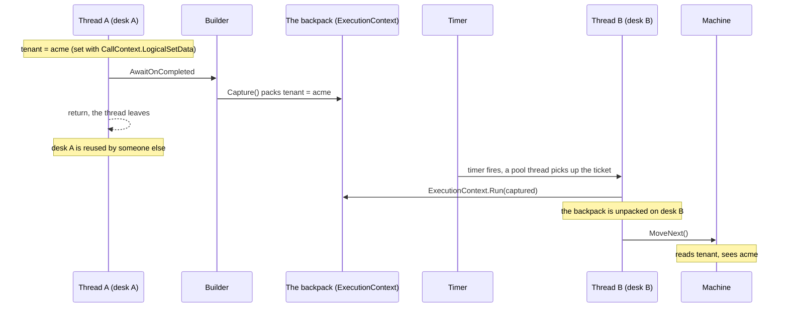
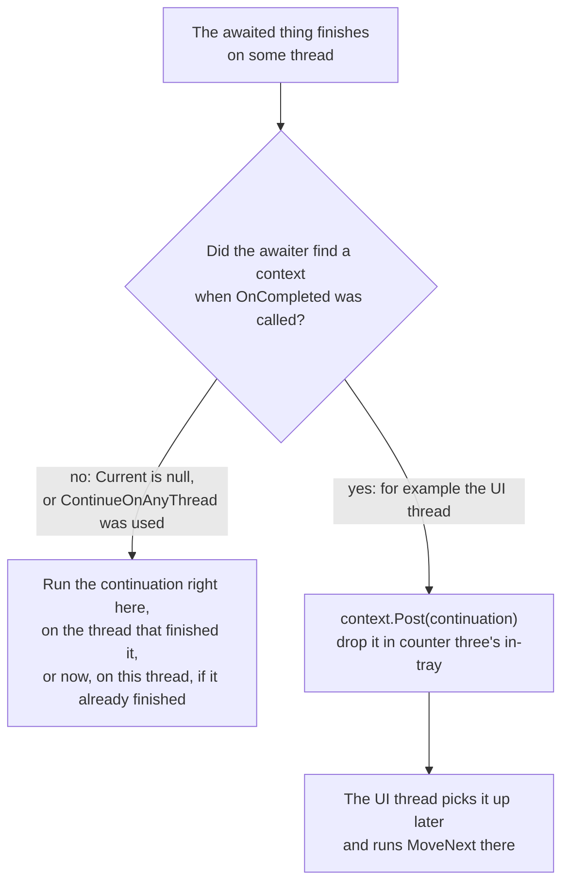
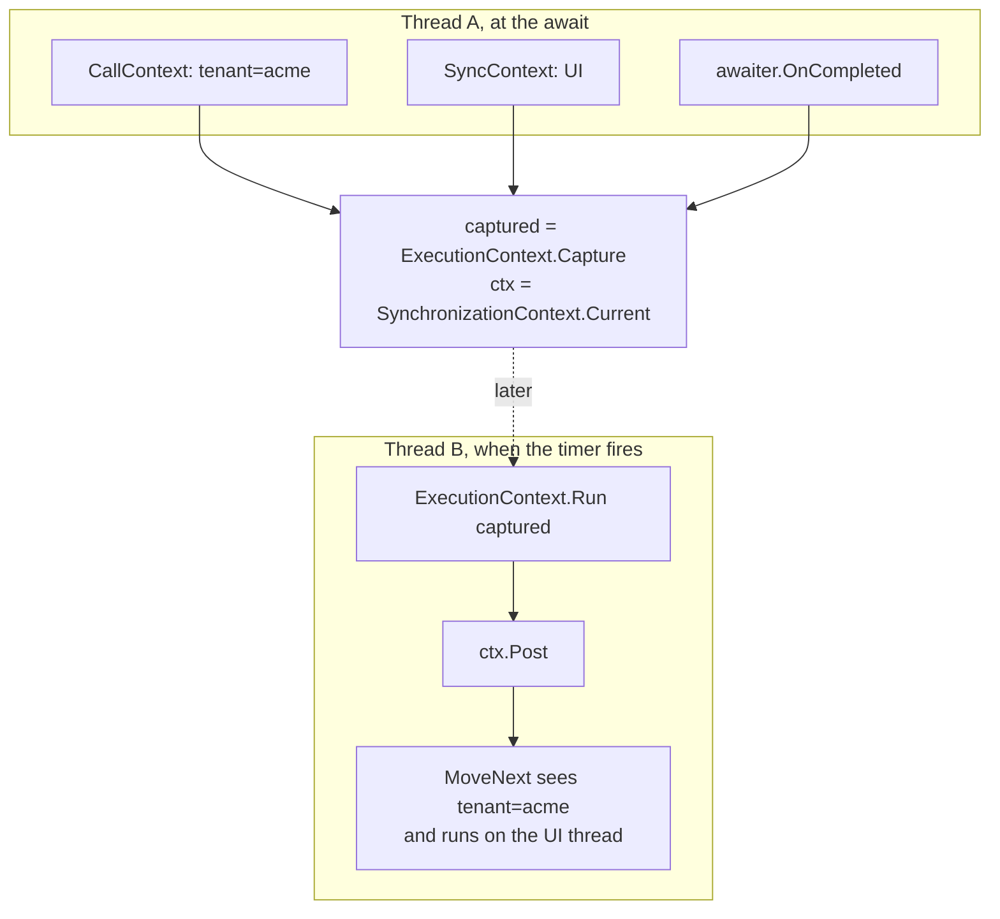

# 5. Context rides along

## At the table

Dee brought a second pitcher of tea without being asked and a basket of fries nobody had ordered. "On the house," she said. "You two have been here three hours and I'm afraid to take the napkins." Behind her, the sports channel had moved from Cowboys highlights to the Rangers game. A Texas batter stepped out of the box and adjusted both gloves while the pitcher waited.

Kevin was on napkin number six. He had stopped drawing boxes and started drawing little stick figures at desks, which Steve took as a sign that it was sinking in.

"Here's one that's going to bite me," Kevin said. "I keep the current sale in a static. `CurrentSale`. The pulser thread sets it when the valve opens, the display thread reads it to draw the gallons. If my pulser loop wakes up on a pool thread now..."

"Is the static thread-static?"

"No. Plain static, with a lock."

"One static means one shared value," Steve said, taking a fry. "The lock makes threads take turns in the protected code. Every read and write that needs that protection must use the same lock. Changing threads does not change which static value you read."

"Okay."

"With `[ThreadStatic]`, each thread has its own copy of the value. Picture a sticky note taped to each thread's desk. Only you see it. Only that desk has it. People love it because it's a cheap per-request bag: the request starts, you tape the tenant name to your desk, and everything you call can read it. No arguments to pass. It's great, right up until the job leaves your desk."

Kevin stopped with a fry halfway to his mouth. "Leaves."

"Request starts on desk A. You tape on the tenant. Then it hits an `await`, and the thread walks away. When the timer dings, the job wakes up on desk B. Whatever note is taped to desk B is whatever the last job that sat there left. You're reading somebody else's card number."

"We don't do that."

"You don't do that *yet*." Steve said it gently. "The guy before you didn't have pool threads to tempt him. Here's the rule, and it's older than `await`: once your code can wake up on another thread, job data stored on the old thread can be missing or wrong."

"So how do I carry it?"

"Two fixes. One: put it in the object you're already passing around. The sale. The sale object already has the sale id in it. Hand the sale to whoever needs it. Two: put it in a backpack that travels with the job. On the desktop that's called `ExecutionContext`. The builder packs the backpack right before the thread leaves, and unpacks it right before the job starts again. Doesn't matter which desk it lands on."

"Does CE have the backpack?"

Steve shook his head. "Compact Framework doesn't ship `ExecutionContext`. I pulled the 3.5 assemblies and looked. So on your box, the backpack is off the table, and you do the first fix. Which is the better fix anyway, bud. A value you can see in the argument list is a value you can't forget about."

"And the display thread? That's the one thread I'm keeping. It owns the LCD."

"That one gets a different thing. `SynchronizationContext`. Picture a sign on the job that says 'Return to counter three.' Counter three is the one person allowed to touch the screen. WinForms sets that sign up on the UI thread on the desktop. In 4.5 the switch is `ConfigureAwait`. In this library it's `ContinueOnAnyThread`, but only the callback form can use it. The iterator form you'll see in chapter 7 always looks for the sign. So start the pulser loop on a thread with no sign on it. The pulser has no business hopping over to the display thread just to compare two numbers."

"Does CE have that one?"

"Same look, same answer. CF 3.5 has neither. So the port gets a small interface of its own. One method: post this to my thread. Your display loop implements it with a queue it drains. The awaiter captures that instead. It's the one real design decision in the port, and it's written down in `docs/netcf-port.md` with everything else the assemblies do and don't have. It's built now, too. The interface is `IPostTarget`, a thread registers itself once with `PostTarget.SetForCurrentThread`, and on the desktop the awaiter still looks for a `SynchronizationContext` first."

Kevin leaned back and looked at napkin six for a while. A desk. A taped note. An arrow to a second desk with a different note.

"Two contexts," he said.

"Two contexts, two jobs, one table." Steve pushed the fries toward him. "Eat. Next we'll compare threads, pool jobs, and state machines. That part has numbers."

The awaiter-and-builder discussion showed that a method can resume on a different thread. That raises a question any real system has to answer: what happened to the stuff that was on the old thread?

## The problem

Say a web request sets a tenant id in a **thread-static** before it starts work. A thread-static field is a variable with one copy per thread. Each thread sees only its own copy, like a sticky note taped to its own desk.

```csharp
[ThreadStatic] static string CurrentTenant; // one value per thread, not per request
```

Then the request awaits something, and the continuation runs on pool thread 7. (A pool thread is one of the crew's worker threads from the shared thread pool.) Thread 7 reads its own `CurrentTenant`. That value may be empty, or a previous request may have left another tenant's name there. The continuation can therefore select the wrong customer's data. Toub shows this bug live at 15:55.

This intentionally flawed sketch uses conceptual modern `async` syntax. It cannot compile with Kevin's C# 3 compiler. Its `IFuture<string>` return also needs custom async-return support beyond C# 5. The sketch shows the thread-static mistake:

<!-- fence: sketch exercise: deliberately broken, modern C# for comparison -->
```csharp
[ThreadStatic] static string CurrentTenant;       // a note taped to this thread's desk

async IFuture<string> Handle(string tenant)
{
    CurrentTenant = tenant;                        // tape the note to desk A
    await Futures.Delay(10);                       // the job leaves; desk A is free for the next job
    return CurrentTenant;                          // wakes up on desk B. Whose note is this?
}
```

**Read it like this.** The first line tapes the customer's name to the desk the job is sitting at. `await` makes the job leave that desk, and the desk gets reused. When the job comes back, it may sit at a different desk, and the last line reads whatever note is taped there. It might be empty. It might be someone else's.

Keep per-request data with the request when work can move between threads.

## ExecutionContext: the bag that travels

**`ExecutionContext`** carries supported ambient data across a thread change. Ambient data is information code can read without receiving it as an argument. On desktop .NET 3.5, `CallContext.LogicalSetData` stores logical call data, such as a tenant name. The builder captures that data before suspension and restores it when the method resumes. Newer .NET versions also offer `AsyncLocal<T>`. The details of which other values flow, including culture, depend on the runtime version.

The builder does the carrying. This shortened desktop excerpt comes from [AsyncMethodBuilder{T}.cs](../../src/MMP.AsyncProxy/Builder/AsyncMethodBuilder%7BT%7D.cs). It omits generic constraints and the separate Compact Framework branch:

```csharp
public void AwaitOnCompleted<TAwaiter, TStateMachine>(ref TAwaiter awaiter, ref TStateMachine stateMachine)
{
    IAsyncStateMachine machine = stateMachine;
    ExecutionContext captured = ExecutionContext.Capture();   // capture supported ambient data at registration
    if (captured == null)                                     // flow was switched off: nothing to carry
    {
        awaiter.OnCompleted(machine.MoveNext);
        return;
    }
    awaiter.OnCompleted(delegate
    {
        // Apply the captured data during MoveNext, then restore this thread's previous context.
        ExecutionContext.Run(captured, delegate { machine.MoveNext(); }, null);
    });
}
```

**Read it like this.**

1. `ExecutionContext.Capture()` packs the backpack. It runs right here, at the `await`, on the thread that is about to leave. Whatever the code set with `CallContext.LogicalSetData` is in the bag now.
2. `awaiter.OnCompleted(delegate { ... })` registers code to run when the operation finishes. In the earlier awaiter discussion's restaurant example, this is the action after the pager buzzes.
3. If `Capture()` gives back `null`, the code that set things up turned flow off (`ExecutionContext.SuppressFlow()`), so there is no backpack to carry and the continuation is just `MoveNext`. (On the Compact Framework build this whole method is that one line, `awaiter.OnCompleted(machine.MoveNext)`, because that platform has no `ExecutionContext` at all.)
4. Inside the other branch's code, `ExecutionContext.Run(captured, ...)` unpacks the backpack on whatever thread is running it, and only then calls `machine.MoveNext()`. The resumed method can then read the captured values.

Capture at the await. Restore right before `MoveNext`. Whatever thread runs the continuation, the method sees the same logical values it saw before it suspended. The test `ExecutionContext_flows_across_the_await` shows it: set a value, await a timer, read it back on the pool thread, same value. The test passes through this builder, and the shared timer flows no context of its own (see `DelayWheel.CreateTimer`), so the builder is what carried the value.

Toub covers context capture and restore from 13:44 to 20:27. In this library, the builder captures context when it registers the continuation. It restores that context when the continuation runs.

## The backpack, as a timeline



**In words:**

1. Thread A is running the method. The tenant, `acme`, is in the ambient state.
2. The method hits an `await` that is not ready. It calls the builder's `AwaitOnCompleted`.
3. The builder calls `Capture()`, which packs the backpack. `tenant = acme` is inside.
4. Thread A returns. Its desk is free, and another job may sit there and tape up a different note.
5. The timer fires. A pool thread, thread B, picks up the ticket. Thread B has its own desk and its own notes, none of which are ours.
6. Before touching the machine, thread B calls `ExecutionContext.Run(captured)`, which unpacks the backpack.
7. Now `MoveNext` runs, reads the tenant, and sees `acme`. The data followed the job, not the thread.


## SynchronizationContext: the thread that matters

There is one case where you do want to go back to a specific thread. UI frameworks. WinForms and WPF have one thread that owns the controls, and touching a control from any other thread throws.

That thread has a **`SynchronizationContext.Current`**. A synchronization context decides where posted code runs. A UI context sends it to the UI thread. Its **`Post`** method schedules a callback through that context. A UI context queues it for its UI thread. This excerpt from [FutureAwaiter{T}.cs](../../src/MMP.AsyncProxy/Core/FutureAwaiter%7BT%7D.cs) captures the context when `OnCompleted` is called:

```csharp
public void OnCompleted(Action continuation)
{
#if !NETCF
    SynchronizationContext context = _continueOnCapturedContext ? SynchronizationContext.Current : null;
    if (context != null)
    {
        // Save a wrapper now; completion posts the actual continuation to this context.
        _promise.RegisterContinuation(delegate { context.Post(delegate { continuation(); }, null); });
        return;
    }
#endif
    // The Compact Framework has no SynchronizationContext. A thread that wants continuations
    // back registers an IPostTarget once; see PostTarget.
    IPostTarget target = _continueOnCapturedContext ? PostTarget.Current : null;
    // Without a destination, the promise decides whether to call inline or queue,
    // or runs it now, on this thread, if it already finished.
    if (target == null)
    {
        _promise.RegisterContinuation(continuation);
        return;
    }
    _promise.RegisterContinuation(delegate { target.Post(continuation); });
}
```

**Read it like this.**

1. The first block (not compiled on the Compact Framework) looks at the current thread's synchronization context: "is there a sign saying return to counter three?" It only looks if `_continueOnCapturedContext` is true. If the flag is false, it uses `null`, which means "no sign".
2. If there is a sign, register a continuation that, instead of running the code, calls `context.Post(...)`. That drops the code in counter three's in-tray. The one thread that owns the screen runs it when it gets to it. Then stop.
3. If there is no `SynchronizationContext`, the awaiter asks for a **post target** (`IPostTarget`), which is the same idea without the .NET class. It is a registry the thread filled in earlier, and it is described just below. If there is none of those either, register the continuation as-is. The promise runs it on the finishing thread by default. A promise created with `RunContinuationsAsynchronously` queues it to the thread pool. If the promise already finished before the registration, the continuation runs now, on the registering thread, whatever the option says.

A captured UI context posts the continuation back to the UI thread. Without a captured context or post target, the promise's completion option decides whether to run it inline or queue it, or it runs now, on this thread, if the promise already finished.

### The same sign on the Compact Framework: `IPostTarget`

The Compact Framework does not ship `SynchronizationContext`, so the library has a small copy of the idea. `IPostTarget` has one method, `Post(Action)`: "run this on my thread, later, never inline." A thread that wants continuations back, like Kevin's display thread, registers itself once at startup. This application sketch omits the `DisplayQueue` implementation and message loop. That queue must accept posts from other threads; only the display thread drains it. See [PostTarget.cs](../../src/MMP.AsyncProxy/Core/PostTarget.cs) for the library registry:

```csharp
// On the display thread, once, when it starts. It owns the LCD, so continuations come back here.
PostTarget.SetForCurrentThread(new DisplayQueue());   // DisplayQueue.Post puts the action on the queue this thread drains
...
PostTarget.SetForCurrentThread(null);                 // take the sign down when the thread ends
```

**Read it like this.** `SetForCurrentThread` writes "the target for *this* thread" into a small list. The awaiter's `PostTarget.Current` looks up the calling thread in that list at the `await`. There is no thread-local variable involved, because the Compact Framework has no `ThreadStatic` either. The list is kept as a tiny array that is copied when it changes, and looked up by the thread's managed id. On the desktop builds, `SynchronizationContext.Current` is checked first and the registry second, so an app can use either one, and separate tests cover each path.



**In words:**

1. Some thread finishes the work. Maybe it is a timer's pool thread.
2. The awaiter remembers whether, back when `OnCompleted` was called, there was a context to go back to.
3. Without a captured context, a default promise runs its registered continuation on the finishing thread. The asynchronous-continuations option queues it instead.
4. If there was, the awaiter does not run it. It posts it to the context, like dropping a note in the in-tray of the one person allowed to touch the screen.
5. That person, the UI thread, picks the note up when it is ready and runs `MoveNext`.


## ConfigureAwait(false), under its real name

Setting `_continueOnCapturedContext` to false skips the return to a captured context. Our `ContinueOnAnyThread()` serves that purpose here, similar to `ConfigureAwait(false)` on a task. It permits any completion thread; it does not force a new thread. The builder still carries `ExecutionContext`. Library code should use it. A library has no business bouncing back to the UI thread for work the UI never sees, and doing so is how you deadlock a `.Result` call on a UI thread.

`Futures.WhenAll` uses it internally for that reason. The caller's own await on the result decides whether to go back to the UI.

## Two contexts, two jobs

| | ExecutionContext | SynchronizationContext |
|---|---|---|
| Carries | ambient data (tenant, trace id, culture) | "which thread should run this" |
| Captured by | the builder, at `AwaitOnCompleted` | the awaiter, at `OnCompleted` |
| Restored by | `ExecutionContext.Run` around `MoveNext` | `context.Post(...)` |
| Turn off with | `ExecutionContext.SuppressFlow()` | `ContinueOnAnyThread()` |
| Real name | same | `ConfigureAwait(false)` |
| The picture | the backpack that travels with the job | the sign that says "return to counter three" |

On desktop builds, the builder captures execution context by default. The awaiter also captures a synchronization context or post target when one is present. On Compact Framework, only the post-target path is available.

## The picture



**In words:**

1. On the left, thread A is at the `await`. It holds two things: the tenant in the ambient state, and a sync context (the UI sign).
2. The builder and the awaiter each capture one of them: the builder takes `ExecutionContext.Capture()`, the awaiter takes `SynchronizationContext.Current`.
3. The dotted arrow is time passing. Thread A has left.
4. Thread B handles the completion. The diagram groups the two context operations together; the actual callback order is important.
5. The awaiter first calls `ctx.Post` to queue the builder's continuation on the UI thread.
6. On the UI thread, that continuation calls `ExecutionContext.Run`. It restores the captured tenant, then calls `MoveNext`. The method reads `acme` there.


## The lesson that survives the course

Thread-static state belongs to one thread. Per-request data can be lost or mixed up when the request resumes on another thread. Either carry the value in the request object itself, or put it in the bag that travels. We have fixed a tenant leak in a logging pipeline this way: resolve the value on the producer side and carry it in the queued item. Same principle, any repo.

## Words you just met

| Term | Plain meaning | The picture |
|------|---------------|-------------|
| **thread-static** | A field with one copy per thread. Breaks the moment a job can wake on a different thread. | A sticky note taped to one desk |
| **`ExecutionContext`** | A bag of ambient data that is captured at one point and restored at another, on any thread. | The backpack that travels with the job |
| **capture / restore** | Take a snapshot now, put it back later. | Pack the backpack, unpack it |
| **`SynchronizationContext`** | An object that can run code on one particular thread, usually the UI thread. | A sign: "return to counter three" |
| **`Post`** | "Run this on your thread when you get to it." | Dropping a note in counter three's in-tray |
| **`ContinueOnAnyThread`** | Skip context capture; the promise decides whether to run inline or queue. | Taking the sign off |
| **`ConfigureAwait(false)`** | The real .NET name for the same switch. | Same as above |
| **pool thread** | One of the shared crew of worker threads from the thread pool. | A crew worker; the desk it sits at is not yours |
