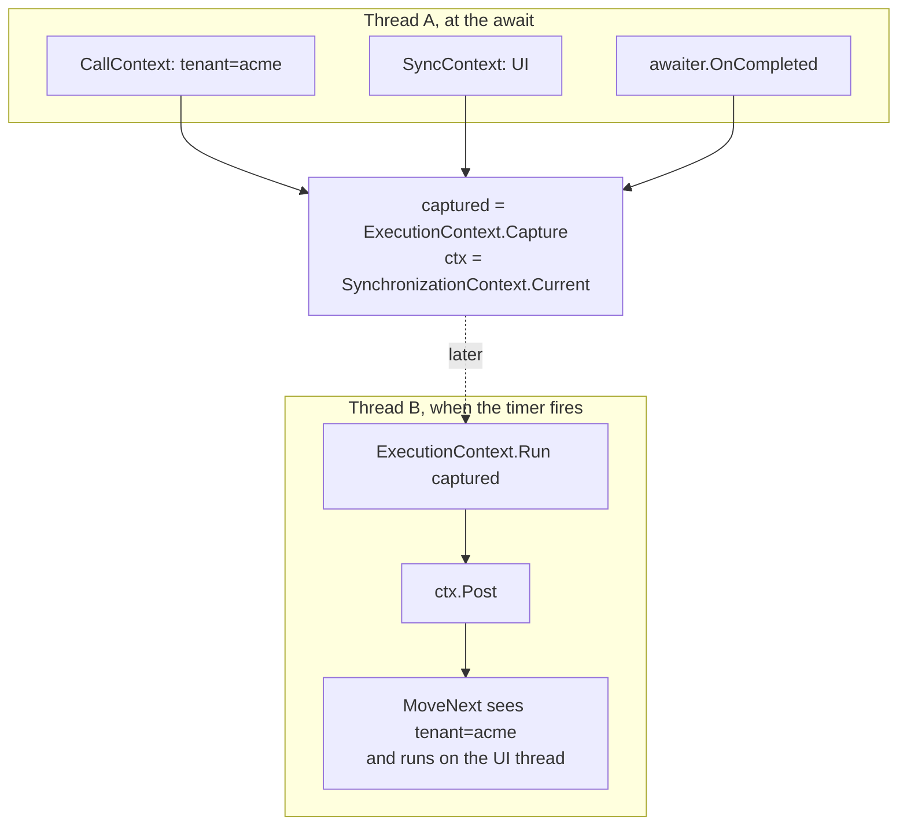

# 5. Context rides along

Chapter 4 ended on "the method wakes up on a different thread." That raises a question any real system has to answer: what happened to the stuff that was on the old thread?

## The problem

Say a web request sets a tenant id in a thread-static before it starts work:

```csharp
[ThreadStatic] static string CurrentTenant;
```

Then it awaits something, and the continuation runs on pool thread 7. Thread 7's `CurrentTenant` is whatever the last request that used thread 7 left there. You are now reading another customer's account number. Toub shows this bug live at 15:55.

Thread-static is the wrong tool once the thread is not yours.

## ExecutionContext: the bag that travels

.NET has had the fix since 2.0. `ExecutionContext` is a bag of ambient state that is captured as an object and restored later, on any thread. `CallContext.LogicalSetData` writes into it. Security context and culture ride in it too. In .NET 4.6 `AsyncLocal<T>` is the friendly front door; in 3.5 you use `CallContext` directly.

The builder does the carrying:

```csharp
public void AwaitOnCompleted<TAwaiter, TStateMachine>(ref TAwaiter awaiter, ref TStateMachine stateMachine)
{
    IAsyncStateMachine machine = stateMachine;
    ExecutionContext captured = ExecutionContext.Capture();   // snapshot, here, now
    awaiter.OnCompleted(delegate
    {
        ExecutionContext.Run(captured, delegate { machine.MoveNext(); }, null);   // restore, there, later
    });
}
```

Capture at the await. Restore right before `MoveNext`. Whatever thread runs the continuation, the method sees the same logical values it saw before it suspended. The test `ExecutionContext_flows_across_the_await` proves it: set a value, await a timer, read it back on the pool thread, same value.

Toub spends 13:44 to 20:27 on this and it is worth the time. The key sentence: ExecutionContext is captured at queue time and restored at run time, which is why the data follows the work and never the thread.

## SynchronizationContext: the thread that matters

There is one case where you do want to go back to a specific thread. UI frameworks. WinForms and WPF have one thread that owns the controls, and touching a control from any other thread throws.

That thread has a `SynchronizationContext.Current`. `Post` on it says "run this on my thread, when you get to it." Our awaiter captures it:

```csharp
public void OnCompleted(Action continuation)
{
    SynchronizationContext context = _continueOnCapturedContext ? SynchronizationContext.Current : null;
    if (context == null) { _promise.RegisterContinuation(continuation); return; }
    _promise.RegisterContinuation(delegate { context.Post(delegate { continuation(); }, null); });
}
```

On a UI thread, the continuation gets posted back to the UI thread. On a pool thread or a console, `Current` is null and the continuation runs wherever the completion happened.

## ConfigureAwait(false), under its real name

That `_continueOnCapturedContext` flag is the whole of `ConfigureAwait(false)`. We named ours `ContinueOnAnyThread()` because that is what it does. Library code should use it: a library has no business bouncing back to the UI thread for work the UI never sees, and doing so is how you deadlock a `.Result` call on a UI thread.

`Futures.WhenAll` uses it internally for that reason. The caller's own await on the result decides whether to go back to the UI.

## Two contexts, two jobs

| | ExecutionContext | SynchronizationContext |
|---|---|---|
| Carries | ambient data (tenant, trace id, culture) | "which thread should run this" |
| Captured by | the builder, at `AwaitOnCompleted` | the awaiter, at `OnCompleted` |
| Restored by | `ExecutionContext.Run` around `MoveNext` | `context.Post(...)` |
| Turn off with | `ExecutionContext.SuppressFlow()` | `ContinueOnAnyThread()` |
| Real name | same | `ConfigureAwait(false)` |

Both ride along by default. Both can be switched off. Neither one is magic; both are a capture at one point and a restore at another, which is the same move the state machine makes with its locals.

## The picture



## The lesson that survives the course

Thread-static state is tied to a thread. Once your code can wake up on any thread, that tie is a bug. Either carry the value in the request object itself, or put it in the bag that travels. We have fixed a tenant leak in a logging pipeline this way: resolve the value on the producer side and carry it in the queued item. Same principle, any repo.
