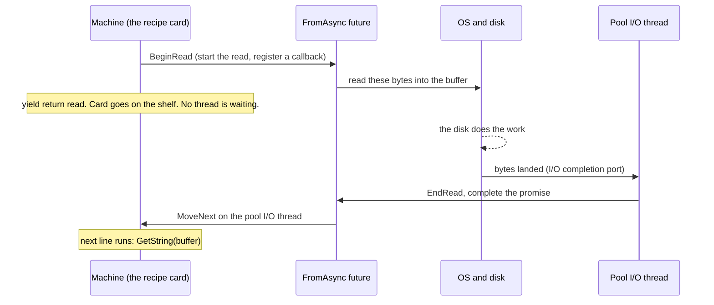

# 6. Threads versus the machine

## At the table

Dee poured Kevin another glass from the pitcher she had brought with the fries, then refilled Steve's coffee. Kevin left his tea untouched and numbered a clean napkin seven.

"Numbers," he said. "Before I believe any of this, I want numbers. I've sat through demos before. Everything works in a demo."

"Good. You should." Steve had the console up already. He had been holding it in his lap like a man holding a winning ticket. "Two thousand requests. Each one waits two hundred milliseconds, and then it adds two numbers. We do it three ways. I want you to watch one column. The one that says *threads*."

"Why that one?"

"Because that's where your 64 megs go."

A small battery icon in the corner of the laptop turned red. Steve sighed, dug a power brick out of his bag, and crawled halfway under the booth to find the outlet. Kevin got a few seconds of free time to look at the screen. He read the table once. Then he read it again, slower, with his lips moving a little.

"Thirteen hundred threads."

"Thirteen ninety-two at the peak, for the thread-per-request row." Steve's voice came up from under the table. "And it worked. Five hundred and some milliseconds, all two thousand done. Now look at row three. Two hundred and twenty-six milliseconds, and the thread count is thirty-three."

"Thirty-three is a lot."

"Thirty-three is what this process has sitting around before the test even starts. It added *zero*, bud. Zero threads for two thousand requests."

Kevin leaned back. "That's a 24-core desktop."

"It's a 24-core desktop, yeah." Steve came back up with the power cord and a cobweb on his sleeve. "Your box is one little ARM core and 64 meg. The numbers will be different. Expect the *shape* to hold; only a run on your board shows it. My guess is row one gets worse on your box, not better, because a thread eats a bigger piece of what you have. Run it yourself tonight. It's a console. It builds for net48 so it runs on any Windows laptop, and it's C# 3, so you can read every line."

Kevin put his finger on the middle row. "What's row two? The thread pool one. It's only got sixty-four requests next to it."

"Row two is the one I want to spend time on." Steve picked a napkin off the stack, looked at it, and put it down again. "Row two looks like the *right* answer. People write it every day. It is the most common way to quietly wreck a server. I'll show you a small example with four workers."

"Four workers?"

"Dee. Can we get a third basket? All not-hot ones this time."

"You can get whatever you want, honey," Dee said, already walking. She brought the basket while Steve was setting up the pool example.

Kevin pointed at the napkin. "My pulser thread is row one."

"Your pulser thread is row one *with one row*. Your serial thread is row one with one row. You're fine at one." Steve tapped the table. "You told me you're about to have ten."

Kevin did not say anything. Out on the frontage road a truck went by with its headlights on. On the TV over the bar, a Rangers runner took a long lead off first until the pitcher turned and sent him scrambling back.

"Okay," Kevin said. "Run it."

## Run it

```
dotnet run --project samples/MMP.AsyncProxy.Comparison -- 2000
```

The program takes a number, N. It makes N requests. Each request waits 200 ms and then adds two numbers. The 200 ms wait stands in for anything slow: a network call, a disk read, a customer answering a door. The program does the same work three different ways and puts a stopwatch on each one.

The program compares these three ways to handle waiting requests:

1. **A thread per request.** Create a thread for each request. It sleeps, adds the numbers, then exits.
2. **The thread pool, with a sleep inside the job.** Queue each request to the shared pool. Each job occupies a worker throughout its sleep.
3. **A state machine per request.** Save the request's inputs and next step in an object. A timer tracks the delay. A pool thread runs the calculation when the delay ends.

## What we got

Measured on 2026-11-03 on a 24-core Windows desktop, .NET Framework 4.8:

```
Requests: 2000, each waits 200 ms then adds two numbers.
Cores: 24

approach                           elapsed ms   peak threads           ok
thread per request (Sleep)                533           1392          yes
thread pool + Sleep (starves)             626             33          yes  (capped at 64 requests)
state machine + Delay (no wait)           226             33          yes

The third row does the same work with the thread count of an idle process.
Nothing waited on a thread. The timer waited, and the pool ran the callbacks.
```

The rows print in order, so the first row is row 1, the second is row 2, and the third is row 3.

Read the columns like this:

- **elapsed ms** is how long the whole batch took, start to finish. Each request waits 200 ms. If all requests start together, the batch can finish shortly after 200 ms. Starting and finishing the requests adds overhead.
- **peak threads** is the most threads the program had alive at once. This counts every live thread in the process, including blocked threads.
- **ok** says each row passed the result check for its own request count. Row two used 64 requests; the other rows used 2,000.

Your results depend on hardware, runtime, and other work in the process. Compare the cost of holding threads during waits.

## Row 1: a thread per request

The following blocks are excerpts, not complete programs. [Program.cs](../../samples/MMP.AsyncProxy.Comparison/Program.cs) contains setup and completion checks. Here `a` is one request's input, `DelayMs` is 200, and `sum[0]` is the shared total. The surrounding loop gives each request its own input.

```csharp
Thread t = new Thread((ThreadStart)delegate
{
    // This dedicated thread stays occupied for the entire delay.
    Thread.Sleep(DelayMs);
    // Other requests update the same total, so the addition must be atomic.
    Interlocked.Add(ref sum[0], a + 1);
});
t.Start();
```

**Read it like this.** For each of the 2,000 requests: make a brand-new thread, tell it to sleep for 200 ms, then add to the shared total. `Interlocked.Add` is a safe way to add to a number that many threads share without them stepping on each other.

The program created 2,000 threads over the batch. At the busiest moment, 1,392 were alive at once, almost all blocked in `Sleep`. Each kept its stack and operating-system record.

It works. The batch took 533 ms, while each request waited 200 ms. Starting, scheduling, and destroying threads adds overhead. The timing table does not measure each cost separately. A sleeping thread keeps its memory, but the scheduler chooses among ready threads. With much larger batches, thread creation can fail when the process runs out of resources.

## Row 2: The parked-car problem (thread pool starvation)

This is row two, and it is extremely informative. It looks useful, but it is also the easiest mistake to make, because it looks like the *correct* answer.

### First, what the pool is for

Chapter 1 introduced the **thread pool**. Quick reminder: it is a small crew of worker threads that the whole program shares, plus a job board. You do not hand the pool a thread. You pin a **work item**, a small piece of code on a ticket, to the board with `ThreadPool.QueueUserWorkItem`. A free crew worker takes the next ticket, does it, and goes back for another.

That only works if tickets are *quick*. Each worker can run one work item at a time. A sleeping work item keeps that worker occupied until the sleep ends.

### Four workers, 64 queued jobs

Suppose the pool has four free workers, and you queue 64 jobs. Each job sleeps for 200 ms, then adds to a total.

The first four jobs start and occupy all four workers. While those jobs sleep, the other 60 remain queued. The sleeping jobs use no CPU time, but their workers cannot start another job until the sleep ends.

The pool may add workers when jobs stay queued, within its limits. That takes time and adds thread resources. With asynchronous delays, all 64 jobs can start their waits without each occupying a worker.

### The queued waits in code

This illustrative fragment assumes a shared integer `delivered`, initially zero. The surrounding program must wait for jobs to finish before reading the final count:

```csharp
for (int i = 0; i < 64; i++)
{
    ThreadPool.QueueUserWorkItem(delegate
    {
        Thread.Sleep(200);        // this work item holds its worker through the delay
        Interlocked.Increment(ref delivered);
    });
}
```

**Read it like this.** Sixty-four times, pin a ticket to the board. Each ticket says "sleep for 200 ms, then count one delivery." The sleep keeps a pool worker occupied for 200 ms. While a crew worker sleeps, it can run nothing else and nobody else can use it.

### The measured proof

The repo has a small program that prints *when each job actually started*, so you can count the waves. Run it:

```
dotnet run --project samples/MMP.AsyncProxy.Comparison -- waves 64
```

Measured on 2026-11-03 on the same 24-core Windows desktop, .NET Framework 4.8:

```
Jobs: 64, each one sleeps 200 ms. Cores: 24. The pool starts with 24 worker threads.

A. Thread pool, and every job sleeps (the crew parks in their cars):
  wave  1:  24 jobs started at about     0 ms
  wave  2:  24 jobs started at about   206 ms
  wave  3:  16 jobs started at about   420 ms
  all 64 jobs finished after 632 ms

B. The same jobs as state machines on a Futures.Delay (no crew member parks):
  wave  1:  64 jobs started at about     1 ms
  all 64 jobs finished after 217 ms

Ideal is about 200 ms: everybody waits at the same time.
```

Read it like this. Every one of the 64 jobs only needs to *wait* 200 ms, and they could all wait at the same time, so the best possible finish is about 200 ms. Version B finished in 217. Version A took 632 ms, about three times longer. The reason is in the first column: the jobs started in **waves**, about 200 ms apart. This desktop's pool starts with 24 workers, so only 24 jobs could be waiting at once, one for each crew worker. That gives 24, then 24, then 16. It is the four-worker story from above with a bigger crew. The table's 626 ms for row two is the same three waves.

```mermaid
gantt
    title 64 jobs that each wait 200 ms, on a crew of 24 (drawn to scale)
    dateFormat X
    axisFormat %L
    section thread pool + Sleep
    wave 1 - 24 jobs parked      :w1, 0, 206
    wave 2 - 24 jobs parked      :w2, 206, 420
    wave 3 - 16 jobs parked      :w3, 420, 632
    section timers + state machines
    all 64 jobs wait together    :t1, 0, 217
```



**In words:**

1. Top bar, "wave 1." The pool has 24 crew workers, so 24 jobs start at once, at time zero, and each one goes to sleep for 200 ms.
2. All 24 workers are now asleep inside their jobs. The other 40 tickets sit on the board. Nothing can pick them up.
3. At about 200 ms the 24 sleepers wake up and finish. Their workers are free again, so the next 24 tickets start. That is "wave 2."
4. Wave 3 does the same thing about 200 ms later, with the last 16 tickets.
5. After three waves the last job finishes at 632 ms.
6. Bottom bar: with timers, all 64 jobs start at once and wait *at the same time*. Nobody is parked, because the wait is a kitchen timer and not a worker. The whole batch is done in 217 ms.


### How bad does it get?

Run it with 2,000 jobs on the same desktop (`waves 2000`) and version A took **16,720 ms**, about seventeen seconds. Version B took **216 ms**. (Most waves held about 24 jobs, 200 ms apart. 2,000 jobs on 24 workers is about 84 waves, and 84 times 200 ms is about 16.8 seconds. The pool hired a few extra workers as the board stayed backed up, which only helped a little. Version A was still more than seventy times slower.) On a real server a seventeen-second pause is not a slow page. It is an outage, and nothing in the code looks broken. Kevin's box has one core, so its crew starts much smaller, and the waves get longer.

### The fix is not a bigger crew

You can tell the pool to start with more workers (`ThreadPool.SetMinThreads`). It helps a little and then you are back to row 1: lots of desks, mostly asleep. Use an asynchronous delay so the worker can run another job during the wait. When the delay expires, a pool thread runs the next step. That is row three.

## Row 3: a state machine per request

```csharp
private static IEnumerable<IFuture> OneRequest(int a, int[] sum)
{
    // The driver saves this future and returns while the timer tracks the delay.
    yield return Futures.Delay(DelayMs);
    // Several resumed requests may update the shared total at the same time.
    Interlocked.Add(ref sum[0], a + 1);
}
// ...
futures[i] = AsyncProxy.Run(OneRequest(i, sum));
// The console main thread waits for the batch; individual waits hold no workers.
Futures.WhenAll(futures).Wait();
```

**Read it like this.**

- `yield return Futures.Delay(DelayMs);` means "set a kitchen timer for 200 ms and put the recipe card on the shelf." This uses the saved-step idea from the earlier state-machine walkthrough in chapter 3. No thread waits here.
- When the timer dings, a crew worker picks the card up at the bookmark, runs the next line (add to the total), and goes straight back to the board. The time depends on the callback and the machine running it.
- `AsyncProxy.Run(...)` builds the card (the state machine) and starts it. You get back a future for it.
- `Futures.WhenAll(futures).Wait()` is the "wait until every order is done" line. It sits at the very top of a console program, which blocks the console's main thread until the batch finishes. Each request still waits without holding a worker.

Result: 226 ms for 2,000 requests, and the peak thread count is 33. That is the number of threads this process had *before* the test started, so the test added none. The delay entries store deadlines instead of holding sleeping workers. Checking those deadlines and running callbacks still uses some CPU time. Every `Futures.Delay` in the process rides on that one timer (the library's `DelayWheel`), like a single egg timer that can count down for thousands of orders.

Each request does the same calculation after a delay. The batch sizes differ, so compare both the request count and the elapsed time. The three versions hold a dedicated thread, hold a pool worker, or save a callback while the timer tracks the delay.

## The table, as a picture

```mermaid
gantt
    title 2000 requests, 200 ms wait each (relative scale)
    dateFormat X
    axisFormat %L
    section thread per request
    1392 threads, 533 ms      :a1, 0, 533
    section pool + Sleep
    64 requests only, 626 ms  :a2, 0, 626
    section state machine
    33 threads, 226 ms        :a3, 0, 226
```



**In words:**

1. Three bars start at time zero, one for each way of doing the work. Longer means slower.
2. The top bar (Row 1), a thread per request, runs for 533 ms. It did all 2,000 requests, but it used up to 1,392 threads to do it.
3. The middle bar (Row 2), the pool with a sleep inside, runs for 626 ms. Look closely at the label: it handled only 64 requests, not 2,000. It was *already* slower than the top bar with thirty times less work.
4. The bottom bar (Row 3), state machines, runs for 226 ms and handled all 2,000 with the thread count of an idle process.


## The real thing: a file read with no thread

The timer is a stand-in. This is an iterator-body excerpt from [FromAsyncTests.cs](../../tests/MMP.AsyncProxy.Tests/FromAsyncTests.cs). Its enclosing method supplies `path` and the shared `Return<string> ret` result box:

```csharp
using (var stream = new FileStream(path, FileMode.Open, FileAccess.Read, FileShare.Read, 4096, FileOptions.Asynchronous))
{
    var buffer = new byte[(int)stream.Length];
    // The adapter calls BeginRead now and EndRead when its callback arrives.
    var read = Futures.FromAsync<int>(
        (cb, state) => stream.BeginRead(buffer, 0, buffer.Length, cb, state),
        stream.EndRead);
    yield return read;                 // stream and buffer stay alive while the read is pending
    // Result is the number of bytes actually read, which can be less than requested.
    ret.Value = Encoding.UTF8.GetString(buffer, 0, read.Result);
}
```

This small-file test performs one read. A production whole-file reader must repeat reads until it reaches the end, and preserve decoder state across chunks. The `using` scope spans the yield; the stream is disposed when the iterator finishes or is disposed.

**Read it like this.**

- On Windows, `FileOptions.Asynchronous` requests an asynchronous file handle. A pending read can then use operating-system completion instead of keeping a pool worker blocked on the disk. Other runtimes and stream implementations can use different paths.
- `BeginRead` starts the read and supplies a callback. The read can complete before that call returns. Like the restaurant pager, the notification says the result is ready; the bytes remain in the buffer.
- `Futures.FromAsync` wraps that Begin/End pair in a future, so you can `yield return` it like any other wait.
- If `read` is pending, `yield return read;` lets the driver save its awaiter and return. If it already succeeded, the driver continues on the current thread.
- When the bytes land, the operating system drops a note in a mailbox called an **I/O completion port**. A pool I/O thread checks that mailbox, runs our callback, the callback fills the promise, and the promise calls `MoveNext`. The method picks up at the next line and turns the bytes into a string.

The following diagram traces a pending Windows asynchronous read. It assumes the read finishes after the driver registers its continuation. It shows one possible order, rather than a guaranteed thread change.



**In words:**

1. The machine asks `FromAsync` to start a read. In this pending-read trace, `BeginRead` submits the request and returns before the read completes.
2. The machine hits `yield return read`. It writes its bookmark, goes on the shelf, and the thread that was running it leaves. Nobody is waiting on the disk.
3. The operating system and the disk do the reading. This is hardware work. It does not need one of our threads.
4. When the bytes land, the operating system posts a "done" note to an I/O completion port, and a pool I/O thread picks it up.
5. That thread calls `EndRead` to collect the result and stores it in the promise.
6. Completing the promise runs the continuation that calls the machine's `MoveNext`. The method continues at the next line on that pool I/O thread.


Modern `ReadAsync` also returns an awaitable result. The underlying I/O path depends on the runtime, operating system, and how the stream was opened. The diagram shows the Windows asynchronous-file path used by this example. .NET 3.5 called it the Asynchronous Programming Model, the Begin/End pair, and `Futures.FromAsync` is the adapter. `Task.Factory.FromAsync` is the same adapter in .NET 4.

## What to take from it

1. Threads are for doing work. Waiting on a thread is paying rent (stack, context, and memory, etc.) on an empty room. We need to give that back to the application.
2. The pool is for *short* work. Anything that waits inside a work item steals a worker from every other job in the program.
3. A state machine plus a callback turns a wait into a timer and a tiny piece of pool work. The waiting requests need stored state rather than one sleeping thread each. Callback load can still cause the pool to add workers.

Row 3 shows waiting through a callback while the thread does other work. Modern `await` uses a compiler-written state machine, but the operation being awaited decides whether the wait holds a worker.

## Try changing it

- Set N to 10,000. Record the elapsed time and peak threads for all three rows. Compare them with your 2,000-request run.
- Change `DelayMs` to 10. Row 3's overhead per request becomes visible. It is small.
- Replace `Futures.Delay` in row 3 with `Futures.Run(() => Thread.Sleep(DelayMs))`. You just rebuilt row 2. Watch it starve.
- Run `dotnet run --project samples/MMP.AsyncProxy.Comparison -- waves 64` and count the waves. Then run it with 200. Before you do, guess the total: (jobs divided by crew size) times 200 ms.

## Words you just met

| Word | Plain meaning | Example or comparison |
|---|---|---|
| **Thread pool** | Reusable threads that run queued work items | A shared crew takes jobs from one queue |
| **Work item** | One small piece of code waiting its turn on the pool's board | A ticket on the rail |
| **Pool starvation** | The crew is all stuck waiting inside jobs, so new jobs can't start | Every driver parked at a curb, with 60 tickets still on the rail |
| **Wave** | A group of jobs that start at the same moment, because that many workers were free | The first four jobs starting together |
| **Parked-car problem** | The mistake of making a pool worker wait inside a job | Sleeping work items occupy workers while other jobs remain queued |
| **I/O completion port** | The mailbox where the operating system drops "your read is done" notes for a pool worker to pick up | A queue of completed I/O notifications |
