# 6. Threads versus the machine

Enough theory. Run it.

```
dotnet run --project samples/MMP.AsyncProxy.Comparison -- 2000
```

The program takes N requests. Each one waits 200 ms, standing in for a network round trip or a disk read, then adds two numbers. It does that three ways and times each.

## What we got

Measured 2026-10-31 on a 24-core Windows 11 box, .NET Framework 4.8:

```
Requests: 2000, each waits 200 ms then adds two numbers.
Cores: 24

approach                           elapsed ms   peak threads           ok
thread per request (Sleep)                528           1357          yes
thread pool + Sleep (starves)             624             33          yes  (capped at 64 requests)
state machine + Delay (no wait)           212             33          yes
```

Your numbers will differ. The shape will not.

## Row 1: a thread per request

```csharp
Thread t = new Thread((ThreadStart)delegate
{
    Thread.Sleep(DelayMs);
    Interlocked.Add(ref sum[0], a + 1);
});
t.Start();
```

2000 threads, 1357 of them alive at the peak. It works. It took two and a half times the minimum, and the extra was pure overhead: thread creation, scheduling, teardown. Push N to 20,000 and watch the OS start to say no.

## Row 2: the pool, with a sleep inside

```csharp
ThreadPool.QueueUserWorkItem(delegate
{
    Thread.Sleep(DelayMs);      // this line is the mistake
    Interlocked.Add(ref sum[0], a + 1);
});
```

Only 64 requests, and it still took three times longer than the delay. The pool started with about one thread per core and each one got pinned by a `Sleep`. The pool adds threads slowly on purpose, so the queue drained in waves. At 2000 requests this row would take minutes. We capped it so the demo finishes.

This is the trap. It looks like you are using the pool correctly. You are using it to park threads, which is the one thing it is bad at.

## Row 3: a state machine per request

```csharp
private static IEnumerable<IFuture> OneRequest(int a, int[] sum)
{
    yield return Futures.Delay(DelayMs);
    Interlocked.Add(ref sum[0], a + 1);
}
// ...
futures[i] = AsyncProxy.Run(OneRequest(i, sum));
Futures.WhenAll(futures).Wait();
```

212 ms for 2000 requests, and the peak thread count is 33. That is the idle count for this process. Zero extra threads. The 200 ms was spent by 2000 timers, which cost nothing while they tick. When each fired, a pool thread ran one `MoveNext`, added two numbers, and went back to the pool in a few microseconds.

The work is identical. The difference is where the waiting happened.

## The table, as a picture

```mermaid
gantt
    title 2000 requests, 200 ms wait each (relative scale)
    dateFormat X
    axisFormat %L
    section thread per request
    1357 threads, 528 ms      :a1, 0, 528
    section pool + Sleep
    64 requests only, 624 ms  :a2, 0, 624
    section state machine
    33 threads, 212 ms        :a3, 0, 212
```



## The real thing: a file read with no thread

The timer is a stand-in. Here is the case that matters, from `tests/MMP.AsyncProxy.Tests/FromAsyncTests.cs`:

```csharp
using (var stream = new FileStream(path, FileMode.Open, FileAccess.Read, FileShare.Read, 4096, FileOptions.Asynchronous))
{
    var buffer = new byte[(int)stream.Length];
    var read = Futures.FromAsync<int>(
        (cb, state) => stream.BeginRead(buffer, 0, buffer.Length, cb, state),
        stream.EndRead);
    yield return read;                 // await
    ret.Value = Encoding.UTF8.GetString(buffer, 0, read.Result);
}
```

`FileOptions.Asynchronous` opens the handle for overlapped I/O. `BeginRead` hands the read to the kernel and returns. The disk does the work. When the bytes land, the kernel posts to an I/O completion port, a pool thread picks that up, runs our callback, which completes the promise, which calls `MoveNext`. Our code never had a thread waiting on the disk.

This is the path every `await stream.ReadAsync(...)` takes in .NET 10. The API names changed. The mechanism did not. .NET 3.5 called it the Asynchronous Programming Model, the Begin/End pair, and `Futures.FromAsync` is the adapter. `Task.Factory.FromAsync` is the same adapter in .NET 4.

## What to take from it

1. Threads are for CPU work. Waiting on one is paying rent on an empty room.
2. The pool is for short CPU work. Anything that blocks inside a work item is stealing from every other work item.
3. A state machine plus a callback turns a wait into a timer and a tiny piece of pool work. The thread count stays flat as N grows.

Row 3 is what every `await` in a modern .NET program does. The compiler writes the machine. In this repo we wrote it ourselves, and the numbers came out the same.

## Try changing it

- Set N to 10,000. Row 1 will get slow or fail. Row 3 will be about 215 ms.
- Change `DelayMs` to 10. Row 3's overhead per request becomes visible. It is small.
- Replace `Futures.Delay` in row 3 with `Futures.Run(() => Thread.Sleep(DelayMs))`. You just rebuilt row 2. Watch it starve.
