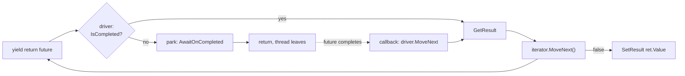

# 7. The iterator trick

## At the table

"I'm not writing that machine by hand," Kevin said. "Chapter 3. I'm not doing it. Not for the pulser, not for the serial call, not for anything that goes in a pump."

"Nobody is. Here's the cheat, and it's the part that makes this work on your compiler." Steve typed for a minute. "C# 2 had `yield return`. Iterators. The compiler takes a method with `yield` in it and builds a class with a state field and a `MoveNext` with a switch. That's chapter 3. It's been doing it since 2005. Your 2008 compiler does it."

"Okay."

"The only thing an iterator can't do is wake itself up. Somebody has to call `MoveNext` again. So the library calls it. You write a method that yields futures, one per thing you'd have awaited, and the driver pulls them one at a time, parks on the ones that aren't done, and calls `MoveNext` when they finish."

He turned the laptop around. Kevin's pulser loop was on the left. The new one was on the right.

```csharp
// Kevin's: a thread, parked in Sleep
while (_running)
{
    Thread.Sleep(_pollMs);
    if (_pulser.Pulses / 1000.0 >= ceilingGallons)
    {
        _valve.Close();
        onStopped();
        return;
    }
}
```

```csharp
// Steve's: an iterator, parked on a timer
private IEnumerable<IFuture> PollUntilCeiling(double ceilingGallons)
{
    while (!_stop.Token.IsCancelRequested)
    {
        yield return Futures.Delay(_pollMs);
        if (_pulser.Pulses / 1000.0 >= ceilingGallons)
        {
            _valve.Close();
            yield break;
        }
    }
}
```

Kevin read them side by side for a long time.

"That's the same loop."

"It's the same loop. `yield return` where `Sleep` was. `yield break` where `return` was. The method returns a future instead of needing a callback, so the sale machine awaits it or hangs a continuation on it. And between polls there's no thread. There's a forty-byte object with a 1 in its state field."

"And the serial call?"

"Same move. The reply completes a promise. A timer races it. `WhenAny` says which one won. Body's six lines. It's in the sample."

```csharp
private IEnumerable<IFuture> AuthorizeBody(string card, int timeoutMs, Return<string> ret)
{
    Promise<string> reply = new Promise<string>(true);
    Action<string> onData = delegate(string text) { reply.TrySetResult(text); };
    _link.DataReceived += onData;
    try
    {
        _link.Send("AUTH " + card);
        IFuture<IFuture> first = Futures.WhenAny(reply.Future, Futures.Delay(timeoutMs));
        yield return first;
        ret.Value = first.Result == reply.Future ? reply.Future.Result : "TIMEOUT";
    }
    finally { _link.DataReceived -= onData; }
}
```

"Your `reply` and your `arrived`," Steve said. "Same two halves. The thread's gone. And if the controller never answers, the timer wins, nobody's stuck, and the watchdog never hears about it."

"`yield return` is `await`."

"`yield return` is `await`. Two things you give up, and you need to know them before you lean on it."

So you have read chapter 3 and you are thinking: I am never writing one of those machines by hand for real code. Right. Neither are we. Here is the cheat.

## C# 2.0 already had a state machine compiler

```csharp
IEnumerable<int> Count()
{
    yield return 1;
    int x = 2;
    yield return x;
    yield return x + 1;
}
```

What does the compiler do with that? It makes a class with a `<>1__state` field, hoists `x` to a field, and generates a `MoveNext()` with a `switch` on the state that jumps back to where it left off. Sound familiar? It is the same transform as chapter 3. The compiler has been doing it since 2005.

The only thing `yield return` lacks is a reason to come back. An iterator waits for someone to call `MoveNext()` again. Nothing calls it on its own.

## So we call it

Open `src/MMP.AsyncProxy/Iterate/IteratorStateMachine{T}.cs`. It is the driver:

```csharp
public void MoveNext()
{
    try
    {
        while (true)
        {
            if (_pending != null) { var f = _pending; _pending = null; f.GetResult(); }  // observe the step we parked on

            if (!_steps.MoveNext()) { _builder.SetResult(_return.Value); return; }       // iterator done, method done

            IAwaiter awaiter = _steps.Current.GetAwaiter();
            if (awaiter.IsCompleted) { awaiter.GetResult(); continue; }                 // fast path, keep going

            _pending = awaiter;
            var self = this;
            _builder.AwaitOnCompleted(ref awaiter, ref self);                           // park, come back later
            return;
        }
    }
    catch (Exception ex) { _builder.SetException(ex); }
}
```

Compare it to the hand-written machine. Same builder. Same `AwaitOnCompleted`. Same `IsCompleted` fast path. Same `GetResult` on resume. Same try/catch into `SetException`. The only difference is that instead of a `switch` on our own state, we call the iterator's `MoveNext()` and let the compiler's switch do the jumping.

The iterator yields futures. We await them. `yield return` is `await`.

## Writing one

```csharp
public static IFuture<int> AddAfterDelayAsync(int a, int b)
{
    return AsyncProxy.Run<int>(delegate(Return<int> ret) { return Body(a, b, ret); });
}

private static IEnumerable<IFuture> Body(int a, int b, Return<int> ret)
{
    yield return Futures.Delay(10);
    int sum = a + b;
    yield return Futures.Delay(10);
    ret.Value = sum * 2;
}
```

Six lines of body for the method that took sixty by hand. The `Return<int>` box is there because an iterator method cannot `return` a value; you set `ret.Value` before the iterator ends.

Reading a typed result after a yield works the same way. You hold the future, yield it, then read `.Result`. It is complete, so `.Result` does not block:

```csharp
private static IEnumerable<IFuture> ReadLength(IFuture<string> source, Return<int> ret)
{
    yield return source;
    ret.Value = source.Result.Length;
}
```

## What you give up

Two things, and you should know them before you lean on this.

**You cannot `catch` a step's fault inside the body.** When a yielded future faults, the driver's `GetResult` throws, which faults the whole operation. The body never sees the exception. Real `await` would let you wrap it in a `try`. The way around it is `Futures.Observe`, a wrapper that always succeeds when the inner future settles, so the driver has nothing to throw and you inspect the step yourself:

```csharp
yield return Futures.Observe(risky);
if (risky.IsFaulted) { /* handle it */ }
else { use(risky.Result); }
```

Open `Futures.Observe` in `Futures.cs`. It is four lines. The test `Observe_never_throws_and_lets_the_body_inspect_the_step` shows a body recovering from a failed step.

**`yield` cannot sit inside a `try` with a `catch`.** The C# iterator rules forbid it. `try`/`finally` is fine. Real `await` has no such limit.

## Who did this before us

Jeffrey Richter shipped `AsyncEnumerator` in 2008, in his Power Threading library, for .NET 2.0. Same idea. Stephen Toub writes an `Iterate` helper live at 59:00 in the 2024 talk and says, more or less, "this is what we would have done before the compiler did it for us." We are standing where they stood. The difference is that our builder and awaiter are public, so the iterator path and the hand-written path share one set of parts and you can see both.

## The picture



One loop. The compiler's state machine inside, ours outside, the builder underneath both.
