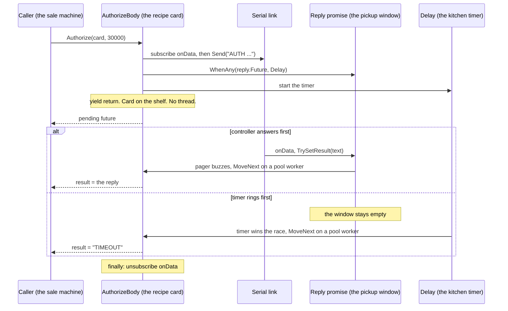
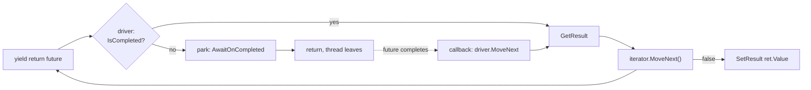

# 7. The iterator trick

## At the table

The empty wing baskets were stacked three high at the end of the booth. Dee had left the sweet tea pitcher, which was Kevin's way of knowing the night was still young. The laptop was plugged into the wall now, a cord stretched across the aisle that every waitress in the building had stepped over at least twice.

"I'm not writing that machine by hand," Kevin said.

"Okay."

"Chapter three. The switch, the state field, the hoisted locals. I'm not doing it. Not for the pulser, not for the serial call, not for anything that goes in a pump." He pushed his plate away. "I've got Dale on Monday. I tell Dale I hand-wrote a state machine for the fuel dispenser, he's going to ask me who's going to maintain it, and the answer is *me*, and I'm forty-one."

"Nobody's asking you to," Steve said. "Nobody writes those. The compiler writes those. Here's the cheat, bro, and it's the part that makes the whole thing work on your compiler."

He typed for a minute. Kevin watched him do it, the way you watch a guy about to pull a coin out of your ear.

"C# 2 had `yield return`. You know it. Iterators. You write a method that hands out a list one item at a time, and every time it says `yield return`, it stops, and the next time somebody asks for an item, it picks up on the next line, locals and all."

"I've used it for walking a list."

"You've used it for walking a list. What did you think the compiler did to make a method stop in the middle and pick up later?"

Kevin opened his mouth. He closed it.

"It built a class," Steve said. "A state field, your locals turned into fields, and a `MoveNext` with a switch at the top. Same thing as chapter 3. It's been doing it since 2005. Your 2008 compiler does it right now, and has the whole time. You've been running this machine for years and never looked inside."

"Okay. So it's a machine. But a list doesn't wake itself up. Somebody has to ask for the next item."

"Bingo. That's the only thing an iterator can't do: wake itself up. So the library does it. You write a method that yields a *future* for each thing you'd have waited for. The library pulls them one at a time. If the future isn't done, it leaves a pager on it and walks away. When the future finishes, the pager buzzes, and the library asks the iterator for the next step."

He turned the laptop around. Kevin's pulser loop was on the left side of the screen. The new one was on the right.

```csharp
// Kevin's: a thread, parked in Sleep
while (_running)
{
    Thread.Sleep(_pollMs);
    if (_pulser.Pulses / 1000.0 >= ceilingGallons)
    {
        _valve.Close();
        onStopped();
        return;
    }
}
```

```csharp
// Steve's: an iterator, parked on a timer
private IEnumerable<IFuture> PollUntilCeiling(double ceilingGallons)
{
    while (!_stop.Token.IsCancelRequested)
    {
        yield return Futures.Delay(_pollMs);
        if (_pulser.Pulses / 1000.0 >= ceilingGallons)
        {
            _valve.Close();
            yield break;
        }
    }
}
```

Kevin read them side by side for a long time. A man at the bar cheered at something on the fishing show.

"That's the same loop."

"It's the same loop. `yield return` where `Sleep` was. `yield break` where `return` was. And between polls there's no thread. There's a little object about forty bytes big with a one in its state field. The valve still closes at the ceiling. Nothing about the pump changed. Only the waiting."

"And the serial call?" Kevin's eyes went to the napkin from chapter two, the one with his own `Authorize` method written on it in ballpoint. "That's the one that scares me."

"Same move, and it uses the two halves you already built." Steve pulled the napkin closer. "Remember the shelf and the doorbell? You had a `reply` shelf where the answer gets set down, and an `arrived` doorbell. Then your thread sat next to the doorbell. In my version, the shelf and the doorbell are one object, a Promise, and *nobody* sits next to it. When the reply comes in, the controller side puts it in the window. And I race it against a timer."

```csharp
private IEnumerable<IFuture> AuthorizeBody(string card, int timeoutMs, Return<string> ret)
{
    Promise<string> reply = new Promise<string>(PromiseOptions.RunContinuationsAsynchronously);
    Action<string> onData = delegate(string text) { reply.TrySetResult(text); };
    _link.DataReceived += onData;
    try
    {
        _link.Send("AUTH " + card);
        IFuture<IFuture> first = Futures.WhenAny(reply.Future, Futures.Delay(timeoutMs));
        yield return first;
        ret.Value = first.Result == reply.Future ? reply.Future.Result : "TIMEOUT";
    }
    finally { _link.DataReceived -= onData; }
}
```

"Body's six lines of real work. It's in the sample." Steve leaned back. "And if the controller never answers, the timer wins, nobody's stuck, and the watchdog never hears about it. That's the kind of thing that bit you in Tulsa. With a timer in the race, a controller that goes quiet can't leave a thread stuck, because there's no thread to get stuck."

Kevin was quiet for a second, then he said it. "`yield return` is `await`."

"`yield return` is `await`. Close enough that you can build on it. And there are two things you give up, and you need to know both before you lean on this at work, because Dale's going to ask."

So you have read chapter 3 and you are thinking: I am never writing one of those machines by hand for real code. Right. Neither are we. Here is the cheat.

## C# 2.0 already had a state machine compiler

```csharp
IEnumerable<int> Count()
{
    yield return 1;
    int x = 2;
    yield return x;
    yield return x + 1;
}
```

**Read it like this.** `Count` is a method that hands out 1, then 2, then 3. It does not run all at once and return a list. It runs until the first `yield return`, stops, and waits. The next time somebody asks for an item, it picks up on the next line, with `x` still holding whatever it held.

An **iterator** is exactly that: a method that can stop in the middle and be asked to continue. Remember the recipe with the bookmark and the sticky note from chapter 3? An iterator is that recipe, and the C# compiler writes the bookmark and the sticky note for you.

What does the compiler do with it? It makes a class with a `<>1__state` field (the bookmark), turns `x` into a field (the sticky note), and writes a `MoveNext()` with a `switch` on the state that jumps back to where it left off. Sound familiar? It is the same transform as chapter 3. The compiler has been doing it since 2005.

The only thing `yield return` lacks is a reason to come back. An iterator waits for someone to call `MoveNext()` again. Nothing calls it on its own. The recipe book sits on the shelf until somebody takes it down.

## So we call it

The library is the somebody. Open `src/MMP.AsyncProxy/Iterate/IteratorStateMachine{T}.cs`. It is the driver:

```csharp
public void MoveNext()
{
    try
    {
        while (true)
        {
            if (_pending != null) { var f = _pending; _pending = null; f.GetResult(); }  // observe the step we parked on

            if (!_steps.MoveNext()) { _steps.Dispose(); _builder.SetResult(_return.Value); return; }  // iterator done, method done

            IFuture step = _steps.Current;
            if (step == null) throw new InvalidOperationException("The iterator yielded a null future.");

            // Fast path: already done and not failed. Skip the awaiter entirely and keep going.
            if (step.IsCompleted && !step.IsFaulted && !step.IsCanceled) continue;

            IAwaiter awaiter = step.GetAwaiter();
            if (awaiter.IsCompleted) { awaiter.GetResult(); continue; }                 // done, but failed or canceled: GetResult throws

            _pending = awaiter;
            var self = this;
            _builder.AwaitOnCompleted(ref awaiter, ref self);                           // park, come back later
            return;
        }
    }
    catch (Exception ex) { _steps.Dispose(); _builder.SetException(ex); }
}
```

**Read it like this.** Think of a clerk working down a to-do list, one item at a time.

1. `if (_pending != null) ...` If this clerk is coming back from a wait, first take a look at how that step turned out. `GetResult` hands over the answer, or throws if the step failed.
2. `if (!_steps.MoveNext()) ...` Ask the iterator for its next step. If there is none, the whole method is done: put the final value in the window with `SetResult` and stop.
3. `IFuture step = _steps.Current;` The step is a future. (A null here is a bug in the iterator, so it throws a clear message.)
4. `if (step.IsCompleted && !step.IsFaulted && !step.IsCanceled) continue;` If the step is *already* done and went fine, cross it off and go to the next one. No waiting, and no awaiter needed. This is the fast path, and it is the common case, so it should cost almost nothing. (If the step is done but failed or was canceled, we fall through, ask for its awaiter, and `GetResult` throws so the failure is not lost.)
5. Otherwise the step is still running. Ask it for its awaiter, the little object that can answer "are you done?" and "buzz me when you are." Remember the awaiter in `_pending`, call `AwaitOnCompleted` to leave the pager ("call `MoveNext` on me when this finishes"), and `return`. The clerk walks away. No thread is holding anything.
6. `catch (Exception ex) ...` If anything throws, the failure goes into the result with `SetException`, so the caller sees it at their own `await`.

Compare it to the hand-written machine from chapter 3. Same builder. Same `AwaitOnCompleted`. Same `IsCompleted` fast path. Same `GetResult` on resume. Same try/catch into `SetException`. The only difference is that instead of a `switch` on our own state, we call the iterator's `MoveNext()` and let the compiler's switch do the jumping.

The iterator yields futures. We await them. `yield return` is `await`.

## Writing one

```csharp
public static IFuture<int> AddAfterDelayAsync(int a, int b)
{
    return AsyncProxy.Run<int>(delegate(Return<int> ret) { return Body(a, b, ret); });
}

private static IEnumerable<IFuture> Body(int a, int b, Return<int> ret)
{
    yield return Futures.Delay(10);
    int sum = a + b;
    yield return Futures.Delay(10);
    ret.Value = sum * 2;
}
```

Six lines of body for the method that took sixty by hand. The `Return<int>` box is there because an iterator method cannot `return` a value; you set `ret.Value` before the iterator ends. Think of it as a tray on the pickup window: the iterator sets the finished dish on the tray, and `AsyncProxy.Run` carries the tray out when the iterator is done.

Reading a typed result after a yield works the same way. You hold the future, yield it, then read `.Result`. It is complete, so `.Result` does not block:

```csharp
private static IEnumerable<IFuture> ReadLength(IFuture<string> source, Return<int> ret)
{
    yield return source;
    ret.Value = source.Result.Length;
}
```

## The serial call, one line at a time

Back to the napkin. This is Kevin's `Authorize`, rebuilt so that no thread waits. Chapter 2 showed his original, with the thread parked beside the doorbell. Here is the new one again, with each line explained.

```csharp
Promise<string> reply = new Promise<string>(PromiseOptions.RunContinuationsAsynchronously);
```

**The pickup window.** A `Promise` is the kitchen's side of the pickup window: the only one who can put the answer in, and only once. Kevin's old code had a shelf (`reply`) and a doorbell (`arrived`). A Promise is both in one object, and it can also buzz the pager of whoever left their number.

The option in the parentheses, `PromiseOptions.RunContinuationsAsynchronously`, says what happens when the reply arrives. Normally the code that puts the answer in the window also runs the waiting code, right there, on its own thread, before it goes back to work. Here that code is a UART callback, the thread that listens to the serial line. You do not want sale logic running on it. With this option, the promise does not run the waiting code itself. It pins a ticket to the thread pool's job board and returns at once. A crew worker picks the ticket up a moment later and runs the waiting code there. (Older code wrote this as `new Promise<string>(true)`. That still compiles, but `true` does not say what it means, so the course uses the name. In modern .NET it is `TaskCreationOptions.RunContinuationsAsynchronously`.)

```csharp
Action<string> onData = delegate(string text) { reply.TrySetResult(text); };
_link.DataReceived += onData;
```

**Leave a note with the serial line.** `onData` says: when the controller sends bytes, put them in the window. `TrySetResult` is the polite version: if the window already has an answer (say the controller sent two replies), it returns `false` and does nothing, instead of throwing on the serial line's thread. A reply that comes after the timer won is harmless too: nobody is waiting for the window any more, and the `finally` below takes the note down.

```csharp
_link.Send("AUTH " + card);
```

**Send the question.** This does not wait for the answer. It just writes bytes to the line and comes back.

```csharp
IFuture<IFuture> first = Futures.WhenAny(reply.Future, Futures.Delay(timeoutMs));
yield return first;
```

**Race the reply against a kitchen timer.** `reply.Future` is the customer's side of the window: they can look and they can ask to be buzzed. `Futures.Delay(timeoutMs)` is a future that finishes when the timer dings. `WhenAny` is a race: it finishes as soon as *either* one does, and its result is the one that won. Then `yield return first` puts the recipe card on the shelf. No thread is waiting.

```csharp
ret.Value = first.Result == reply.Future ? reply.Future.Result : "TIMEOUT";
```

**Read the winner.** When the card comes off the shelf, one of the two has finished. If the reply won, hand back its text. If the timer won, hand back `"TIMEOUT"`.

```csharp
finally { _link.DataReceived -= onData; }
```

**Take the note back.** Whichever way we left, stop listening, so a late reply does not fire a handler for a call that is already over.



**In words:**

1. The sale machine calls `Authorize`. The recipe card (`AuthorizeBody`) subscribes a callback to the serial link and sends the question.
2. The card starts a race with `WhenAny`: the reply window against a kitchen timer. Then it yields, goes on the shelf, and returns a pending future to the caller. At this moment no thread is working on the call.
3. **If the controller answers first:** the serial link calls `onData`, which puts the text in the window (`TrySetResult`). That buzzes the pager. A pool worker opens the card at the bookmark and sees that the reply won. The caller gets the reply.
4. **If the timer rings first:** the window stays empty. The timer finishes the race instead, which buzzes the pager, and a pool worker opens the card, sees that the timer won, and hands back `"TIMEOUT"`.
5. Either way, the last thing the card does is the `finally` line: it takes its note off the serial link.

**Why it matters:** the two branches show why this cannot hang the way Kevin's original could. There is always a timer in the race, so one of the two always finishes. Nobody waits for a controller that never answers.

## What you give up

Two things, and you should know them before you lean on this.

**You cannot `catch` a step's fault inside the body.** When a yielded future faults, the driver's `GetResult` throws, which faults the whole operation. The body never sees the exception. Real `await` would let you wrap it in a `try`. The way around it is `Futures.Observe`, a wrapper that always succeeds when the inner future settles, so the driver has nothing to throw and you inspect the step yourself:

```csharp
yield return Futures.Observe(risky);
if (risky.IsFaulted) { /* handle it */ }
else { use(risky.Result); }
```

**Read it like this.** `Observe` is a padded envelope. Whatever happens to the step inside, good or bad, the envelope arrives safely. Then *you* open it and look at `IsFaulted` yourself, instead of the driver blowing up on your behalf.

Open `Futures.Observe` in `Futures.cs`. It is a few lines. The test `Observe_never_throws_and_lets_the_body_inspect_the_step` shows a body recovering from a failed step.

**`yield` cannot sit inside a `try` with a `catch`.** The C# iterator rules forbid it. `try`/`finally` is fine, and that is why `AuthorizeBody` above uses `finally` and not `catch`. Real `await` has no such limit.

## Who did this before us

Jeffrey Richter shipped `AsyncEnumerator` in 2008, in his Power Threading library, for .NET 2.0. Same idea. Stephen Toub writes an `Iterate` helper live at 59:00 in the 2024 talk and says, more or less, "this is what we would have done before the compiler did it for us." We are standing where they stood. The difference is that our builder and awaiter are public, so the iterator path and the hand-written path share one set of parts and you can see both.

## The picture



**In words:**

1. Start at "yield return future." The iterator has just handed the driver a future and stopped.
2. The driver asks the diamond: is that future already done?
3. **Yes (top path):** call `GetResult` to look at the answer, ask the iterator for its next step with `MoveNext()`, and the iterator hands back another future. Round again. This loop spins without any waiting, as long as every step is already done.
4. **No (bottom path):** the driver parks. It calls `AwaitOnCompleted` to leave a pager on the future, then returns, and the thread leaves. This is the moment nothing is running.
5. The dotted arrow: later, when the future completes, the pager buzzes and the callback calls the driver's `MoveNext`. The driver goes back to `GetResult`, then on around the loop.
6. When the iterator has no more steps (`MoveNext` says false), the driver puts the final value in the window with `SetResult`. That is the exit on the right.

**Why it matters:** one loop does the whole job. The compiler's state machine sits inside it and ours sits outside it, and the builder sits under both. Nothing here waits on a thread, ever.

## Words you just met

| Word | Plain meaning | The picture |
|---|---|---|
| **Iterator** | A method with `yield return` that can stop in the middle and be asked to go on | A recipe with a bookmark; the compiler writes the bookmark |
| **`yield return`** | "Hand this out, then stop here" | Putting the recipe card on the shelf |
| **`MoveNext`** | Ask the iterator to carry on to its next step | Open the recipe at the bookmark |
| **Driver** | The library's loop that asks for each step and parks on the ones that are not done | A clerk working down a to-do list |
| **`Return<T>`** | A tray an iterator uses to hand back a final value, since it cannot `return` one | The tray on the pickup window |
| **`PromiseOptions.RunContinuationsAsynchronously`** | When this promise finishes, pin the waiting code to the pool's job board instead of running it on the finishing thread | The kitchen does not carry the pizza out; it hangs a ticket and a driver does |
| **`WhenAny`** | A future that finishes when the first of several does | A race between two runners |
| **`Observe`** | A wrapper that always succeeds so a failure can be looked at instead of thrown | A padded envelope |
