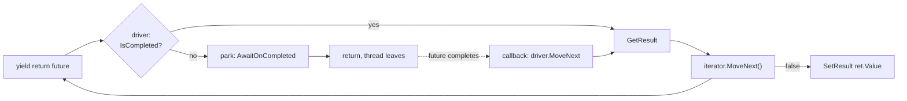

# 7. The iterator trick

So you have read chapter 3 and you are thinking: I am never writing one of those machines by hand for real code. Right. Neither are we. Here is the cheat.

## C# 2.0 already had a state machine compiler

```csharp
IEnumerable<int> Count()
{
    yield return 1;
    int x = 2;
    yield return x;
    yield return x + 1;
}
```

What does the compiler do with that? It makes a class with a `<>1__state` field, hoists `x` to a field, and generates a `MoveNext()` with a `switch` on the state that jumps back to where it left off. Sound familiar? It is the same transform as chapter 3. The compiler has been doing it since 2005.

The only thing `yield return` lacks is a reason to come back. An iterator waits for someone to call `MoveNext()` again. Nothing calls it on its own.

## So we call it

Open `src/MMP.AsyncProxy/Iterate/IteratorStateMachine{T}.cs`. It is the driver:

```csharp
public void MoveNext()
{
    try
    {
        while (true)
        {
            if (_pending != null) { var f = _pending; _pending = null; f.GetResult(); }  // observe the step we parked on

            if (!_steps.MoveNext()) { _builder.SetResult(_return.Value); return; }       // iterator done, method done

            IAwaiter awaiter = _steps.Current.GetAwaiter();
            if (awaiter.IsCompleted) { awaiter.GetResult(); continue; }                 // fast path, keep going

            _pending = awaiter;
            var self = this;
            _builder.AwaitOnCompleted(ref awaiter, ref self);                           // park, come back later
            return;
        }
    }
    catch (Exception ex) { _builder.SetException(ex); }
}
```

Compare it to the hand-written machine. Same builder. Same `AwaitOnCompleted`. Same `IsCompleted` fast path. Same `GetResult` on resume. Same try/catch into `SetException`. The only difference is that instead of a `switch` on our own state, we call the iterator's `MoveNext()` and let the compiler's switch do the jumping.

The iterator yields futures. We await them. `yield return` is `await`.

## Writing one

```csharp
public static IFuture<int> AddAfterDelayAsync(int a, int b)
{
    return AsyncProxy.Run<int>(delegate(Return<int> ret) { return Body(a, b, ret); });
}

private static IEnumerable<IFuture> Body(int a, int b, Return<int> ret)
{
    yield return Futures.Delay(10);
    int sum = a + b;
    yield return Futures.Delay(10);
    ret.Value = sum * 2;
}
```

Six lines of body for the method that took sixty by hand. The `Return<int>` box is there because an iterator method cannot `return` a value; you set `ret.Value` before the iterator ends.

Reading a typed result after a yield works the same way. You hold the future, yield it, then read `.Result`. It is complete, so `.Result` does not block:

```csharp
private static IEnumerable<IFuture> ReadLength(IFuture<string> source, Return<int> ret)
{
    yield return source;
    ret.Value = source.Result.Length;
}
```

## What you give up

Two things, and you should know them before you lean on this.

**You cannot catch a step's fault inside the body.** When a yielded future faults, the driver's `GetResult` throws, which faults the whole operation. The body never sees the exception. Real `await` would let you wrap it in a `try`. If you need that, yield the future, then check `IsFaulted` on it before you read `Result`:

```csharp
yield return risky;
if (risky.IsFaulted) { /* handle */ }
```

That does not work yet, because the driver throws before you get there. It is on the plan as `Futures.Observe(f)`, a wrapper that completes successfully and lets you inspect the inner one.

**`yield` cannot sit inside a `try` with a `catch`.** The C# iterator rules forbid it. `try`/`finally` is fine. Real `await` has no such limit.

## Who did this before us

Jeffrey Richter shipped `AsyncEnumerator` in 2008, in his Power Threading library, for .NET 2.0. Same idea. Stephen Toub writes an `Iterate` helper live at 59:00 in the 2024 talk and says, more or less, "this is what we would have done before the compiler did it for us." We are standing where they stood. The difference is that our builder and awaiter are public, so the iterator path and the hand-written path share one set of parts and you can see both.

## The picture



One loop. The compiler's state machine inside, ours outside, the builder underneath both.
