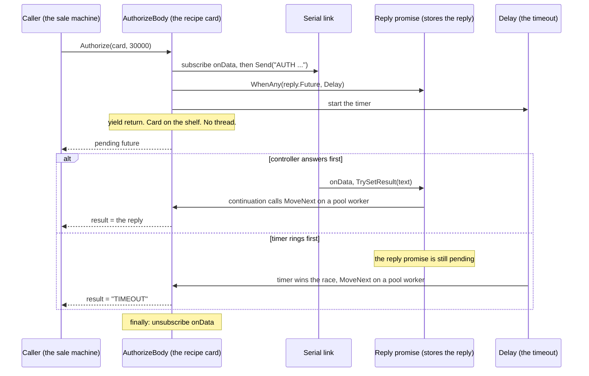
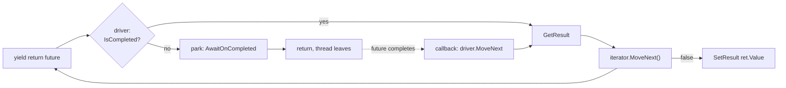

# 7. The iterator trick

## At the table

The third basket was empty now, stacked on the first two at the end of the booth. Dee had left the second sweet tea pitcher, which was Kevin's way of knowing the night was still young. Kevin turned napkin seven over for the iterator notes. The laptop's power cord ran down to the outlet under the table.

"I'm not writing that machine by hand," Kevin said.

"Okay."

"That state machine we wrote earlier. The switch, the state field, the hoisted locals. I'm not doing it. Not for the pulser, not for the serial call, not for anything that goes in a pump." He pushed his plate away. "I've got Dale on Monday. I tell Dale I hand-wrote a state machine for the fuel dispenser, he's going to ask me who's going to maintain it, and the answer is *me*, and I'm forty-one."

"Nobody's asking you to," Steve said. "Nobody writes those. The compiler writes those. There's a cheat, bud, and we can make it work on your compiler."

He typed for a minute. Kevin watched him do it, the way you watch a guy about to pull a coin out of your ear.

"C# 2 already had `yield return`," Steve said. "It lets a method produce a sequence one item at a time. LINQ has examples of it."

"I haven't really dug into LINQ. Isn't that newer than my runtime?"

Steve opened Microsoft's [LINQ overview](https://learn.microsoft.com/en-us/dotnet/visual-basic/programming-guide/concepts/linq/introduction-to-linq). "It shipped with desktop .NET Framework 3.5. Let me show you `Except`. Give it some numbers and a second collection of numbers to exclude. It produces the remaining distinct numbers."

He typed a small console example. This code goes inside `Main`, with `using System;`, `using System.Collections.Generic;`, and `using System.Linq;` at the top of the file:

```csharp
int[] numbers = { 1, 2, 3 };
int[] excluded = { 2 };

// Describe the sequence. Its elements are produced when the loop requests them.
IEnumerable<int> remaining = numbers.Except(excluded);
foreach (int number in remaining)
{
    Console.WriteLine(number);
}
```

The console printed:

```text
1
3
```

"I could write a loop that builds a new list with those two numbers," Kevin said.

"You could. But this implementation supplies them as the caller asks for them. Look inside Microsoft's [Framework reference source for `ExceptIterator`](https://github.com/microsoft/referencesource/blob/main/System.Core/System/Linq/Enumerable.cs#L794-L799)."

Steve pointed to its output loop. This excerpt leaves out the method declaration and the setup of `set`, which initially contains the excluded values:

```csharp
foreach (TSource element in first)
    if (set.Add(element)) yield return element;
```

"`Add` returns true if the value wasn't already in the set," Steve said. "That skips excluded values and duplicates. So the first value it hands out is `1`."

"And `yield return` hands that back to my loop?"

"Yes. Your `foreach` gets an enumerator and calls its `MoveNext`. That runs the iterator until it reaches `yield return`. The enumerator reports an item is available, and your loop reads it through `Current`. Then your loop prints `1`."

"What happens to the loop inside `Except`?"

"It pauses there. When your outer loop calls `MoveNext` again, the iterator continues after that yield. It skips `2`, yields `3`, and pauses again. One more call reaches the end and reports no more items."

Kevin followed the two loops with his finger. "So `foreach` walks the sequence. `yield return` is how this method supplies its next item."

"Right. It doesn't start a thread or wait for a timer. Your caller controls when it asks for the next item."

"Where did the paused method keep its place?"

"The compiler built a state machine. A state field, saved values, and a `MoveNext` method. Same pieces as the hand-written machine we worked through earlier. The `yield return` feature dates back to C# 2; LINQ gives us a real library example of using it."

"Okay. But those items are numbers. How does that help my pulser?"

"Our iterator yields futures instead of numbers. A normal `foreach` would ask for the next item as soon as its loop body finishes. Our driver checks the yielded future first. If it's pending, the driver registers a continuation and returns. When that future completes, the continuation calls the driver, which asks the iterator for its next item."

"So the compiler saves the method's place, and your driver decides when it can continue?"

"Right. We're borrowing the iterator mechanism, rather than using `Except` in the pump. The loop body still does your pulse check. It yields a delay's future at the point where your old thread slept."

He turned the laptop around. Kevin's pulser loop was on the left side of the screen. The new one was on the right.

These are method-body comparisons from the forecourt sample, not complete programs. [KevinsPump.cs](../../samples/MMP.AsyncProxy.Forecourt/KevinsPump.cs) holds the original; [StevesPump.cs](../../samples/MMP.AsyncProxy.Forecourt/StevesPump.cs) holds the iterator version. The owning pump supplies the counter, valve, and polling interval.

```csharp
// Kevin's: a thread, parked in Sleep
while (_running)
{
    // The polling thread holds its stack throughout this wait.
    Thread.Sleep(_pollMs);
    if (_pulser.Pulses / 1000.0 >= ceilingGallons)
    {
        _valve.Close();
        onStopped();
        return;
    }
}
```

```csharp
// Steve's: an iterator, parked on a timer
private IEnumerable<IFuture> PollUntilCeiling(double ceilingGallons)
{
    while (!_stop.Token.IsCancelRequested)
    {
        // Yield a future to the driver; yield alone does not schedule resumption.
        yield return Futures.Delay(_pollMs);
        if (_pulser.Pulses / 1000.0 >= ceilingGallons)
        {
            _valve.Close();
            yield break;
        }
    }
}
```

Kevin read them side by side for a long time. A man at the bar cheered as a Rangers fly ball cleared the outfield wall. The man beside him, wearing an Astros cap, kept eating.

"That's the same loop."

"It's the same loop. `yield return` where `Sleep` was. `yield break` where `return` was. Between polls, an object holds the saved fields and the next step. Its size depends on those fields. The valve check stays in the loop. The wait releases the thread, and we still need to test the timing on your pump."

"And the serial call?" Kevin's eyes went to napkin two, the one with the flow of his old `Authorize` method drawn on it in ballpoint. "That's the one that scares me."

"Same move, and it uses the two halves you already built." Steve pulled the napkin closer. "Remember the entrance line and the pager? Your old `Authorize` kept its thread in line with `WaitOne`. The new version returns a future, like a claim ticket. The receiving callback stores the reply in the promise, like the host recording table 12. A continuation runs when that reply is ready. I also give the wait a timeout."

This method is from `StevesPump.cs`. `_link` is the injected `SerialLink` that sends requests and raises reply events. The public `Authorize` method starts this iterator through `AsyncProxy.Run<string>`. `Return<string> ret` carries its final answer to that driver.

```csharp
private IEnumerable<IFuture> AuthorizeBody(string card, int timeoutMs, Return<string> ret)
{
    // This promise watches the serial reply; the driver owns the overall method result.
    Promise<string> reply = new Promise<string>(PromiseOptions.RunContinuationsAsynchronously);
    // Repeated replies leave the first stored reply unchanged.
    Action<string> onData = delegate(string text) { reply.TrySetResult(text); };
    _link.DataReceived += onData;
    try
    {
        _link.Send("AUTH " + card);
        // The result of this race is the winning future, not its reply text.
        IFuture<IFuture> first = Futures.WhenAny(reply.Future, Futures.Delay(timeoutMs));
        yield return first;
        // The race has ended, so reading the winning reply cannot block.
        ret.Value = first.Result == reply.Future ? reply.Future.Result : "TIMEOUT";
    }
    // Iterator disposal also runs finally if the driver exits on a failure.
    finally { _link.DataReceived -= onData; }
}
```

"Body's six lines of real work. It's in the sample." Steve leaned back. "And if the controller never answers, the timer wins, nobody's stuck, and the watchdog never hears about it. That's the kind of thing that bit you in Tulsa. With a timer in the race, a controller that goes quiet can't leave a thread stuck, because there's no thread to get stuck."

Kevin was quiet for a second, then he said it. "`yield return` is `await`."

"`yield return` is `await`. Close enough that you can build on it. And there are two things you give up, and you need to know both before you lean on this at work, because Dale's going to ask."

After the hand-written state-machine walkthrough, you may be thinking: I am never writing one of those machines by hand for real code. Right. Neither are we. Here is the cheat.

## C# 2.0 already had a state machine compiler

```csharp
IEnumerable<int> Count()
{
    // The body first runs when a consumer calls the iterator's MoveNext.
    yield return 1;
    int x = 2;
    yield return x;
    yield return x + 1;
}
```

**Read it like this.** `Count` is a method that hands out 1, then 2, then 3. It does not run all at once and return a list. It runs until the first `yield return`, stops, and waits. The next time somebody asks for an item, it picks up on the next line, with `x` still holding whatever it held.

An **iterator** is exactly that: a method that can stop in the middle and be asked to continue. Remember the recipe with the bookmark and the sticky note from our earlier state-machine discussion? An iterator is that recipe, and the C# compiler writes the bookmark and the sticky note for you.

What does the compiler do with it? It makes a class with a `<>1__state` field (the bookmark), turns `x` into a field (the sticky note), and writes a `MoveNext()` with a `switch` on the state that jumps back to where it left off. Sound familiar? It is the same transformation we performed in the earlier state-machine walkthrough. The compiler has been doing it since 2005.

The only thing `yield return` lacks is a reason to come back. An iterator waits for someone to call `MoveNext()` again. Nothing calls it on its own. The recipe book sits on the shelf until somebody takes it down.

## So we call it

The library is the somebody. Open [IteratorStateMachine{T}.cs](../../src/MMP.AsyncProxy/Iterate/IteratorStateMachine%7BT%7D.cs). Its `MoveNext` drives a different object: `_steps` is the compiler-generated iterator, with its own `MoveNext`. The driver waits for each future; the iterator runs the next section of your method. This is the driver's shortened method:

```csharp
public void MoveNext()
{
    try
    {
        while (true)
        {
            if (_pending != null) { var f = _pending; _pending = null; f.GetResult(); }  // check the saved step before advancing the body

            if (!_steps.MoveNext()) { _steps.Dispose(); _builder.SetResult(_return.Value); return; }  // dispose runs iterator finally blocks before completing the result

            IFuture step = _steps.Current;
            if (step == null) throw new InvalidOperationException("The iterator yielded a null future.");

            // Fast path: already done and not failed. Skip the awaiter entirely and keep going.
            if (step.IsCompleted && !step.IsFaulted && !step.IsCanceled) continue;

            IAwaiter awaiter = step.GetAwaiter();
            if (awaiter.IsCompleted) { awaiter.GetResult(); continue; }                 // settled: observe any fault or cancellation before advancing

            // Save before registration: completion can occur during OnCompleted.
            _pending = awaiter;
            var self = this;
            _builder.AwaitOnCompleted(ref awaiter, ref self);                           // register driver.MoveNext, then leave this call
            return;
        }
    }
    catch (Exception ex) { _steps.Dispose(); _builder.SetException(ex); }
}
```

**Read it like this.** Think of a clerk working down a to-do list, one item at a time.

1. `if (_pending != null) ...` If this clerk is coming back from a wait, first take a look at how that step turned out. `GetResult` hands over the answer, or throws if the step failed.
2. `if (!_steps.MoveNext()) ...` Ask the iterator for its next step. If there is none, the whole method is done: store the final value in the result promise with `SetResult` and stop.
3. `IFuture step = _steps.Current;` The step is a future. (A null here is a bug in the iterator, so it throws a clear message.)
4. `if (step.IsCompleted && !step.IsFaulted && !step.IsCanceled) continue;` If the step is *already* done and went fine, cross it off and go to the next one. No waiting, and no awaiter needed. This fast path avoids creating an awaiter when the yielded future has already succeeded. (If the step is done but failed or was canceled, we fall through, ask for its awaiter, and `GetResult` throws so the failure is not lost.)
5. Otherwise, get the step's awaiter. If it now reports complete, observe its outcome and continue. If it reports incomplete, register for completion. Remember the awaiter in `_pending`, call `AwaitOnCompleted` to register the continuation ("call `MoveNext` on me when this finishes"), and `return`. The clerk walks away. The driver holds the awaiter in a field, so the thread can return to other work.
6. `catch (Exception ex) ...` If the step or body throws, the driver disposes the iterator and then passes the exception to the builder. An ordinary exception faults the result; a cancellation exception cancels it. This assumes disposal succeeds. If cleanup itself throws, this implementation can exit before completing the result promise.

Disposing an iterator runs any active `finally` blocks, such as the serial callback's unsubscribe. Keep that cleanup reliable. The driver has no second guard around `_steps.Dispose()` to preserve the original error if cleanup throws.

Compare it to the hand-written machine from chapter 3. Same builder. Same `AwaitOnCompleted`. Same `IsCompleted` fast path. Same `GetResult` on resume. Same try/catch into `SetException`. The only difference is that instead of a `switch` on our own state, we call the iterator's `MoveNext()` and let the compiler's switch do the jumping.

The iterator yields a future. The driver waits through a callback, then asks the iterator to continue. Together they provide an await-like flow on the older compiler.

## Writing one

```csharp
public static IFuture<int> AddAfterDelayAsync(int a, int b)
{
    // Run creates the driver and returns a future for the whole Body operation.
    return AsyncProxy.Run<int>(delegate(Return<int> ret) { return Body(a, b, ret); });
}

private static IEnumerable<IFuture> Body(int a, int b, Return<int> ret)
{
    yield return Futures.Delay(10);
    int sum = a + b;
    yield return Futures.Delay(10);
    // The driver copies this value into its promise when the iterator ends.
    ret.Value = sum * 2;
}
```

With `a = 3` and `b = 4`, `Body` waits once, saves `sum = 7`, waits again, and sets `ret.Value = 14`. The `Return<int>` box is there because an iterator method cannot `return` a value; you set `ret.Value` before the iterator ends. The iterator writes its answer into this shared box. When the iterator ends, the driver copies that answer into the method's result promise.

Reading a typed result after a yield works the same way. You hold the future, yield it, then read `.Result`. It is complete, so `.Result` does not block:

```csharp
private static IEnumerable<IFuture> ReadLength(IFuture<string> source, Return<int> ret)
{
    // The driver observes failure or cancellation before returning control here.
    yield return source;
    ret.Value = source.Result.Length; // reached after successful completion
}
```

## The serial call, one line at a time

Back to the napkin. This is Kevin's `Authorize`, rebuilt so that no thread waits. The earlier callbacks-and-promises discussion showed his original, with the calling thread blocked in `WaitOne`. Here is the new one again, with each line explained.

```csharp
Promise<string> reply = new Promise<string>(PromiseOptions.RunContinuationsAsynchronously);
```

**The host's record.** A `Promise` holds the reply and its completion state. Like the host's record of a table request, it can be updated by the code handling the request. The future is the customer's claim ticket: read-only access to that same outcome. A promise also keeps the continuations registered to run when it completes.

The option in the parentheses, `PromiseOptions.RunContinuationsAsynchronously`, says what happens when the reply arrives. Normally the code that stores the answer in the promise also runs the waiting code, right there, on its own thread, before it goes back to work. Here that code is a UART callback, the thread that listens to the serial line. You do not want sale logic running on it. With this option, the promise does not run the waiting code itself. It pins a ticket to the thread pool's job board and returns at once. A crew worker picks the ticket up a moment later and runs the waiting code there. (Older code wrote this as `new Promise<string>(true)`. That still compiles, but `true` does not say what it means, so the course uses the name. In modern .NET it is `TaskCreationOptions.RunContinuationsAsynchronously`.)

That option queues callbacks saved while the promise was pending. Registration after completion can call the callback on the registering thread, or post it through a captured context. The option alone does not guarantee a thread change or that `Authorize` returns a pending future.

```csharp
Action<string> onData = delegate(string text) { reply.TrySetResult(text); };
_link.DataReceived += onData;
```

**Leave a note with the serial line.** `onData` says: when the controller sends bytes, store them in the promise. `TrySetResult` is the polite version: if the promise already has an outcome (say the controller sent two replies), it returns `false` and does nothing, instead of throwing on the serial line's thread. If the timer wins, `WhenAny` keeps that winner even if a reply arrives later. The reply promise can still accept that late reply; it is separate from the race promise. The `finally` below removes the event handler. A callback already in progress can finish after removal.

```csharp
_link.Send("AUTH " + card);
```

**Send the question.** This does not wait for the answer. It just writes bytes to the line and comes back.

```csharp
IFuture<IFuture> first = Futures.WhenAny(reply.Future, Futures.Delay(timeoutMs));
yield return first;
```

**Race the reply against a timeout.** `reply.Future` is read-only access to the reply promise. Like a customer holding a claim ticket, the caller can check the outcome or register to be notified. `Futures.Delay(timeoutMs)` is a future that finishes when the timer dings. `WhenAny` is a race: it finishes as soon as *either* one does, and its result is the one that won. Then `yield return first` puts the recipe card on the shelf. No thread waits for either input. `WhenAny` leaves the losing operation running: a reply win leaves the delay scheduled, and a timeout leaves the controller request running.

```csharp
ret.Value = first.Result == reply.Future ? reply.Future.Result : "TIMEOUT";
```

**Read the winner.** `first.Result` is a future, because `WhenAny` returns the winning input. The `==` compares that input with `reply.Future`. If they match, `reply.Future.Result` supplies the reply text. Otherwise, `ret.Value` becomes `"TIMEOUT"`. For example, a reply at two seconds beats a thirty-second delay. If no reply arrives, the delay wins.

```csharp
finally { _link.DataReceived -= onData; }
```

**Take the note back.** `finally` removes this call's event handler when the iterator ends or is disposed. A callback already running can still finish. `TrySetResult` safely handles an extra attempt to fill the reply promise.



**In words:**

1. The sale machine calls `Authorize`. The recipe card (`AuthorizeBody`) subscribes a callback to the serial link and sends the question.
2. The card starts a race with `WhenAny`: the reply future against the timeout future. Then it yields, goes on the shelf, and returns a pending future to the caller. At this moment no thread is working on the call.
3. **If the controller answers first:** the serial link calls `onData`, which stores the text in the promise (`TrySetResult`). The reply wins the race, and its completion schedules the continuation. A pool worker opens the card at the bookmark and sees that the reply won. The caller gets the reply.
4. **If the timer finishes first:** the reply promise is still pending. The timer wins the race and schedules the continuation. A pool worker opens the card, sees that the timer won, and hands back `"TIMEOUT"`.
5. Either way, the last thing the card does is the `finally` line: it takes its note off the serial link.


## What you give up

Two things, and you should know them before you lean on this.

**You cannot `catch` a step's fault inside the body.** When a yielded future faults, the driver's `GetResult` throws, which faults the whole operation. The body never sees the exception. Real `await` would let you wrap it in a `try`. The way around it is `Futures.Observe`, a wrapper that always succeeds when the inner future settles, so the driver has nothing to throw and you inspect the step yourself:

```csharp
// Shortened sketch: handle cancellation separately when risky can be canceled.
yield return Futures.Observe(risky);
if (risky.IsFaulted) { /* handle it */ }
else { use(risky.Result); }
```

**Read it like this.** `Observe(risky)` completes successfully after `risky` finishes, even if `risky` failed or was canceled. The driver therefore resumes the body. The body checks `risky.IsFaulted` before reading its result. If cancellation is possible, check `risky.IsCanceled` too; the shown `else` branch handles success only.

Open `Futures.Observe` in [Futures.cs](../../src/MMP.AsyncProxy/Futures.cs). It is a few lines. The test `Observe_never_throws_and_lets_the_body_inspect_the_step` shows a body recovering from a failed step.

**`yield` cannot sit inside a `try` with a `catch`.** The C# iterator rules forbid it. `try`/`finally` is fine, and that is why `AuthorizeBody` above uses `finally` and not `catch`. Real `await` has no such limit.

## Who did this before us

Jeffrey Richter shipped `AsyncEnumerator` in 2008, in his Power Threading library, for .NET 2.0. Same idea. Stephen Toub writes an `Iterate` helper live at 59:00 in the 2024 talk and says, more or less, "this is what we would have done before the compiler did it for us." We are standing where they stood. The difference is that our builder and awaiter are public, so the iterator path and the hand-written path share one set of parts and you can see both.

## The picture



**In words:**

1. Start at "yield return future." The iterator has just handed the driver a future and stopped.
2. The driver asks the diamond: is that future already done?
3. **Yes (top path):** call `GetResult` to look at the answer, ask the iterator for its next step with `MoveNext()`, and the iterator hands back another future. Round again. This loop spins without any waiting, as long as every step is already done.
4. **No (bottom path):** the driver parks. It calls `AwaitOnCompleted` to register a continuation with the future, then returns, and the thread leaves. This is the moment nothing is running.
5. The dotted arrow: later, when the future completes, the continuation calls the driver's `MoveNext`. The driver goes back to `GetResult`, then on around the loop.
6. When the iterator has no more steps (`MoveNext` says false), the driver stores the final value in the result promise with `SetResult`. That is the exit on the right.


## Words you just met

| Word | Plain meaning | Example or comparison |
|---|---|---|
| **Iterator** | A method with `yield return` that can stop in the middle and be asked to go on | A recipe with a bookmark; the compiler writes the bookmark |
| **`yield return`** | "Hand this out, then stop here" | Putting the recipe card on the shelf |
| **`MoveNext`** | Ask the iterator to carry on to its next step | Open the recipe at the bookmark |
| **Driver** | The library's loop that asks for each step and parks on the ones that are not done | A clerk working down a to-do list |
| **`Return<T>`** | A shared box an iterator uses to hand back a final value, since it cannot `return` one | The driver reads `ret.Value` when the iterator ends |
| **`PromiseOptions.RunContinuationsAsynchronously`** | When this promise finishes, pin the waiting code to the pool's job board instead of running it on the finishing thread | The completing thread queues a work item that runs the continuations |
| **`WhenAny`** | A future that finishes when the first of several does | A race between two runners |
| **`Observe`** | A wrapper that always succeeds so a failure can be looked at instead of thrown | The wrapper completes successfully; inspect the original future for its result or error |
