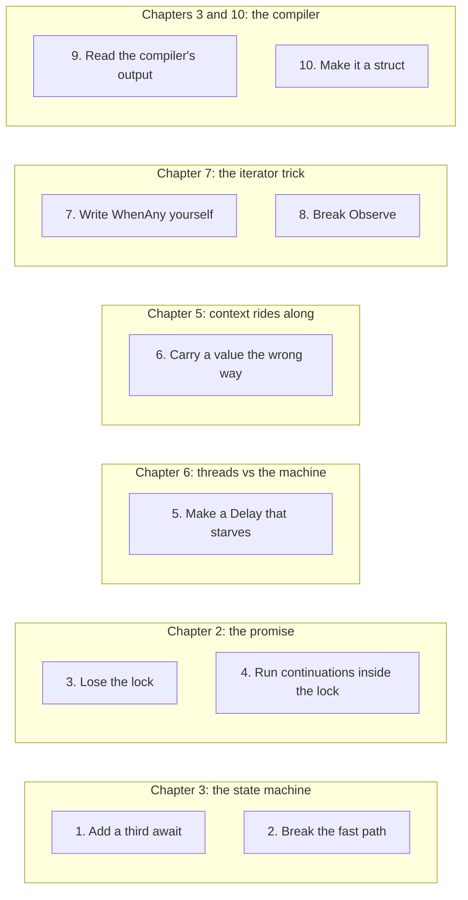

# 8. Exercises

## At the table

Dee brought a fresh stack of napkins without being asked, set them down next to Kevin's elbow, and said, "I figured you two were on napkin number eight." Then she took away the last of the wing bones and left.

"Homework," Steve said.

"I'm forty-one."

"Homework." Steve did not blink. "You've got the pulser loop and the host call. That's tonight. Tomorrow you do the card reader thread the same way. The reader raises an event when somebody taps a card, so that's a promise, same as the serial reply. You hand out the future, the event handler stores the result in the promise, and the sale machine waits on it. Easy. It's the same move you just learned, and the fastest way to own a move is to do it on something you know."

"Okay. That's fair. Tonight and tomorrow."

"Then Thursday you break it."

Kevin looked up from the napkin. "I *what*?"

"You break it. On purpose. You pull the lock out of the promise. You run the test a thousand times. You count the continuations that never ran, and then you put the lock back and you never touch it again."

"Why would I break it on purpose?" Kevin said. "I've got a certification. I've got Dale. I've got a hundred ways it can break without any help from me."

"Because in two years somebody is going to look at that lock and think, that's slow, and take it out. Probably a smart kid. Maybe a kid who read a blog post about lock-free code. And you're going to be the one guy in the building who knows what happens next, because you did it once yourself with nobody watching." Steve slid the laptop over. "Ten of them. They're the ones I'd do if I were you. They are small. Each one is a tiny change to the repo, you build it, you run the tests, and you see what moved."

Kevin scrolled. "Where are the answers?"

"There aren't any, bud. On purpose. The tests are the answers. If you change a line and a test goes red, that's the repo telling you what the line was for. That's better than me telling you. You'd forget what I said by Friday. You won't forget a red test you caused."

"Hm." Kevin picked up a fresh napkin, numbered it eight, wrote *1 to 10* across the top, and underlined it twice. "Do I do them in order?"

"Do the first three in order. After that, pick whichever one scares you most."

"Number four scares me."

"It scares everyone," Steve said, and ate the last celery stick.

Each one is a small change to the repo. Build, run the tests, see what moved. Answers are not here on purpose; the tests are the answers.

## How to work these

- **Make a branch first** (`git switch -c exercises`). Start with a clean working tree. After each exercise, review your diff and restore only the files you changed for that exercise. Keep any unrelated work.
- **Run the tests** with `dotnet test tests/MMP.AsyncProxy.Tests`. That project runs on .NET Framework 4.8, so it runs directly on Windows. On Linux or macOS it needs Mono installed.
- **Predict before you run.** Write down on a napkin what you think will happen. The learning is in the gap between your guess and the result.
- Under each exercise you will find a **Hint** (a nudge, not the answer) and **What you should see** (the symptom, so you know you reproduced it).

The hand-written machine is in `samples/MMP.AsyncProxy.Samples/AddAfterDelay.cs`. The promise is in `src/MMP.AsyncProxy/Core/Promise{T}.cs`. The iterator driver is in `src/MMP.AsyncProxy/Iterate/IteratorStateMachine{T}.cs`. Tests mentioned below are under `tests/MMP.AsyncProxy.Tests`; search for the named test before editing so you can compare its original result.

## Which chapter each exercise pokes at

**In words:**

1. Each box is one exercise. Each framed group is labelled with the chapter whose idea the exercise pokes at.
2. Exercises 1 and 2 work on the hand-written machine from chapter 3: add one more wait, then remove the fast path.
3. Exercises 3 and 4 work on the promise from chapter 2: take the lock out, then run callbacks while holding it.
4. Exercise 5 revisits pool starvation from the thread comparison in chapter 6: rebuild the parked-car problem on purpose.
5. Exercise 6 revisits context from chapter 5: replace the traveling backpack with a note taped to one desk.
6. Exercises 7 and 8 revisit the iterator discussion in chapter 7: write `WhenAny` yourself, then remove the `Observe` wrapper.
7. Exercises 9 and 10 compare your machine with the one the real compiler writes.

## 1. Add a third await

Take `AddAfterDelayMachine` and add a third `Futures.Delay` before the return. You need a new `case 2`, a new `Resume2` label, and a new parked state. Count how many places you touched. That count is why we let the compiler do this.

**Hint.** Copy the block for the second wait and change the numbers. Each wait has the same three parts: park (save the bookmark), come back (jump to the label), carry on.

**What you should see.** The tests still pass when you get it right, and you edited at least three separate spots in one method. Now picture doing that for a method with ten waits.

If the added delay changes no calculation, the numeric result should stay the same. Add a test that checks the extra step ran; the existing result assertion alone cannot distinguish two delays from three.

## 2. Break the fast path

In `AddAfterDelayMachine.MoveNext`, delete the `if (!awaiter.IsCompleted)` check and always park. Run `Hand_written_machine_with_zero_delay_completes_synchronously` and record the result. Check whether it still completes on the caller's thread. Trace `Promise<T>.RegisterContinuation` when the promise is already complete. Does it call the continuation inline or queue it?

**Hint.** Removing the fast path forces callback registration even for a completed promise. Read the final `continuation()` call in `RegisterContinuation`. It can resume the machine before registration returns.

**What you should see.** With the current default promise, the zero-delay test can still pass: registration invokes the callback inline. The added cost is callback registration and nested calls instead of direct progress. A captured UI context can post the callback for later. The promise's queue option applies to callbacks saved before completion. Record the path you observed.

## 3. Lose the lock

In `Promise<T>.RegisterContinuation`, remove the `lock`. Write a test that completes the promise from one thread while another registers a continuation, in a tight loop, a thousand times. Count how many continuations never ran. Put the lock back.

**Hint.** Remember promise registration from chapter 2: check "is it pending?" then add to the list. The lock is what keeps a finish from sneaking in between those two steps.

Finish both test threads before counting callbacks. Give the experiment a timeout so a lost callback cannot hang the test runner. Restore the lock even if the race fails to appear; a successful run cannot prove this unsynchronized version safe.

**What you should see.** Some runs lose a continuation: the count of callbacks that never ran is more than zero. It may be zero on a lucky run. That is the lesson. This kind of bug hides for days and then shows up in production.

## 4. Run continuations inside the lock

In `Promise<T>.Complete`, move the loop that invokes `toRun` callbacks inside the `lock`. Create promises A and B. Give A a continuation that reads B's status, and give B a continuation that reads A's status. Complete A and B on separate threads. Before either callback reads the other status, make both announce that they arrived and wait until both have arrived. This test coordination is a barrier: each thread holds one promise lock before requesting the other. Use a short test timeout so a deadlock becomes a failed test. Restore the callback loop after the experiment.

**Hint.** A deadlock needs two parties, each holding one thing and waiting for the thing the other holds. Here the "things" are the two promises' locks. Set up two threads that finish the two promises at the same time, each one's callback touching the other promise.

**What you should see.** Two threads can each hold one promise lock while requesting the other lock. Neither can continue. Your test timeout should report this hang. A callback on one thread can take the same C# lock again, so one thread alone will not demonstrate this deadlock.

## 5. Make a Delay that starves

Replace `Futures.Delay` with a version that does `Futures.Run(() => Thread.Sleep(ms))`. Run the comparison console. Row 3 now behaves like row 2. Explain, in one sentence, where the thread went.

**Hint.** Look back at the 64 queued jobs in chapter 6. Which worker stays occupied during each delay?

**What you should see.** Row 3 slows to the shape of row 2: jobs start in waves, and the total time climbs from about 200 ms to seconds. The `waves` mode of the console (`-- waves 64`) shows it clearly.

## 6. Carry a value the wrong way

In `ReadTenantAfterDelay`, replace `CallContext.LogicalSetData` with a `[ThreadStatic]` field. (The set happens in the test and the read happens in `ReadTenantAfterDelay`, so change both ends.) Run `ExecutionContext_flows_across_the_await`. It fails, or it passes by luck. Run it twenty times. Explain which thread the value was on each time.

**Hint.** A `[ThreadStatic]` value is a note taped to one desk. Print `Thread.CurrentThread.ManagedThreadId` when you set it and again when you read it.

**What you should see.** It will usually fail: the read happens on a pool worker, at a different desk, and finds an empty note (or someone else's). A run can pass by luck if the same thread happened to handle both. That luck is why this bug survives testing.

## 7. Write WhenAny before you read ours

Cover `Futures.WhenAny` in `Futures.cs` with your hand. Write your own that completes with the first input to finish. You need something that lets only the first callback win. Then uncover ours. It uses `TrySetResult` as the flag, because a promise already refuses a second completion. Did you reach for `Interlocked.CompareExchange` instead? Both work. Which one is easier to read?

**Hint.** Think of a race with one prize. The first runner to cross the line takes it, and everyone after that finds the prize already gone.

**What you should see.** Your version passes the `WhenAny_*` tests in `CombinatorTests.cs`. Whichever way you built the "only the first one wins" part, you can now say why the other way also works.

## 8. Break Observe

`Futures.Observe` lets an iterator body recover from a failed step. Remove it from `Recover` in `CombinatorTests.cs` and yield `risky` directly. Watch the test fault instead of recover. Now explain, from `IteratorStateMachine.MoveNext`, which line threw and why the body never got a chance.

**Hint.** Find the line at the top of the driver's loop that looks at the step the iterator parked on. What does `GetResult` do when the step failed?

**What you should see.** The test that used to recover now ends with the whole operation faulted. The body never got to run its recovery code, because the driver threw before asking the iterator for the next step.

## 9. Read the compiler's output

`docs/compiler-vs-handwritten.md` has the real compiler's state machine beside ours with a mapping table. Take the table away and build it yourself from `docs/compiler-output/AddAfterDelayReal.decompiled.cs` and `AddAfterDelay.cs`. Then add a third `await` to the real method and rerun `tools/decompile.ps1`. Compare how the decompiled code selects its saved state. The compiler and decompiler versions can affect whether you see nested `if`s or a `switch`.

**Hint.** Match fields first (the bookmark, the builder, the hoisted locals), then match the pieces of `MoveNext`. The ugly names such as `<>1__state` are the same ideas wearing a different coat.

**What you should see.** Field for field, the two line up. After the third `await`, there is one more saved resume point. Inspect the generated branches, whether the decompiler shows `if`s or a `switch`. (The decompile script uses `ilspycmd` and is written for PowerShell.)

## 10. Make it a struct

The real compiler emits a struct machine in Release. Turn `AddAfterDelayMachine` into a struct. `Builder.Start(ref machine)` still works. `Builder.AwaitOnCompleted(ref awaiter, ref self)` with `AddAfterDelayMachine self = this;` now copies the struct. The copy and the original start with the same state, and only the copy gets the callback. Record whether the test passes, faults, or hangs. Inspect which copy owns each state update. Then study the real builder's `SetStateMachine` path and design a builder that keeps one boxed machine. Compare the number of copies and boxes before and after that change.

**Hint.** A class is one labelled box on the shelf; everybody holds the same box. A struct is a photocopy: copy it and you have two sheets, and writing on one does not change the other. Whose sheet got the bookmark?

**What you should see.** Copying the struct creates separate state fields, but it does not guarantee a hang. The copies can share the builder's promise, and a callback can resume a boxed copy successfully. Trace those copies before drawing a conclusion. This library's builder does not call `SetStateMachine`, so adding that method alone cannot change its behavior.

## Words you just met

| Word | Plain meaning | Example or comparison |
|---|---|---|
| **Regression test** | A test that fails if somebody breaks a behavior that used to work | A smoke alarm: silent until the day it matters |
| **Deadlock** | Two threads, each holding something the other needs, both stuck forever | Each person holds a key the other needs, and both wait for the other to hand it over |
| **Fast path** | The quick route taken when the wait is already over | The host already has your table assignment, so you can read it immediately |
| **Struct vs class** | A struct is copied when you pass it; a class is shared | A photocopy versus the one labelled box |
