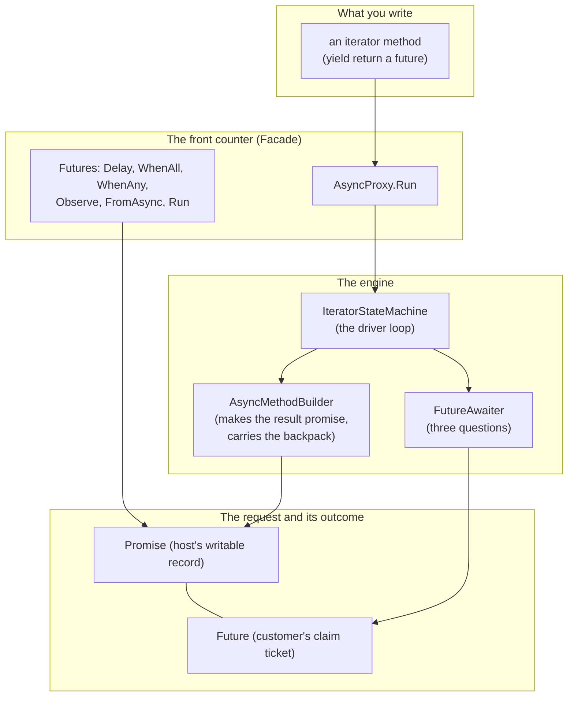

# 9. Patterns and principles

## At the table

Dee came by with the check folded in half on a little tray, and set it between them like a hand grenade she had already pulled the pin on.

"You boys want pie? Apple, pecan, and the chocolate thing that somebody's cousin makes."

"Give us a minute, Dee," Steve said, and she gave them exactly one, which was how Dee did it.

Kevin looked at the check, looked at the screen, and looked at the napkin that said *1 to 10* at the top with eight things crossed off. His tea had gone warm an hour ago. The wings were long gone. Somewhere behind him, a kid was crying at a table he could not see, and the Rangers fan at the bar had stopped watching the game and started watching Kevin.

"What do I tell my boss," Kevin said. "Dale. He's going to ask what this is. He's going to want a name for it, something he can put on the certification form."

"Give him several. None of them are new, bud. That's the good news." Steve counted on his fingers. "Future and promise: 1977 and 1988. Observer. A state machine driven by a state number and a switch. An iterator used as a coroutine. Adapter, three times over. He'll have heard of most of them. Dale likes things with old names. Old names mean somebody already got hurt by it and wrote a paper."

"He's going to ask why I'm pulling a library into certified firmware."

"Then tell him what it is. Seven hundred lines of C# 3. No reflection. No code generation. No unsafe. Every type is named after the thing in 4.5 that it stands in for, so when the hardware finally gets retired and you move to a real runtime, you can match the teaching types to their runtime counterparts. You still have to check behavior and limits. And tell him the thing he actually cares about." Steve tapped the table. "The sale machine doesn't change. The hard limits don't change. The pump still owns the valve. Only the *waiting* changed."

Kevin wrote the word *waiting* on the napkin and underlined it. "He'll want to know what it's bad at."

"Three things, and they're in the README. 
- One, you can't catch a failed step inside an iterator body. You wrap it in `Observe` and look. 
- Two, `yield` can't sit in a `try` with a `catch`. 
- Three, continuations normally run on the finishing thread. For the serial reply, ask the promise to queue them to the pool. That keeps the UART reader's callback from also running your sale logic. A display update still needs its own thread."

Kevin wrote three lines under the word *waiting*. Then he looked at them for a while.

"You know what's funny?" he said. "I came in here with a thread problem. I figured you'd show me a trick. I did not figure I'd walk out with a thing I can explain to a *committee*."

"That's what the old names are for," Steve said. "They're a handshake with every engineer who came before you. And if Dale's read Dan North, let's hold the code up against CUPID now and see where we come up short. I'd rather you hear it from me than from him."

"Come up short? You?"

"Always. Keep reading."

A **pattern** is a named solution to a problem that comes up often in code. A promise solves "the answer will arrive later." An adapter solves "these two interfaces do different things." This chapter connects those names to the files you have used. It then checks the design with CUPID, SOLID, and DRY, three ways to review how code fits together.

## The patterns, by file

The table names each pattern, shows its file, and explains the job it does. The last column connects that job to the restaurant story.

| Pattern | Where | What it buys | Example or comparison |
|---|---|---|---|
| **Future / Promise** | `Core/Promise{T}.cs`, `Core/IFuture.cs` | A placeholder for a value that arrives later, split into a write side and a read side. Older than most of us: Baker and Hewitt named futures in 1977, Liskov and Shrira named promises in 1988. | The host writes the outcome in a request record; the customer uses a claim ticket to read it |
| **Observer** | `Promise<T>.RegisterContinuation`, `IAwaiter.OnCompleted`, `CancelToken.Register` | "Call me when it happens." Every continuation is an observer of one promise. Cancel callbacks are observers of one source. | A pager alerts the customer, who then returns to the host |
| **State machine** | `samples/.../AddAfterDelay.cs`, `Iterate/IteratorStateMachine{T}.cs` | A method that can stop and resume. An `int` says where we are, a `switch` jumps back there. Here, one method reads a number and jumps to the matching case. Another design, the State pattern, uses a separate class for each state. This library uses the smaller switch-based design. | A recipe with a bookmark and a sticky note |
| **Iterator, used as a coroutine** | `Iterate/AsyncProxy.cs` | `yield return` already suspends and resumes. We drive it from the outside and it becomes a coroutine. | A recipe you read one step at a time, where somebody else decides when to turn the page |
| **Adapter** | `Futures.FromAsync`, `Futures.Observe`, `IteratorStateMachine` | Begin/End becomes a future. A future that may fault becomes one that cannot. An `IEnumerator<IFuture>` becomes an `IAsyncStateMachine`. Three adapters, same job: make an old shape fit a new socket. | A travel plug that lets an old plug fit a new wall socket |
| **Facade** | `Futures`, `AsyncProxy` | Two static classes with short names in front of the machinery. Most callers never see a builder or an awaiter. | The front counter: a short menu in front of a big kitchen |
| **Protocol, duck-typed** | `Core/IAwaiter.cs` | The awaiter provides `IsCompleted`, `OnCompleted`, and `GetResult`. C# 5 also requires an accessible `GetAwaiter` method on the awaited value; its awaiter must meet the compiler's completion rules. This library puts its three calls behind `IAwaiter` so C# 3 code can use them. | A job posting with three requirements: anyone who can do all three gets the job |
| **Null Object** | `CancelToken.None`, `EmptyDisposable`, `VoidResult`, `Futures.Completed` | A value that is safe to use and does nothing. Callers skip the null checks. | `CancelToken.None` can be passed when no cancellation is needed |
| **Registration handle** | `CancelSource.Register` returns `IDisposable` | Subscribe, get a handle, dispose the handle to unsubscribe. The .NET idiom for "undo a registration", from `IObservable` to event-to-token bridges. | Returning the pager ends notifications; the table request can still finish |
| **Wrapper, for the non-generic twin** | `Core/Promise.cs`, `Builder/AsyncMethodBuilder.cs` | The void versions hold a generic one over `VoidResult` and forward. One implementation to get right. | The non-generic promise forwards its calls to a generic promise |
| **Countdown latch** | `Futures.WhenAll` | N callbacks, one counter, `Interlocked.Decrement`, whoever hits zero finishes the job. No lock, no waiting thread. | Friends splitting a check: when the last one has paid, the table is done |
| **Ambient context, captured and restored** | `AsyncMethodBuilder<T>.AwaitOnCompleted`, `FutureAwaiter<T>.OnCompleted` | Grab `ExecutionContext` and `SynchronizationContext` at one point, put them back at another. Same move the state machine makes with its locals, applied to the environment. | The backpack that travels with the job |
| **Read-only view** | `Core/Future{T}.cs`, handed out by `Promise<T>.Future` | A separate sealed object that forwards the read members. The receiver cannot reach the setters by any cast. Capability by object identity, not only by static type. | The customer's claim ticket provides access to the host's record without permission to change it |

These patterns describe jobs the library already needs: storing results, waking methods, and connecting APIs.

Paths beginning with `Core/`, `Builder/`, or `Iterate/` are relative to `src/MMP.AsyncProxy/`. The sample machine is in `samples/MMP.AsyncProxy.Samples/AddAfterDelay.cs`. This chapter names responsibilities; chapters 2 through 7 contain the source excerpts and walkthroughs.

### How the pieces connect

**Follow one delay through the diagram:**

1. Your iterator calls `Futures.Delay(100)` and yields its future.
2. `AsyncProxy.Run` has created an `IteratorStateMachine` to drive your iterator. The driver reads that future.
3. If the delay is pending, the driver saves its awaiter. The builder registers a callback and returns.
4. The timer completes the delay's promise. The saved callback runs the driver again, and your iterator continues after `yield return`.
5. When your iterator ends, the builder completes a different promise: the result of the entire method.

The delay's future represents one step. The future returned by `AsyncProxy.Run` represents the full method.

## CUPID

Dan North's CUPID is five properties code can have. Not rules. Things that, when present, make the code a joy to work in. We check each one against this repo.

**Composable means pieces work together.** Suppose you start two delays and give their futures to `WhenAll`. It returns a future that completes after both delays finish. The delays need no special knowledge of `WhenAll`. They provide the same future interface that other operations use.

**Unix philosophy means giving each piece a clear job.** `Promise` stores completion. `FutureAwaiter` checks completion and reads the result. `AsyncMethodBuilder` starts the machine and registers its next call. `IteratorStateMachine` pulls each next step. Some jobs combine concerns: `Futures.Delay(ms, token)` handles both a timer and cancellation, because either one can end that delay.

**Predictable means the rules stay consistent.** A pending future ends in success, failure, or cancellation. After that, it keeps that outcome. The first completion wins. By default, the finishing thread calls callbacks saved while pending. `PromiseOptions.RunContinuationsAsynchronously` queues those saved callbacks to the pool instead. Registration after completion can run inline or post through a captured context. A separate future object gives callers a read-only view; it exposes no completion methods.

**Idiomatic.** *In plain words: it feels natural to people who already write .NET.* Names such as `FutureAwaiter` and `AsyncMethodBuilder` resemble their .NET counterparts. The promise option uses the same member name as `TaskCreationOptions.RunContinuationsAsynchronously`. `Begin`/`End` adapts through a method that looks like `Task.Factory.FromAsync`. Registrations return `IDisposable`. The examples often use anonymous delegates, such as `delegate { ... }`. C# 3 also supports lambdas with statement bodies. The delegate spelling keeps these examples close to the older callback APIs.

**Domain-based.** *In plain words: the code uses the words of the problem, not generic filler.* The domain here is asynchrony, and the words are future, promise, awaiter, continuation, state, cancel. No `Manager`, no `Helper`, no `Util`.

## SOLID

SOLID is older and more prescriptive. CUPID came out of frustration with how SOLID gets applied, so we treat it as a checklist rather than a creed.

**Single responsibility.** *In plain words: each class has one reason to change.* The split between `Promise` (holds the result), `FutureAwaiter` (answers the compiler), and `AsyncMethodBuilder` (drives the machine) is the whole reason the hand-written machine and the iterator machine can share parts. Collapse them into one class and you could not write `IteratorStateMachine` without copying half of `AddAfterDelayMachine`.

**Open/closed.** *In plain words: you can add new abilities without cutting open the old code.* The driver reads futures through `IFuture` and gets their completion members through `IAwaiter`. A new future implementation can provide those interfaces without changing the driver's loop. `Futures.FromAsync` wraps a compatible Begin/End operation in a future. The caller supplies the delegates, including the matching End call. End collects the result or throws the operation's error; the adapter stores either outcome in the promise. The state machine keeps the same completion protocol.

**Liskov substitution.** *In plain words: anywhere the general thing fits, the more specific thing fits too.* `IFuture<T>` is an `IFuture`. Anywhere that takes the base, the generic works. `WhenAll` takes `IFuture[]` and you pass typed futures in without a cast. The `Future<T>` that a promise hands out is an `IFuture<T>` and behaves like one everywhere it is passed as one. (The promise itself is deliberately *not* an `IFuture<T>`; see "where we fell short".)

**Interface segregation.** *In plain words: give each caller the members its job needs.* `IAwaiter` exposes the three completion members used by this library's builder and machines. `IAwaiter<T>` also returns a typed result. `IFuture<T>` adds direct outcome inspection and blocking reads. Neither interface exposes setters. Code can complete an operation when it holds the promise; receiving the future alone gives it no such access.

**Dependency inversion.** *In plain words: depend on a plug shape, not on a particular appliance.* The state machine depends on `IAwaiter` and on the builder. It does not know about timers, thread pools, or file handles. `Futures.FromAsync` takes two delegates and never names `FileStream`. Swap the timer for a socket and the machine does not change.

This review covers a small teaching library. The .NET types provide useful models, but a larger library would need its own review and tests.

## DRY

DRY stands for "don't repeat yourself." Keep one implementation of a rule when several callers need that same rule. The rule of three is a guide: after three similar uses, check whether one shared implementation would help.

**Extracted.**

- `Promise` is a shell over `Promise<VoidResult>`. One completion algorithm.
- `AsyncMethodBuilder` is a shell over `AsyncMethodBuilder<VoidResult>`.
- `Futures.Run(Action)` calls `Run<VoidResult>`. `Run<T>(work)` calls `Run<T>(work, CancelToken.None)`. `Delay(ms)` calls `Delay(ms, None)`. Every overload funnels to one body.
- `IAwaiter.GetResult()` on the generic awaiter forwards to the typed one.

**Waiting.** The registration code, "if pending add to list, else run now, under a lock", appears in `Promise<T>.RegisterContinuation` and in `CancelSource.Register`. Two occurrences. The third would be a `Signal` or a `Latch`, and that is when it becomes a shared `CallbackList` type. Until then, two copies of eight lines are cheaper than a shared abstraction that has to serve both and fit neither.

**On purpose.** `AddAfterDelay.cs` and `AddAfterDelayIterator.cs` do the same thing twice. That duplication is the lesson. Deleting either one deletes the comparison.

## Where we fell short

Three things a reviewer flagged on the first draft. One is fixed. One was half fixed since then. One is watched.

1. **The read-only view was a cast away. Fixed.** The first draft had `Promise<T>` implement `IFuture<T>` and return `this` from `Future`. Anyone who wrote `(Promise<T>)future` got the setters back. The fix was a separate sealed `Future<T>` that holds the promise and forwards the reads, which is how `TaskCompletionSource` and `Task` are arranged. Cost: one allocation per promise. The test `Future_view_cannot_be_cast_back_to_a_completer` now asserts the types are unrelated, and the compiler rejects the cast at build time. The separate object prevents callers from casting a future back to the promise that can complete it.
2. **Booleans as strategy. Half fixed.** The review's worry was flags: `continueOnCapturedContext` and `runContinuationsAsync` were both plain `bool`s, and `new Promise<string>(true)` does not tell the reader what the `true` is for. *What changed:* the promise's flag is now a named option, `PromiseOptions.RunContinuationsAsynchronously`, so the call reads `new Promise<string>(PromiseOptions.RunContinuationsAsynchronously)` and matches .NET's own `TaskCreationOptions` member word for word. It is a `[Flags]` enum, so a second option can be added without changing any signature. The old `bool` constructor still compiles, so nobody's existing code broke, but the course and the library now write the option by name. *What stays watched:* `continueOnCapturedContext` is still a flag on the awaiter (`ContinueOnAnyThread()` is the readable face of it). Two flags are fine. A third flag is the moment to roll them into one options object or a small policy interface. Watch for it.
3. **`SetStateMachine` does no work in the hand-written sample.** Fine for class machines, wrong for struct ones. Exercise 10 in chapter 8 is where you find out why. A release that supports struct machines would need a safe way to preserve the same machine across pauses. This teaching builder is used with class machines.

## The one to remember

If you forget every pattern name in the table, keep this: every piece here is a capture at one point and a restore at another. The state machine captures locals in fields and restores them on `MoveNext`. The builder captures `ExecutionContext` and restores it before the callback. The awaiter captures `SynchronizationContext` and posts back to it. The promise captures continuations and runs them on completion. Each piece keeps the information needed for its next call.

At the restaurant, the host keeps the request record and the list of pagers to buzz. The record corresponds to the promise. Returning to read the table assignment is the continuation; the buzz is its notification.

## Words you just met

| Word | Plain meaning | The picture |
|---|---|---|
| **Pattern** | A named shape that shows up again and again in code | A word for a move, like "fork" in chess |
| **CUPID** | Five good properties of code: Composable, Unix philosophy, Predictable, Idiomatic, Domain-based | A report card with five grades |
| **SOLID** | Five older design rules (single responsibility, open/closed, Liskov, interface segregation, dependency inversion) | A checklist, not a law |
| **DRY** | "Don't repeat yourself": say a thing once | One recipe, many uses |
| **Facade** | A short front door in front of a complicated inside | The front counter |
| **Adapter** | A piece that makes an old shape fit a new socket | A travel plug |
