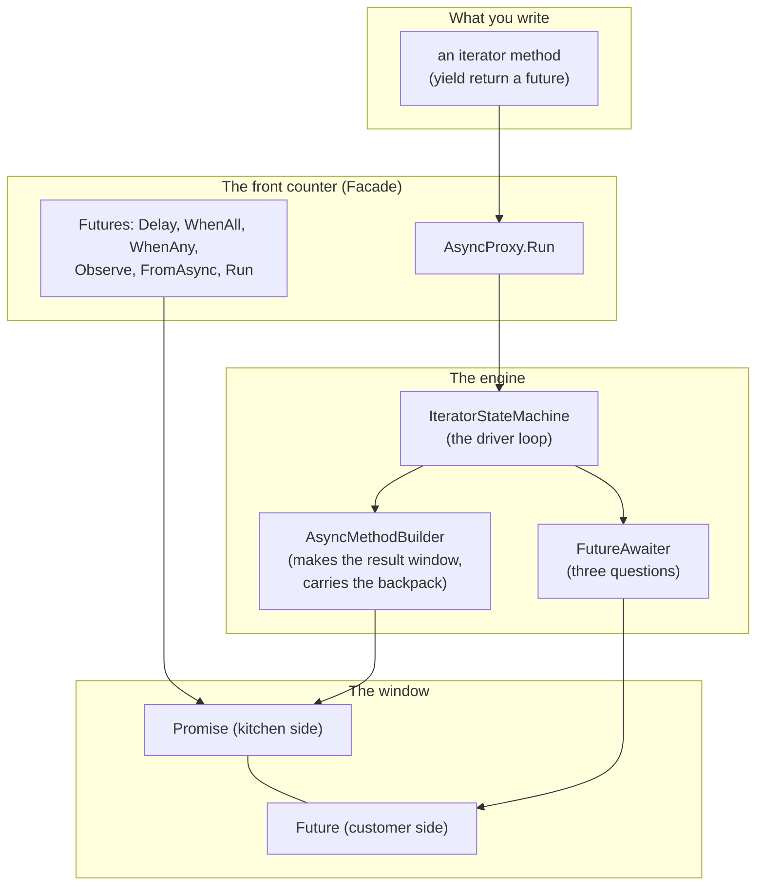

# 9. Patterns and principles

## At the table

Dee came by with the check folded in half on a little tray, and set it between them like a hand grenade she had already pulled the pin on.

"You boys want pie? Apple, pecan, and the chocolate thing that somebody's cousin makes."

"Give us a minute, Dee," Steve said, and she gave them exactly one, which was how Dee did it.

Kevin looked at the check, looked at the screen, and looked at the napkin that said *1 to 10* at the top with eight things crossed off. His tea had gone warm an hour ago. The wings were long gone. Somewhere behind him, a kid was crying at a table he could not see, and the man at the bar had stopped watching the fishing show and started watching Kevin.

"What do I tell my boss," Kevin said. "Dale. He's going to ask what this is. He's going to want a name for it, something he can put on the certification form."

"Give him several. None of them are new, bro. That's the good news." Steve counted on his fingers. "Future and promise: 1977 and 1988. Observer. A state machine, the table-driven kind. An iterator used as a coroutine. Adapter, three times over. He'll have heard of most of them. Dale likes things with old names. Old names mean somebody already got hurt by it and wrote a paper."

"He's going to ask why I'm pulling a library into certified firmware."

"Then tell him what it is. Seven hundred lines of C# 3. No reflection. No code generation. No unsafe. Every type is named after the thing in 4.5 that it stands in for, so when the hardware finally gets retired and you move to a real runtime, the rename is mechanical, a find and replace. And tell him the thing he actually cares about." Steve tapped the table. "The sale machine doesn't change. The hard limits don't change. The pump still owns the valve. Only the *waiting* changed."

Kevin wrote the word *waiting* on the napkin and underlined it. "He'll want to know what it's bad at."

"Three things, and they're in the README. One, you can't catch a failed step inside an iterator body. You wrap it in `Observe` and look. Two, `yield` can't sit in a `try` with a `catch`. Three, continuations run on the finishing thread unless you ask for the pool, and you will ask for the pool, every time, because you do not want the UART interrupt running your sale logic."

Kevin wrote three lines under the word *waiting*. Then he looked at them for a while.

"You know what's funny?" he said. "I came in here with a thread problem. I figured you'd show me a trick. I did not figure I'd walk out with a thing I can explain to a *committee*."

"That's what the old names are for," Steve said. "They're a handshake with every engineer who came before you. And if Dale's read Dan North, there's a chapter here that holds the code up against CUPID and says where we come up short. I'd rather you hear it from me than from him."

"Come up short? You?"

"Always. Keep reading."

We did not sit down and pick patterns. We built the smallest thing that worked and the patterns showed up, because they are the shapes these problems take. A **pattern** is a named shape that people keep finding in code. When you can name it, you can say "oh, it is that again" instead of working it out from scratch. This chapter names them after the fact, points at the file each one lives in, and then holds the code up against CUPID, SOLID, and DRY. Where it falls short, we say so.

## The patterns, by file

The first four columns are the technical answer. The last one is a picture to keep in your head.

| Pattern | Where | What it buys | In a picture |
|---|---|---|---|
| **Future / Promise** | `Core/Promise{T}.cs`, `Core/IFuture.cs` | A placeholder for a value that arrives later, split into a write side and a read side. Older than most of us: Baker and Hewitt named futures in 1977, Liskov and Shrira named promises in 1988. | A pickup window: the kitchen puts the food in, the customer can only look |
| **Observer** | `Promise<T>.RegisterContinuation`, `IAwaiter.OnCompleted`, `CancelToken.Register` | "Call me when it happens." Every continuation is an observer of one promise. Cancel callbacks are observers of one source. | The restaurant pager |
| **State machine** | `samples/.../AddAfterDelay.cs`, `Iterate/IteratorStateMachine{T}.cs` | A method that can stop and resume. An `int` says where we are, a `switch` jumps back there. This is the table-driven kind, with one method and a state field. The GoF State pattern, with one class per state, would be ten times the code for no gain here. | A recipe with a bookmark and a sticky note |
| **Iterator, used as a coroutine** | `Iterate/AsyncProxy.cs` | `yield return` already suspends and resumes. We drive it from the outside and it becomes a coroutine. | A recipe you read one step at a time, where somebody else decides when to turn the page |
| **Adapter** | `Futures.FromAsync`, `Futures.Observe`, `IteratorStateMachine` | Begin/End becomes a future. A future that may fault becomes one that cannot. An `IEnumerator<IFuture>` becomes an `IAsyncStateMachine`. Three adapters, same job: make an old shape fit a new socket. | A travel plug that lets an old plug fit a new wall socket |
| **Facade** | `Futures`, `AsyncProxy` | Two static classes with short names in front of the machinery. Most callers never see a builder or an awaiter. | The front counter: a short menu in front of a big kitchen |
| **Protocol, duck-typed** | `Core/IAwaiter.cs` | Three members. In C# 5 the compiler does not even need the interface; anything with those three members is awaitable. We made it an interface because C# 3 has no way to say "anything with these members". | A job posting with three requirements: anyone who can do all three gets the job |
| **Null Object** | `CancelToken.None`, `EmptyDisposable`, `VoidResult`, `Futures.Completed` | A value that is safe to use and does nothing. Callers skip the null checks. | A dummy lamp that fits the socket and does nothing, so nobody has to check for an empty socket |
| **Registration handle** | `CancelSource.Register` returns `IDisposable` | Subscribe, get a handle, dispose the handle to unsubscribe. The .NET idiom for "undo a registration", from `IObservable` to event-to-token bridges. | Handing the pager back to cancel your order |
| **Wrapper, for the non-generic twin** | `Core/Promise.cs`, `Builder/AsyncMethodBuilder.cs` | The void versions hold a generic one over `VoidResult` and forward. One implementation to get right. | A second front door into the same room |
| **Countdown latch** | `Futures.WhenAll` | N callbacks, one counter, `Interlocked.Decrement`, whoever hits zero finishes the job. No lock, no waiting thread. | Friends splitting a check: when the last one has paid, the table is done |
| **Ambient context, captured and restored** | `AsyncMethodBuilder<T>.AwaitOnCompleted`, `FutureAwaiter<T>.OnCompleted` | Grab `ExecutionContext` and `SynchronizationContext` at one point, put them back at another. Same move the state machine makes with its locals, applied to the environment. | The backpack that travels with the job |
| **Read-only view** | `Core/Future{T}.cs`, handed out by `Promise<T>.Future` | A separate sealed object that forwards the read members. The receiver cannot reach the setters by any cast. Capability by object identity, not only by static type. | The customer's side of the window, a different object from the kitchen's |

Thirteen named shapes in about 700 lines of library. None of them were added for their own sake. Each one is the answer to a question the previous chapter asked.

### How the pieces connect

**In words:**

1. At the top is the only thing you write: an iterator method that hands out futures with `yield return`.
2. You give it to `AsyncProxy.Run`, one of the two front counters. The other, `Futures`, is where you get ready-made futures: a delay, a read, a race.
3. `AsyncProxy.Run` builds the driver loop, the `IteratorStateMachine`, and starts it.
4. The driver does two jobs: it asks the `FutureAwaiter` the three questions about each future it is handed (are you done, buzz me, what is the answer), and it uses the `AsyncMethodBuilder` to park itself and to put the final answer in.
5. At the bottom is the window. The builder owns a promise, the kitchen side, for the *method's* result. The awaiter looks at a future, the customer side, for each *step*. A `Futures` helper, such as `Delay`, owns a promise of its own and hands out its future.
6. Everything meets at the promise and the future. That is why every other piece can be small.

**Why it matters:** the shape is a funnel. Many things you can wait on, one small window type they all use. The pieces do not know about each other except through that window and the three-question awaiter.

## CUPID

Dan North's CUPID is five properties code can have. Not rules. Things that, when present, make the code a joy to work in. We check each one against this repo.

**Composable.** *In plain words: pieces that snap together like building blocks, without gluing.* Small surface, few dependencies, intention revealing. `IFuture` has seven members. `IAwaiter` has three. You can combine futures with `WhenAll`, `WhenAny`, and `Observe` without any of them knowing about the others, because they all speak `IAwaiter`. A new combinator is a new static method; nothing existing changes. Score: good.

**Unix philosophy.** *In plain words: each piece does one job and does it well, like a stapler that does not also toast bread.* `Promise` completes. `FutureAwaiter` answers three questions. `AsyncMethodBuilder` makes four calls. `IteratorStateMachine` pulls the next step. `CancelSource` flips a flag and runs callbacks. Open any file and the class fits on a screen with its comments. Score: good. The one that does two things is `Futures.Delay(ms, token)`, which is both a timer and a cancel race, and the comment inside says so.

**Predictable.** *In plain words: it does what it looks like it does, the same way every time, with no surprises.* A future moves once and never back. First completion wins and the second is refused. Continuations run inline unless you asked otherwise, and the `PromiseOptions` argument is the only place that changes. There are no hidden threads. A future handed out as read-only stays read-only, because it is a different object from the promise. Score: good. The first draft had a hole here; see "where we fell short".

**Idiomatic.** *In plain words: it feels natural to people who already write .NET.* The names are the .NET 4.5 names with one letter changed, on purpose, and the promise option is spelled exactly like the `TaskCreationOptions` member it stands in for. `Begin`/`End` adapts through a method that looks like `Task.Factory.FromAsync`. Registrations return `IDisposable`. The C# 3 inside uses anonymous delegates where a modern reader expects lambdas, because C# 3 lambdas cannot be statement bodies in every position we needed. Score: good for 2008, slightly dated for 2026, which is the point.

**Domain-based.** *In plain words: the code uses the words of the problem, not generic filler.* The domain here is asynchrony, and the words are future, promise, awaiter, continuation, state, cancel. No `Manager`, no `Helper`, no `Util`. Score: good.

## SOLID

SOLID is older and more prescriptive. CUPID came out of frustration with how SOLID gets applied, so we treat it as a checklist rather than a creed.

**Single responsibility.** *In plain words: each class has one reason to change.* The split between `Promise` (holds the result), `FutureAwaiter` (answers the compiler), and `AsyncMethodBuilder` (drives the machine) is the whole reason the hand-written machine and the iterator machine can share parts. Collapse them into one class and you could not write `IteratorStateMachine` without copying half of `AddAfterDelayMachine`.

**Open/closed.** *In plain words: you can add new abilities without cutting open the old code.* `IAwaiter` is the extension point. Any type that implements it can be parked on. `Futures.FromAsync` means every Begin/End API in the framework became awaitable without touching the library. Adding `WhenAny` in slice 2 touched zero existing files.

**Liskov substitution.** *In plain words: anywhere the general thing fits, the more specific thing fits too.* `IFuture<T>` is an `IFuture`. Anywhere that takes the base, the generic works. `WhenAll` takes `IFuture[]` and you pass typed futures in without a cast. The `Future<T>` that a promise hands out is an `IFuture<T>` and behaves like one everywhere it is passed as one. (The promise itself is deliberately *not* an `IFuture<T>`; see "where we fell short".)

**Interface segregation.** *In plain words: do not make anyone depend on buttons they never press.* `IAwaiter` has three members and nothing else, because that is all the compiler calls. `IFuture` has no setters. A caller that only needs "tell me when" gets `IAwaiter`. A caller that needs "give me the value" gets `IFuture<T>`. Nobody gets `SetResult` unless they made the promise.

**Dependency inversion.** *In plain words: depend on a plug shape, not on a particular appliance.* The state machine depends on `IAwaiter` and on the builder. It does not know about timers, thread pools, or file handles. `Futures.FromAsync` takes two delegates and never names `FileStream`. Swap the timer for a socket and the machine does not change.

One caveat: SOLID is easy to pass when the code is this small. The test is whether the shapes hold at ten times the size. The reason to believe they do is that the real .NET runtime has the same five seams and has held for fourteen years.

## DRY

DRY stands for "don't repeat yourself." Rule of three: duplicate once and wait, extract on the third. Here is where we extracted and where we are waiting.

**Extracted.**

- `Promise` is a shell over `Promise<VoidResult>`. One completion algorithm.
- `AsyncMethodBuilder` is a shell over `AsyncMethodBuilder<VoidResult>`.
- `Futures.Run(Action)` calls `Run<VoidResult>`. `Run<T>(work)` calls `Run<T>(work, CancelToken.None)`. `Delay(ms)` calls `Delay(ms, None)`. Every overload funnels to one body.
- `IAwaiter.GetResult()` on the generic awaiter forwards to the typed one.

**Waiting.** The two-case register shape, "if pending add to list, else run now, under a lock", appears in `Promise<T>.RegisterContinuation` and in `CancelSource.Register`. Two occurrences. The third would be a `Signal` or a `Latch`, and that is when it becomes a shared `CallbackList` type. Until then, two copies of eight lines are cheaper than a shared abstraction that has to serve both and fit neither.

**On purpose.** `AddAfterDelay.cs` and `AddAfterDelayIterator.cs` do the same thing twice. That duplication is the lesson. Deleting either one deletes the comparison.

## Where we fell short

Three things a reviewer flagged on the first draft. One is fixed. One was half fixed since then. One is watched.

1. **The read-only view was a cast away. Fixed.** The first draft had `Promise<T>` implement `IFuture<T>` and return `this` from `Future`. Anyone who wrote `(Promise<T>)future` got the setters back. The fix was a separate sealed `Future<T>` that holds the promise and forwards the reads, which is how `TaskCompletionSource` and `Task` are arranged. Cost: one allocation per promise. The test `Future_view_cannot_be_cast_back_to_a_completer` now asserts the types are unrelated, and the compiler rejects the cast at build time. Lesson for the course: a review that names a concrete fix gets acted on. One that says "consider encapsulation" does not.
2. **Booleans as strategy. Half fixed.** The review's worry was flags: `continueOnCapturedContext` and `runContinuationsAsync` were both plain `bool`s, and `new Promise<string>(true)` does not tell the reader what the `true` is for. *What changed:* the promise's flag is now a named option, `PromiseOptions.RunContinuationsAsynchronously`, so the call reads `new Promise<string>(PromiseOptions.RunContinuationsAsynchronously)` and matches .NET's own `TaskCreationOptions` member word for word. It is a `[Flags]` enum, so a second option can be added without changing any signature. The old `bool` constructor still compiles, so nobody's existing code broke, but the course and the library now write the option by name. *What stays watched:* `continueOnCapturedContext` is still a flag on the awaiter (`ContinueOnAnyThread()` is the readable face of it). Two flags are fine. A third flag is the moment to roll them into one options object or a small policy interface. Watch for it.
3. **`SetStateMachine` is empty.** Fine for class machines, wrong for struct ones. Exercise 10 in chapter 8 is where you find out why. A real release would either implement it or seal the door by making the builder refuse struct machines at compile time, which C# 3 cannot express.

## The one to remember

If you forget every pattern name in the table, keep this: every piece here is a capture at one point and a restore at another. The state machine captures locals in fields and restores them on `MoveNext`. The builder captures `ExecutionContext` and restores it before the callback. The awaiter captures `SynchronizationContext` and posts back to it. The promise captures continuations and runs them on completion. Same move, four places. That is what Composable looks like when it is working.

In kitchen terms: the recipe card writes down what was in your hands before you walked away (state machine). The backpack carries the job's things from worker to worker (execution context). The sign says "return to counter 3" (synchronization context). And the pickup window keeps the list of pagers to buzz (promise).

## Words you just met

| Word | Plain meaning | The picture |
|---|---|---|
| **Pattern** | A named shape that shows up again and again in code | A word for a move, like "fork" in chess |
| **CUPID** | Five good properties of code: Composable, Unix philosophy, Predictable, Idiomatic, Domain-based | A report card with five grades |
| **SOLID** | Five older design rules (single responsibility, open/closed, Liskov, interface segregation, dependency inversion) | A checklist, not a law |
| **DRY** | "Don't repeat yourself": say a thing once | One recipe, many uses |
| **Facade** | A short front door in front of a complicated inside | The front counter |
| **Adapter** | A piece that makes an old shape fit a new socket | A travel plug |
