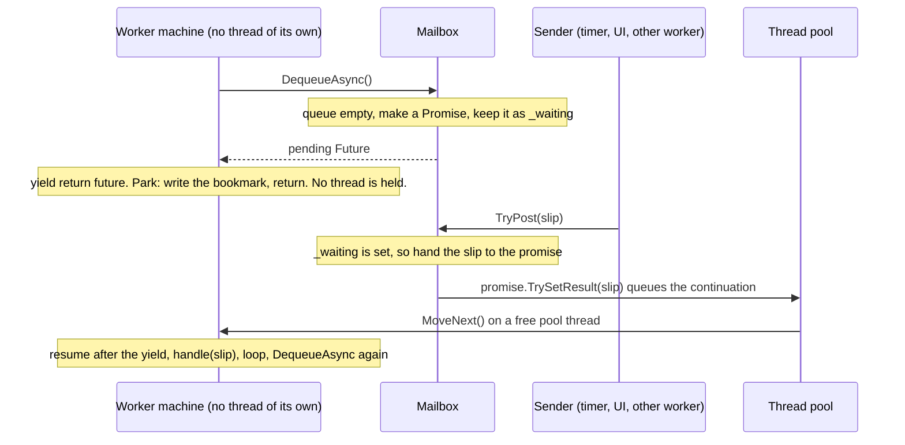

# 10. Waiting without a thread

The first nine chapters built the machine. This one puts it to work on the shape most programs have at their core: a worker that waits for something to do, does it, and waits again. The worked example is MMP.GasPumpSimulator, a forecourt simulator that runs its three workers three different ways. One of those ways is this library. Every piece of it would compile on .NET 3.5.

By the end you will know what a thread costs, how a method can stop in the middle and pick up later, how an empty in-tray wakes a sleeping worker without anyone standing there, and where the saved threads, memory, and CPU cycles go. At the end the machine this library builds sits beside the machine the modern C# compiler builds, down to the IL, so you can see they are the same shape.

The four projects under `training/` take this chapter's one shape and show the move on four more.

## 1. Three ways to wait

A worker in the simulator is a loop: wait for a slip in the in-tray, handle it, wait again. The slips arrive a few times a second during a sale and never for minutes at a time between sales. So the loop spends almost all of its life waiting. The question this chapter is about is simple: **what does the worker hold while it waits?**

The simulator has three answers, picked at startup. Everything above them is the same code.

1. **A thread.** `ThreadedDispatch`. Each worker gets its own thread, and the thread sits inside `BlockingCollection.Take()` until a slip arrives. Simple, and the way it was done in 2008.
2. **The compiler's state machine.** `ChannelDispatch`. Each worker is an `async` method that `await`s a channel. When the channel is empty the method stops, gives its thread back, and holds nothing but a small object. The C# compiler wrote the machinery for that in 2012.
3. **A hand-built state machine.** `AsyncProxyDispatch`. The same idea as number 2, written without the `async` keyword, using a C# 2 iterator and this library for the rest.

Numbers 2 and 3 do the same thing. Number 3 is here so you can see how number 2 works with the lid off. If you understand number 3, you understand `await`.

## 2. What a thread costs

> **Short version.** A thread is a worker with their own desk, chair, and filing cabinet. A parked thread is a desk nobody is sitting at that still takes up floor space and still gets a visit from the manager every time the manager walks the room.

A thread is the operating system's unit of running code. To make one, the system sets aside three things:

- **A stack.** Memory for the thread's local variables and call chain. On Windows the default reservation for a .NET thread is about one megabyte. Most of it is never touched, but it is spoken for.
- **A kernel object.** The system's own record of the thread: its state, its priority, its place in the scheduler's lists.
- **A slot in the scheduler.** The scheduler is the part of the system that decides which thread runs on which CPU core, and for how long.

When a thread waits inside `Take()`, it is **blocked**. It runs no code, but the stack is still reserved, the kernel object still exists, and the scheduler still knows about it. When a slip finally arrives, the system has to perform a **context switch**: save whatever was running on that core, load the waiting thread's registers and stack pointer, and jump to it. A switch costs on the order of microseconds, which sounds like nothing until you do it thousands of times a second.

| | Threaded: a parked thread per worker | AsyncProxy: a bookmark per worker |
|---|---|---|
| Three workers | three threads, each with about 1 MB of reserved stack, a kernel object, and a scheduler slot, all blocked in `Take()` | three small objects, a few hundred bytes each: the fields of the loop and which step it stopped at |
| Three thousand workers | three thousand threads, about 3 GB of reserved stack, and a scheduler walking three thousand entries | three thousand small objects, and the same handful of pool threads |
| Who runs the code | the worker's own thread, after a wake-up | a pool thread, about one per core, shared by everything, only while a slip is in hand |

The left column pays for a desk per worker whether or not anyone is working. The right column pays for a sticky note per worker and shares the desks.

For three workers, a thread each is fine. The simulator keeps `ThreadedDispatch` because it is the simplest to read and the best fit for a call that truly blocks, like a bank request on a 2008 library with no asynchronous version. The savings matter when workers multiply: a forecourt controller with forty dispensers, a server with thousands of connections. The way to get there is to stop holding a thread while you wait.

## 3. A method with a bookmark

> **Short version.** A normal method is a recipe you read top to bottom without stopping. An iterator is the same recipe with a bookmark. You can read a step, put the bookmark in, close the book, and come back later to the next step with everything you had in your hands still there.

Here is the whole trick behind `await`, and it is older than `await`. In 2005, C# 2 added `yield return`. You write a method that returns a sequence, and every time it says `yield return x`, it hands out `x` and **stops**. When the caller asks for the next item, the method **resumes** on the line after the `yield`, with all its local variables intact.

The compiler makes that possible by rewriting your method into a class. The class has one field per local variable, one field for "which step am I on", and one method, `MoveNext`, that is your code chopped into pieces with a `switch` at the top that jumps to the right piece. The compiler has been doing this since 2005. It is a state machine, and the compiler wrote it for you.

What you write:

```csharp
IEnumerable<IFuture> Loop(Mailbox<T> box, Action<T> handle)
{
    while (!_stopping)
    {
        var next = box.DequeueAsync();
        yield return Futures.Observe(next);   // the bookmark
        if (next.IsCanceled) yield break;
        handle(next.Result);
    }
}
```

What the compiler builds, from the Release build of the simulator:

```csharp
class <Loop>d__5 : IEnumerator<IFuture>
{
    int     <>1__state;      // the bookmark
    IFuture <>2__current;    // what was yielded
    Mailbox<T> box; Action<T> handle;   // the locals
    IFuture<T> <next>5__2;   // a local that crosses the yield

    bool MoveNext()
    {
        switch (<>1__state) { case 0: ... case 1: ... }
        // run until the next yield, set state, return
    }
}
```

The field named `state` is the bookmark. The locals became fields so they survive between calls.

Now the one-line insight this library is built on: **a method that pauses at each `yield` and a method that pauses at each `await` need the same machine.** Both save the locals, record where they stopped, and return. The only thing `await` adds is *who calls `MoveNext` next*. With `yield`, the caller pulls the next item whenever it likes. With `await`, the thing you were waiting for calls `MoveNext` when it finishes. So the library's job is small: take an iterator that yields *futures* (promises of a value), and arrange for each future to call `MoveNext` when it completes.

```csharp
// src/MMP.AsyncProxy/Iterate/IteratorStateMachine{T}.cs: the last tenth that turns an iterator into async.
public void MoveNext()
{
    try
    {
        while (true)
        {
            // Coming back from a suspend? Observe the step we parked on.
            if (_pending != null) { IAwaiter finished = _pending; _pending = null; finished.GetResult(); }

            // Ask the iterator for its next future. No more? The method is done.
            if (!_steps.MoveNext()) { _steps.Dispose(); _builder.SetResult(_return.Value); return; }

            IFuture step = _steps.Current;
            IAwaiter awaiter = step.GetAwaiter();

            // Fast path: the future is already done, so no suspend. Keep going in this loop.
            if (awaiter.IsCompleted) { awaiter.GetResult(); continue; }

            // Slow path: park here. The builder will call MoveNext again when the future completes.
            _pending = awaiter;
            IteratorStateMachine<T> self = this;
            _builder.AwaitOnCompleted(ref awaiter, ref self);
            return;
        }
    }
    catch (Exception ex) { _steps.Dispose(); _builder.SetException(ex); }
}
```

Read it as a clerk working a to-do list. Pull the next item. If it is already done, cross it off and pull the next. If it is not done, write "call me when this finishes" on it and go home. There is no thread standing at the desk while the item is out. When the item finishes, whoever finished it calls the clerk back, and the clerk picks up the list where the bookmark is.

## 4. How the mailbox wakes the worker

> **Short version.** An empty in-tray hands the worker an IOU instead of a slip. When a slip finally arrives, the person dropping it off cashes the IOU, and that is what wakes the worker up, on whatever thread happens to be free.

In the threaded design the mailbox is a `BlockingCollection` and the worker's thread sleeps inside it. In the AsyncProxy design the mailbox is a plain queue plus one **promise**. A promise is a box that will hold a value later; the matching **future** is the read-only view of that box you hand to whoever is waiting.

```csharp
// GasPump.Dispatch/AsyncProxyDispatch.cs, the mailbox
public IFuture<T> DequeueAsync()
{
    lock (_lock)
    {
        if (_closed) return Canceled();
        if (_items.Count > 0)
        {
            var ready = new Promise<T>(true);
            ready.SetResult(_items.Dequeue());   // already done: the fast path, no suspend
            return ready.Future;
        }
        _waiting = new Promise<T>(true);          // empty: hand out an IOU
        return _waiting.Future;
    }
}

public bool TryPost(T item)
{
    Promise<T>? wake = null;
    lock (_lock)
    {
        if (_closed) return false;
        if (_waiting is { } w) { _waiting = null; wake = w; }     // someone is waiting: pay the IOU
        else if (_items.Count >= capacity) return false;         // full: the sender waits
        else _items.Enqueue(item);
        Interlocked.Increment(ref _pending);
    }
    // Outside the lock. The promise runs continuations on the pool, so this returns right away.
    wake?.TrySetResult(item);
    return true;
}
```



Nobody waits. The sender finishes posting in microseconds. The worker runs only while there is a slip in its hand.

Two details carry the weight here.

- **The promise is built with `runContinuationsAsync = true`.** When the sender pays the IOU, the worker's code does not run on the sender's thread. It is queued to the thread pool. That keeps the sender fast and keeps a lock held by the sender from ever being held while the worker runs. The modern name for this flag is `TaskCreationOptions.RunContinuationsAsynchronously`.
- **The handoff happens outside the lock.** `TryPost` takes the waiting promise out from under the lock and completes it after letting go. A callback that takes its own lock can never deadlock against the mailbox's.

## 5. The parts, and their modern names

Everything in this library is a copy of something in the modern runtime, written in C# 3 so it compiles on .NET 3.5. The names were chosen so the match is obvious.

| In MMP.AsyncProxy | In .NET today | What it is |
|---|---|---|
| `Promise<T>` | `TaskCompletionSource<T>` | The box the answer gets put in. You keep it; you hand out its future. |
| `IFuture<T>` | `Task<T>` | The read-only view of the box. Wait on it, or ask to be called when it fills. |
| `FutureAwaiter<T>` | `TaskAwaiter<T>` | What an await talks to: is it done, call me when it is, give me the result. |
| `AsyncMethodBuilder<T>` | `AsyncTaskMethodBuilder<T>` | Starts the machine, parks it on an awaiter, completes the future at the end. |
| `IteratorStateMachine<T>` | the class the C# compiler emits for an `async` method | The `MoveNext` loop above. Ours drives a C# 2 iterator; the compiler's is the method itself, rewritten. |
| `yield return future;` | `await task;` | The bookmark. |
| `AsyncProxy.Run(Loop(...))` | calling an `async` method | Build the machine, start it, hand back its future. |

## 6. The shift, step by step

Here is the same worker loop under the two designs, and what changes at each line.

**Thread per worker**

```csharp
// ThreadedDispatch.cs
_thread = new Thread(() =>
{
    foreach (var item in box.Queue.GetConsumingEnumerable(_stop.Token))
    {
        // the thread sleeps inside Take() between items
        handle(item);
    }
});
_thread.Start();
```

- One thread made at startup, alive until Dispose.
- Between slips the thread is blocked in the kernel.
- Each slip costs a context switch to wake this thread.
- Simple to debug: the call stack is the whole story.

**Hand-built state machine**

```csharp
// AsyncProxyDispatch.cs
_loop = AsyncProxy.Run(Loop(box, handle, owner));

IEnumerable<IFuture> Loop(...)
{
    while (!_stopping)
    {
        var next = box.DequeueAsync();
        yield return Futures.Observe(next);   // park
        if (next.IsCanceled || next.IsFaulted || _stopping) yield break;
        handle(next.Result);
    }
}
```

- No thread made. One small object holds the loop's state.
- Between slips nothing runs and nothing is reserved.
- Each slip costs a pool work item, not a kernel wake-up.
- Harder to debug: the stack shows the pool, and the "where was I" lives in a field.

Notice what did not change. Still one message at a time, because the loop is sequential. Still no shared state between workers. Still a bounded mailbox that makes a flood wait. The three rules every strategy keeps are kept here by the shape of the loop, not by a lock.

## 7. Where the savings are

| Resource | Thread per worker | State machine per worker | Why |
|---|---|---|---|
| Threads while idle | one per worker | zero | A parked machine is an object, not a thread. Pool threads go back to the pool. |
| Memory while idle | about 1 MB reserved stack per worker, plus a kernel object | a few hundred bytes per worker: the loop's fields and one pending promise | The locals that cross the yield became fields. Nothing else is kept. |
| Cost to deliver one slip | a kernel wake-up and a context switch to a specific thread | a queue push to the pool and a run on whichever thread is free | The pool thread is already running and warm in cache. No specific thread has to be found and woken. |
| Scaling to thousands of workers | thousands of threads; the scheduler and memory give out first | thousands of small objects; the pool stays the size of the machine | Work is proportional to messages, not to workers. |
| A call that truly blocks (a 2008 bank library) | fine: it blocks its own thread and nobody else waits | bad: it would block a pool thread that everything shares | This is why the simulator has `PrefersBlockingIo`. The payment worker blocks under threads and continues on a callback under the other two. |
| Allocation per message | none beyond the message | one promise when the mailbox was empty; none when a slip was already waiting | The fast path in `DequeueAsync` hands back a completed future and the machine never parks. |

The summary: for three workers the two columns cost about the same and the thread version is easier to read. The state machine wins the moment workers outnumber cores by a lot, or the moment a worker spends most of its time waiting, which a pump worker does. The simulator keeps all three so the trade is visible instead of argued about. The bench under `training/` puts numbers on each row.

## 8. Which thread problems go away, and which stay

People sometimes say async "removes threading problems." It removes some and leaves others, and knowing which is the difference between a safe design and a lucky one.

**Gone, because there is no parked thread**

- **Thread exhaustion.** You cannot run out of threads for idle workers, because idle workers hold none.
- **Blocking deadlocks** of the "I am waiting for you and you are waiting for me" kind that involve a thread sleeping in a kernel wait. Nothing sleeps in a kernel wait. A wait is a note on a promise.
- **Wake-up cost.** No context switch to a specific sleeping thread per message.

**Still there, and handled by the actor rules, never by async**

- **Races on shared state.** Two machines resumed on two pool threads at once can still stomp on a shared field. The simulator avoids this by the rule that workers share nothing and pass messages. Async did not buy that; the design did.
- **Reentrancy.** A continuation can run while you still hold a lock if you complete a promise inside the lock. The mailbox completes outside the lock and the promise queues to the pool, which is why that is written down twice in the code.
- **Lost exceptions.** A faulted future nobody observes is a silent failure. The loop wraps each dequeue in `Futures.Observe` and checks `IsFaulted` so a closed mailbox ends the loop instead of throwing into nowhere.
- **Debugging.** The stack trace of a resumed machine shows the pool, and nothing of your code's history. The library copies the first stack trace into the exception's data before rethrowing, because .NET 3.5 had no other way to keep it.

> **The one-sentence rule.** Async decides *what a worker holds while it waits*. The actor rules decide *what a worker may touch while it runs*. You need both, and they are different decisions.

## 9. The same machine, in IL

Is the code the compiler emits for `async` really the same shape as what the C# 2 iterator plus this library produce? Here is the evidence from the simulator's build. `GasPump.Dispatch.dll` was compiled in Release and decompiled with ILSpy 10.0.1. The Channel worker is a real `async` lambda, so the modern compiler built its machine. The AsyncProxy worker is an iterator, so the C# 2 machinery built its machine. Both are shown with the sugar turned off (`-lv CSharp1` for the iterator so `yield` is not re-sugared, `-lv CSharp4` for the async one so `await` is not).

**Iterator machine (AsyncProxy worker)**

```csharp
// decompiled, CSharp1, Release build
private sealed class <Loop>d__5 : IEnumerable<IFuture>, IEnumerator<IFuture>, IDisposable
{
    private int <>1__state;            // the bookmark
    private IFuture <>2__current;      // the future just yielded
    private Mailbox<T> box;             // hoisted parameter
    private Action<T> handle;           // hoisted parameter
    private AsyncProxyDispatch owner;   // hoisted parameter
    private IFuture<T> <next>5__2;      // local that crosses the yield

    private bool MoveNext()
    {
        int num = <>1__state;
        switch (num)
        {
        default: return false;
        case 0:  <>1__state = -1; break;          // first run
        case 1:                                   // resumed after the yield
            <>1__state = -1;
            if (<next>5__2.IsCanceled || ...) return false;
            try { handle(<next>5__2.Result); }
            finally { box.Handled(); ... }
            <next>5__2 = null;
            break;
        }
        if (!worker._stopping)
        {
            <next>5__2 = box.DequeueAsync();
            <>2__current = Futures.Observe(<next>5__2);
            <>1__state = 1;                       // park at step 1
            return true;
        }
        return false;
    }
}
```

**Async machine (Channel worker)**

```csharp
// decompiled, CSharp4, Release build
private struct <<-ctor>b__0>d : IAsyncStateMachine
{
    public int <>1__state;                        // the bookmark
    public AsyncTaskMethodBuilder <>t__builder;   // starts, parks, completes
    public <>c__DisplayClass3_0 <>4__this;        // hoisted captures: box, handle, owner
    private IAsyncEnumerator<T> <>7__wrap1;       // local that crosses an await
    private ValueTaskAwaiter<bool> <>u__1;        // the awaiter we parked on
    private ValueTaskAwaiter <>u__2;

    private void MoveNext()
    {
        int num = <>1__state;
        try
        {
            if (num != 0)
            {
                if (num == 1) { awaiter = <>u__2; ... goto IL_01a0; }   // resumed after await 1
                <>7__wrap1 = box.Channel.Reader.ReadAllAsync(token).GetAsyncEnumerator();
            }
            ...
            awaiter2 = <>7__wrap1.MoveNextAsync().GetAwaiter();
            if (!awaiter2.IsCompleted)
            {
                num = (<>1__state = 0);               // park at step 0
                <>u__1 = awaiter2;
                <>t__builder.AwaitUnsafeOnCompleted(ref awaiter2, ref this);
                return;
            }
            ...
            handle(current);
        }
        catch (Exception e) { <>1__state = -2; <>t__builder.SetException(e); return; }
        <>1__state = -2;
        <>t__builder.SetResult();
    }
}
```

Line them up and the skeleton is identical:

- a field named `<>1__state` holding which step the method is parked at, with the same conventions: `-1` running, `-2` finished, `0` and up for each parking spot;
- every local that has to survive a pause hoisted into a field, with the compiler's slot number in the name (`<next>5__2`, `<>7__wrap1`);
- one `MoveNext` that reads the state, jumps to the right piece, runs until the next pause, writes the new state, and returns.

And the one difference, which is the whole of what `async` adds. The iterator's `MoveNext` returns `true` and leaves the future in `<>2__current` for someone else to deal with. The async machine's `MoveNext` deals with it itself: it asks the awaiter whether it is done, and if not it hands *itself* to the builder (`AwaitUnsafeOnCompleted(ref awaiter, ref this)`) so the awaiter can call `MoveNext` again later. This library's `IteratorStateMachine` is that missing paragraph, written once and reused for every iterator you hand it.

Down at the IL level the resemblance is clearer still, because the names fall away and only the moves are left. Both methods open the same way: load the state field into a local, branch on it.

**Iterator MoveNext, first instructions**

```
.method private final hidebysig newslot virtual
    instance bool MoveNext () cil managed
// Code size: 218 (0xda)
IL_0000: ldarg.0
IL_0001: ldfld  int32 '<Loop>d__5'<!T>::'<>1__state'
IL_0006: stloc.0
IL_0007: ldarg.0
IL_0008: ldfld  Worker`1 '<Loop>d__5'<!T>::'<>4__this'
IL_000d: stloc.1
IL_000e: ldloc.0
IL_000f: brfalse.s IL_0017      // state 0: first run
IL_0011: ldloc.0
IL_0012: ldc.i4.1
IL_0013: beq.s IL_004e          // state 1: resume after the yield
IL_0015: ldc.i4.0
IL_0016: ret                    // any other state: finished
IL_0017: ldarg.0
IL_0018: ldc.i4.m1
IL_0019: stfld  int32 '<>1__state'   // mark running
...
IL_0045: ldarg.0
IL_0046: ldc.i4.1
IL_0047: stfld  int32 '<>1__state'   // park at 1
IL_004c: ldc.i4.1
IL_004d: ret
```

**Async MoveNext, first instructions**

```
.method private final hidebysig newslot virtual
    instance void MoveNext () cil managed
// Code size: 524 (0x20c)
IL_0000: ldarg.0
IL_0001: ldfld  int32 '<<-ctor>b__0>d'<!T>::'<>1__state'
IL_0006: stloc.0
IL_0007: ldarg.0
IL_0008: ldfld  DisplayClass3_0 '<<-ctor>b__0>d'<!T>::'<>4__this'
IL_000d: stloc.1
.try
{
  IL_0013: ldloc.0
  IL_0014: brfalse.s IL_0064    // state 0: resume after await 0
  IL_0016: ldloc.0
  IL_0017: ldc.i4.1
  IL_0018: beq IL_0183          // state 1: resume after await 1
  IL_001d: ...                  // otherwise: first run, open the reader
  ...
  // at each await: if (!awaiter.IsCompleted) { state = n; store awaiter;
  //   builder.AwaitUnsafeOnCompleted(ref awaiter, ref this); ret }
}
catch [System.Runtime]System.Exception
{
  // state = -2; builder.SetException(e); ret
}
```

Decompiled 2026-11-02 from `src/GasPump.Dispatch/bin/Release/net10.0/GasPump.Dispatch.dll` with ilspycmd 10.0.1 (`-lv CSharp1`, `-lv CSharp4`, `-il`). Names, offsets, and code sizes are as printed; long type names are shortened for the page.

Same opening: `ldarg.0`, `ldfld <>1__state`, `stloc.0`, then a branch on the state. Same parking move: store the new state, return. The async version is wrapped in a `.try` so that any exception becomes a faulted task instead of escaping, and it is a `struct` so that a method that never waits allocates nothing. Those are refinements on the same machine, and they are the same refinements `docs/compiler-vs-handwritten.md` records against the hand-written sample. The training track's `docs/compiler-output/training/` folder holds the same comparison for four more programs.

## 10. The proof

The claim is that the three strategies behave the same. The simulator's test suite runs the whole sale under each one, with a fake clock, and the happy-path trace test prints the same event list three times:

```
Passed  HappyPathTraceTests.The_happy_path_hits_the_events_in_this_order(strategy: "threaded")
Passed  HappyPathTraceTests.The_happy_path_hits_the_events_in_this_order(strategy: "channel")
Passed  HappyPathTraceTests.The_happy_path_hits_the_events_in_this_order(strategy: "asyncproxy")

events:  CardPresented > CodeEntered > Approved > PumpArmed > GradeSelected > NozzleLifted
         > SpoutInserted > FlowStarted > Progress > FlowPaused > FlowResumed > Progress
         > NozzleHung > CompletionSent
```

Under the AsyncProxy strategy, no worker owns a thread. The pool runs a machine when a slip lands and nothing otherwise. The one place the strategies are allowed to differ is the payment worker's bank call, and the difference is written in one `if` on `PrefersBlockingIo`.

The training track does the same thing in miniature: one contract, one test suite, run against the threaded version and the AsyncProxy version of each project. Start with `training/README.md`.

## 11. Where to start reading

1. `README.md` at the repo root. The same method three ways: with `async`, as an iterator, and as the hand-written machine the compiler would emit.
2. `docs/compiler-vs-handwritten.md`. The compiler's output beside the hand-written class, row by row.
3. `src/MMP.AsyncProxy/Iterate/IteratorStateMachine{T}.cs`. Ninety lines. The whole of what `await` adds to `yield`.
4. `src/MMP.AsyncProxy/Core/Promise{T}.cs`. Where continuations are stored and run, and why they run outside the lock.
5. `training/01-mailbox/`. The in-tray and the clerk, written with threads and then with this library, with the tests that prove the two agree.
6. In MMP.GasPumpSimulator, `src/GasPump.Dispatch/AsyncProxyDispatch.cs` beside `ThreadedDispatch.cs`. The mailbox as a promise and the worker as an iterator, in a program that sells fuel.

Source: MMP.GasPumpSimulator at `main` 95b8191 and MMP.AsyncProxy v0.1.0 on 2026-11-02; 322 dotnet tests and 10 Playwright specs passed that day.
