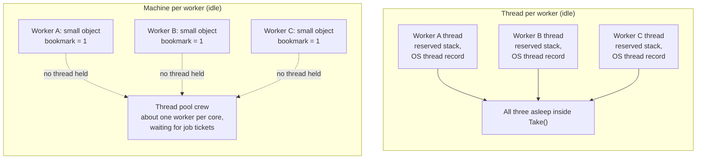
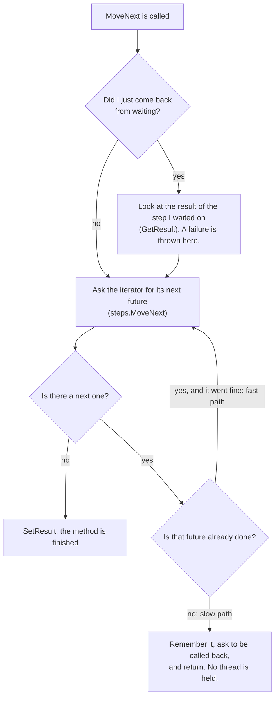
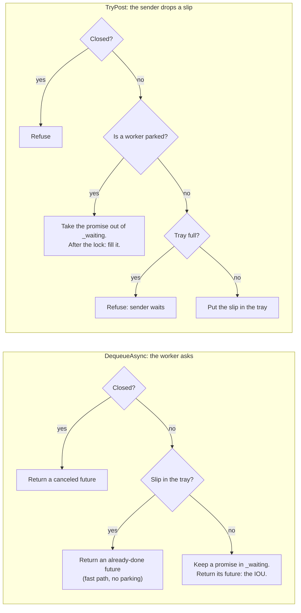
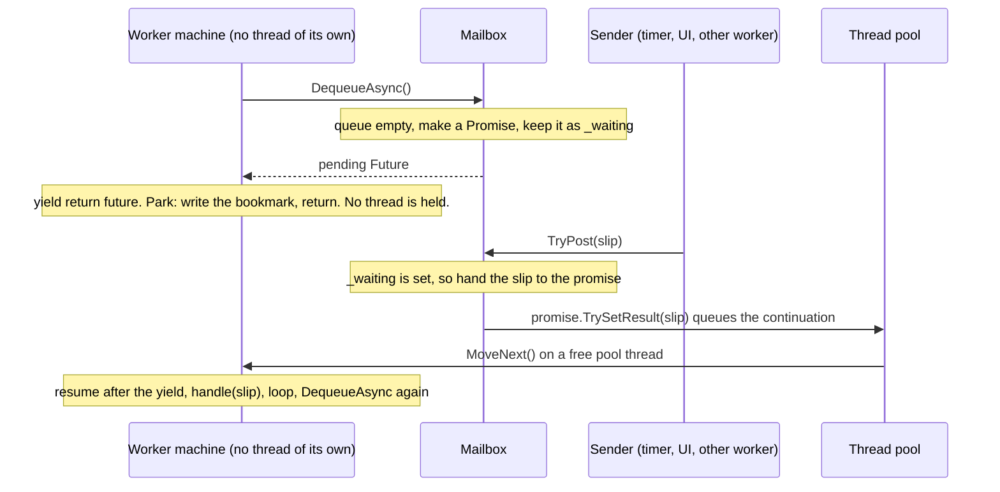
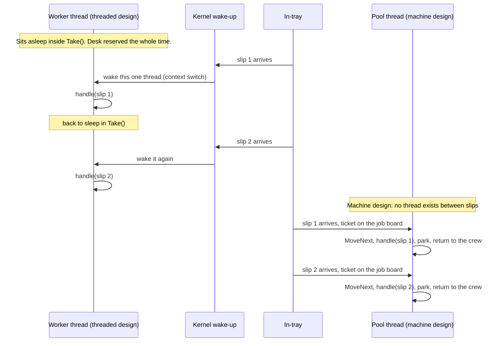
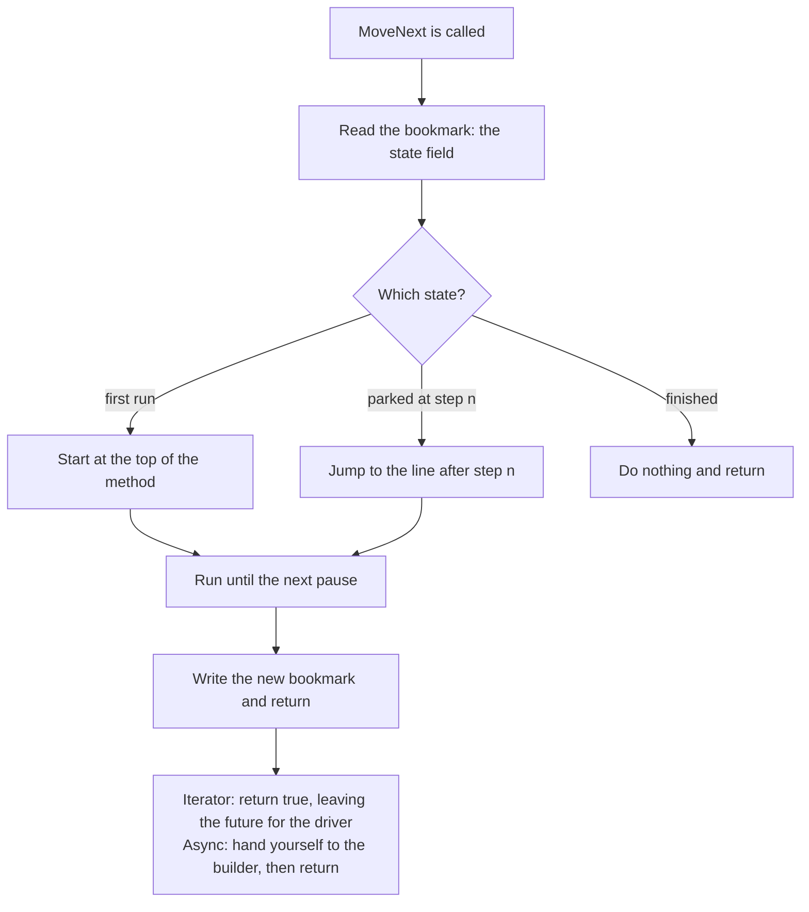

# 10. Waiting without a thread

## At the table

The wings were gone. Not "mostly gone." Gone. Kevin had even gnawed the celery, which Steve decided not to mention. The Rangers game had ended, and the sports channel was replaying the home run that had brought the man at the bar to his feet. Neither Kevin nor Steve had watched enough to know who won.

Dee came by with a coffee pot in one hand and a dessert menu she did not bother to open. She refilled Steve's cup. Kevin still had the warm sweet tea he had been ignoring.

"Pie," she said. "You two get the pie. It's the same pie you get every time."

"Pie," Steve agreed. "Two forks."

"Two forks, two plates, and I'm not letting you split one plate, because last time you sat here until eleven o'clock and I had to turn the lights off around you." She was already walking away. "Kitchen closes in twenty."

Kevin watched her go. Then he checked his phone, because it had buzzed twice during the pie order. It was Dale. Both texts said some version of *did you ask him about the certification yet.*

"Dale?" Steve said.

"Dale." Kevin numbered a fresh napkin nine and set his phone face down on it. "He wants to know if it's going to cost him a recertification. I told him I'd know tonight. Don't make me a liar."

"I won't. Hang on." Steve pushed his plate aside and turned the laptop around. "This is a pump."

It was two of them, side by side on the screen. One was green and amber and said Howard's across the top. The other was red and gold and said Samms. Each one had a dispenser on the left, a station on the right, and a wire drawn between them with little counters ticking up as messages went back and forth.

"Two stations across the street from each other," Steve said. "Same code, one release apart. The dispenser is its own process, like the head board in your pump. The station is the back office. They talk over TCP the way yours talk over the serial line, with sequence numbers and a heartbeat."

"You built a whole pump."

"I built a whole pump, bud. The card flow. The hold. The taper at the end of the fill. The hard limits. A hash-chained ledger, where every sale is stitched to the one before it, so nobody can quietly edit last Tuesday. The whole thing. It's what I needed to prove the library on, because a timer and two integers don't convince anybody." He pointed at a little chip in the corner of Howard's screen. `dispatch: threaded`. "See that? Three workers in there. One for the sale, one for the pump, one for the payment. Each one is the same thing you drew on your first napkin: wait for a message, handle it, wait again. And the program can run those three workers three different ways. I pick one at startup."

"Three ways."

"A thread each, like yours. That's the 2008 way. Then the way the modern C# compiler does it, with `async` and something called a `Channel`. And then this library, using the iterator trick we worked through earlier."

Kevin leaned in. "And they all pass the same tests?"

"Same sale, same events, same order, under all three. One test, three rows. The only place the three are allowed to differ is the payment worker's bank call. A 2008 bank library *blocks*. It makes your thread sit and stare until the bank answers. Under threads that's fine, because that thread has nothing else to do anyway. Under the machine it's a problem. There's a flag for it."

"A flag for it," Kevin said, writing it on the napkin.

"Let's follow the pump's workers." Steve scrolled. "What a thread costs. How an in-tray wakes a sleeping worker without a thread standing there. Where the savings are. And then the really fun part: the IL, which is the language the compiler writes its output in, of the compiler's machine next to ours, from the same build, so you can see they're the same shape."

Kevin pulled the laptop toward himself like a man pulling a plate toward himself. "Can I run it?"

"It's on GitHub. There's a training track under it, with your two loops written both ways, the clerk and the in-tray, with the tests, and three more problems after that. Eat your pie."

Dee had started putting chairs up on the tables at the other end of the room. The legs pointed at the ceiling like the antlers of something very flat.

"Twenty minutes," she called. "Not twenty-one."

---

The first nine chapters built the machine. This one puts it to work on the shape most programs have at their core: a **worker** that waits for something to do, does it, and waits again. Picture a store clerk behind a counter. A customer walks up, the clerk helps them, and then the clerk waits for the next one. Most of a clerk's day is spent waiting.

The worked example is MMP.GasPumpSimulator, a forecourt simulator that runs its three workers three different ways. One of those ways is this library. The AsyncProxy library targets .NET 3.5. The simulator also uses modern .NET APIs, including channels, so the complete simulator requires a modern runtime.

By the end you will know:

- what a thread costs, in terms you can picture;
- how a method can stop in the middle and pick up later;
- how an empty in-tray wakes a sleeping worker without anyone standing there;
- where the saved threads, memory, and CPU time go;
- and how the machine this library builds sits beside the machine the modern C# compiler builds, all the way down to the IL, so you can see they are the same shape.

The training projects apply this worker loop to other problems. Chapter 11 adds CPU work and a printer that requires one owner thread.

## 1. Three ways to wait

A worker in the simulator is a loop: wait for a slip in the in-tray, handle it, wait again. A **slip** is one message, like "the nozzle was lifted" or "the card was approved." Slips arrive a few times a second during a sale, and then not at all for minutes between sales. So the loop spends almost all of its life waiting.

Compare what each worker keeps in memory while its mailbox is empty.

Think of three ways a shop could staff a counter.

1. **A worker with a desk.** Every clerk gets their own desk, chair, and filing cabinet, and sits at the counter all day. When no customers come, they sit there anyway.
2. **A recipe with a bookmark, written by the compiler.** Nobody sits at the counter. When a customer shows up, a worker from a shared crew picks up the recipe where the bookmark is, helps the customer, and puts the bookmark back.
3. **The same bookmarked recipe, written by hand.** The same idea as number 2, but a person wrote the bookmark and the sticky notes themselves instead of letting the compiler do it.

The simulator has all three, picked at startup. Everything above them is the same code.

1. **A thread.** `ThreadedDispatch`. Each worker gets its own thread, and the thread sits inside `BlockingCollection.GetConsumingEnumerable`, which waits like `Take()`, until a slip arrives. (`Take()` means "give me the next item, and if there isn't one, I'll wait right here.") It is simple, and it is the way it was done in 2008.
2. **The compiler's state machine.** `ChannelDispatch`. Each worker is an `async` method that `await`s a **channel**. A channel is a built-in in-tray from modern .NET. When the channel is empty, the method stops, gives its thread back, and holds nothing but a small object. The C# compiler wrote the machinery for that in 2012.
3. **A hand-built state machine.** `AsyncProxyDispatch`. The same idea as number 2, written without the `async` keyword, using a C# 2 iterator and this library for the rest.

Numbers 2 and 3 do the same thing. Number 3 is here so you can see how number 2 works with the lid off. If you understand number 3, you understand `await`.

## 2. What a thread costs

> **Short version.** A blocked thread keeps its stack and operating-system control record while it waits.

A **thread** is the operating system's unit of running code. It is one worker who can run one piece of your program at a time. Each thread needs memory and scheduling support:

- **A stack.** Memory for active method calls and their local data. On desktop Windows, a .NET thread often reserves about 1 MB of stack address space. Physical memory is supplied as needed.
- **A kernel object.** The kernel is the core of the operating system. It keeps a control record for each thread, including its ID, priority, and state. That record remains allocated while the thread waits.
- **Scheduling work.** The **scheduler** is the part of the system that decides which thread runs on which CPU core, and for how long. The scheduler chooses among threads that are ready to run. A blocked thread stays out of that choice until something wakes it. The operating system keeps its records during the wait.

When a thread waits inside `Take()`, it is **blocked**. It runs no code, but keeps its stack and operating-system record. When a slip finally arrives, the system has to perform a **context switch**. That means: save whatever was running on that CPU core, restore the waiting thread's saved processor state, and resume its instructions. Saving and restoring thread state takes time. The cost depends on the operating system, hardware, and workload.

| | Threaded: a parked thread per worker | AsyncProxy: a bookmark per worker |
|---|---|---|
| Three workers | three threads, each with about 1 MB of reserved stack address space and an operating-system control record, all blocked in `Take()` | three small objects, about one kilobyte each (1,152 bytes measured, `FootprintTests`): the fields of the loop and which step it stopped at |
| Three thousand workers | three thousand threads, about 3 GB of reserved stack at 1 MB each, plus operating system records | three thousand small objects, and the same handful of pool threads |
| Who runs the code | the worker's own thread, after a wake-up | a shared pool thread while a message is being handled; the pool adjusts its thread count |

The threaded version keeps a stack for each idle worker. The async version saves each worker's fields and next step in an object. Pool threads run those steps when messages arrive.

### What "pool thread" means

You will see "pool thread" a lot from here on, so here is the idea once, clearly. The **thread pool** is a small crew of worker threads that the whole program shares, plus a job board. You never hand it a thread. You pin a **work item**, a small piece of code on a ticket, to the board with `ThreadPool.QueueUserWorkItem`. A free crew worker takes the next ticket, runs it, and goes back to wait for the next one. A **pool thread** is one of those crew workers.

Your code queues a work item, and the pool chooses a thread to run it. A blocked work item occupies that thread until the wait ends. Other queued jobs may have to wait for a free thread.

### Who holds what while the worker is idle



**In words:**

1. On the left, each worker has a thread with its own reserved stack and operating-system control record.
2. All three threads are doing the same thing: sitting inside `Take()`, asleep, waiting for a slip.
3. They run no code during the wait. Their stack reservations and operating-system records remain allocated.
4. On the right, each worker is just a small object on the heap with a number in it. The number is the bookmark, "I am parked at step 1."
5. The dotted arrows show that idle state-machine objects hold saved data without occupying a thread.
6. The only threads in the right-hand picture belong to the shared pool crew. Three thousand idle worker objects can share far fewer pool threads. The pool changes its size as the running work changes.

The scheduler chooses ready threads. A blocked thread becomes eligible when its wait ends. The pool changes its size as needed.

For three workers, a thread each is fine. The simulator keeps `ThreadedDispatch` because it is the simplest to read, and because it is the best fit for a call that truly blocks, like a bank request on a 2008 library that has no asynchronous version. The savings matter when workers multiply: a forecourt controller with forty dispensers, or a server with thousands of connections. The way to get there is to stop holding a thread while you wait.

## 3. A method with a bookmark

> **Short version.** A normal method is a recipe you read top to bottom without stopping. An iterator is the same recipe with a bookmark. You can read a step, put the bookmark in, close the book, and come back later to the next step with everything you had in your hands still there.

Here is the whole trick behind `await`, and it is older than `await`. In 2005, C# 2 added `yield return`. You write a method that returns a **sequence**, a list of things handed out one at a time. Every time the method says `yield return x`, it hands out `x` and **stops**. When the caller asks for the next item, the method **resumes** on the line after the `yield`, with all its local variables still there.

When a method call returns, its stack space can be reused. An iterator must save the variables it will need on its next call. The compiler creates a class with fields for that saved data. The class has:

- a **field** (a labeled compartment) for each value that must survive a pause;
- one field for "which step am I on," which is the bookmark;
- and one method, `MoveNext`, which is your code chopped into pieces, with a `switch` at the top that jumps to the right piece.

The compiler has been doing this since 2005. It is a **state machine**: a thing that is always in one named state, and that moves to the next state when you poke it. The compiler wrote it for you.

What you write:

This shortened iterator comes from `src/GasPump.Dispatch/AsyncProxyDispatch.cs` in MMP.GasPumpSimulator. It assumes the surrounding worker owns `_stopping` and calls it through `AsyncProxy.Run`. The simulator snippets use modern C# syntax even though the iterator technique works with C# 2. These excerpts describe the November 2 version named at the end of the chapter; newer checkouts may also dequeue ready messages without allocating a promise.

<!-- fence: sketch excerpt from MMP.GasPumpSimulator AsyncProxyDispatch.cs, outside this repo -->
```csharp
IEnumerable<IFuture> Loop(Mailbox<T> box, Action<T> handle)
{
    while (!_stopping)
    {
        var next = box.DequeueAsync();
        // Observe lets this body inspect cancellation after the driver resumes it.
        yield return Futures.Observe(next);
        if (next.IsCanceled) yield break;
        handle(next.Result);
    }
}
```

**Walkthrough:**

1. `while (!_stopping)`: keep doing this until somebody tells the worker to stop.
2. `box.DequeueAsync()`: "ask the in-tray for the next slip." It does not wait. It hands back an **IOU**, which is a future: a ticket that will hold the slip when one arrives.
3. `yield return Futures.Observe(next)`: "put in the bookmark and go away until that IOU is paid." `Observe` completes successfully even if `next` fails or is canceled. The following lines must check `next` before reading its result.
4. `if (next.IsCanceled) yield break;`: if the in-tray was closed while we waited, there is no slip. End the method.
5. `handle(next.Result)`: the message is available in `next.Result`. Pass it to `handle`. In this short example, cancellation is checked; the fuller loop in section 6 also checks faults.

What the compiler builds from that, from the Release build of the simulator:

The next block is a shortened decompiler sketch. Names such as `<>1__state` and literal `...` show generated structure; this block cannot be pasted into a C# source file.

<!-- fence: sketch decompiled by ILSpy, shortened -->
```csharp
class <Loop>d__5 : IEnumerator<IFuture>
{
    int     <>1__state;      // the bookmark
    IFuture <>2__current;    // what was yielded
    Mailbox<T> box; Action<T> handle;   // the locals
    IFuture<T> <next>5__2;   // a local that crosses the yield

    bool MoveNext()
    {
        switch (<>1__state) { case 0: ... case 1: ... }
        // run until the next yield, set state, return
    }
}
```

**Walkthrough:** The class name `<Loop>d__5` has angle brackets so it can never collide with a name you wrote. Each field is something the method needs to remember. `<>1__state` is the bookmark: a plain number that says which step you stopped at. `<>2__current` is the IOU that was just handed out. `box` and `handle` are the method's parameters, now kept in the box. And `<next>5__2` is the local variable `next`, kept in the box because it has to survive the pause. The compiler wraps your name in angle brackets and adds a marker and a number so its names can never clash with yours. You will see that pattern again in section 9.

Both `yield` and `await` save values and record where the method paused. Their drivers differ: With `yield`, the caller pulls the next item whenever it likes. With `await`, the thing you were waiting for calls `MoveNext` when it finishes. So the library's job is small: take an iterator that yields *futures* (promises of a value), and arrange for each future to call `MoveNext` when it completes.

```csharp
// Condensed from src/MMP.AsyncProxy/Iterate/IteratorStateMachine{T}.cs.
public void MoveNext()
{
    try
    {
        while (true)
        {
            // Check the completed step before asking the iterator to continue.
            // GetResult throws on failure/cancellation; catch forwards it if iterator cleanup succeeds.
            if (_pending != null)
            {
                IAwaiter finished = _pending;
                _pending = null;
                finished.GetResult();
            }

            // The iterator owns its saved locals. Its next call resumes after the yield.
            // At its end, publish the separate result for the entire operation.
            if (!_steps.MoveNext())
            {
                _steps.Dispose();
                _builder.SetResult(_return.Value);
                return;
            }

            IFuture step = _steps.Current;
            if (step == null) throw new InvalidOperationException("The iterator yielded a null future.");

            // Fast path: the future already succeeded, so no suspend and no awaiter. Keep going in this loop.
            if (step.IsCompleted && !step.IsFaulted && !step.IsCanceled) continue;

            // Done but failed or canceled? GetResult throws. Still running? Fall through and park.
            IAwaiter awaiter = step.GetAwaiter();
            if (awaiter.IsCompleted)
            {
                awaiter.GetResult();
                continue;
            }

            // Save the awaiter before registration: completion could race with registration.
            // The builder arranges another MoveNext call; returning releases this thread.
            _pending = awaiter;
            IteratorStateMachine<T> self = this;
            _builder.AwaitOnCompleted(ref awaiter, ref self);
            return;
        }
    }
    catch (Exception ex)
    {
        // The body's finally blocks run now. If one of them throws too, the first
        // fault still wins, so the future settles and the caller sees the cause.
        try { _steps.Dispose(); }
        catch (Exception disposeFault) { Attach(ex, disposeFault); }
        _builder.SetException(ex);
    }
}
```

Read it as a clerk working a to-do list. Pull the next item. If it is already done, cross it off and pull the next. If it is not done, write "call me when this finishes" on it and go home. There is no thread standing at the desk while the item is out. When the item finishes, whoever finished it calls the clerk back, and the clerk picks up the list where the bookmark is.

**Read it like this, line by line:**

1. `if (_pending != null) ...`: "Did I come back from a nap?" If yes, look at the result of the step I was waiting on. If that step failed, `GetResult()` throws here, and the failure is handled at the bottom.
2. `if (!_steps.MoveNext()) ...`: "Ask the iterator for its next future." That one call is the compiler's `switch` doing its jump. If there is no next one, the method is finished: close the iterator and put the final answer into the result future (`SetResult`).
3. `IFuture step = _steps.Current;`: the future the iterator just handed out. (A null is a bug in the iterator, so it throws a clear message.)
4. `if (step.IsCompleted && !step.IsFaulted && !step.IsCanceled) continue;`: the **fast path**. The thing we asked for is already done and went fine, so there is nothing to wait for. Go around the loop again. No thread leaves, no callback is needed, and no awaiter is even made. If the step is done but failed or was canceled, we fall through: `GetAwaiter()` and `GetResult()` throw so the failure reaches the caller.
5. `_pending = awaiter;` and `AwaitOnCompleted(...)`: the **slow path**, for a step that is still running. Remember what we are parked on, tell the builder "when this finishes, call `MoveNext` on me again," and `return`. That `return` is the thread walking away.
6. `catch (Exception ex)`: dispose the iterator, then pass the exception to the builder. The builder records failure or cancellation in the overall result. If `_steps.Dispose()` throws too, the inner `catch` keeps that second fault and the result still completes.

Iterator disposal runs its active `finally` blocks. Those blocks might unsubscribe a device callback or release a resource. The driver guards that cleanup with its own `try`, so the future always settles and the first fault wins. A cleanup fault rides on the first exception, stored in its `Data` under `AsyncProxy.DisposeFaultKey`.

Here is the same loop as a picture.



**In words:**

1. Somebody calls `MoveNext`. This happens once at the start, and then once after each time the method was parked.
2. If we just came back from waiting, the first job is to read the result of the step we waited on. A failed step is thrown here, and the loop's `catch` turns it into a failed result.
3. Then we ask the iterator for its next future. This is where the compiler's bookmark does its work: the iterator picks up right after the last `yield return`.
4. If there is no next future, the method has reached its end. We put the final value into the result future and stop.
5. If there is one, we check whether it is already done and went fine. If it is, we loop straight back for the next one. Nothing waits and no thread leaves. (A step that finished by failing or being canceled is handled by the awaiter, which throws, so the failure is never skipped.)
6. If it is not done, we leave a note ("call me back"), and the method returns. At this moment no thread is inside the method at all. It is a bookmarked recipe sitting on the shelf.

The compiler builds the iterator's switch. The library driver registers the callback that calls the iterator again after a future finishes.

## 4. How the mailbox wakes the worker

> **Short version.** An empty in-tray hands the worker an IOU instead of a slip. When a slip finally arrives, the person dropping it off cashes the IOU, and that is what wakes the worker up, on whatever thread happens to be free.

In the threaded design the mailbox is a `BlockingCollection` and the worker's thread sleeps inside it. In the AsyncProxy design the mailbox is a plain queue plus one **promise**. A promise stores a value and completion state. At the restaurant, the host keeps a record of your table request and eventually writes its outcome, such as table 12. Your claim ticket gives you read-only access to that outcome; it corresponds to the **future**. You can register a continuation, like arranging to return to the host when your pager buzzes. The pager signals readiness. The result stays in the record. Here, the result is the next mailbox message.

This excerpt shows the mailbox's two handoff methods, inside its surrounding class. Fields and `Canceled()` are omitted. There is one reader, so `_waiting` holds at most one pending dequeue; several senders can call `TryPost`.

<!-- fence: sketch excerpt from MMP.GasPumpSimulator AsyncProxyDispatch.cs, outside this repo, modern C# -->
```csharp
// GasPump.Dispatch/AsyncProxyDispatch.cs, the mailbox
public IFuture<T> DequeueAsync()
{
    lock (_lock)
    {
        if (_closed) return Canceled();
        if (_items.Count > 0)
        {
            // v0.1.0 had no PromiseOptions; true asks for RunContinuationsAsynchronously.
            var ready = new Promise<T>(true);
            ready.SetResult(_items.Dequeue());   // already done: the fast path, no suspend
            return ready.Future;
        }
        // Keep the completion side; return its read-only future to the single reader.
        _waiting = new Promise<T>(true);
        return _waiting.Future;
    }
}

public bool TryPost(T item)
{
    Promise<T>? wake = null;
    lock (_lock)
    {
        if (_closed) return false;
        // Transfer the waiting promise to this sender, so only this post can complete it.
        if (_waiting is { } w) { _waiting = null; wake = w; }
        else if (_items.Count >= capacity) return false;         // refuse immediately; caller chooses what to do
        else _items.Enqueue(item);
        // Count accepted messages, including the message currently being handled.
        Interlocked.Increment(ref _pending);
    }
    // Complete outside the mailbox lock. Saved continuations are queued to the pool.
    wake?.TrySetResult(item);
    return true;
}
```

**Walkthrough.** First, what is a `lock`? It is a rule that says "only one thread at a time may be inside these braces." Two threads touching the same queue at the same moment would corrupt it, so both methods take the lock before they touch it.

`DequeueAsync` is the worker asking, "Is there a slip for me?"

1. If the in-tray is closed, hand back a future that is already canceled, so the worker knows to stop.
2. If there is already a slip in the tray, take it out. Make a promise, fill it right away, and hand back its future. The future is already done, so the worker takes the **fast path**: no waiting, no parking.
3. If the tray is empty, make a promise and **keep it** in `_waiting`. Hand back its future. That future is the IOU: "when a slip shows up, it will be here." The worker parks on it.

`TryPost` is the sender dropping a slip off.

1. If the tray is closed, refuse.
2. If a worker is parked (`_waiting` holds a promise), take that promise out of `_waiting`, and save it in `wake`. The sender will complete it after leaving the lock.
3. If nobody is waiting and the tray is full, refuse. `TryPost` returns `false` right away. The caller decides whether to retry, wait, or report failure. If there is room, put the slip in the tray.
4. After the lock is let go, fill the promise (`TrySetResult(item)`). That is the moment the parked worker wakes up.

Here are the same two decisions as a picture.



**In words:**

1. The left half is the worker asking for a slip. The first question is whether the tray is closed. If it is, the answer is a canceled future, and the worker stops.
2. If the tray is open and a slip is sitting there, the worker gets an already-finished future back. It never parks. This is the fast path.
3. If the tray is open and empty, the worker gets an IOU: the future of a promise the tray keeps in `_waiting`. The worker parks on it and the thread leaves.
4. The right half is a sender dropping a slip off. A closed tray refuses.
5. If a worker is parked, the sender does not put the slip in the tray at all. It takes the waiting promise, and once it has let go of the lock, it fills the promise with the slip. That is the wake-up.
6. If no worker is parked, the slip goes in the tray if there is room, and `TryPost` returns `false` if there is not. The caller handles that refusal; the diagram's "sender waits" label describes one possible caller policy.

The mailbox keeps one pending promise for its single reader. Completing that promise makes the reader's next step ready to run.

During normal processing, `_pending` counts accepted messages until their handlers finish. The full worker calls `box.Handled()` in a `finally` block to decrement it, even if a handler throws. It includes queued messages and a message being handled; `_items.Count` measures only the queue. Shutdown can discard messages before handling them, and this implementation does not subtract those discarded messages. Treat this counter as a processing measure, rather than a final count after disposal.

Now the whole round trip, over time:



**In words:**

1. The worker machine asks the mailbox for a slip with `DequeueAsync()`.
2. The tray is empty, so the mailbox makes a promise, keeps it as `_waiting`, and hands the worker the matching future.
3. The worker does `yield return` on that future. That writes the bookmark and returns. From here on, the worker holds no thread.
4. Later, a sender (a timer, the UI, or another worker) calls `TryPost` with a slip.
5. The mailbox sees `_waiting` is set, so it gives the slip to that promise instead of putting it in the tray.
6. Filling the promise does not run the worker on the sender's thread. It queues a job ticket on the pool's job board.
7. A free pool thread takes the ticket and calls the worker's `MoveNext`. The worker resumes right after its `yield`, handles the slip, loops, and asks for the next one.

The sender returns after posting and queuing the callback. A pool worker later handles the message. Posting can briefly wait for the mailbox lock.

Two details carry the weight here.

- **The promise is built with `PromiseOptions.RunContinuationsAsynchronously`.** A **continuation** is code registered to run after completion. This option queues callbacks saved while the promise was pending. A pool worker runs them, keeping that work off the completing sender's thread. A callback registered after completion can instead run inline on the registering thread, or post through a captured context. The option also lets a queued callback start before the sender returns, so other locks still need care. The modern name is `TaskCreationOptions.RunContinuationsAsynchronously`. Older code used `new Promise<T>(true)`; the named option explains that Boolean's purpose.
- **The handoff happens outside the lock.** `TryPost` takes the waiting promise out from under the lock and fills it after letting go. This keeps the callback from running inline while `TryPost` holds the mailbox lock. Other lock orders still need care. (A **deadlock** is two things each waiting for the other, forever.)

## 5. The parts, and their modern names

The library models selected parts of modern async in C# 3 for .NET 3.5. The table connects each teaching type to its closest .NET counterpart. Their features and limits differ.

| In MMP.AsyncProxy | In .NET today | What it is |
|---|---|---|
| `Promise<T>` | `TaskCompletionSource<T>` | The writable record of the outcome. You keep it and hand out its future. (The host's table-request record.) |
| `IFuture<T>` | `Task<T>` | Read-only access to the outcome. Check it or register a continuation. (The customer's claim ticket.) |
| `FutureAwaiter<T>` | `TaskAwaiter<T>` | What an await talks to: is it done, call me when it is, give me the result. |
| `AsyncMethodBuilder<T>` | `AsyncTaskMethodBuilder<T>` | Starts the machine, parks it on an awaiter, completes the future at the end. |
| `IteratorStateMachine<T>` | the class the C# compiler emits for an `async` method | The `MoveNext` loop above. Ours drives a C# 2 iterator; the compiler's is the method itself, rewritten. |
| `yield return future;` | `await task;` | The bookmark. |
| `AsyncProxy.Run(Loop(...))` | calling an `async` method | Build the machine, start it, hand back its future. |
| `PromiseOptions.RunContinuationsAsynchronously` | `TaskCreationOptions.RunContinuationsAsynchronously` | When the promise finishes, pin the waiting code to the pool's job board instead of running it on the finisher's thread. |

## 6. The shift, step by step

Here is the same worker loop under the two designs, and what changes at each line.

These are shortened excerpts from `src/GasPump.Dispatch/ThreadedDispatch.cs` and `src/GasPump.Dispatch/AsyncProxyDispatch.cs` in MMP.GasPumpSimulator. They omit shutdown, handler-error handling, and accounting. `Loop(...)` abbreviates a method signature; it is a reading sketch, rather than a complete method to paste.

**Thread per worker**

<!-- fence: sketch excerpt from MMP.GasPumpSimulator ThreadedDispatch.cs, outside this repo, modern C# -->
```csharp
// ThreadedDispatch.cs
_thread = new Thread(() =>
{
    foreach (var item in box.Queue.GetConsumingEnumerable(_stop.Token))
    {
        // The enumerator blocks this dedicated thread while the mailbox is empty.
        handle(item);
    }
});
_thread.Start();
```

- One thread made at startup, alive until Dispose.
- Between slips the thread is blocked in the kernel.
- Each slip costs a context switch to wake this thread.
- Simple to debug: the call stack is the whole story.

**Hand-built state machine**

<!-- fence: sketch excerpt from MMP.GasPumpSimulator AsyncProxyDispatch.cs, outside this repo, shortened signature -->
```csharp
// AsyncProxyDispatch.cs
_loop = AsyncProxy.Run(Loop(box, handle, owner));

IEnumerable<IFuture> Loop(...)
{
    while (!_stopping)
    {
        var next = box.DequeueAsync();
        // Resume even after cancellation/failure so the following test can end the loop.
        yield return Futures.Observe(next);
        if (next.IsCanceled || next.IsFaulted || _stopping) yield break;
        handle(next.Result);
    }
}
```

- No thread made. One small object holds the loop's state.
- Between messages the worker keeps its state object and pending future. It holds no thread.
- A message that completes a pending wait queues a pool callback. The operating system may need to wake a pool thread.
- Harder to debug: the stack shows the pool, and the "where was I" lives in a field.

The loop handles one message at a time. Each worker owns its own state, and each mailbox limits how many messages it accepts. The mailbox lock protects its queue during posting and removal. It does a different job from the worker's sequential loop.

Here is the difference in time, for one worker handling two slips:



**In words:**

1. At the top, the threaded worker has one thread of its own and it is asleep inside `Take()`.
2. Slip 1 arrives. The system has to find that one specific sleeping thread and wake it with a context switch.
3. The thread handles the slip, and goes back to sleep. Its stack and operating-system record remain allocated throughout the wait.
4. Slip 2 does the same thing: another wake-up of the same thread.
5. Below, the machine design has no worker thread at all between slips.
6. Slip 1 arrives and a ticket goes on the job board. Whichever pool thread is free takes it, runs `MoveNext`, handles the slip, parks the machine again, and goes back to the crew.
7. Slip 2 does the same, possibly on a different pool thread. The machine does not care which one.

**Why it matters:** The work is identical. What changes is what is reserved between slips, and how the next slip finds a worker.

## 7. Where the savings are

| Resource | Thread per worker | State machine per worker | Why |
|---|---|---|---|
| Threads while idle | one per worker | zero | A parked machine is an object, not a thread. Pool threads go back to the pool. |
| Memory while idle | about 1 MB reserved stack per worker, plus a kernel object | about one kilobyte per worker (1,152 bytes measured, `FootprintTests`): the loop's fields and one pending promise | The locals that cross the yield became fields. Nothing else is kept. |
| Cost to deliver one slip | a kernel wake-up and a context switch to a specific thread | a queue push to the pool and a run on whichever thread is free | Any available pool thread can run the callback. An idle pool thread may need to wake first. |
| Scaling to thousands of workers | thousands of threads; the scheduler and memory give out first | thousands of state objects; a shared pool that adjusts to demand | Work is proportional to messages, not to workers. |
| A call that truly blocks (a 2008 bank library) | fine: it blocks its own thread and nobody else waits | bad: it would block a pool thread that everything shares | This is the parked-car problem from chapter 6. A pool thread that sits and waits is a crew worker parked at the curb, and a small crew can only afford a few of those. This is why the simulator has `PrefersBlockingIo`. The payment worker blocks under threads and continues on a callback under the other two. |
| Allocation per message | none beyond the message | at least a promise and its future for each dequeue in the shown code, including the ready-message path; a parked dequeue adds the `Observe` wrapper and callback objects | The ready-message path creates a promise and completes it at once. It saves a pause, while still allocating that promise and its future. |

A pool callback can still involve a context switch. The main saving is that each idle worker holds a small state object instead of a separate thread.

For three workers, a thread per worker may be a reasonable cost and is easy to follow. With thousands of mostly idle workers, sharing pool threads saves many stack reservations. The training benchmarks measure selected workloads; they do not measure every cost in this table.

## 8. Which thread problems go away, and which stay

People sometimes say async "removes threading problems." It removes some and leaves others, and knowing which is the difference between a safe design and a lucky one.

**Costs avoided by each pending mailbox wait**

- **Thread exhaustion.** You cannot run out of threads for idle workers, because idle workers hold none.
- **A blocked thread for each mailbox wait.** The worker returns while its future is pending. Deadlocks remain possible if methods wait on each other in a cycle, or callers block a thread needed by a callback.
- **A dedicated thread to wake.** The callback can use an available pool thread. Waking that pool thread can still cost a context switch.

**Problems the design must still handle**

(The **actor rules** are the simulator's house rules: each worker owns its own data, and workers talk only by sending slips.)

- **Races on shared state.** A **race** is when two things touch the same data at about the same time and the answer depends on who gets there first. Two machines resumed on two pool threads at once can still stomp on a shared field. The simulator avoids this by the rule that workers share nothing and pass messages. Async did not buy that; the design did.
- **Reentrancy.** This is when code runs again while an earlier run is still going. A continuation can run while you still hold a lock if you complete a promise inside the lock. The mailbox completes outside the lock and the promise queues to the pool, which is why that is written down twice in the code.
- **Lost exceptions.** A faulted future nobody observes is a silent failure: it broke, and nobody was told. The loop wraps each dequeue in `Futures.Observe` and checks `IsCanceled`, so a closed mailbox ends the loop instead of throwing into nowhere. Handler throws are caught and left to the sale machine to log.
- **Debugging.** The stack trace of a resumed machine shows the pool, and nothing of your code's history. The library copies the first stack trace into the exception's data before rethrowing, because .NET 3.5 had no other way to keep it. (The Compact Framework build can't even do that: it has no `Exception.Data`, so the first trace is lost on the rethrow. The README lists it as a known limit.)

> **The one-sentence rule.** Async decides *what a worker holds while it waits*. The actor rules decide *what a worker may touch while it runs*. You need both, and they are different decisions.

## 9. The same machine, in IL

Is the code the compiler emits for `async` really the same shape as what the C# 2 iterator plus this library produce? Here is the evidence from the simulator's build.

First, a few words you will need. **IL** (intermediate language) is the plain, low-level language a .NET compiler writes its output in before the machine runs it. A **decompiler** is a tool that reads that output and shows it back to you as C# or as IL text. `GasPump.Dispatch.dll` was compiled in Release and decompiled with ILSpy 10.0.1. The Channel worker is a real `async` lambda, so the modern compiler built its machine. The AsyncProxy worker is an iterator, so the C# 2 machinery built its machine. Both are shown with the sugar turned off (`-lv CSharp1` for the iterator so `yield` is not re-sugared, `-lv CSharp4` for the async one so `await` is not). "Sugar" is the friendly keyword, like `yield` or `await`, that the compiler turns into the plain machine.

**Iterator machine (AsyncProxy worker)**

Both following C# blocks are shortened decompiler output from the simulator, rather than compilable source. They omit declarations and branches. The first is an iterator class; the second is a modern `async` method's generated struct. Literal `...` marks omitted material.

<!-- fence: sketch decompiled by ILSpy 10.0.1, shortened -->
```csharp
// decompiled, CSharp1, Release build
private sealed class <Loop>d__5 : IEnumerable<IFuture>, IEnumerator<IFuture>, IDisposable
{
    private int <>1__state;            // the bookmark
    private IFuture <>2__current;      // the future just yielded
    private Mailbox<T> box;             // hoisted parameter
    private Action<T> handle;           // hoisted parameter
    private AsyncProxyDispatch owner;   // hoisted parameter
    private IFuture<T> <next>5__2;      // local that crosses the yield

    private bool MoveNext()
    {
        int num = <>1__state;
        switch (num)
        {
        default: return false;
        case 0:  <>1__state = -1; break;          // first run
        case 1:                                   // resumed after the yield
            <>1__state = -1;
            if (<next>5__2.IsCanceled || ...) return false;
            try { handle(<next>5__2.Result); }
            finally { box.Handled(); ... }
            <next>5__2 = null;
            break;
        }
        if (!worker._stopping)
        {
            <next>5__2 = box.DequeueAsync();
            <>2__current = Futures.Observe(<next>5__2);
            <>1__state = 1;                       // park at step 1
            return true;
        }
        return false;
    }
}
```

**Walkthrough.** "Hoisted" means lifted off the stack and into a field. The names with angle brackets are the compiler's own. It wraps a name in `<...>` and adds a marker and a number so that nothing it makes can ever clash with something you wrote. So `<next>5__2` is your variable `next`, kept in a field because it has to survive the pause, with a number the compiler added. And `<>1__state` is the bookmark.

1. `int num = <>1__state; switch (num)`: read the bookmark and jump based on it.
2. `case 0`: the first run. Mark the machine "running" (`-1`) and fall out of the switch to start at the top of the loop.
3. `case 1`: we were parked at step 1, which means we are resuming after the `yield`. Mark "running," check whether the IOU was canceled, and if not, handle the slip we were waiting for.
4. `default: return false`: any other state means the method is already finished. Do nothing.
5. After the switch, if we are not stopping: ask the in-tray for the next slip, hand out the IOU as the thing we yielded (`<>2__current`), write `1` into the bookmark, and `return true`. That `return true` is the "go park" moment.

**Async machine (Channel worker)**

<!-- fence: sketch decompiled by ILSpy 10.0.1, shortened -->
```csharp
// decompiled, CSharp4, Release build
private struct <<-ctor>b__0>d : IAsyncStateMachine
{
    public int <>1__state;                        // the bookmark
    public AsyncTaskMethodBuilder <>t__builder;   // starts, parks, completes
    public <>c__DisplayClass3_0 <>4__this;        // hoisted captures: box, handle, owner
    private IAsyncEnumerator<T> <>7__wrap1;       // local that crosses an await
    private ValueTaskAwaiter<bool> <>u__1;        // the awaiter we parked on
    private ValueTaskAwaiter <>u__2;

    private void MoveNext()
    {
        int num = <>1__state;
        try
        {
            if (num != 0)
            {
                if (num == 1) { awaiter = <>u__2; ... goto IL_01a0; }   // resumed after await 1
                <>7__wrap1 = box.Channel.Reader.ReadAllAsync(token).GetAsyncEnumerator();
            }
            ...
            awaiter2 = <>7__wrap1.MoveNextAsync().GetAwaiter();
            if (!awaiter2.IsCompleted)
            {
                num = (<>1__state = 0);               // park at step 0
                <>u__1 = awaiter2;
                <>t__builder.AwaitUnsafeOnCompleted(ref awaiter2, ref this);
                return;
            }
            ...
            handle(current);
        }
        catch (Exception e) { <>1__state = -2; <>t__builder.SetException(e); return; }
        <>1__state = -2;
        <>t__builder.SetResult();
    }
}
```

**Walkthrough.** This is the machine the modern compiler writes for the `async` worker. It is a `struct`, which is a kind of box that does not need a separate memory allocation when it never has to wait. Walk through it the same way:

1. `<>1__state` is the bookmark again, and `-2` means finished.
2. `<>t__builder` is the helper that starts the machine, parks it, and completes its result. (In this library, the same job belongs to `AsyncMethodBuilder<T>`.)
3. `<>7__wrap1`, `<>u__1`, and `<>u__2` are the sticky notes: a local that has to cross an await, and the awaiters it parked on.
4. Inside `MoveNext`: read the bookmark, and if we are resuming (`num == 1`), jump back to the right spot with a `goto`.
5. `if (!awaiter2.IsCompleted)`: if what we asked for is not done yet, write the bookmark (`<>1__state = 0`), save the awaiter, and give *the machine itself* to the builder with `AwaitUnsafeOnCompleted(ref awaiter2, ref this)`, which means "when that is done, call me again." Then `return`. That is the thread walking away.
6. The `catch` and the last two lines are the two exits: a failure goes to `SetException`, and success goes to `SetResult`.

Compare their shared steps, while keeping the state numbers separate:

- a field named `<>1__state` holding which step the method is parked at, but different number meanings. In the iterator shown, `0` starts the method and `1` resumes it. In the async machine, `0` and `1` resume awaits, and `-2` means finished;
- every local that has to survive a pause hoisted into a field, with a number the compiler adds to the name (`<next>5__2`, `<>7__wrap1`);
- one `MoveNext` that reads the state, jumps to the right piece, runs until the next pause, writes the new state, and returns.



**In words:**

1. Something calls `MoveNext`. Both machines, the iterator's and the async one, begin the same way.
2. The first thing they do is read the bookmark, the `<>1__state` field.
3. The bookmark decides where to go. A first run starts at the top. A parked machine jumps to the line just after the pause it was parked on. A finished machine does nothing.
4. From wherever it landed, the machine runs ordinary code until it reaches the next pause.
5. At the pause it writes the new bookmark into the field and returns, so the thread is free.
6. The last box shows who arranges the next call. Other details also differ, including result handling, exceptions, and the state numbers.

Both outputs use a state field and a method that resumes from that state. This build uses a modern compiler for both source methods; the iterator mechanism was introduced in C# 2.

The main difference in this comparison is who arranges the next call. The iterator's `MoveNext` returns `true` and leaves the future in `<>2__current` for someone else to deal with. The async machine's `MoveNext` deals with it itself: it asks the awaiter whether it is done, and if not it hands *itself* to the builder (`AwaitUnsafeOnCompleted(ref awaiter, ref this)`) so the awaiter can call `MoveNext` again later. This library's `IteratorStateMachine` is that missing paragraph, written once and reused for every iterator you hand it.

Down at the IL level the resemblance is clearer still, because the names fall away and only the moves are left. Here is a small dictionary for the instructions you are about to see. Each line is one tiny step the machine takes.

| IL word | What it does |
|---|---|
| `ldarg.0` | Load argument zero. In a method on an object, that is `this`: the machine itself. |
| `ldfld` | Load a field: read one of the machine's labeled compartments. |
| `stfld` | Store into a field: write to one of those compartments. |
| `stloc` / `ldloc` | Store to or load from a local scratch variable inside this one method. |
| `ldc.i4.1`, `ldc.i4.m1`, `ldc.i4.0` | Load the small whole number 1, minus 1, or 0. |
| `brfalse.s` | Branch if false (or zero): jump to another line if the value is zero. |
| `beq.s` | Branch if equal: jump if the two values just loaded are the same. |
| `ret` | Return: leave the method. |

**Iterator MoveNext, first instructions**

```
.method private final hidebysig newslot virtual
    instance bool MoveNext () cil managed
// Code size: 218 (0xda)
IL_0000: ldarg.0
IL_0001: ldfld  int32 '<Loop>d__5'<!T>::'<>1__state'
IL_0006: stloc.0
IL_0007: ldarg.0
IL_0008: ldfld  Worker`1 '<Loop>d__5'<!T>::'<>4__this'
IL_000d: stloc.1
IL_000e: ldloc.0
IL_000f: brfalse.s IL_0017      // state 0: first run
IL_0011: ldloc.0
IL_0012: ldc.i4.1
IL_0013: beq.s IL_004e          // state 1: resume after the yield
IL_0015: ldc.i4.0
IL_0016: ret                    // any other state: finished
IL_0017: ldarg.0
IL_0018: ldc.i4.m1
IL_0019: stfld  int32 '<>1__state'   // mark running
...
IL_0045: ldarg.0
IL_0046: ldc.i4.1
IL_0047: stfld  int32 '<>1__state'   // park at 1
IL_004c: ldc.i4.1
IL_004d: ret
```

**Walkthrough.** The first seven instructions are "read the bookmark into a scratch variable, and read the owner object (`<>4__this`) into another." Then comes the branching. `ldloc.0; brfalse.s` means "if the bookmark is zero, jump to the first-run code." `ldloc.0; ldc.i4.1; beq.s` means "if the bookmark is one, jump to the resume code." Anything else falls through to `ldc.i4.0; ret`, which means "return false: finished." Further down, `ldarg.0; ldc.i4.1; stfld '<>1__state'` is the machine writing "1" into its bookmark, and `ldc.i4.1; ret` is "return true," the park. (`newslot` on the first line is just an IL word that says "this method is a new entry in the class's method table." It has nothing to do with this chapter's story.)

**Async MoveNext, first instructions**

```
.method private final hidebysig newslot virtual
    instance void MoveNext () cil managed
// Code size: 524 (0x20c)
IL_0000: ldarg.0
IL_0001: ldfld  int32 '<<-ctor>b__0>d'<!T>::'<>1__state'
IL_0006: stloc.0
IL_0007: ldarg.0
IL_0008: ldfld  DisplayClass3_0 '<<-ctor>b__0>d'<!T>::'<>4__this'
IL_000d: stloc.1
.try
{
  IL_0013: ldloc.0
  IL_0014: brfalse.s IL_0064    // state 0: resume after await 0
  IL_0016: ldloc.0
  IL_0017: ldc.i4.1
  IL_0018: beq IL_0183          // state 1: resume after await 1
  IL_001d: ...                  // otherwise: first run, open the reader
  ...
  // at each await: if (!awaiter.IsCompleted) { state = n; store awaiter;
  //   builder.AwaitUnsafeOnCompleted(ref awaiter, ref this); ret }
}
catch [System.Runtime]System.Exception
{
  // state = -2; builder.SetException(e); ret
}
```

**Walkthrough.** It opens the same way: `ldarg.0; ldfld '<>1__state'; stloc.0` is "read the bookmark." Then the same two branches: bookmark zero jumps to the resume point after await 0, bookmark one jumps to the resume point after await 1. Anything else is a first run. The new part is `.try { ... } catch`: the whole body is wrapped so that any failure is caught and sent to `SetException`, the same job the iterator driver's `catch` does.

Decompiled 2026-11-02 from `src/GasPump.Dispatch/bin/Release/net10.0/GasPump.Dispatch.dll` with ilspycmd 10.0.1 (`-lv CSharp1`, `-lv CSharp4`, `-il`). Names, offsets, and code sizes are as printed; long type names are shortened for the page. The iterator IL is from that day's build of 95b8191 and is not reproducible from `main`; the async IL still matches the current build.

Same opening: `ldarg.0`, `ldfld <>1__state`, `stloc.0`, then a branch on the state. Same parking move: store the new state, return. The async version is wrapped in a `.try` so that any exception becomes a faulted task instead of escaping, and its state machine is a `struct`, which can avoid a separate state-machine allocation when the method finishes without pausing. The method can still allocate other objects. Those are refinements on the same machine, and they are the same refinements `docs/compiler-vs-handwritten.md` records against the hand-written sample. The training track's `docs/compiler-output/training/` folder holds the same comparison for four more programs.

## 10. The proof

The claim is that the three strategies behave the same. How would you check that? You would run the same sale three times, once under each strategy, and compare what happened. The simulator's test suite does that, with a fake clock so nothing depends on real time, and the happy-path trace test prints the same event list three times:

```
Passed  HappyPathTraceTests.The_happy_path_hits_the_events_in_this_order(strategy: "threaded")
Passed  HappyPathTraceTests.The_happy_path_hits_the_events_in_this_order(strategy: "channel")
Passed  HappyPathTraceTests.The_happy_path_hits_the_events_in_this_order(strategy: "asyncproxy")

events:  CardPresented > CodeEntered > Approved > PumpArmed > GradeSelected > NozzleLifted
         > SpoutInserted > FlowStarted > Progress > FlowPaused > FlowResumed > Progress
         > NozzleHung > CompletionSent
```

**Walkthrough.** Each `Passed` line is one run of the same test under a different worker strategy. The `events:` line is the story of one sale in the order things happened: the card goes in, the code is entered, the bank approves, the pump is armed, the customer picks a grade, lifts the nozzle, fuel flows, pauses, resumes, the nozzle goes back, and the completion message is sent. All three strategies produced that same list.

Under the AsyncProxy strategy, no worker owns a thread. The pool runs a machine when a slip lands and nothing otherwise. The one place the strategies are allowed to differ is the payment worker's bank call, and the difference is written in one `if` on `PrefersBlockingIo`.

The training track does the same thing in miniature: one contract, one test suite, run against the threaded version and the AsyncProxy version of each project. Start with `training/README.md`.

## 11. Where to start reading

1. `README.md` at the repo root. The same method three ways: with `async`, as an iterator, and as the hand-written machine the compiler would emit.
2. `docs/compiler-vs-handwritten.md`. The compiler's output beside the hand-written class, row by row.
3. `src/MMP.AsyncProxy/Iterate/IteratorStateMachine{T}.cs`. Ninety lines. The whole of what `await` adds to `yield`.
4. `src/MMP.AsyncProxy/Core/Promise{T}.cs`. Where continuations are stored and run, and why they run outside the lock.
5. `training/01-mailbox/`. The in-tray and the clerk, written with threads and then with this library, with the tests that prove the two agree.
6. In MMP.GasPumpSimulator, `src/GasPump.Dispatch/AsyncProxyDispatch.cs` beside `ThreadedDispatch.cs`. The mailbox as a promise and the worker as an iterator, in a program that sells fuel.

## Words you just met

| Term | Plain meaning | Example or comparison |
|---|---|---|
| **Worker** | A loop that waits for something to do, does it, and waits again. | A clerk behind a counter. |
| **Thread** | The operating system's unit of running code. | Runs instructions using its own stack. |
| **Stack / kernel object / scheduler** | Memory for active calls; the thread's control record; the part that chooses ready threads to run. | A blocked thread keeps its memory and record until it exits. |
| **Context switch** | Saving one thread's place and loading another's. | The manager pulling one worker off the job and putting another on. |
| **Thread pool / pool thread / work item** | A small shared crew of worker threads, one of those workers, and one small job. | A crew sharing a job board; a crew worker; a ticket on the board. |
| **State machine** | A box that holds a method's variables and a number for where it stopped. | A recipe with a bookmark and a sticky note. |
| **Promise / future** | The writable box for a value that arrives later; its read-only view. | The host's writable request record and the customer's claim ticket. |
| **Continuation** | The code waiting on a promise: "run this when it finishes." | Returning to the host to read the table assignment after the pager buzzes. |
| **IL** | The low-level language a .NET compiler writes its output in. | The compiler's shorthand notes. |

Source: MMP.GasPumpSimulator at `main` 95b8191 and MMP.AsyncProxy v0.1.0 on 2026-11-02; 322 dotnet tests and 10 Playwright specs passed that day.

Next: [11. When threads win](11-when-threads-win.md), the cases where the plain thread is the right tool.
