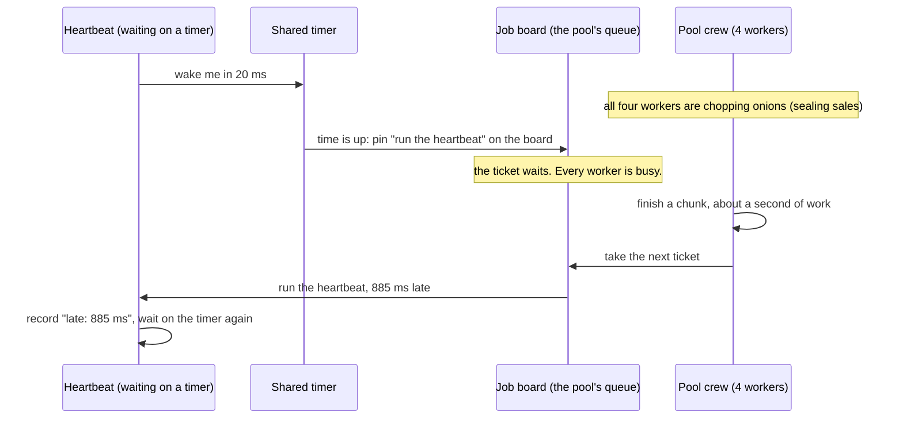
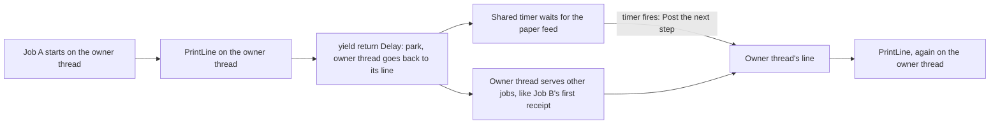
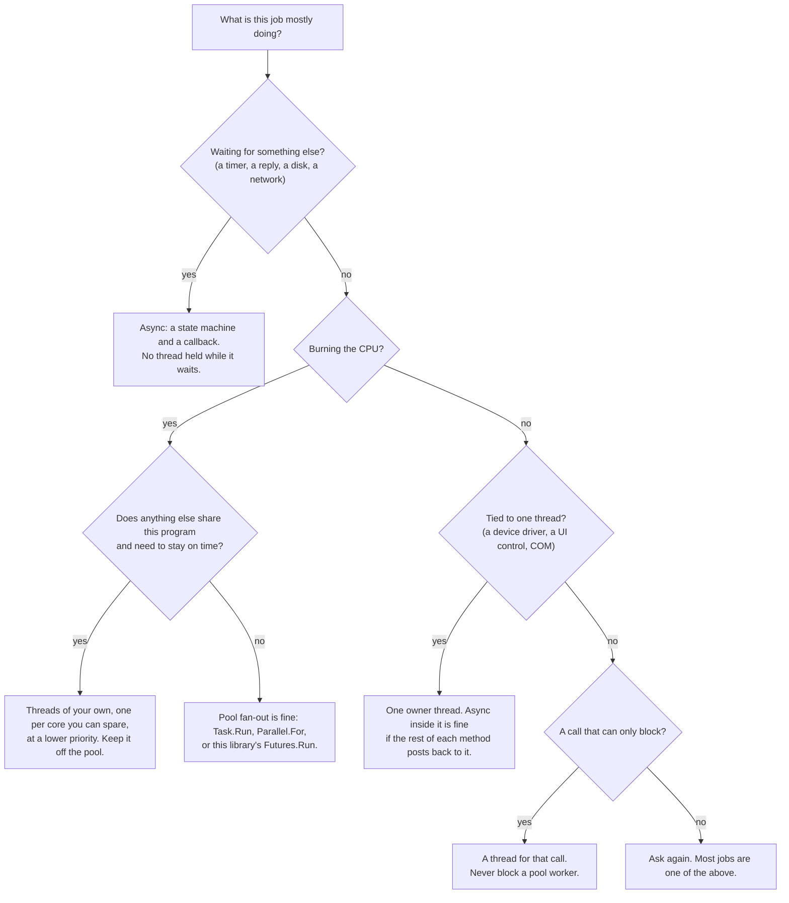

# 11. When threads win

## At the table

The next Tuesday. Same booth, same bass-fishing channel, same fish losing the same fight on all four TVs. Steve was ten minutes late this time, and when he slid in, Kevin was already there. He had already ordered. That was how Steve knew it was bad.

"You ordered the hot ones *before* I got here," Steve said.

"I had a feeling," Kevin said. "Dee knows."

Dee knew. She put down the tea and the coffee, looked at Kevin, looked at Steve, and said, "Whatever it is, I'm not bringing the pie until you two have settled it." Then she went off to ruin somebody else's night.

Kevin had a new napkin flat on the table, smoothed with the side of his hand. It was napkin number ten. He had written at the top of it, in block capitals: **SETTLEMENT.**

"Good news first," he said. "The serial thread is gone. The pulser thread is gone. I turned both of them into machines like you showed me. The display hasn't frozen once. Dale walked past my desk and said the pump *felt* faster. Dale does not say things like that."

"That's great, bro."

"It is great. And then Dale came back an hour later." Kevin tapped the napkin. "The certification people want a new thing. At the end of every day, the station settles. Every sale gets *sealed*. You take the sale and you run it through a hash, SHA-256, three hundred times in a row, so that nobody can cheaply forge a day's log. On a busy station that's twenty thousand sales. And it has to run at midnight, while the pumps are still on, because pumps don't close."

"Okay."

"So I thought: easy. That's async. That's the thing we do now. I turn the sealing into a machine, I `yield return` between sales, everybody claps." Kevin looked at Steve. "That's right, isn't it?"

Steve did not answer right away. He picked a wing off Kevin's plate. Kevin let him.

"Tell me what the serial thread was doing while it waited," Steve said.

"Nothing."

"And what is the sealing doing?"

Kevin opened his mouth, and then he closed it. "...Math."

"Math. Three hundred rounds of it, times twenty thousand. Not one second of that is waiting. Every second of it is a core running flat out." Steve pulled the napkin over and turned it sideways. He drew a restaurant: a dining room on the left, a kitchen on the right, a swinging door in the middle. "Here's the whole chapter. The waiters take your order, walk it back, and then go serve other tables while the kitchen cooks. That's async. A waiter does not stand at the pass staring at your steak. If he did, you'd need a waiter per table. Async is how one waiter looks after twenty tables, because most of what a waiter does is wait."

"Okay."

"Now your boss hands the restaurant twenty thousand onions to chop. Do you hire more waiters?"

"You hire cooks."

"You hire cooks. And knives. And you don't put them in the dining room." Steve tapped the swinging door. "Async is for waiting. Threads are for working. I told you in chapter one that a thread is a terrible tool for *waiting*. I never told you it was a terrible tool."

Kevin looked at the napkin for a long moment. "You told me threads hurt."

"I told you a sleeping thread hurts. A thread with a core and something to do is the best tool there is. It's the only tool there is. A core runs a thread. Everything else, the machines, the pager, the pool, all of it, is a way to avoid holding a thread while you wait. It can't make the work go away. Chopping is chopping."

"So I was wrong to try."

"You weren't wrong to try. Try it. Both ways. Let me show you what happens." Steve turned the laptop around. "I wrote the settlement three ways. The crew with its own threads, the loop like you said, and a third one that people write after the loop turns out slow. Watch the last column."

What follows is that table, and then a second one for the thing Dale added after lunch, which is a receipt printer with a mind of its own.

## Waiting and working

Every job a program does falls into one of three kinds. Knowing which kind you have is most of the answer.

| The job mostly… | Example from the pump | What it needs |
|---|---|---|
| **Waits** for something else to finish | the serial reply, a timer, a file read | A way to leave and be called back. No thread held. This is the whole course. |
| **Works**, using the CPU nonstop | sealing 20,000 sales | A core. A thread runs on a core, and nothing else does. |
| **Owns** something that is tied to one thread | a printer driver, a UI control | That one thread, kept for as long as the thing exists. |

Async and await, from chapter 1 to chapter 10, are the answer to the first row. This chapter is the other two. In both, the thread isn't a cost to get rid of. It is the thing the job needs.

Some words first, because they come up on every page.

- A **CPU-bound** job is one where the speed is set by how fast the CPU can compute. Nothing is waiting on a disk or a network. If you gave it a faster CPU, it would finish sooner.
- A **core** is one worker inside the CPU. A four-core machine can run four threads truly at the same time.
- A **dedicated thread** is a thread you make yourself for a job and own for its length, as opposed to a pool thread, which is borrowed. (In modern .NET, `Task.Factory.StartNew(..., TaskCreationOptions.LongRunning)` is how you ask for one.)
- **Priority** is a number on a thread that tells the operating system who goes first when two threads want the same core. A thread with a higher priority can **preempt** (push aside) a lower one.

## Case 1: the crunch

### The job

`training/05-crunch`. A day of sales is a list of records. **Sealing** one record means hashing it over and over. SHA-256, `rounds` times. That is the CPU work, and it is the same loop in every version:

```csharp
// training/MMP.AsyncProxy.Training/Crunch/Contract/ISettler.cs
public static ulong Seal(SHA256 sha, SaleRecord sale, int rounds)
{
    byte[] h = new byte[32];
    BitConverter.GetBytes(sale.Id).CopyTo(h, 0);
    BitConverter.GetBytes(sale.Cents).CopyTo(h, 4);
    for (int r = 0; r < rounds; r++) h = sha.ComputeHash(h);
    return BitConverter.ToUInt64(h, 0);
}
```

**Read it like this.** Start with 32 bytes built from the sale. Hash them. Hash the result. Hash that. Do it `rounds` times and keep the first eight bytes of the last hash as the seal. There is no `await` in it, no wait, no disk. It is a core, busy, until it is done.

The answer a version returns is the money (total, and per grade) and one checksum made by XOR-ing every record's seal. XOR doesn't care about order, so four threads that finish in any order still agree with one thread. That is what lets the test say "every version gets the same answer as one plain loop."

And while the settlement runs, a **heartbeat** stands in for Kevin's pulser. It has to tick every 20 ms. (The real pulser polls every 50 ms. The bench ticks faster so that lateness is easy to see.) It waits on a timer, not on a thread, which is just what chapter 7 taught, so it needs a worker for a few microseconds per tick. After each tick it records how late the tick was.

### Version 1: a crew of threads of its own (`threaded`)

```csharp
// training/MMP.AsyncProxy.Training/Crunch/Threaded/CrewSettler.cs
for (int t = 0; t < _crew; t++)
{
    int me = t;
    threads[t] = new Thread(delegate() { parts[me] = Ledger.SealRange(sales, me, sales.Length, _crew, rounds); });
    threads[t].IsBackground = true;
    threads[t].Name = "crunch:" + t;
    threads[t].Priority = ThreadPriority.BelowNormal;       // the crew yields to anything more urgent
    threads[t].Start();
}
```

**Read it like this.** Make `_crew` threads. Thread number `me` takes records `me`, `me + crew`, `me + 2 × crew`, and so on, so every thread gets a fair share without any of them touching another's records. Each one keeps its own running totals in `parts[me]`, so no two threads ever write the same variable and no lock is needed. When all the threads are done (the `Join` calls), the totals are merged. By default the crew is **one smaller than the number of cores**, which leaves a core free. And every crew thread has `BelowNormal` priority, which says to the operating system: if anything more urgent wants this core, take it from me.

Where did the threads come from? From `new Thread`. Not the pool. Nothing in this version ever touches the pool's job board.

### Version 2: the loop (`async-loop`)

```csharp
// training/MMP.AsyncProxy.Training/Crunch/Async/LoopSettler.cs
for (int start = 0; start < sales.Length; start += ChunkSize)
{
    int from = start;
    int to = Math.Min(start + ChunkSize, sales.Length);
    IFuture<Tally> chunk = Futures.Run<Tally>(delegate { return Ledger.SealRange(sales, from, to, 1, rounds); });
    yield return chunk;                       // "await": the machine parks, the pool thread runs the chunk
    all.Merge(chunk.Result);
}
```

**Read it like this.** Cut the day into chunks of 500. For each chunk, hand the work to the pool (`Futures.Run`), then `yield return` it, which is this library's `await`: park, and get called back when the chunk is done. Then do the next chunk.

It never holds a thread while it waits. It also never has more than one chunk running, so it never gets more than one core. One chunk, then the next, then the next. The machine gave us nothing here, because there was no waiting to avoid.

### Version 3: the fan-out (`async-pool`)

```csharp
// training/MMP.AsyncProxy.Training/Crunch/Async/PoolFanOutSettler.cs
for (int c = 0; c < _chunks; c++)
{
    int me = c;
    int count = _chunks;
    chunks[c] = Futures.Run<Tally>(delegate { return Ledger.SealRange(sales, me, sales.Length, count, rounds); });
}
yield return Futures.WhenAll(chunks);          // park once; every chunk runs on a borrowed worker
```

**Read it like this.** What a person does after finding out that version 2 is slow: cut the day into one chunk per core, pin every chunk to the pool's job board at once, and park until all of them are done. In modern C# this is `Task.Run` in a loop, or `Parallel.For`. It uses every core.

### The numbers

Measured on a 4-core Linux container, .NET 10, on 2026-11-02, with 20,000 sales and 300 rounds each, while a 20 ms heartbeat ran:

```
dotnet run --project training/MMP.AsyncProxy.Training.Bench -c Release -f net10.0 -- crunch

version      elapsed ms  peak threads   worst late  average late     ok
one loop           3602             -            -             -    yes
async-loop         3489            17         7 ms          0 ms    yes
async-pool         1026            17       885 ms        111 ms    yes
threaded           1361            20         3 ms          0 ms    yes
```

Three runs gave the same picture. `async-pool` took 1,026 to 1,108 ms and its worst heartbeat was 751 to 885 ms late. `threaded` took 1,204 to 1,425 ms and its worst heartbeat was 3 ms late, every time. `async-loop` took 3,489 to 4,062 ms, about the same as one plain loop.

Read it in this order:

1. **`async-loop`** is no faster than the plain loop. Async cannot make CPU work go faster. The chunks went to the pool and back, one at a time, and that cost a little.
2. **`async-pool`** is the fastest. It uses all four cores. It is also the one that wrecks the heartbeat: the worst tick landed **885 ms** late. Kevin's pulser is a 50 ms job.
3. **`threaded`** is a little slower than `async-pool`, because the crew is three threads and the fourth core was left free on purpose. But the worst heartbeat was **3 ms** late. The crew was a fifth to a third slower, and the pulser was hundreds of times more punctual.

### Why the fan-out hurts: the busy crew



**In words:**

1. The heartbeat asks the shared timer to wake it in 20 ms, and then holds no thread. Nothing is wrong yet.
2. The pool's four workers are all busy sealing sales. This is not the parked-car problem from chapter 6. Nobody is waiting. They are working as hard as they can.
3. The timer goes off on time and pins a ticket on the job board: "run the heartbeat's next step."
4. There is no free worker to take it. The ticket sits on the board while the workers finish what they are doing.
5. The workers finish a chunk, and one of them takes the next ticket. That ticket is the heartbeat's.
6. The heartbeat runs, 885 ms later than it should have, and records the lateness.

**Why it matters:** the pool is shared. When you fill it with long CPU work, you fill it for everyone. The timer buzzes on time and no one answers the pager. Both this and the parked-car problem end the same way, with tickets waiting for a free worker. The difference is why the workers are busy. There, they were parked. Here, they are working.

```mermaid
gantt
    title Four cores, one settlement (drawn to scale from the measured run)
    dateFormat X
    axisFormat %L
    section async-pool, crunch on the pool
    core 1 sealing :a1, 0, 1030
    core 2 sealing :a2, 0, 1030
    core 3 sealing :a3, 0, 1030
    core 4 sealing :a4, 0, 1030
    heartbeat waits for a worker :crit, a5, 20, 885
    section threaded, crunch on its own threads
    core 1 crew thread :b1, 0, 1360
    core 2 crew thread :b2, 0, 1360
    core 3 crew thread :b3, 0, 1360
    core 4 stays free so the heartbeat runs on time :done, b4, 0, 1360
```



**In words:**

1. The top block is `async-pool`. All four cores are sealing for about 1,030 ms, so the job finishes first.
2. The red bar is the heartbeat. It was due at 20 ms but had no worker until about 905 ms.
3. The bottom block is `threaded`. Three cores run the crew for about 1,360 ms, which is longer.
4. The fourth core has nothing on it for the whole run. That is the room the pool's timer needed. The heartbeat finds a worker at once.
5. So `async-pool` finishes about a quarter sooner, and `threaded` is the only one that keeps the pulser on time.

**Why it matters:** speed isn't the only number. A plan that uses every core is fast for itself and slow for everything that shares the machine.

### What if you only have one core?

Kevin's board has one ARM core, and this is the part that surprised him. A crew of `max(1, cores - 1)` is a crew of one thread. It cannot leave a core free, because there is no second core. So what keeps the pulser on time?

**Priority.** The settlement thread runs at `BelowNormal`. The pulser's pool worker runs at the normal level. Windows CE keeps the highest-priority ready thread running, and the moment the timer fires and the pulser's worker is ready, the settlement thread is pushed aside. The pulser takes a few microseconds, gets off the core, and the settlement thread picks up where it stopped.

A pool job has no such knob. Every ticket on the job board is equal. You cannot pin a ticket that says "I am less important." The pool has no way to say that, and a thread has it built in.

One honest note about the measurement. The container here is Linux, which mostly ignores `ThreadPriority` for normal programs, so the numbers above come from leaving a core free, not from priority. The priority part is what the Windows CE argument depends on. It is not measured here.

## Case 2: the thread that owns the printer

### The job

`training/06-printer`. Dale's other new ask: a receipt printer. The vendor SDK is a COM object in a single-threaded apartment. It is the kind of driver that comes with one rule in the manual and a lot of silence about what happens if you break it: **the thread that opens the printer is the only thread allowed to call it**.

```csharp
// training/MMP.AsyncProxy.Training/Printer/Contract/IReceiptDesk.cs
public void Open()
{
    lock (_gate) _owner = Thread.CurrentThread.ManagedThreadId;
}

public void PrintLine(string line)
{
    int me = Thread.CurrentThread.ManagedThreadId;
    lock (_gate)
    {
        _callers[me] = true;
        if (me != _owner)
        {
            _rejected++;
            throw new WrongThreadException("The printer was opened on thread " + _owner + " and called from thread " + me + ".");
        }
        _lines.Add(line);
    }
}
```

**Read it like this.** `Open` writes down which thread called it. `PrintLine` checks: is the caller that same thread? If not, count a rejection and throw. A real driver might not throw. It might quietly scribble over its own memory. This one tells you.

A receipt job prints some receipts, and after each one the paper has to advance, which takes `feedMs`. The paper feed is a wait. Remember that the chapters before this one are about waits.

### Version 1: one owner thread (`threaded`)

An `OwnerThread` (in `Support/OwnerThread.cs`) is a thread that does nothing except take jobs off a line and run them. The driver is opened on it and only ever called from it.

```csharp
// training/MMP.AsyncProxy.Training/Printer/Threaded/OwnerThreadDesk.cs
_owner.Invoke(delegate
{
    for (int i = 0; i < receipts.Length; i++)
    {
        _printer.PrintLine(receipts[i]);
        printed++;
        Thread.Sleep(feedMs);              // the owner thread sits here. Nobody else can use the printer meanwhile.
    }
});
```

**Read it like this.** The whole job is one block, run on the owner thread. After each line, the owner thread sleeps while the paper advances. For all that time, it is the only thread that can touch the printer, and it is asleep. A second job has to stand in line until the first one is completely done.

### Version 2: the mistake (`async-naive`)

The state machine is started on whatever thread happens to call `PrintJob`.

```csharp
// training/MMP.AsyncProxy.Training/Printer/Async/NaiveDesk.cs
_printer.PrintLine(receipts[i]);   // the first line is called from the caller's thread, the rest from the pool
printed++;
...
yield return Futures.Delay(feedMs);
```

**Read it like this.** The printer was opened on the owner thread. This machine did not start there, and it never goes back there. The first `PrintLine` comes from the caller's thread. After the first `yield return`, the machine resumes on a pool thread, and so does every line after it. Every one of them is on the wrong thread.

### Version 3: post back to the owner (`async-postback`)

```csharp
// training/MMP.AsyncProxy.Training/Printer/Async/PostBackDesk.cs
_owner.Invoke(delegate
{
    job = AsyncProxy.Run<PrintReport>(delegate(Return<PrintReport> ret) { return Body(receipts, feedMs, ret); });
});
return job.Result;                         // this blocks the CALLER, not the owner thread

private IEnumerable<IFuture> Body(string[] receipts, int feedMs, Return<PrintReport> ret)
{
    int printed = 0;
    for (int i = 0; i < receipts.Length; i++)
    {
        _printer.PrintLine(receipts[i]);       // on the owner thread, every time
        printed++;
        yield return Futures.Delay(feedMs);    // the owner thread goes back to its line; the timer waits
    }
    ret.Value = new PrintReport(printed, 0, null);
}
```

**Read it like this.** The machine is *started* on the owner thread, inside the `Invoke`. That matters because of chapter 5. When the machine parks at the `yield return`, the awaiter captures the `SynchronizationContext` that is current: the `OwnerThread` is one. When the timer fires, the library does not run the next step on whichever pool thread is free. It **posts** it back to the owner thread's line. The owner thread picks it up and calls `PrintLine`, on the right thread. (The Compact Framework has no `SynchronizationContext`. There the library's `IPostTarget` plays the same part: a thread registers itself once, and the awaiter posts back to it.)

And while the machine waits for the timer, the owner thread is not asleep. It is back at its line, free to print a receipt for some other job.



**In words:**

1. Job A starts on the owner thread, because `PrintJob` runs the machine inside an `Invoke`.
2. The machine prints its first line. That `PrintLine` is on the owner thread, so the driver accepts it.
3. The machine hits `yield return Futures.Delay(feedMs)`, parks, and returns. The owner thread goes back to its line.
4. Two things happen at once. The shared timer counts the paper feed, and the owner thread is free to serve other work, such as the first receipt of Job B.
5. When the timer fires, it does not run the next step itself. It **posts** it to the owner thread's line.
6. The owner thread gets to that item and prints the next line, again on the one thread the driver allows.

**Why it matters:** the owner thread did not go away. The device insists on it. What async changed is what the thread does while the paper feeds. It used to sit through the wait. Now it serves someone else.

### The numbers

Eight jobs arrive at once, five receipts each, a 40 ms paper feed after each. One job alone takes about 200 ms.

```
dotnet run --project training/MMP.AsyncProxy.Training.Bench -c Release -f net10.0 -- printer 8

version          elapsed ms  printed   rejected  driver threads
threaded               1613       40          0               1
async-postback          215       40          0               1
async-naive             203        0         40              13
```

1. **`threaded`** printed all 40 lines, correctly, on one thread. It took 1,613 ms, which is eight jobs one after another at about 200 ms each. The owner thread sat through every paper feed.
2. **`async-postback`** printed all 40 lines, correctly, on one thread, in 215 ms, which is about one job's time. The eight jobs overlapped their waits on the owner thread.
3. **`async-naive`** finished in 203 ms and printed **nothing**. The driver refused all 40 calls, and 13 different threads tried. It was the fastest, and it did not work.

This one is a case where async wins, but only if it keeps the thread rule. That is the point of the case. **The wrong async is worse than threads. It's broken.** A plain thread has one advantage over async here: it can't forget which thread it is on.

A note on how this bench got fixed. The first draft of the printer bench ran its eight callers with `Task.Run`, and `async-postback` took 4,558 ms. Each caller blocked waiting for its job, so each one parked a pool worker, and the timers the machine needs to wake up queued behind them. That is the parked-car problem from chapter 6, in the bench that was written to *show* a different point. The fix was to give each caller a thread of its own (`TaskCreationOptions.LongRunning`). The lesson is the same one: blocking jobs belong on their own threads, not on the shared board.

## Case 3, in one paragraph: the library that only blocks

Chapter 10 has the third case. The bank's 2008 library has a call that blocks until the bank answers, and there is no async version. If you call it inside `Futures.Run`, a pool worker sits parked for the whole call: the parked-car problem again. The fix is the same as the printer's: give the blocking call a thread of its own, and let the rest of your program wait on a future for the answer. That is the `PrefersBlockingIo` flag in the pump simulator.

## Which tool, when



**In words:**

1. Start at the top: what is this job mostly doing?
2. If it is mostly waiting for something else, use async. That is chapters 1 to 10.
3. If it is mostly burning CPU, ask a second question: does anything else in the program need to stay on time?
4. If yes, give the work threads of its own, one fewer than the cores if you can, at a lower priority, and keep it off the pool. That is the crew.
5. If nothing else cares, a pool fan-out is fine and it is the fastest way to use every core.
6. If the job is tied to one thread, make that thread the owner, and let async methods post back to it.
7. If the only API you have blocks, give that call its own thread.

**Why it matters:** async is a tool for one kind of job. The rest of the program is full of the other kinds, and picking the wrong tool is how you get a pump that pours late.

## What to take from it

1. **Async and threads solve different problems.** Async stops a *wait* from holding a thread. It cannot make CPU work go faster, and it cannot remove a thread that a device needs.
2. **The pool is shared.** Long CPU work on it makes every other ticket wait, and so do blocking calls. Both end with tickets on the board and no one free to take them.
3. **A thread is the way to say how many cores, and how important.** A pool job can't say either.
4. **Wrong-thread async fails loudly if you are lucky.** The printer driver here threw an exception. A real one might not.

## Words you just met

| Term | Plain meaning | The picture |
|---|---|---|
| **CPU-bound** | Speed is set by the CPU, not by waiting on anything | Chopping onions: more cooks, not more waiters |
| **Core** | One worker inside the CPU; it runs one thread at a time | One cook at one cutting board |
| **Dedicated thread** | A thread you make and own for a job, not borrowed from the pool | A cook hired just for this job |
| **Priority / preempt** | A number that says who goes first; a higher one pushes a lower one aside | The head cook can pull a helper off a task |
| **Busy crew** | The pool's workers are all working, so new tickets wait | Every cook is chopping; the pager buzzes and no one answers |
| **Thread affinity** | A device or object that only one thread may touch | A key that only fits one hand |
| **Owner thread** | The one thread that holds such a device and does nothing else | The one person with the key |
| **Post back** | Hand the rest of a method to the owner thread instead of running it anywhere | "Send the rest of this order back to counter 3" |

## Try it

Run the tests and the two tables, and then break things on purpose.

```
dotnet test training/MMP.AsyncProxy.Training.Tests -f net10.0 --filter "FullyQualifiedName~Crunch|FullyQualifiedName~Printer"
dotnet run --project training/MMP.AsyncProxy.Training.Bench -c Release -f net10.0 -- crunch
dotnet run --project training/MMP.AsyncProxy.Training.Bench -c Release -f net10.0 -- printer 8
```

1. **Sweep the crew.** In `CrewSettler`, pass a crew of 1, 2, 3 and 4 and run `crunch`. Where does elapsed stop improving? What happens to the heartbeat when the crew equals the number of cores?
2. **Shrink the day.** Run `crunch 2000 300`. Is the heartbeat still late for `async-pool`? Why does the length of the work matter to the pulser, and not only to the total time?
3. **Predict, then run.** In `PostBackDesk`, start the machine on the *caller's* thread instead of inside `_owner.Invoke`. What do you expect the report to say? Then run the test and see.
4. **Count the threads.** Run `printer 40`. Which version's elapsed time grows with the number of jobs, and which stays flat? What is each one doing in the meantime?

Next: back to [the course index](README.md), or on to `training/05-crunch/README.md` and `training/06-printer/README.md` for each project's tests and the sealed numbers.
