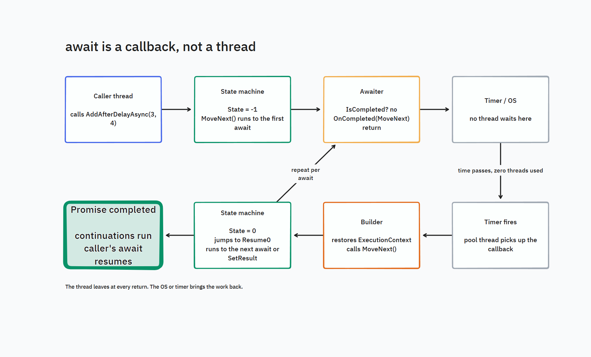

# How async/await works, from the inside

A course told through conversations between two developers after hours. It has an opening story and eleven chapters about how async code runs. The examples come from this repo, so you can open the source beside a chapter and follow each step. Start with basic C#: methods, variables, and method calls. The course introduces threads and explains new terms as they appear.

The two developers are Steve and Kevin. Kevin keeps the firmware for a fuel dispenser: Windows CE 6, .NET Compact Framework 3.5, the Visual Studio 2008 compiler, four threads, and a box with 64 MB. They meet for wings at a place on the frontage road where Dee, the waitress, knows both their orders. Each chapter opens at the table, where Kevin asks what a working engineer would ask and Steve answers with the thing in the chapter. The code Kevin brought (threads) and the code he left with (this library) are in `samples/MMP.AsyncProxy.Forecourt`, built for net35 with C# 3, and `tests/MMP.AsyncProxy.Tests/ForecourtTests.cs` runs both.

Use the .NET SDK and `dotnet` to run the desktop samples. The older compiler examples show how the library works on C# versions that lack `async` and `await`. Kevin's device uses a separate Compact Framework build.

| # | Chapter | What you leave with |
|---|---------|---------------------|
| 0 | [Dinner](00-dinner.md) | Kevin's pump, his four threads, and the problem he brought |
| 1 | [Why threads hurt](01-why-threads-hurt.md) | Why "one thread per thing" stops scaling, with numbers from this machine |
| 2 | [Callbacks and promises](02-callbacks-and-promises.md) | The Promise/Future split and why only one side can finish |
| 3 | [The state machine](03-the-state-machine.md) | What the compiler emits for an `async` method, read line by line |
| 4 | [Awaiter and builder](04-awaiter-and-builder.md) | The three-call protocol and the four-call builder, with a sequence diagram |
| 5 | [Context rides along](05-context-rides-along.md) | How a value set before an await is still there after it, on another thread |
| 6 | [Threads versus the machine](06-threads-vs-the-machine.md) | Run the comparison console and read the table |
| 7 | [The iterator trick](07-the-iterator-trick.md) | How `yield return` gets you async on C# 2.0 |
| 8 | [Exercises](08-exercises.md) | Write your own machine, break it, fix it |
| 9 | [Patterns and principles](09-patterns-and-principles.md) | The thirteen patterns that showed up, and the code held against CUPID, SOLID, and DRY |
| 10 | [Waiting without a thread](10-waiting-without-a-thread.md) | The worker loop with threads and with the machine, in a real program, down to the IL. The door into `training/` |
| 11 | [When threads win](11-when-threads-win.md) | The jobs where async is the wrong tool: CPU work, and a device that owns a thread. Two runnable projects with numbers |

Diagrams: Mermaid blocks render on GitHub. The tldraw canvas in `diagrams/` opens in tldraw desktop or at tldraw.com. Every diagram is followed by an **In words** walkthrough (the steps, in time order, saying who is working and who is waiting) and a **Why it matters** line. If a picture doesn't make sense, read the words under it first, then look at the picture again.

## What happens at an await

An `await` checks whether an operation has finished. If it has, the method reads the result and keeps running. If it is still pending, the method saves its place, registers a callback, and returns control to its caller. A callback is code that another part of the program calls later. Here, it resumes the method when the operation finishes.

The method pauses, but the thread that ran it can do other work. The saved state stays in memory. The awaiter decides how to run the callback: on the thread that completes the operation, or through a captured context. A captured context can send it back to a UI thread.

This picture uses a shorter example: one delay, then `3 + 4 = 7`. Chapter 3 adds a second delay and doubles the sum to `14`.

Read the picture clockwise from the top left.

**In words:**

1. **Caller thread (top left).** Some code calls `AddAfterDelayAsync(3, 4)`. The method starts running on that thread.
2. **State machine (top, second box).** The call creates an object that stores the method's inputs and its place in the work (chapter 3). It sets `State = -1` for the initial entry and calls `MoveNext()`. That method runs the next part of the work.
3. **Awaiter (top, third box).** At the delay, the machine checks `IsCompleted`. In this path, the delay is still pending. The machine saves its place and registers a callback that will call `MoveNext()`. Then it returns control to the caller.
4. **Timer / OS (top right).** The delay keeps its promise and timer entry in memory. The promise stores the callback. The operating system tracks when the timer is due. No thread is set aside to wait for this delay. Read "zero threads used" as zero threads blocked by the delay; timer handling still needs CPU time.
5. **Timer fires (bottom right).** When the time is up, a pool thread picks up the callback.
6. **Builder (bottom, third box).** On desktop .NET, the callback restores the saved `ExecutionContext` before it calls `MoveNext()`. This context holds values that belong to the current flow of work (chapter 5). Compact Framework lacks this context support.
7. **State machine again (bottom, second box).** The saved `State = 0` sends execution to `Resume0`. The machine reads the delay's result, then adds `3 + 4`. Another pending await would save a new place and return again. An already completed await would keep running.
8. **Promise completed (bottom left).** The machine calls `SetResult(7)`. Its promise now holds `7`, and callbacks registered by its callers can run. A caller that awaited this result can resume and read `7`.

**Why it matters:** a pending delay keeps saved data and a callback in memory. It frees the calling thread to do other work until a thread runs the callback.

The chapters trace each part of this path in the source code.

## The pictures the course keeps using

The same few pictures carry the whole course. They are introduced where the chapter needs them and reused after that, so you only learn each once.

| Idea | The picture | Chapter |
|---|---|---|
| **Thread** | Runs instructions using its own stack. The operating system keeps its ID, priority, and state in a control record | 0, 1 |
| **Waiting on a thread** | Standing at the counter, staring at the cook | 1 |
| **Callback** | The restaurant pager: leave it, go sit, it buzzes | 1 |
| **Thread pool** | A shared crew takes queued jobs (**work items**), then becomes available for another job | 1 |
| **Promise and future** | A pickup window. The kitchen can put food in it, once. The customer can only look and ask to be buzzed | 2 |
| **State machine** | A recipe with a bookmark and a sticky note of everything you were holding | 3 |
| **Context** | A backpack that travels with the job, and a sign that says "back to counter 3" | 5 |
| **Pool starvation** | Every pool worker is occupied, so queued jobs must wait for a free worker | 6 |
| **Async versus threads** | Waiters and cooks. Async is how one waiter handles twenty tables. Chopping twenty thousand onions takes cooks | 11 |
