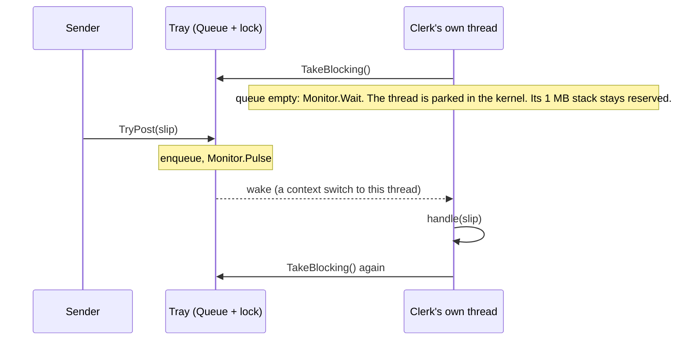
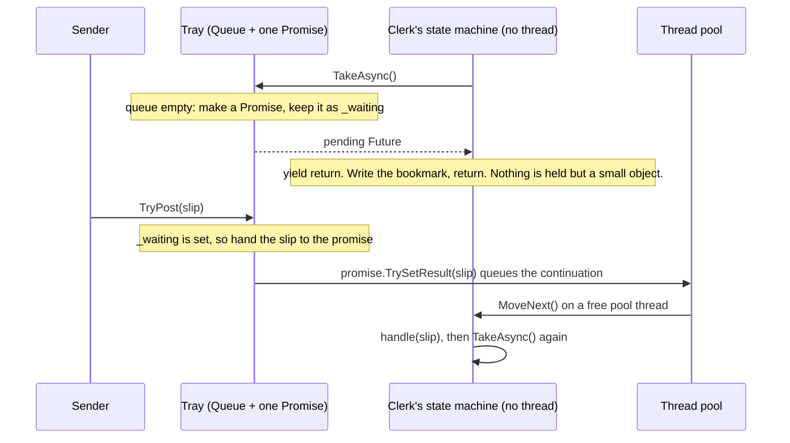

# 01. The clerk and the in-tray

## 1. The job

A clerk sits at a desk with an in-tray. Slips arrive a few times a second when the shop is busy and never for minutes at a time when it is quiet. The clerk takes the top slip, handles it, and looks at the tray again. This is the shape of every worker in MMP.GasPumpSimulator, and of most servers.

Three rules hold for any version of this program. One slip at a time. The tray holds only so many, so a flood makes the sender wait. A slip whose handler throws does not unseat the clerk. The tests in `MMP.AsyncProxy.Training.Tests/Mailbox` check those rules against every version, so the only question left is: what does the clerk hold while the tray is empty?

The code is in `MMP.AsyncProxy.Training/Mailbox/`. The contract is three interfaces in `Contract/`: `IInTray<T>` (post, close), `IClerk` (is it running, how many handled, wait until idle), and `IDesk` (open a tray, seat a clerk). The threaded version is in `Threaded/`, the AsyncProxy version in `Async/`, and the .NET 10 version in `MMP.AsyncProxy.Training.Modern/Mailbox/`.

## 2. The thread way

`ThreadedInTray<T>` is a `Queue<T>` under a lock. `ThreadedClerk<T>` makes a thread when it sits down. The thread runs one loop:

```csharp
T slip;
while (_tray.TakeBlocking(out slip))      // sleeps inside Monitor.Wait while the tray is empty
{
    try { _handle(slip); }
    catch (Exception) { /* the clerk stays seated */ }
    finally { _tray.Handled(); }
}
```

`TakeBlocking` is where the thread goes to sleep:

```csharp
lock (_gate)
{
    while (_slips.Count == 0)
    {
        if (_closed) { slip = default(T); return false; }
        Monitor.Wait(_gate);                // the thread parks here, in the kernel
    }
    slip = _slips.Dequeue();
    return true;
}
```

And `TryPost` is what wakes it: enqueue under the lock, then `Monitor.Pulse`. The kernel picks that one thread, restores its registers and stack, and it returns from `Wait` with the lock back in hand.



While the tray is empty the clerk holds a whole thread: a reserved stack of about one megabyte, a kernel object, and a place in the scheduler's lists. The test `Two_hundred_idle_threaded_clerks_hold_two_hundred_threads` makes that visible. Seat 200 clerks who have nothing to do, count the process's threads, and the count went up by 200.

## 3. The AsyncProxy way

The tray changes in one place and the clerk changes in one place. Everything else is the same code.

**The tray hands out an IOU.** `PromiseInTray<T>.TakeAsync` returns a future instead of blocking:

```csharp
lock (_gate)
{
    if (_slips.Count > 0)
    {
        Promise<T> ready = new Promise<T>(true);
        ready.SetResult(_slips.Dequeue());    // a slip was waiting: the future is already done
        return ready.Future;
    }
    if (_closed) return Cancelled();
    _waiting = new Promise<T>(true);          // empty: hand out an IOU
    return _waiting.Future;
}
```

`TryPost` pays the IOU if one is out, otherwise it enqueues:

```csharp
Promise<T> wake = null;
lock (_gate)
{
    if (_closed) return false;
    if (_waiting != null) { wake = _waiting; _waiting = null; }   // the clerk is waiting: hand it over
    else if (_slips.Count >= _capacity) return false;
    else _slips.Enqueue(slip);
    Interlocked.Increment(ref _pending);
}
if (wake != null) wake.TrySetResult(slip);                        // outside the lock, on purpose
return true;
```

**The clerk becomes an iterator.** `IteratorClerk<T>.Loop` is the same loop with `yield return` where the thread used to sleep:

```csharp
private IEnumerable<IFuture> Loop()
{
    while (!_stopping)
    {
        IFuture<T> next = _tray.TakeAsync();
        yield return Futures.Observe(next);                        // park here if the tray is empty
        if (next.IsCanceled || next.IsFaulted || _stopping) yield break;
        try { _handle(next.Result); }
        catch (Exception) { /* the clerk stays seated */ }
        finally { _tray.Handled(); }
    }
}
```

And the constructor hands it to the library: `_loop = AsyncProxy.Run(Loop());`. No thread is made.



Line by line, here is what moved:

| Thread way | AsyncProxy way | Why |
|---|---|---|
| `new Thread(Loop).Start()` | `AsyncProxy.Run(Loop())` | The library drives the loop; no thread is reserved for it |
| `bool TakeBlocking(out T slip)` | `IFuture<T> TakeAsync()` | A blocking call becomes a future you can park on |
| `Monitor.Wait(_gate)` | `_waiting = new Promise<T>(true)` | The parked thread becomes a promise the next post pays |
| `Monitor.Pulse(_gate)` | `wake.TrySetResult(slip)` | A kernel wake-up becomes a pool work item |
| `while (TakeBlocking(out slip))` | `yield return Futures.Observe(next)` | The sleep becomes a bookmark |
| `_thread.Join(2000)` | an `OnCompleted` callback on the loop's future and `WaitOne(2000)` | Waiting for the clerk to go home, with a bound either way |
| `_running` flag set in `finally` | `!_loop.IsCompleted` | The loop's own future says whether it is still going |

Two rules in the new tray carry weight. The promise is built with `true`, so its continuation runs on the pool and never on the sender's stack. And the promise is completed outside the lock, so the clerk's code never runs while the tray's lock is held. Chapter 10 of the course explains both.

## 4. Thread model against async model

**What left.** Thread exhaustion: 200 idle clerks added fewer than 20 threads to the process (the test `Two_hundred_idle_clerks_hold_no_threads`, which runs against the AsyncProxy and modern versions). The per-slip wake-up is a pool work item, so no specific sleeping thread has to be found and switched to. And the clerk's stack is gone: its state is the handful of fields in the iterator class.

**What stayed.** The three rules are kept by the shape of the loop, in both versions. One slip at a time, because the loop is sequential. A bounded tray, because `TryPost` refuses when full. A seated clerk after a bad slip, because the `catch` is the same. None of that came from async. Races on shared state did not leave either: two clerks resumed on two pool threads can still write the same field, so the design still has to say that clerks share nothing. And a handler that blocks now blocks a pool thread everyone shares, where before it blocked only its own.

**What the bench caught.** The first draft of `IteratorClerk.Dispose` polled `IsCompleted` with `Thread.Sleep(1)`. On Windows one millisecond of sleep is one 15 ms timer tick, so 1000 clerks took fifteen seconds to go home while the threaded version's `Thread.Join` took 288 ms in total. The fix is in `Dispose`: hang a callback on the loop's future, wait on an event with a bound. That is the `Task.Wait(timeout)` overload the library lacks, written by hand, and it is row 1 of the improvements table in `docs/prd-training.md`.

## 5. The same machine in IL

Both versions were compiled in Release and decompiled with ilspycmd 10.0.1. The AsyncProxy clerk is an iterator, so the C# compiler's iterator machinery built its class; it is shown at C# 1 level so `yield` is not re-sugared. The modern clerk is an `async` method, so the modern compiler built its struct; it is shown at C# 4 level so `await` is not. The full files are `docs/compiler-output/training/mailbox.iterator.cs`, `mailbox.iterator.il`, `mailbox.modern.cs`, and `mailbox.modern.il`.

**The iterator machine, .NET 3.5**

```csharp
private sealed class <Loop>d__14 : IEnumerable<IFuture>, IEnumerator<IFuture>, IDisposable
{
    private int <>1__state;             // the bookmark
    private IFuture <>2__current;       // the future just yielded
    public IteratorClerk<T> <>4__this;  // the clerk: tray, handle, counters
    private IFuture<T> <next>5__2;      // the local that crosses the yield

    private bool MoveNext()
    {
        int num = <>1__state;
        IteratorClerk<T> iteratorClerk = <>4__this;
        switch (num)
        {
        default: return false;
        case 0: <>1__state = -1; break;                       // first run
        case 1:                                               // resumed after the yield
            <>1__state = -1;
            if (<next>5__2.IsCanceled || <next>5__2.IsFaulted || iteratorClerk._stopping) return false;
            try { iteratorClerk._handle(<next>5__2.Result); }
            catch (Exception) { }
            finally { iteratorClerk._tray.Handled(); ... }
            <next>5__2 = null;
            break;
        }
        if (!iteratorClerk._stopping)
        {
            <next>5__2 = iteratorClerk._tray.TakeAsync();
            <>2__current = Futures.Observe(<next>5__2);
            <>1__state = 1;                                   // park at step 1
            return true;
        }
        return false;
    }
}
```

**The async machine, .NET 10**

```csharp
private struct <Loop>d__12 : IAsyncStateMachine
{
    public int <>1__state;                                    // the bookmark
    public AsyncTaskMethodBuilder <>t__builder;               // starts, parks, completes
    public ChannelInTray<T> tray;  public Action<T> handle;   // hoisted parameters
    public ChannelClerk<T> <>4__this;
    private ConfiguredCancelableAsyncEnumerable<T>.Enumerator <>7__wrap1;   // local across an await
    private ConfiguredValueTaskAwaitable<bool>.ConfiguredValueTaskAwaiter <>u__1;   // the awaiter parked on

    private void MoveNext()
    {
        int num = <>1__state;
        ChannelClerk<T> channelClerk = <>4__this;
        try
        {
            if (num != 0)
            {
                if (num == 1) { ... goto IL_0192; }                            // resumed after await 1
                <>7__wrap1 = tray.Channel.Reader.ReadAllAsync().ConfigureAwait(false).GetAsyncEnumerator();
            }
            ...
            IL_00b8:
            awaiter2 = <>7__wrap1.MoveNextAsync().GetAwaiter();
            if (!awaiter2.IsCompleted)
            {
                num = (<>1__state = 0);                                       // park at step 0
                <>u__1 = awaiter2;
                <>t__builder.AwaitUnsafeOnCompleted(ref awaiter2, ref this);
                return;
            }
            ...
            handle(current);
        }
        catch (Exception exception) { <>1__state = -2; <>t__builder.SetException(exception); return; }
        <>1__state = -2;
        <>t__builder.SetResult();
    }
}
```

The skeleton is the same in both: a `<>1__state` field with `-1` for running, `-2` for finished, and `0` and up for each parking spot; every local that must survive a pause hoisted to a field with the compiler's slot number in its name (`<next>5__2`, `<>7__wrap1`); one `MoveNext` that reads the state, jumps, runs to the next pause, writes the state, and returns.

The IL openings are the same moves:

```
// iterator MoveNext, .NET 3.5          // async MoveNext, .NET 10
IL_0000: ldarg.0                         IL_0000: ldarg.0
IL_0001: ldfld  int32 ...::'<>1__state'  IL_0001: ldfld  int32 ...::'<>1__state'
IL_0006: stloc.0                         IL_0006: stloc.0
IL_0007: ldarg.0                         IL_0007: ldarg.0
IL_0008: ldfld  ...::'<>4__this'         IL_0008: ldfld  ...::'<>4__this'
IL_000d: stloc.1                         IL_000d: stloc.1
IL_000e: ldloc.0                         .try {
IL_000f: brfalse.s IL_0017  // state 0     IL_000e: ldloc.0
IL_0011: ldloc.0                           IL_000f: brfalse.s IL_0058  // state 0
IL_0012: ldc.i4.1                          IL_0011: ldloc.0
IL_0013: beq.s IL_004e      // state 1     IL_0012: ldc.i4.1
IL_0015: ldc.i4.0                          IL_0013: beq IL_0175        // state 1
IL_0016: ret                // finished    ...
```

Load the state, branch on it. Same opening, same park (store the new state, return), same finish.

Three differences, and each one is a lesson for the library:

1. **The modern machine is a `struct`, and it lives on the stack until the first real pause.** A loop that finds a slip already waiting never allocates a machine at all. Ours is a class from the first `MoveNext`.
2. **The modern machine deals with its own awaiter.** `if (!awaiter2.IsCompleted) { ... AwaitUnsafeOnCompleted(ref awaiter2, ref this); return; }` is inside `MoveNext`. Our iterator's `MoveNext` only returns `true` and leaves the future in `<>2__current`; `IteratorStateMachine<T>` in the library is that missing paragraph. One copy of it serves every iterator.
3. **`ValueTask<bool>` from `MoveNextAsync` costs nothing when the channel already has an item.** Our fast path still builds a `Promise<T>`, its `Future<T>`, and an `Observe` wrapper for a slip that was already there. That is where the allocation column below comes from.

## 6. Memory and speed

1000 clerks, each at its own tray, each handed ten slips in a round-robin: 10,000 wake-ups. The clerks sit idle for 50 ms first, so the peak-threads column shows what an idle clerk holds. Measured 2026-11-02 on a 24-core Windows 11 machine, Release build.

```
dotnet run --project training/MMP.AsyncProxy.Training.Bench -c Release -f net48 -- 1000
Runtime: .NET Framework 4.8.10008.0, cores: 24, N = 1000

project      version      elapsed ms  peak threads  allocated bytes  peak WS bytes    ok
mailbox      threaded            288          1018          835,632     93,360,128   yes
mailbox      asyncproxy           96            34       12,591,240     93,360,128   yes

dotnet run --project training/MMP.AsyncProxy.Training.Bench -c Release -f net10.0 -- 1000
Runtime: .NET 10.0.14, cores: 24, N = 1000

project      version      elapsed ms  peak threads  allocated bytes  peak WS bytes    ok
mailbox      threaded            274          1020          704,952     84,041,728   yes
mailbox      asyncproxy           93            35       10,050,168     84,041,728   yes
mailbox      modern               88            36        1,776,728     84,041,728   yes
```

How to read it:

- **Peak threads** is the headline. A thousand threaded clerks are a thousand threads. A thousand AsyncProxy clerks are the pool's idle count, 34 or 35, the same as the modern version.
- **Elapsed** is three times lower for the state machines, on both runtimes. The threaded row pays to make, wake, and join a thousand threads. The machines pay a pool work item per slip.
- **Allocated bytes** is where the hand-built machine loses, by about six times against the modern one: around one kilobyte per slip against about 180 bytes. Section 5 says why: a promise, a future, and an `Observe` wrapper per step, even on the fast path, where the modern runtime's `ValueTask` and struct machine allocate nothing. The improvements table in the PRD carries the fixes.
- **Peak working set** is the process's high-water mark and the same for every row in a run, because the rows share one process and the first row sets it. Read it as "none of these blew up", and read the thread column for the memory story: a thousand reserved stacks are a thousand megabytes of address space that the working set does not show because nothing touched them.
- The allocation column was taken in a second pass with the thread sampler off. On .NET Framework, `Process.Threads` reads the whole system process table on every call, and a first run under a 5 ms sampler charged 700 MB of the sampler's own garbage to the slow row.

## 7. CUPID, DRY, SOLID

**Composable.** The contract is three small interfaces and the test suite is a theory over desks. Adding the modern version was one file and one line in `Desks.Open`. **Unix.** Each tray does one thing: hold slips and say when there are none. Each clerk does one thing: loop. **Predictable.** The three rules are tested, and a version that broke one would fail by name. The AsyncProxy tray completes its promise outside its lock, so a reader can see that no handler ever runs under the tray's lock. **Idiomatic.** The threaded version is the `Monitor.Wait` loop every 2008 developer wrote. The AsyncProxy version is the gas pump's `AsyncProxyDispatch` in C# 3. The modern version is a `Channel` and `await foreach`. **Domain.** Tray, slip, clerk, desk: no `Manager`, no `Helper`.

**DRY.** The two trays share the queue-under-a-lock shape and the two clerks share the handle-count-release block. They are kept as two copies on purpose, because the point of the project is the diff between them. `WaitUntilIdle` is three copies of the same poll; a fourth user would be the moment to move it into the contract as a default.

**SOLID.** The single responsibility that mattered is the tray's: it decides what the clerk holds while waiting, and nothing else changed when that decision changed. `IDesk` is the open door: a fourth version needs no edit to the tests. `IClerk` exposes nothing a caller could use to run a slip itself.

## 8. Run it

```
dotnet test training/MMP.AsyncProxy.Training.Tests           # 15 on net48 (two desks), 22 on net10.0 (three desks)
dotnet run --project training/MMP.AsyncProxy.Training.Bench -c Release -f net48 -- 1000
dotnet run --project training/MMP.AsyncProxy.Training.Bench -c Release -f net10.0 -- 1000
pwsh tools/decompile.ps1                                       # regenerates docs/compiler-output/training/mailbox.*
```
