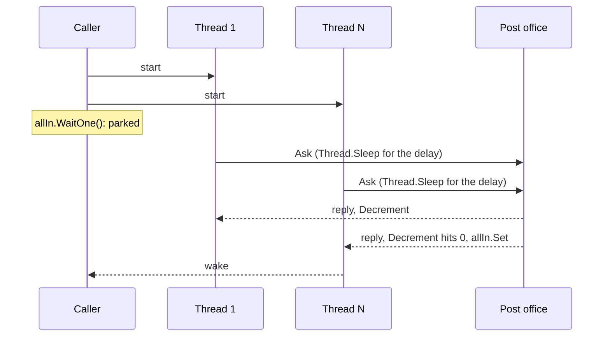
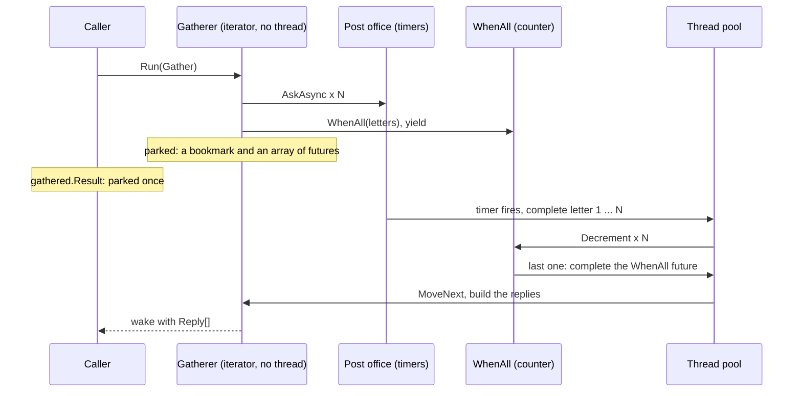

# 02. Many letters, one reply

## 1. The job

A caller sends N letters at the same moment, each to a slow post office, and needs every reply before it can go on. A price check against three suppliers. A page that needs five lookups. A forecourt controller asking every pump for its totals.

Three rules hold for any version. One reply per address, in the order the addresses were given. A bounced address is one bad reply, and the rest still come back; the batch never fails as a whole. N letters take one delay, because they are in flight together. The tests in `MMP.AsyncProxy.Training.Tests/FanOut` check those rules against every version, so the question left is: what does each letter hold while its reply is on the way?

The code is in `MMP.AsyncProxy.Training/FanOut/`. The contract is `ICourier` and the `Reply` it returns. `PostOffice` is the slow service every courier talks to: a letter takes `DelayMs` to answer and some addresses bounce. It has two doors. `Ask` sleeps the calling thread for the delay, the way a 2008 web request did. `AskAsync` hands back a future a timer completes. The modern courier builds its own door from the same two facts.

## 2. The thread way

`ThreadPerLetterCourier` makes a thread per address. Each thread walks through the blocking door, writes its reply into its slot, and counts down. The last one to finish sets the event the caller is parked on.

```csharp
int remaining = addresses.Length;
using (ManualResetEvent allIn = new ManualResetEvent(false))
{
    for (int i = 0; i < addresses.Length; i++)
    {
        int slot = i;
        string address = addresses[i];
        Thread t = new Thread(delegate()
        {
            try { replies[slot] = new Reply(address, office.Ask(address), null); }   // sleeps for the delay
            catch (Exception ex) { replies[slot] = new Reply(address, null, ex); }
            finally
            {
                // The countdown. Whoever decrements to zero wakes the caller.
                if (Interlocked.Decrement(ref remaining) == 0) allIn.Set();
            }
        });
        t.IsBackground = true;
        t.Name = "letter:" + address;
        t.Start();
    }
    allIn.WaitOne();                       // the caller, parked until the last reply
}
```



While the replies are on the way the courier holds N threads and the caller holds one more. Every one of the N is asleep in `Thread.Sleep` with a reserved stack. The test `Two_hundred_threaded_letters_in_flight_are_two_hundred_threads` counts them.

## 3. The AsyncProxy way

`WhenAllCourier` sends every letter through the future door, then parks once on `Futures.WhenAll`. The gatherer is an iterator with a single yield, and the caller waits once on its result.

```csharp
public Reply[] SendAll(string[] addresses, PostOffice office)
{
    IFuture<Reply[]> gathered = AsyncProxy.Run<Reply[]>(delegate(Return<Reply[]> ret) { return Gather(addresses, office, ret); });
    return gathered.Result;                    // the caller, parked once, at the top
}

private static IEnumerable<IFuture> Gather(string[] addresses, PostOffice office, Return<Reply[]> ret)
{
    IFuture<string>[] letters = new IFuture<string>[addresses.Length];
    for (int i = 0; i < addresses.Length; i++) letters[i] = office.AskAsync(addresses[i]);

    yield return Futures.Observe(Futures.WhenAll(letters));      // one await for the lot

    Reply[] replies = new Reply[addresses.Length];
    for (int i = 0; i < addresses.Length; i++)
    {
        IFuture<string> letter = letters[i];
        replies[i] = letter.IsFaulted
            ? new Reply(addresses[i], null, letter.Exception)
            : new Reply(addresses[i], letter.Result, null);
    }
    ret.Value = replies;
}
```

`Futures.WhenAll` is the countdown from the thread version, moved into the library: N callbacks, one counter, `Interlocked.Decrement`, and whoever hits zero completes the one future the gatherer is parked on. No thread waits for it. `Observe` wraps it so a bounced letter faults its own future and never the gatherer; the loop after the yield reads each letter's state.



Line by line:

| Thread way | AsyncProxy way | Why |
|---|---|---|
| `new Thread(...)` per address | `office.AskAsync(address)` per address | A letter is a future, and a future holds no thread |
| `office.Ask(address)` inside the thread, asleep | `Futures.Delay` inside `AskAsync`, parked | The delay is a timer either way; only what waits on it changed |
| `Interlocked.Decrement(ref remaining)` in each thread's `finally` | `Futures.WhenAll` | The same countdown, written once in the library |
| `allIn.WaitOne()` | `yield return Futures.Observe(WhenAll(...))` | The park moves from a kernel wait to a bookmark |
| `replies[slot] = ...` from N threads | `replies[i] = ...` from one loop after the yield | The writes happen on one thread, in order, after every letter is in |
| `catch` per thread | `letter.IsFaulted` per letter | A bounce is read, never caught |

What did not change: the caller still blocks once at the top, the replies are still in address order, and a bounce is still one bad reply.

## 4. Thread model against async model

**What left.** N threads for N letters. The test `Two_hundred_letters_in_flight_add_no_threads` sends 200 letters through the AsyncProxy and modern couriers and counts the process's threads while they fly. The N `Thread.Sleep` calls left too; a timer entry per letter ticks instead, and timer entries cost nothing while they wait. And the N scattered writes into `replies[]` became one loop on one thread.

**What stayed.** The caller still parks a thread, once. The library's `WhenAll` has the same counter and the same first-to-zero rule the threads had. A bounce is still a per-letter fact.

**What the test caught.** On .NET 10, 200 timers firing on the same tick made the thread pool grow: 57 threads in a cold process, 22 in a warm one, against fewer than 20 for the modern courier's 200 `Task.Delay`. Those are pool threads the runtime added for a moment, and they went back; no letter held one. In the warm bench at 1000 letters both couriers sat at the idle count. The cause was in the library: each `Futures.Delay` was its own `System.Threading.Timer`, and its callback called `Timer.Dispose`, which takes the timer queue's lock, so 200 callbacks at once looked like starvation to the pool's heuristic. The modern runtime runs every `Task.Delay` on one timer queue and unlinks a fired entry without a dispose on that path. That is row 6 of the improvements table in `docs/prd-training.md`: one shared timer wheel for `Futures.Delay`. Row 6 has since replaced the per-delay timers with `DelayWheel`, and the thread counts above were taken before it. On a Compact Framework pool of 25 there is no room for a burst of 57, so the row matters there more than here.

## 5. The same machine in IL

Both gatherers were compiled in Release and decompiled with ilspycmd 10.0.1, the iterator at C# 1 and the async method at C# 4. The full files are `docs/compiler-output/training/fan-out.iterator.cs`, `fan-out.iterator.il`, `fan-out.modern.cs`, and `fan-out.modern.il`.

**The iterator machine, .NET 3.5**

<!-- fence: sketch decompiled by ilspycmd 10.0.1 -->
```csharp
private sealed class <Gather>d__3 : IEnumerable<IFuture>, IEnumerator<IFuture>, IDisposable
{
    private int <>1__state;                 // the bookmark
    private IFuture <>2__current;           // the future just yielded
    public string[] addresses; public PostOffice office; public Return<Reply[]> ret;   // hoisted parameters
    private IFuture<string>[] <letters>5__2;   // the local that crosses the yield

    private bool MoveNext()
    {
        switch (<>1__state)
        {
        default: return false;
        case 0:
            <>1__state = -1;
            <letters>5__2 = new IFuture<string>[addresses.Length];
            for (int j = 0; j < addresses.Length; j++) <letters>5__2[j] = office.AskAsync(addresses[j]);
            <>2__current = Futures.Observe(Futures.WhenAll(<letters>5__2));
            <>1__state = 1;                 // park at step 1
            return true;
        case 1:
            <>1__state = -1;
            Reply[] array = new Reply[addresses.Length];
            for (int i = 0; i < addresses.Length; i++) { ... }
            ret.Value = array;
            return false;
        }
    }
}
```

**The async machine, .NET 10**

<!-- fence: sketch decompiled by ilspycmd 10.0.1 -->
```csharp
private struct <Gather>d__3 : IAsyncStateMachine
{
    public int <>1__state;                                   // the bookmark
    public AsyncTaskMethodBuilder<Reply[]> <>t__builder;     // starts, parks, completes
    public PostOffice office; public string[] addresses;     // hoisted parameters
    private Task<string>[] <letters>5__2;                    // the local that crosses the await
    private ConfiguredTaskAwaitable<string[]>.ConfiguredTaskAwaiter <>u__1;   // the awaiter parked on

    private void MoveNext()
    {
        int num = <>1__state;
        Reply[] result;
        try
        {
            if (num != 0) <letters>5__2 = addresses.Select(a => Ask(a, office)).ToArray();
            try
            {
                if (num != 0)
                {
                    awaiter = Task.WhenAll(<letters>5__2).ConfigureAwait(false).GetAwaiter();
                    if (!awaiter.IsCompleted)
                    {
                        num = (<>1__state = 0);              // park at step 0
                        <>u__1 = awaiter;
                        <>t__builder.AwaitUnsafeOnCompleted(ref awaiter, ref this);
                        return;
                    }
                }
                else { awaiter = <>u__1; <>u__1 = default; num = (<>1__state = -1); }
                awaiter.GetResult();
            }
            catch (Exception) { }
            Reply[] array = new Reply[addresses.Length];
            for (int num2 = 0; num2 < addresses.Length; num2++) { ... }
            result = array;
        }
        catch (Exception exception) { <>1__state = -2; <letters>5__2 = null; <>t__builder.SetException(exception); return; }
        <>1__state = -2;
        <letters>5__2 = null;
        <>t__builder.SetResult(result);
    }
}
```

Same skeleton: a `<>1__state` bookmark, the parameters and the one local that crosses the pause hoisted to fields with the compiler's slot number (`<letters>5__2` on both sides), one `MoveNext` with a jump on the state. The one await is the one parking spot, state 1 on the iterator side and state 0 on the async side, because the iterator counts its first run as state 0.

The IL openings:

```
// iterator MoveNext, .NET 3.5                  // async MoveNext, .NET 10
IL_0000: ldarg.0                                 IL_0000: ldarg.0
IL_0001: ldfld  int32 ...::'<>1__state'          IL_0001: ldfld  int32 ...::'<>1__state'
IL_0006: stloc.0                                 IL_0006: stloc.0
IL_0007: ldloc.0                                 .try {
IL_0008: brfalse.s IL_0010   // state 0            IL_0007: ldloc.0
IL_000a: ldloc.0                                   IL_0008: brfalse.s IL_003e   // state 0: resume
IL_000b: ldc.i4.1                                  IL_000a: newobj  <>c__DisplayClass3_0  // the lambda's closure
IL_000c: beq.s IL_0079       // state 1            ...
IL_000e: ldc.i4.0
IL_000f: ret                 // finished
```

Two differences worth the look. The modern machine's one `await` has a `catch (Exception) { }` around it inside the machine, because `Task.WhenAll` throws on any fault and the body swallows it to read each task; the iterator gets the same effect from `Futures.Observe`, outside the machine, with no try block. And the modern machine allocates a closure (`<>c__DisplayClass3_0`) for the `Select` lambda that captures `office`; the iterator's plain `for` loop allocates nothing but the array. Neither changes the shape.

## 6. Memory and speed

1000 letters at once to an office that answers in 100 ms. Measured 2026-11-02 on a 24-core Windows 11 machine, Release build, before the 0.2.0 fast paths and `DelayWheel`.

```
dotnet run --project training/MMP.AsyncProxy.Training.Bench -c Release -f net48 -- 1000
project      version      elapsed ms  peak threads  allocated bytes  peak WS bytes    ok
fan-out      threaded            307           782        8,781,888     94,691,328   yes
fan-out      asyncproxy          117            34        1,933,312     98,320,384   yes

dotnet run --project training/MMP.AsyncProxy.Training.Bench -c Release -f net10.0 -- 1000
project      version      elapsed ms  peak threads  allocated bytes  peak WS bytes    ok
fan-out      threaded            204          1035          509,872     95,956,992   yes
fan-out      asyncproxy          120            36        1,662,496     95,956,992   yes
fan-out      modern              118            36          527,232     95,956,992   yes
```

How to read it:

- **Elapsed.** The office takes 100 ms. The AsyncProxy and modern couriers took that plus about 20 ms to make and read a thousand futures. The threaded courier took two to three times the delay, and all of the extra is making a thousand threads one after another: on .NET Framework the last thread started about 200 ms after the first, which is why its peak was 782 and never 1000, because the early letters had already come back.
- **Peak threads.** A thousand letters in flight is a thousand threads for the thread courier (1035 on .NET 10, where thread start is faster and all of them were alive at once). For the state machines it is the pool's idle count, 34 to 36, the same as the modern version. The pool injection the test caught at 200 cold did not show at 1000 warm.
- **Allocated bytes.** About 1.9 KB per letter for AsyncProxy on .NET Framework and 1.7 KB on .NET 10, against about 0.5 KB for the modern version. Per letter in this run: a promise and a future for the `Delay`, a `Timer` (now a `DelayWheel` entry), a promise and a future for the `AskAsync` result, its iterator, a `WhenAll` continuation, and the `Reply`. The modern `Task.Delay` is one timer-queue entry and one task. Rows 2, 3, and 6 of the improvements table are where that goes.
- **Peak working set** is the process's high-water mark across the whole bench run and says only that nothing blew up.

## 7. CUPID, DRY, SOLID

**Composable.** `WhenAll` is a combinator over `IAwaiter`; it knows nothing about post offices or timers, and the gatherer knows nothing about how a letter is answered. **Unix.** The office answers letters. The courier sends and gathers. `WhenAll` counts. **Predictable.** A bounce is a per-letter fact in both versions, so a reader of `Reply[]` never has to guess which letter failed. **Idiomatic.** The thread version is the countdown every 2008 developer wrote with `ManualResetEvent` and `Interlocked`. The AsyncProxy version is `Task.WhenAll` under its 3.5 name. **Domain.** Letter, address, reply, bounce, office.

**DRY.** The countdown exists once in the thread courier and once in `Futures.WhenAll`. Those are two different programs on purpose; a third would be the moment to ask whether the thread version should call the library's counter, and the answer would be no, because the point of the thread version is to show the counter in the open. The `Reply` building loop is written once per version.

**SOLID.** `ICourier` is the open door: a fourth version needs no test change. `PostOffice` carries both doors so that neither courier needs a different office; a reviewer could argue the blocking door and the future door are two responsibilities, and they would be right, and they are kept together so the two couriers are answered by one object with one delay.

## 8. Run it

```
dotnet test training/MMP.AsyncProxy.Training.Tests --filter "FullyQualifiedName~FanOut"
dotnet run --project training/MMP.AsyncProxy.Training.Bench -c Release -f net48 -- 1000
dotnet run --project training/MMP.AsyncProxy.Training.Bench -c Release -f net10.0 -- 1000
pwsh tools/decompile.ps1                                       # regenerates docs/compiler-output/training/fan-out.*
```
