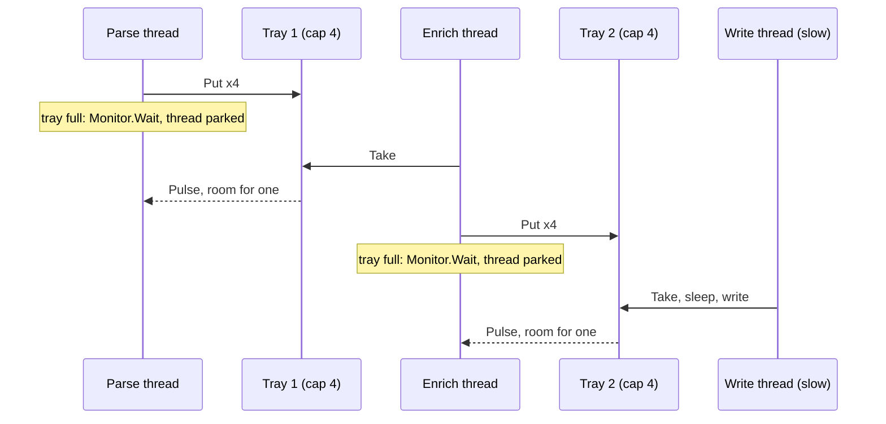
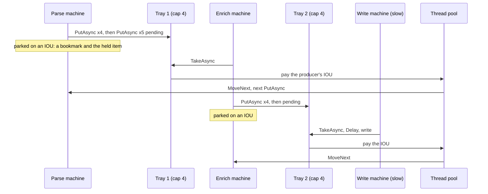

# 03. The assembly line

## 1. The job

Three stages in a row: parse, enrich, write. Each stage hands its output to the next through a tray that holds only so many items. When the tray is full the stage before it must wait. When the tray is empty the stage after it must wait. This is backpressure, and every pipeline that does not lose data has it. A log shipper. An ETL job. A pump head that reads pulses, prices them, and prints a receipt.

Three rules hold for any version. Every input comes out transformed and in order. A poison item is dropped and the line goes on. The trays bound how far ahead the fast stages can run: with trays of capacity C and three stages, the line never holds more than 2C plus three items between intake and output, and `LineResult.InFlightPeak` reports the most it held. The tests in `MMP.AsyncProxy.Training.Tests/Pipeline` check those rules against every version, so the question left is: what does a waiting stage hold?

The code is in `MMP.AsyncProxy.Training/Pipeline/`. The contract is `IAssemblyLine`, `LineResult`, and `Stages`, the three functions every version runs: `Parse(x) = x + 1`, `Enrich(x) = x * 2` and throws on 13, `Write` appends after a delay. `InFlightMeter` is the shared counter.

## 2. The thread way

`BlockingTray<T>` is a queue under a lock with two waits. `Put` parks the producer in `Monitor.Wait` while the tray is full. `Take` parks the consumer in `Monitor.Wait` while the tray is empty. Either side's change pulses the other.

```csharp
public bool Put(T item)
{
    lock (_gate)
    {
        while (_items.Count >= _capacity)
        {
            if (_closed) return false;
            Monitor.Wait(_gate);                    // the producer's thread, parked: tray full
        }
        _items.Enqueue(item);
        Monitor.PulseAll(_gate);
        return true;
    }
}
```

`ThreadedLine` makes a thread per stage. Each thread blocks on its tray in both directions.

```csharp
Thread enrich = new Thread(delegate()
{
    int x;
    while (parsed.Take(out x))                      // parked while tray 1 is empty
    {
        try { enriched.Put(Stages.Enrich(x)); }     // parked while tray 2 is full
        catch (InvalidOperationException) { lock (dropped) dropped.Add(x); meter.Left(); }
    }
    enriched.Close();
});
```



Three stages, three threads, for the life of the run, and at any moment two of them are usually parked: the fast ones, waiting on the slow one. The test `A_waiting_threaded_line_holds_three_threads` counts them.

## 3. The AsyncProxy way

`PromiseTray<T>` is the same queue under the same lock, with two IOUs instead of two parked threads.

```csharp
public IFuture<bool> PutAsync(T item)
{
    Promise<T> wakeTaker = null;
    lock (_gate)
    {
        if (_closed) return Done(false);
        if (_waitingTaker != null) { wakeTaker = _waitingTaker; _waitingTaker = null; }   // consumer waiting: hand it over
        else if (_items.Count < _capacity) { _items.Enqueue(item); return Done(true); }
        else
        {
            _held = item; _holding = true;                   // full: hold the item at the door, hand out an IOU
            _waitingPutter = new Promise<bool>(PromiseOptions.RunContinuationsAsynchronously);
            return _waitingPutter.Future;
        }
    }
    wakeTaker.TrySetResult(item);                            // outside the lock
    return Done(true);
}
```

`TakeAsync` is the mirror: an item if there is one, and when it takes one it lets the held item in and pays the producer's IOU; an IOU of its own if the tray is empty; a cancelled future once the tray is closed and drained.

`IteratorLine` makes an iterator per stage. Each one yields a tray future in each direction.

```csharp
private static IEnumerable<IFuture> EnrichStage(PromiseTray<int> behind, PromiseTray<int> ahead, List<int> dropped, InFlightMeter meter)
{
    while (true)
    {
        IFuture<int> next = behind.TakeAsync();
        yield return Futures.Observe(next);                 // parks only when the tray behind is empty
        if (next.IsCanceled) break;                         // closed and drained
        int enrichedItem;
        try { enrichedItem = Stages.Enrich(next.Result); }
        catch (InvalidOperationException) { dropped.Add(next.Result); meter.Left(); continue; }
        yield return ahead.PutAsync(enrichedItem);          // parks only when the tray ahead is full
    }
    ahead.Close();
}
```



Line by line:

| Thread way | AsyncProxy way | Why |
|---|---|---|
| `new Thread(...)` per stage | `AsyncProxy.Run(Stage(...))` per stage | A stage is an iterator; no thread is reserved for it |
| `bool Put(T)` that blocks | `IFuture<bool> PutAsync(T)` | A full tray hands back an IOU and holds the item at the door |
| `bool Take(out T)` that blocks | `IFuture<T> TakeAsync()` | An empty tray hands back an IOU |
| `Monitor.Wait` and `PulseAll`, both sides | one `Promise` per side, completed outside the lock | The waits became promises; the pulses became completions |
| `Thread.Sleep(writeDelayMs)` | `yield return Futures.Delay(writeDelayMs)` | The slow stage sleeps on a timer, not a thread |
| `write.Join()` | `done.Wait()` on the writer's future | The caller parks once either way |

What did not change: the three stage functions, the tray capacity, the in-flight bound, and where the poison item is caught.

## 4. Thread model against async model

**What left.** Three dedicated threads, two of them parked most of the time. Each `Monitor.Wait` with its stack. The `PulseAll` broadcasts, which wake every waiter to re-check a condition; the promises wake the one side that was waiting and nobody else.

**What stayed.** The backpressure rule, by shape: `InFlightPeak` stays under 2C + 3 in every version, because a full tray refuses in every version. One producer and one consumer per tray, which both trays assume. The poison `catch` sits in the same place.

**What the tests caught.** The pool grew by 14 threads for the AsyncProxy line in the thread test, on both runtimes, every run, against 3 for the threaded line. Those are the writer's timers again (`Futures.Delay(3)` per item), the same cause as the fan-out project's row 6, and they go back to the pool; the threaded line's three never do. In the bench with no write delay the AsyncProxy line sat at the idle count.

## 5. The same machine in IL

Both enrich stages were compiled in Release and decompiled with ilspycmd 10.0.1, the iterator at C# 1 and the async method at C# 4. The full files are `docs/compiler-output/training/pipeline.iterator.cs`, `pipeline.iterator.il`, `pipeline.modern.cs`, and `pipeline.modern.il`. This stage has two parking spots, one in each direction, so the machine has two resume cases.

**The iterator machine, .NET 3.5**

```csharp
private sealed class <EnrichStage>d__4 : IEnumerable<IFuture>, IEnumerator<IFuture>, IDisposable
{
    private int <>1__state;                 // the bookmark
    private IFuture <>2__current;           // the future just yielded
    public PromiseTray<int> behind, ahead; public List<int> dropped; public InFlightMeter meter;   // hoisted parameters
    private IFuture<int> <next>5__2;        // the local that crosses the first yield

    private bool MoveNext()
    {
        switch (<>1__state)
        {
        default: return false;
        case 0: <>1__state = -1; goto IL_0022;                          // first run
        case 1:                                                          // resumed after the take
            <>1__state = -1;
            if (!<next>5__2.IsCanceled)
            {
                int item;
                try { item = Stages.Enrich(<next>5__2.Result); }
                catch (InvalidOperationException) { dropped.Add(<next>5__2.Result); meter.Left(); goto IL_0022; }
                <>2__current = ahead.PutAsync(item);
                <>1__state = 2;                                          // park at the put
                return true;
            }
            ahead.Close();
            return false;
        case 2: <>1__state = -1; <next>5__2 = null; goto IL_0022;        // resumed after the put
        }
        IL_0022:
        <next>5__2 = behind.TakeAsync();
        <>2__current = Futures.Observe(<next>5__2);
        <>1__state = 1;                                                  // park at the take
        return true;
    }
}
```

**The async machine, .NET 10**

```csharp
private struct <EnrichStage>d__4 : IAsyncStateMachine
{
    public int <>1__state;                                             // the bookmark
    public AsyncTaskMethodBuilder <>t__builder;
    public ChannelReader<int> behind; public ChannelWriter<int> ahead; public List<int> dropped; public InFlightMeter meter;
    private ConfiguredCancelableAsyncEnumerable<int>.Enumerator <>7__wrap1;       // the reader, across awaits
    private ConfiguredValueTaskAwaitable.ConfiguredValueTaskAwaiter <>u__1;        // the put awaiter (state 0) and the dispose awaiter (state 2)
    private ConfiguredValueTaskAwaitable<bool>.ConfiguredValueTaskAwaiter <>u__2;  // the take awaiter (state 1)

    private void MoveNext()
    {
        int num = <>1__state;
        try
        {
            ...
            IL_0167:
            if (awaiter2.GetResult())                                  // a take came back with an item
            {
                int current = <>7__wrap1.Current;
                int item;
                try { item = Stages.Enrich(current); }
                catch (InvalidOperationException) { dropped.Add(current); meter.Left(); goto IL_0107; }
                awaiter = ahead.WriteAsync(item).ConfigureAwait(false).GetAwaiter();
                if (!awaiter.IsCompleted)
                {
                    num = (<>1__state = 0);                            // park at the put
                    <>u__1 = awaiter;
                    <>t__builder.AwaitUnsafeOnCompleted(ref awaiter, ref this);
                    return;
                }
                goto IL_0100;
            }
            ...
            IL_0107:
            awaiter2 = <>7__wrap1.MoveNextAsync().GetAwaiter();
            if (!awaiter2.IsCompleted)
            {
                num = (<>1__state = 1);                                // park at the take
                <>u__2 = awaiter2;
                <>t__builder.AwaitUnsafeOnCompleted(ref awaiter2, ref this);
                return;
            }
            goto IL_0167;
        }
        catch (Exception exception) { <>1__state = -2; <>t__builder.SetException(exception); return; }
        <>1__state = -2;
        <>t__builder.SetResult();
    }
}
```

Same skeleton, now with two parking spots: both machines have a state per await, both hoist the parameters and the one local that crosses a pause, both jump on the state at the top and store it before returning. The `try` around `Stages.Enrich` with the `goto` on the catch is the same in both, because both compilers rewrite the `continue` inside a `catch` the same way.

The IL openings:

```
// iterator MoveNext, .NET 3.5                  // async MoveNext, .NET 10
IL_0000: ldarg.0                                 IL_0000: ldarg.0
IL_0001: ldfld  int32 ...::'<>1__state'          IL_0001: ldfld  int32 ...::'<>1__state'
IL_0006: stloc.0                                 IL_0006: stloc.0
IL_0007: ldloc.0                                 .try {
IL_0008: switch (IL_001b, IL_004d, IL_00b4)        IL_0007: ldloc.0
IL_0019: ldc.i4.0                                  ... branch on num: 0, 1, 2
IL_001a: ret                 // finished
```

With three states the iterator's compiler emits a `switch` instruction where two states got a pair of branches. The async compiler does the same jump with compares. The one difference that is not cosmetic: the modern machine keeps three awaiters as fields (`<>u__1`, `<>u__2`), one per awaited type, because its awaiters are structs it must hold across the park. The iterator holds one `IFuture` in `<>2__current` and the library's driver holds the boxed awaiter. Row 3 of the improvements table is about that box.

## 6. Memory and speed

10,000 items through trays of 8 with no write delay, so the cost measured is the hand-off itself. Measured 2026-11-02 on a 24-core Windows 11 machine, Release build, from the same bench run as the other rows.

```
dotnet run --project training/MMP.AsyncProxy.Training.Bench -c Release -f net48 -- 1000
project      version      elapsed ms  peak threads  allocated bytes  peak WS bytes    ok
pipeline     threaded             31            37          284,176    100,261,888   yes
pipeline     asyncproxy           21            34       18,341,152    100,261,888   yes

dotnet run --project training/MMP.AsyncProxy.Training.Bench -c Release -f net10.0 -- 1000
project      version      elapsed ms  peak threads  allocated bytes  peak WS bytes    ok
pipeline     threaded             39            37          121,496     97,615,872   yes
pipeline     asyncproxy           26            37       16,558,712     97,615,872   yes
pipeline     modern               17            37          123,616     97,615,872   yes
```

How to read it:

- **Elapsed.** All three move 10,000 items through two hand-offs in tens of milliseconds. The AsyncProxy line beat the threaded one on both runtimes, because a promise completion is cheaper than a `Monitor` pulse and a context switch. The modern line beat both.
- **Peak threads.** No row stands out, and that is the point for a three-stage line: three threads is nothing. The difference is per stage, and a line of thirty stages is thirty parked threads one way and thirty small objects the other.
- **Allocated bytes.** This is the row that teaches. The AsyncProxy line allocated about 1.8 KB per item, against 12 bytes per item for the modern line and 28 for the threaded one. Every item crosses two trays, and every crossing on the fast path still builds a completed promise and its future for `PutAsync`, another pair for `TakeAsync`, an `Observe` wrapper, and a boxed awaiter in the driver. The modern channel's `TryWrite` and `TryRead` succeed with no allocation and `ValueTask` carries the synchronous result in a struct. Rows 2, 3, 4, and 7 of the improvements table in `docs/prd-training.md` are the fixes, and this project is the third use of the same fast path, which is the rule-of-three moment for row 4.
- **Peak working set** is the process's high-water mark across the whole bench run.

## 7. CUPID, DRY, SOLID

**Composable.** A tray knows nothing about stages, a stage knows nothing about what is on the other side of its tray, and the three stage functions know nothing about either. **Unix.** Parse parses, enrich enriches, write writes, a tray holds. **Predictable.** The in-flight bound is a number the result carries, so backpressure is a tested fact and never a hope. A promise is completed outside the tray's lock in every path, so no stage runs under another's lock. **Idiomatic.** `BlockingTray` is the `Monitor.Wait` bounded queue from every 2008 threading chapter. `PromiseTray` is `Channel.CreateBounded` under its 3.5 name. **Domain.** Line, stage, tray, item, poison.

**DRY.** The two trays share the queue-under-a-lock shape and the close-and-drain rule. They are two copies on purpose. The three stage bodies share the take-handle-put rhythm in both versions; a fourth stage would be the moment to write a generic `Stage<TIn, TOut>` and the answer should still be no until the fourth one exists.

**SOLID.** `IAssemblyLine` is the open door for a fourth version. `PromiseTray` takes on two waits in one class, which is a second responsibility by the letter; it is kept because the two waits share the one lock and the one queue, and splitting them would put the lock in a third place.

## 8. Run it

```
dotnet test training/MMP.AsyncProxy.Training.Tests           # 35 on net48, 52 on net10.0, with the earlier projects
dotnet run --project training/MMP.AsyncProxy.Training.Bench -c Release -f net48 -- 1000
dotnet run --project training/MMP.AsyncProxy.Training.Bench -c Release -f net10.0 -- 1000
pwsh tools/decompile.ps1                                       # regenerates docs/compiler-output/training/pipeline.*
```
