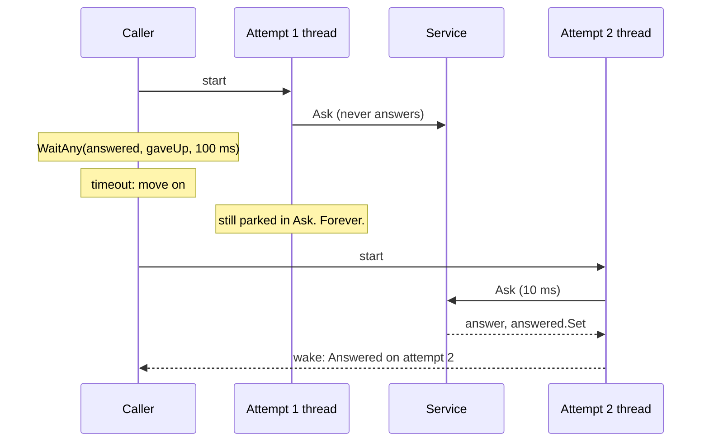
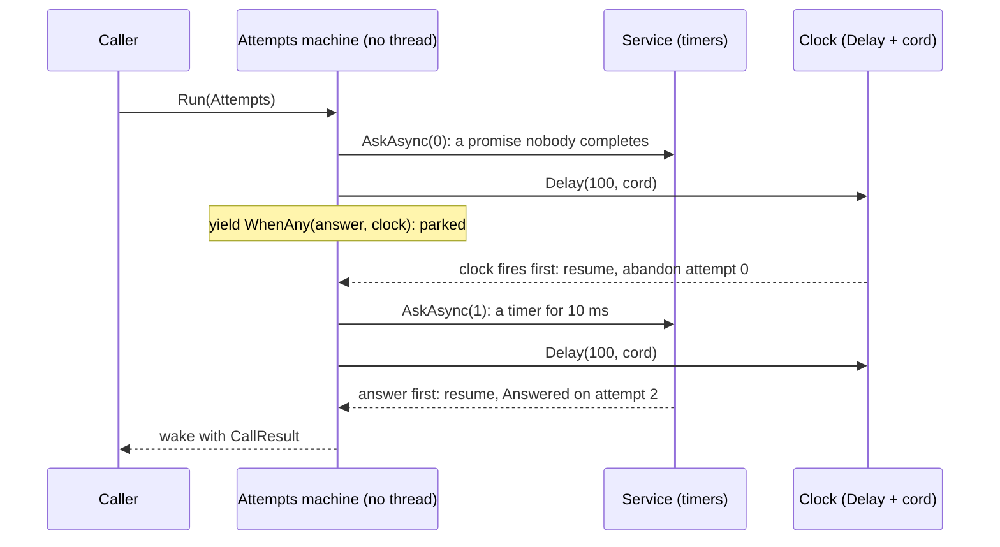

# 04. Waiting with a stopwatch

## 1. The job

A request goes to a service that sometimes answers late or never. The caller gives each attempt a time limit, tries a few times, and may pull the cord altogether while an attempt is still out. The service's answer, when it finally comes, must land somewhere harmless. A bank authorization from a pump. A heartbeat to a controller that went quiet. Any call over a wire you do not own.

Three rules hold for any version. An attempt that runs past the limit is abandoned and the next one starts; after the last one the call gives up. A late answer to an abandoned attempt lands nowhere and breaks nothing. A pull on the cord ends the call at once, mid-attempt, and a cord pulled before the call means no attempt at all. The tests in `MMP.AsyncProxy.Training.Tests/Deadline` check those rules against every version, so the question left is: what does an abandoned attempt leave behind?

The code is in `MMP.AsyncProxy.Training/Deadline/`. The contract is `IDeadlineCaller`, `CallResult`, and `GiveUp`, the cord. `FlakyService` is the service with a scripted delay per attempt, where a negative delay means never; it counts every answer it produces whether or not anyone is still waiting. It has the two doors: `Ask` blocks, `AskAsync` returns a future a timer completes or nobody ever does.

## 2. The thread way

`ThreadPerAttemptCaller` starts a thread per attempt. The thread walks through the blocking door and sets an event when it has the answer. The caller waits on that event, the give-up event, or the clock, whichever comes first. This is its loop, shortened:

```csharp
for (int attempt = 0; attempt < maxAttempts; attempt++)
{
    if (giveUp.Requested) return new CallResult(CallOutcome.Cancelled, null, attempt);

    string[] slot = new string[1];
    ManualResetEvent answered = new ManualResetEvent(false);
    Thread t = new Thread(delegate()
    {
        slot[0] = service.Ask(which);                 // parked here for the delay, or forever
        answered.Set();                               // nobody may be listening by now
    });
    t.IsBackground = true;
    t.Start();

    int signalled = WaitHandle.WaitAny(new WaitHandle[] { answered, gaveUp }, timeoutMs, false);
    if (signalled == 0) return new CallResult(CallOutcome.Answered, slot[0], attempt + 1);
    if (signalled == 1) return new CallResult(CallOutcome.Cancelled, null, attempt + 1);
    // WaitTimeout: abandon the attempt. Its thread is still parked inside Ask.
}
return new CallResult(CallOutcome.GaveUp, null, maxAttempts);
```



The second attempt answered and the call is done. The first attempt's thread is still there, parked inside `Ask` with its stack, and nothing will ever wake it. On the pump that was the serial thread Kevin was afraid of, and it is why the board needed a watchdog. The test `Fifty_abandoned_threaded_attempts_leave_fifty_threads_behind` counts them after the calls are over.

## 3. The AsyncProxy way

`WhenAnyCaller` makes each attempt a future, makes the clock a `Futures.Delay` with the cord's token on it, and parks once per attempt on `Futures.WhenAny`.

```csharp
public CallResult Call(FlakyService service, int timeoutMs, int maxAttempts, GiveUp giveUp)
{
    CancelSource cord = new CancelSource();
    giveUp.OnFired(cord.Cancel);
    IFuture<CallResult> call = AsyncProxy.Run<CallResult>(delegate(Return<CallResult> ret) { return Attempts(service, timeoutMs, maxAttempts, cord.Token, ret); });
    return call.Result;                                   // the caller, parked once, at the top
}

private static IEnumerable<IFuture> Attempts(FlakyService service, int timeoutMs, int maxAttempts, CancelToken cord, Return<CallResult> ret)
{
    for (int attempt = 0; attempt < maxAttempts; attempt++)
    {
        if (cord.IsCancelRequested) { ret.Value = new CallResult(CallOutcome.Cancelled, null, attempt); yield break; }

        IFuture<string> answer = service.AskAsync(attempt);
        IFuture clock = Futures.Delay(timeoutMs, cord);         // the cord cancels the clock
        IFuture<IFuture> first = Futures.WhenAny(answer, clock);
        yield return first;                                     // parked on whichever comes first; no thread

        if (first.Result == answer) { ret.Value = new CallResult(CallOutcome.Answered, answer.Result, attempt + 1); yield break; }
        if (cord.IsCancelRequested) { ret.Value = new CallResult(CallOutcome.Cancelled, null, attempt + 1); yield break; }
        // The clock won: abandon the attempt. Its promise stays pending, and that is all that stays.
    }
    ret.Value = new CallResult(CallOutcome.GaveUp, null, maxAttempts);
}
```



Line by line:

| Thread way | AsyncProxy way | Why |
|---|---|---|
| `new Thread(...)` per attempt | `service.AskAsync(attempt)` | An attempt is a future; a never-answering one is a promise nobody completes |
| `ManualResetEvent answered` | the attempt's future | The future is the event and the slot in one object |
| `WaitHandle.WaitAny(answered, gaveUp, timeoutMs)` | `Futures.WhenAny(answer, Futures.Delay(timeoutMs, cord))` | Three things raced on a kernel wait become two futures raced on a counter |
| `gaveUp.Set()` from the cord | `cord.Cancel()` from the cord, which cancels the clock | The cord ends the current wait in both; here it does so by completing the clock early |
| `giveUp.Requested` at the top of each attempt | `cord.IsCancelRequested` at the top of each attempt | Same check, same place |
| a parked thread per abandoned attempt | a pending promise per abandoned attempt | The whole of what this project is about |

What did not change: the outcome rules, the attempt count in the result, and that the caller still parks once at the top.

## 4. Thread model against async model

**What left.** The thread per attempt, and with it the thread that outlives the attempt. The test `Fifty_abandoned_attempts_leave_no_threads_behind` runs fifty calls that each abandon an attempt and finds the process's thread count back where it started. A never-answering attempt under AsyncProxy is a `Promise<string>` nobody completes: a few dozen bytes, kept alive by whoever still references it, and collected when the service forgets it.

**What stayed.** The late answer is still produced, and still lands nowhere: the service's `Answers` count goes up after the caller has gone, in both versions, and nothing throws. The cord is still checked at the top of every attempt. And the caller still blocks once.

**What the bench caught.** The first draft of the bench raced a 10 ms answer against a 20 ms limit, and the callers lost on a coin flip. Windows timers tick every 15.6 ms, so a 10 ms timer and a 20 ms timer can fire on the same tick, and `WhenAny` then answers whichever continuation ran first. The tests use a 100 ms limit against a 10 ms answer and never saw it; the bench now uses 60 against 20. The rule is the pump's rule too: a time limit near the timer's tick is a guess, and Kevin's 30-second serial timeout was never near one.

## 5. The same machine in IL

Both attempt loops were compiled in Release and decompiled with ilspycmd 10.0.1, the iterator at C# 1 and the async method at C# 4. The full files are `docs/compiler-output/training/deadline.iterator.cs`, `deadline.iterator.il`, `deadline.modern.cs`, and `deadline.modern.il`.

**The iterator machine, .NET 3.5**

<!-- fence: sketch decompiled by ilspycmd 10.0.1 -->
```csharp
private sealed class <Attempts>d__3 : IEnumerable<IFuture>, IEnumerator<IFuture>, IDisposable
{
    private int <>1__state;                                // the bookmark
    private IFuture <>2__current;                          // the future just yielded
    public FlakyService service; public int timeoutMs; public int maxAttempts; public CancelToken cord; public Return<CallResult> ret;
    private int <attempt>5__2;                             // the loop counter, hoisted: it lives across the yield
    private IFuture<string> <answer>5__3;                  // the attempt's future, hoisted
    private IFuture<IFuture> <first>5__4;                  // the WhenAny future, hoisted

    private bool MoveNext()
    {
        switch (<>1__state)
        {
        default: return false;
        case 0: <>1__state = -1; <attempt>5__2 = 0; break;                       // first run
        case 1:                                                                   // resumed after the race
            <>1__state = -1;
            if (<first>5__4.Result == <answer>5__3) { ret.Value = new CallResult(CallOutcome.Answered, <answer>5__3.Result, <attempt>5__2 + 1); return false; }
            if (cord.IsCancelRequested) { ret.Value = new CallResult(CallOutcome.Cancelled, null, <attempt>5__2 + 1); return false; }
            <answer>5__3 = null; <first>5__4 = null;
            <attempt>5__2++;
            break;
        }
        if (<attempt>5__2 < maxAttempts)
        {
            if (cord.IsCancelRequested) { ret.Value = new CallResult(CallOutcome.Cancelled, null, <attempt>5__2); return false; }
            <answer>5__3 = service.AskAsync(<attempt>5__2);
            IFuture future = Futures.Delay(timeoutMs, cord);
            <first>5__4 = Futures.WhenAny(<answer>5__3, future);
            <>2__current = <first>5__4;
            <>1__state = 1;                                                       // park at the race
            return true;
        }
        ret.Value = new CallResult(CallOutcome.GaveUp, null, maxAttempts);
        return false;
    }
}
```

**The async machine, .NET 10**

<!-- fence: sketch decompiled by ilspycmd 10.0.1 -->
```csharp
private struct <Attempts>d__3 : IAsyncStateMachine
{
    public int <>1__state;                                           // the bookmark
    public AsyncTaskMethodBuilder<CallResult> <>t__builder;
    public FlakyService service; public int timeoutMs; public int maxAttempts; public CancellationToken cord;
    private int <attempt>5__2;                                       // the loop counter, hoisted
    private Task<string> <answer>5__3;                               // the attempt's task, hoisted
    private ConfiguredTaskAwaitable<Task>.ConfiguredTaskAwaiter <>u__1;   // the WhenAny awaiter parked on

    private void MoveNext()
    {
        int num = <>1__state;
        CallResult result;
        try
        {
            if (num != 0) { <attempt>5__2 = 0; goto IL_0129; }                   // first run
            awaiter = <>u__1; <>u__1 = default; num = (<>1__state = -1);         // resumed after the race
            goto IL_00c6;
            IL_00c6:
            if (awaiter.GetResult() == <answer>5__3) result = new CallResult(CallOutcome.Answered, <answer>5__3.Result, <attempt>5__2 + 1);
            else if (!cord.IsCancellationRequested) { <answer>5__3 = null; <attempt>5__2++; goto IL_0129; }
            else result = new CallResult(CallOutcome.Cancelled, null, <attempt>5__2 + 1);
            goto end_IL_0007;
            IL_0129:
            if (<attempt>5__2 < maxAttempts)
            {
                if (!cord.IsCancellationRequested)
                {
                    <answer>5__3 = Ask(service, <attempt>5__2);
                    Task task = Task.Delay(timeoutMs, cord);
                    awaiter = Task.WhenAny(<answer>5__3, task).ConfigureAwait(false).GetAwaiter();
                    if (!awaiter.IsCompleted)
                    {
                        num = (<>1__state = 0);                                   // park at the race
                        <>u__1 = awaiter;
                        <>t__builder.AwaitUnsafeOnCompleted(ref awaiter, ref this);
                        return;
                    }
                    goto IL_00c6;
                }
                result = new CallResult(CallOutcome.Cancelled, null, <attempt>5__2);
            }
            else result = new CallResult(CallOutcome.GaveUp, null, maxAttempts);
            end_IL_0007:;
        }
        catch (Exception exception) { <>1__state = -2; <>t__builder.SetException(exception); return; }
        <>1__state = -2;
        <>t__builder.SetResult(result);
    }
}
```

This is the closest match of the four projects, because the method is a loop with one await and the loop counter has to survive the pause. Both compilers hoisted `attempt` to `<attempt>5__2`, both hoisted the attempt's future to `<answer>5__3`, both put the one parking spot at the race, and both wrote the same `if (first == answer) ... else if (cancelled) ... else loop` after it. The iterator keeps the `WhenAny` future in a third hoisted field (`<first>5__4`) because it reads `.Result` after the yield; the async machine reads the same value from `awaiter.GetResult()` and needs no field for it.

The IL openings:

```
// iterator MoveNext, .NET 3.5                  // async MoveNext, .NET 10
IL_0000: ldarg.0                                 IL_0000: ldarg.0
IL_0001: ldfld  int32 ...::'<>1__state'          IL_0001: ldfld  int32 ...::'<>1__state'
IL_0006: stloc.0                                 IL_0006: stloc.0
IL_0007: ldloc.0                                 .try {
IL_0008: brfalse.s IL_0013   // state 0            IL_0007: ldloc.0
IL_000a: ldloc.0                                   IL_0008: brtrue.s ...   // state 0: resume at the race
IL_000b: ldc.i4.1            // state 1
```

## 6. Memory and speed

100 calls one after another, each to a service that stays silent on the first attempt and answers in 20 ms on the second, with a 60 ms limit, so every call abandons one attempt. Measured on a 24-core Windows 11 machine, Release build. The net48 rows are from 2026-11-03, after the 0.2.0 fast paths. The net10.0 rows are from 2026-11-02, before them. The threaded row runs last in its group, because its abandoned attempts never go away and would raise every later baseline.

```
dotnet run --project training/MMP.AsyncProxy.Training.Bench -c Release -f net48 -- 1000
project      version      elapsed ms  peak threads  allocated bytes  peak WS bytes    ok
deadline     asyncproxy         9439            34          655,360    106,258,432   yes
deadline     threaded           9440           133        1,007,616    106,258,432   yes

dotnet run --project training/MMP.AsyncProxy.Training.Bench -c Release -f net10.0 -- 1000
project      version      elapsed ms  peak threads  allocated bytes  peak WS bytes    ok
deadline     asyncproxy         9263            42          589,496     95,113,216   yes
deadline     modern             9240            42          243,944     95,113,216   yes
deadline     threaded           9438           116          198,488     95,113,216   yes
```

How to read it:

- **Elapsed.** All three take about 93 ms per call: a 60 ms limit, a 20 ms answer, and the timer ticks between. The waiting is the same length in every version. What differs is what waits.
- **Peak threads.** This is the row. One hundred calls, one hundred abandoned attempts. The threaded caller's peak is a hundred above the idle count on .NET Framework (133 against 34) and about seventy-five above on .NET 10 (116 against 42); those are threads parked inside `Ask` that will never return, and they stayed for the rest of the process. The AsyncProxy and modern callers sat at the idle count, because an abandoned attempt is a promise and a promise is not a thread.
- **Allocated bytes.** About 6.5 KB per call for AsyncProxy on .NET Framework, 6 KB on .NET 10, against 2.4 KB for the modern caller and 2 KB for the threaded one on .NET 10. Per call: two attempts, each with a service future and its iterator, a `Delay` wheel entry and cancel registration, a `WhenAny` with two continuations, and the race's own promise. The modern `Task.WhenAny` and `Task.Delay` share the timer queue and allocate less per step. Rows 3 and 6 of the improvements table are now in the code; row 2 still applies here.
- **Peak working set** is the process's high-water mark across the whole bench run.

## 7. CUPID, DRY, SOLID

**Composable.** `WhenAny` races any two awaitables, and `Delay` with a token is the clock in any race; neither knows about attempts. The cord is one small class that three different cancel mechanisms plug into. **Unix.** The service answers or does not. The clock ticks. The cord cuts. The caller loops. **Predictable.** A late answer is a counted fact (`Answers`) in both versions, so "lands nowhere" is a test and never a hope. The outcome enum has three values and every path sets one. **Idiomatic.** The thread version is `WaitHandle.WaitAny` with a timeout, the 2008 way to race a reply against a clock. The AsyncProxy version is `Task.WhenAny(task, Task.Delay(ms, token))` under its 3.5 names. **Domain.** Attempt, limit, cord, late answer.

**DRY.** The three outcome checks after the race are written once per version and read the same. `GiveUp` is one class shared by all three callers; each adapts it to its own cancel type in one line. The service has two doors, as in the fan-out project, and the same remark applies.

**SOLID.** `IDeadlineCaller` is the open door for a fourth version. `GiveUp` depends on nothing and is depended on by all three, which is the dependency inversion the cord needs: the callers know the cord, the cord knows none of them.

## 8. Run it

```
dotnet test training/MMP.AsyncProxy.Training.Tests --filter "FullyQualifiedName~Deadline"
dotnet run --project training/MMP.AsyncProxy.Training.Bench -c Release -f net48 -- 1000
dotnet run --project training/MMP.AsyncProxy.Training.Bench -c Release -f net10.0 -- 1000
pwsh tools/decompile.ps1                                       # regenerates docs/compiler-output/training/deadline.*
```
